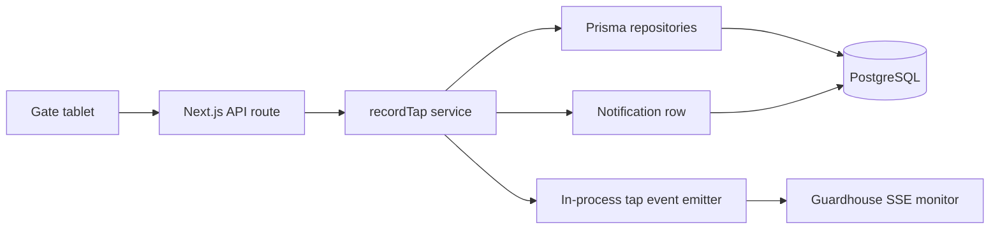
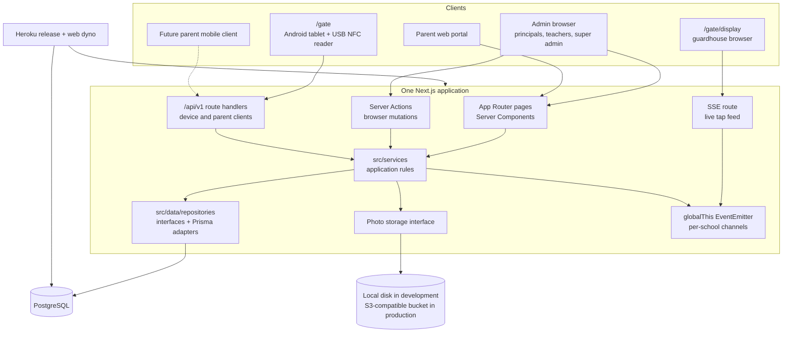
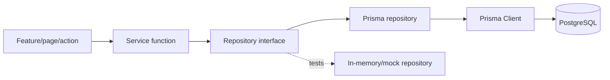
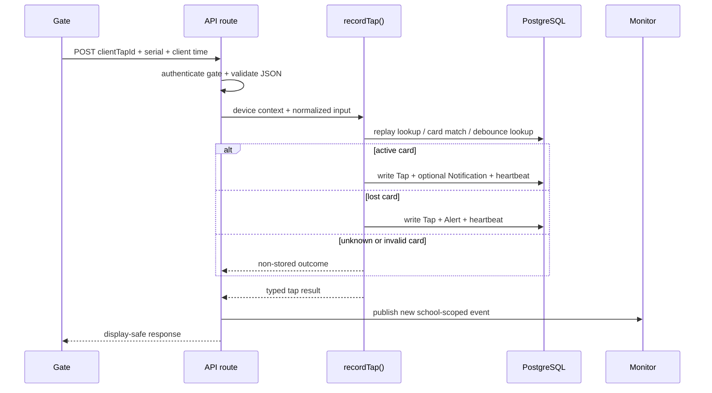
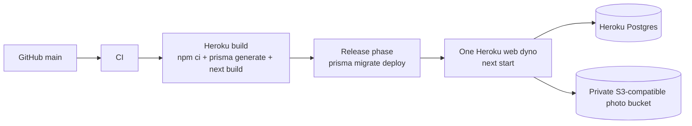

# Bantay Aral: current-state system architecture

**Status:** implementation review  
**Reviewed:** 2026-10-16  
**Scope:** the architecture that is present in this repository today, not a replacement for the future-oriented design in [`ARCHITECTURE.md`](./ARCHITECTURE.md).

## 1. Executive summary

Bantay Aral is currently a single Next.js 16 application that serves the
browser UI and the non-browser clients. It is not split into independently
deployable services.

The system has four important boundaries:

1. **Presentation and transport** — App Router pages, Server Actions, API
   route handlers and the SSE stream.
2. **Application services** — domain decisions such as staff sign-in, parent
   token authentication, card matching, tap debouncing and attendance
   direction.
3. **Data access** — repository interfaces and Prisma-backed implementations.
4. **Infrastructure** — PostgreSQL, Heroku's web dyno, and optional
   S3-compatible object storage for student photo thumbnails.

The core operational path is deliberately synchronous:



The application is intentionally optimized for a low-cost pilot. The current
deployment assumes one Heroku web dyno because live tap events and some
throttles are process-local. The database is the durable source of truth;
the in-process event stream is a delivery convenience, not the attendance
record.

## 2. Runtime topology



### Process model

- `next start` runs the web process.
- `prisma migrate deploy` runs in the Heroku release phase before the new
  process receives traffic.
- Prisma Client is shared through `globalThis` during development hot reloads
  to avoid opening a new client for every reload.
- Tap events are also held on `globalThis`, but only to preserve one emitter
  across development reloads. They are not persisted in the emitter.

## 3. Request surfaces

### 3.1 Admin web

The admin web uses Server Components for reads and feature-local Server
Actions for mutations:

```text
src/app/(app)/*
  -> src/features/*/actions.ts
  -> src/services/*
  -> src/data/repositories/*
  -> Prisma -> PostgreSQL
```

Staff sessions are represented by a signed, HTTP-only cookie. The cookie
contains the staff ID, password-version stamp and, for a super admin, the
currently selected school. `getSession()` resolves the cookie and then
re-checks the staff record and password version before returning the session.
The school is therefore derived from trusted server-side state rather than a
school ID supplied by the page.

### 3.2 Gate station

The gate station uses a device token and calls:

- `GET /api/v1/gate/roster`
- `POST /api/v1/gate/taps`
- `POST /api/v1/devices/heartbeat`

The roster is school-scoped by the authenticated `Device`, contains active
cards and minimal student display data, and supports an `ETag`/`304` flow so
the tablet can poll cheaply.

The tap request contains a device-generated UUID, the reader serial and the
client timestamp. The service normalizes the serial, handles retries,
matches the card, applies the two-minute debounce rule, derives time-in or
time-out, and writes the durable result.

### 3.3 Guardhouse monitor

The monitor authenticates through a monitor device token or a permitted
browser session and consumes:

- `GET /api/v1/gate/stream`
- `/gate/display/connect` for the browser's connection setup

The stream is Server-Sent Events. Events are published after the tap service
has produced its result and are filtered by school channel. A 25-second
keep-alive is used because the deployment's router closes silent connections
after roughly 55 seconds.

The monitor is intentionally read-only and receives only display fields:
student name, grade, section, photo URL, tap time and tap outcome. It does not
receive LRN, birth date or guardian details.

### 3.4 Parent clients

The parent web portal uses its own signed browser cookie. The versioned API
uses bearer tokens:

- `POST /api/v1/parents/signup`
- `POST /api/v1/parents/login`
- `POST /api/v1/parents/logout`
- `GET /api/v1/parents/me`
- `GET /api/v1/parents/schools`
- `GET /api/v1/parents/children`
- `POST /api/v1/parents/children`
- `GET /api/v1/parents/children/:id/taps`

Parent tokens are random, returned once, and stored only as SHA-256 hashes.
They expire after 90 days of inactivity and are touched at most once per
hour. A parent is not assigned to one school; each
`ParentStudentLink` carries the child's school, allowing one account to span
schools without making the browser choose an authoritative school.

## 4. Application and data-access layers

The repository pattern is the main substitution boundary:



The `src/data/repositories/index.ts` module supplies the application-wide
repository instances. Prisma repositories are kept in `src/data/repositories`
and map database records to feature/domain types. This keeps pages and
services from importing Prisma models directly.

The main domain aggregates are:

| Aggregate | Purpose |
|---|---|
| `School` | Tenant boundary, theme, attendance cutoffs and notification preference |
| `Staff` | Staff identity, role, school membership and password hash |
| `Student` | Minimal student profile and optional photo key |
| `Card` | Physical NFC serial and lifecycle state |
| `Tap` | Immutable attendance input, keyed by the device UUID |
| `Alert` | Lost-card tap alert, one-to-one with a tap |
| `Parent` | Cross-school parent account |
| `ParentStudentLink` | School-scoped authorization to a child |
| `ParentToken` | Hashed mobile/API session token |
| `Notification` | Durable parent feed item |
| `Device` | Gate or monitor identity, school and token hash |

Every school-owned record has a `schoolId`, and repository methods generally
take the school ID explicitly. Cross-school protection is reinforced by
database relations, scoped lookups and isolation tests.

## 5. Tap transaction and attendance derivation



Important invariants in the implementation:

- The client UUID makes retries idempotent.
- A card read within two minutes of an existing tap is a duplicate.
- A tap stores the student ID as it was known at tap time.
- Time-in/time-out is derived from the student's ordered taps; it is not
  stored as a mutable direction on the tap row.
- A lost-card tap is stored and raises an alert.
- An unknown card is shown to the gate/monitor but is not stored as
  attendance.
- The tap writer is the persistence boundary for the tap and related records,
  so the service can decide the outcome without embedding Prisma calls in
  the route.

The durable database write and the `lastSeenAt` heartbeat are treated as one
tap write operation. The monitor publication occurs after the service returns;
if publication fails, the database record remains authoritative.

## 6. Authentication and authorization

| Caller | Credential | Validation | Scope |
|---|---|---|---|
| Staff browser | Signed HTTP-only cookie | Signature, expiry, staff existence, password version | Role plus school from session |
| Parent browser | Signed HTTP-only cookie | Signature, expiry and parent existence | Linked children |
| Gate device | Bearer device token | SHA-256 lookup, active status, device kind | Device's school |
| Monitor device | Bearer device token | SHA-256 lookup, active status, monitor kind | Device's school, read-only |
| Parent API client | Bearer parent token | SHA-256 lookup, revocation, 90-day inactivity | Token's parent and linked children |

Password material is hashed through the shared password helper. Device and
parent API tokens are never stored in plaintext. Parent sign-in and signup
use in-process throttles keyed by the request address; the current deployment
therefore keeps one web dyno.

## 7. Storage and deployment



- PostgreSQL is the only durable application database.
- Student photos are stored as provider-independent object keys. Development
  can use local storage; production is configured for S3-compatible storage,
  currently Cloudflare R2.
- Production settings are checked at startup by `src/instrumentation.ts`.
- The release phase applies migrations before the web process starts serving
  the new release.
- The documented pilot cost is one web dyno, one small Postgres database and
  the object-storage free tier.

## 8. Current constraints and architectural risks

These are properties of the current implementation, not defects hidden by the
diagram:

1. **Single-process live events.** The SSE feed uses an in-memory
   `EventEmitter`. A second dyno would not receive events published by the
   first. The existing scaling documentation identifies PostgreSQL
   `LISTEN/NOTIFY` as the next low-cost replacement.
2. **In-process throttling.** Parent sign-in limits and related counters are
   process-local. Multiple dynos would make the limits inconsistent.
3. **No separate worker yet.** Notifications are durable database rows, but
   push delivery is not a separate outbox worker in the current schema/path.
   The future push phase still needs delivery status, retry policy and
   provider adapters.
4. **No offline gate queue yet.** The current gate can keep a roster locally,
   but the durable offline tap queue and replay protocol remain future work.
5. **Photo access is application-mediated.** The app owns the photo route and
   storage interface; object storage is not exposed directly to clients.
6. **API surface is intentionally incomplete.** Parent APIs exist for
   identity, linked children and tap history, while notification delivery and
   mobile push registration are not complete.

The practical consequence is that the current architecture is appropriate
for the pilot's one-dyno operating model, but horizontal scaling should not be
enabled by simply increasing dynos. The event bus, throttles, and eventual
notification delivery need shared infrastructure first.

## 9. Recommended architectural reading order

For future changes, read the relevant document in this order:

1. [`DATA-MODEL.md`](./DATA-MODEL.md) — domain records and invariants.
2. [`SCHOOL-ISOLATION.md`](./SCHOOL-ISOLATION.md) — tenant boundary rules.
3. [`AUTH.md`](./AUTH.md) — staff and parent browser sessions.
4. [`GATE.md`](./GATE.md) — gate input and tap behavior.
5. [`NOTIFICATIONS.md`](./NOTIFICATIONS.md) — current notification feed.
6. [`ARCHITECTURE.md`](./ARCHITECTURE.md) — intended future backend shape.
7. This document — how those designs are actually assembled in the current
   code.

## 10. Source map

| Concern | Main implementation locations |
|---|---|
| App routes and clients | `src/app/`, `src/features/` |
| API transport | `src/app/api/v1/` |
| Domain services | `src/services/` |
| Repository interfaces and adapters | `src/data/repositories/` |
| Database schema and migrations | `prisma/schema.prisma`, `prisma/migrations/` |
| Staff sessions | `src/lib/session.ts`, `src/lib/session-cookie.ts` |
| Parent API tokens | `src/services/parents/parent-token.ts`, `src/lib/parent-session.ts` |
| Device authentication | `src/services/devices/` |
| Tap processing | `src/services/taps/`, `src/data/repositories/prisma-tap-writer.ts` |
| Live monitor events | `src/services/taps/tap-events.ts`, `src/app/api/v1/gate/stream/route.ts` |
| Photo abstraction | `src/lib/storage/`, `src/app/api/v1/photos/[...key]/route.ts` |
| Production startup/deployment | `src/instrumentation.ts`, `Procfile`, `docs/DEPLOY.md` |
