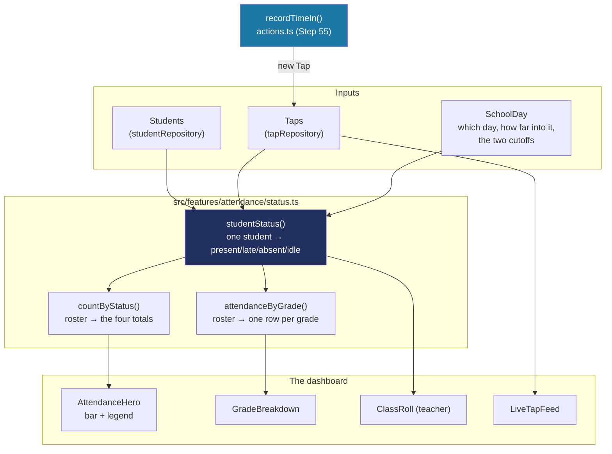
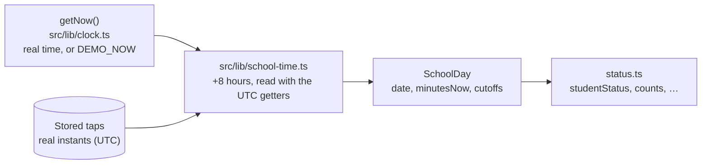
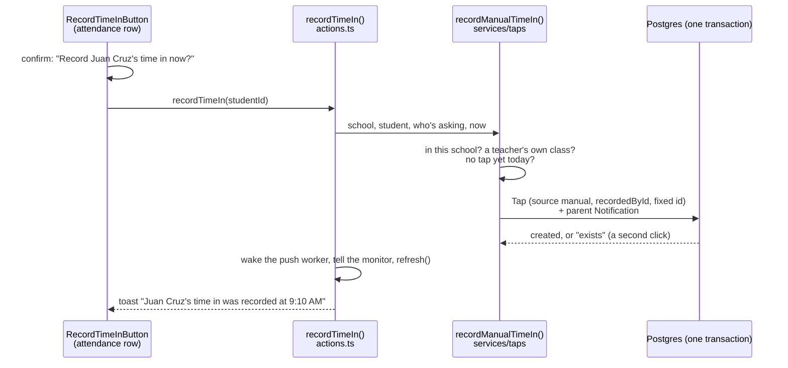

# How attendance is worked out

Step 8 built what a `Tap` *is* (`docs/DATA-MODEL.md`). Step 9 built how it gets *read* (`docs/DATA-ACCESS.md`). Step 13 builds the piece in between those and the screen: **turning a pile of tap records into "who is in school right now"**.

This is a genuinely separate subsystem from both, and it's the one every attendance-shaped screen sits on — the dashboard (Step 13), the attendance page (Step 17), the gate (Step 47), and any report after that. See `docs/BUILD-LOG.md`'s Step 13, Step 17 and Step 19 entries for the decisions as they were made; this document is the reference for how the mechanism works.

## The one idea to hold on to

**A student's attendance status is never stored. It is always calculated.**

Nothing in the database (or, today, the seed data) says "Juan is present". What exists is:

- a **roster** — every student in the school
- a list of **taps** — "this card was tapped at this gate at this time"

Everything a principal sees is derived from those two lists plus one more input: **what time it is now**. That last one matters more than it looks — the same taps mean different things at 7:50 AM ("most people haven't arrived yet") than at 9:15 AM ("these eight didn't come in").

Why derive instead of store? Because a stored status goes stale and can disagree with the taps that produced it. Deriving it means there is exactly one source of truth (the taps), and any screen that asks the same question gets the same answer.

## The shape of it



## The four statuses, and the two cutoffs that produce them

`studentStatus(studentId, taps, day)` answers one question about one student, and there are only four possible answers — the same four fixed status colors the design system reserves (`docs/STYLING-SYSTEM.md`):

| Status | When | Shown as |
|---|---|---|
| **Present** | They tapped today, at or before the late cutoff | Green |
| **Late** | They tapped today, after the late cutoff | Amber |
| **Not yet tapped** | No tap today, and it's still before the absent cutoff | Grey |
| **Absent** | No tap today, and it's now past the absent cutoff | Red |

The logic is two questions in sequence — *did they tap?*, then *how does the clock compare?*:

```ts
export function studentStatus(studentId: string, taps: Tap[], day: SchoolDay): AttendanceStatus {
  const tap = todaysTap(studentId, taps, day);
  if (tap) {
    return schoolMinutesOf(tap.tappedAt) <= day.lateAfter ? "present" : "late";
  }
  return day.minutesNow >= day.absentFrom ? "absent" : "idle";
}
```

A `SchoolDay` (`src/features/attendance/status.ts`) carries everything the rules need, built once per page by `schoolToday(now, times)` or `schoolDayFor(date, now, times)`:

- **`date`**: the school's calendar date being shown.
- **`minutesNow`**: how far into that day it is. Today, it's the current time. A past day is over (1440), so a student with no tap is absent. A future day hasn't started (0), so nobody is absent yet.
- **`lateAfter`**: 8:05 AM by default, an 8:00 start with five minutes' grace. Tap at or before it and you're present; after it, late.
- **`absentFrom`**: 9:00 AM by default. Before this, a student with no tap is just "not yet tapped", since they might still be on the way. From it on, absent.

**Each school sets its own two times (Step 44.5).** They are columns on the `School` row (`lateAfter`, `absentFrom`, text like `"08:05"`), edited in **Settings › Attendance times**. Every page loads its school and passes it straight in: `schoolToday(now, school)` works because a `School` already has both fields. `DEFAULT_ATTENDANCE_TIMES` matches the database defaults and is used only for a new school, the seed data, tests, and the fallback when a school record can't be found. `attendanceTimesSchema` (`src/features/schools/schemas.ts`) checks the form and the save action: both times must be `HH:MM`, and absent must be later than late.

**Time in and time out (Step 49).** `dayTapSummary(studentId, taps, day)` labels a student's taps that day in order: 1st in, 2nd out, 3rd in, and so on, the same alternation as `deriveTapKind`. **Time in** is the first tap. **Latest** (Step 59.3, replacing Step 49's "Time out") is the newest tap with its kind, shown from the 2nd tap on: "Out 4:05 PM", or "Back in 7:05 PM" after in, out, in (`latestLabel`). Step 49 showed the last tap only when it was an out, so after 13 taps ending on an in the row read "Time out —", the same as a student who never moved (P-052). The Attendance page shows both, and a student with more than 2 taps gets an "N taps" button that opens the whole day (`day-taps.tsx`). Status still comes from the first tap only. The parent API sends `latest` too, beside the old `timeOut`, which it still works out the Step 49 way so the installed parent app keeps working.

**Weekends have no late or absent (Step 44.6).** Students sometimes come in on a Saturday or Sunday, but the times vary, so a weekend is a **flexible** day. `schoolDayFor` sets `day.flexible = isWeekend(date)` (`src/lib/school-time.ts`), and `studentStatus` checks it first:

```ts
if (tap) {
  if (day.flexible) return "present";
  return schoolMinutesOf(tap.tappedAt) <= day.lateAfter ? "present" : "late";
}
return !day.flexible && day.minutesNow >= day.absentFrom ? "absent" : "idle";
```

So on a weekend only two statuses can happen, and only their words change: `statusLabel(status, flexible)` (`src/components/status-pill.tsx`) shows **Came in** for present and **No tap** for idle. Every pill, the legend, the phone count tiles and the dashboard hero take `flexible={day.flexible}`. The legend and tiles then show just those two keys, and the hero says "N of M students came in" with the line "Weekend: no late or absent times." The gate, notifications and lost-card alerts don't change at all. The rule is the same for every school. A school with regular Saturday classes, or a weekday holiday, would need a per-school calendar, which doesn't exist yet.

**Two details that are easy to get wrong:**

*Only the earliest tap of the day counts.* `todaysTap()` sorts and takes the first one. A student who taps twice (a mis-tap, or a future time-out tap) must not be able to turn "present" into "late" with their second tap.

*Taps from other days are ignored.* The date is compared before the time, so yesterday's tap can never make someone look present today.

## School time and the clock (Step 44)

Phase 1 ran on a frozen clock (`DASHBOARD_NOW`, always 9:15 AM on 20 June 2026), and stored the school's clock time as if it were UTC. Step 44 replaced both, because a real tap can't work that way: 7:56 AM in Balanga is 23:56 UTC **the day before**.



- **Store instants, read them on the school's clock in one place.** Every tap, alert and notification time is a real moment. Only `src/lib/school-time.ts` turns one into the school's date (`schoolDateOf`), minutes into the day (`schoolMinutesOf`) or display text (`formatSchoolTime`, `formatSchoolDate`). The Philippines is UTC+8 all year with no daylight saving, so it adds 8 hours and reads the result with the `getUTC…` methods, which give the same answer on every computer. If a school outside the Philippines ever joins, this is the file to change.
- **"Now" comes from `getNow()`** (`src/lib/clock.ts`), on the server only. It's the real time, unless `DEMO_NOW` pins it. Pages hand the resulting `SchoolDay` to their components, so the browser and the server always agree on "now" for a page.
- **`DEMO_NOW`** pins the clock to the demo morning (`"2026-06-19T09:15:00+08:00"`, a Friday; it was the 20th, a Saturday, until Step 44.6). The browser tests set it in `playwright.config.ts`, so they see the seed data's day on every run. You can set it in `.env` to show the sample data. Never set it on a real server. While it's set, every staff page shows a **Demo clock** badge in the top bar, so it can't go unnoticed.
- **No default "now" anywhere.** Each status function takes its `SchoolDay` explicitly, so TypeScript points at every caller that has to say which day it means.
- **Pages load one day of taps** with `tapRepository.listBySchoolOnDate(schoolId, date)` (from the school's midnight to the next, using the `(schoolId, tappedAt)` index), not the school's whole history. The dashboard's "Needs attention" panel loads each open alert's tap by id instead, since an alert nobody has dealt with can be from an earlier day.

## Aggregating: counts and per-grade rows

Two thin wrappers do all the summarising, and both just call `studentStatus()` in a loop:

- **`countByStatus(students, taps, now)`** → `{ present, late, absent, idle }`. Every student lands in exactly one bucket, so the four always add up to the roster size. That's what makes the segmented bar's proportions honest.
- **`attendanceByGrade(students, taps, now)`** → one row per grade level, each with the grade's student count and its "in school" percentage (present + late, over the grade's total).

`attendanceByGrade` only returns grades that **actually exist at that school**. Two of the three demo schools only have three grade levels each — they'd otherwise show three permanently-empty rows for grades they don't teach.

## Recording a time in by hand (Step 55), end to end

A sticker fails, or a student has none yet, and they're standing in the classroom. Their teacher (or the principal) opens **Attendance**, finds the student's row, and presses **Record time in**. It replaced Step 13's "Simulate a tap", which tapped the *next* student who hadn't tapped, never the one in front of you.



The rules live in `recordManualTimeIn()` (`src/services/taps/record-manual-time-in.ts`), not in the button or the action:

1. **Who.** A principal or super admin can record anyone at their school; a teacher only their own advisory class. Anyone else's student answers "not found".
2. **Once a day, before any tap.** A student with any tap today, from a gate or by hand, is refused, so a hand-recorded tap is always a **time in**. The button is disabled then too, but the server checks again.
3. **Now, honestly.** The time is the moment it's pressed, so a student recorded at 9:10 shows as **Late**, with "Recorded by staff" under the time. Picking an earlier arrival time is a later step: it brings rules (no future times, the right day, how it orders against later taps).
4. **Two clicks, one tap.** The tap's id is made from the student and the date (`manualTimeInId`, shaped as a version 5 UUID). Two clicks, or two teachers at the same moment, make the same id. The database keeps the first, and the writer answers `"exists"` for the second, so parents get one notification. It goes through the same `tapWriter` as a gate's taps, so the tap and its notification are written together or not at all.
5. **The card serial is kept when there is one.** The gate's 2-minute check looks for taps of the same serial, so a sticker that finally reads a minute after a hand-recorded time in is caught as a duplicate instead of becoming a time out. Since Step 56 the write also locks that card and checks the whole school day under the lock, so a gate read landing at the same moment can't slip in between (`docs/GATE.md`, "One read, one tap"). A student with no card gets a tap with no serial (`Tap.cardSerial` is nullable since Step 55).
6. **Never claims a gate read it.** `stationId` is `"manual"`, `source` is `manual`, and `recordedById` names the staff member (kept as null if they're later removed).

### The `refresh()` line is load-bearing

```ts
import { refresh } from "next/cache";
// ...
refresh();
```

Without it the button appears to do nothing. Step 11's dev switcher gets a free re-render because it sets a **cookie**, and Next re-renders the page automatically when a Server Action changes one. `recordTimeIn` changes *data*, not a cookie, so it gets no such thing and has to ask. See `docs/LEARNING-LOG.md`'s "Staying put but showing new data" entry for the three-way comparison (`cookie` / `redirect()` / `refresh()`).

### Where the button sits

Exactly where the time in will appear, and only while there's none: in the **Time in** cell of the desktop table (a small outline button), and under the status on a phone card (a quieter text button, still 44px tall to tap). Once the student has tapped, the time takes its place. Changed in the owner's review, 2026-10-20: a first version kept a disabled button on every tapped row in its own column, and put a boxed button under the name on phones, next to the "No card" tag. Ten disabled buttons hid the one that worked, and the phone card stacked three things on the left while the "—" on the right sat empty. Past days show no button at all.

## The attendance page (Step 17): picking one class, one day

The dashboard's `ClassRoll` always shows "my whole school" or "my one advisory class" — there's no way to pick a *different* class, or look at a day other than today. The attendance page (`src/app/(app)/attendance/page.tsx`) is that browsing screen: a date, grade and section in the URL (same shareable-URL, back-button-works shape as the Students list — see `docs/URL-DRIVEN-LISTS.md`), resolved server-side in `src/features/attendance/attendance-search-params.ts`.

Two things make this resolution non-trivial:

- **The class picker has no "all" option.** Unlike the Students list's grade filter, this page always shows exactly one class at a time — "pick a date and *class*" — so `resolveClassSelection()` has to always return *some* real class, even when the URL names one that doesn't exist (a stale link, a hand-edited query string, or nothing at all yet). It falls back to the first class that actually has students, the same shape as the prototype's own `if (!SECTIONS[grade].includes(section)) section = SECTIONS[grade][0]`.
- **A teacher's own class always wins.** `resolveClassSelection()` takes an optional `lockedTo` — a teacher's advisory grade/section — and when it's set, everything else is ignored outright, not just hidden in the UI. That's the same real server-side guard the Students list's `searchStudents(..., { restrictTo })` already uses: a teacher who hand-edits the URL to another grade/section still only ever sees their own class, because the page never asks the URL what class to show for a locked-in teacher in the first place.

The other wrinkle is the date. The page opens on today on the school's clock (Step 44), and `schoolDayFor(date, now)` judges any other date fairly: a past day is over, so a student with no tap is absent; a future day hasn't started, so nobody is. One exception: a past day with **no taps at all** anywhere in the school shows "No taps that day" instead of a whole class marked absent, because that's almost always a weekend, a holiday or a day the gate was off.

## Where a `Tap` comes from

Every `Tap` the screens above read is written in one of two places, both through `tapWriter.record()`, which saves the tap with its alert or parent notification in one transaction:

| Where | Code | What it writes |
|---|---|---|
| The real gate, `/gate` (Step 47), a tablet with the USB reader | `recordTap()` in `src/services/taps/record-tap.ts`, behind `POST /api/v1/gate/taps` | A tap for an active card (time in or out from the day's order), a tap with no student and an alert naming the owner for a lost card (Step 57: it's nobody's attendance), nothing for an unknown card |
| A time in recorded by hand on the attendance page (Step 55) | `recordManualTimeIn()` in `src/services/taps/record-manual-time-in.ts` | A tap with `source: manual` and who recorded it |

The seed data (`src/data/seed/taps.ts`) writes the demo morning's taps directly.

Until Step 55.1 there was a third: Phase 1's `/station`, a simulated kiosk where a principal pressed "Valid card", "Lost card" or "Unknown card" and the page made up a tap for the next waiting student. Once the real gate and its monitor existed, the station no longer matched them (no photos, an older look), and a principal could make a parent believe their child arrived when nobody tapped, so it was removed (owner decision, 2026-10-21).

## Quick recipes

**I want to change when "late" starts for one school.** Sign in as its principal (or open it as super admin) and change **Settings › Attendance times**. Nothing in the code changes. To change the starting values for *new* schools, change both the `@default` on `School.lateAfter`/`absentFrom` in `prisma/schema.prisma` (with a migration) and `DEFAULT_ATTENDANCE_TIMES` in `src/features/attendance/status.ts`, so the two stay twins. The unit tests in `status.test.ts` assert the boundary on both sides, and with non-default times.

**I want the app to show a different moment of the school day.** Set `DEMO_NOW` in `.env` and restart `npm run dev`, for example `DEMO_NOW="2026-06-19T08:30:00+08:00"`. A Saturday or Sunday, such as `"2026-06-20T10:00:00+08:00"`, shows the weekend version of every screen. Before 9:00 AM un-tapped students read as "not yet tapped" rather than "absent"; before 8:05 AM everyone who has tapped reads as present. Remove it again to get the real clock back.

**I want attendance numbers on a new screen.** Import `countByStatus` / `attendanceByGrade` from `src/features/attendance/status.ts` and feed them a roster and a tap list from the repositories. Don't re-derive statuses by hand — these functions are unit-tested and the screens should agree with each other.

**I want to show one student's status somewhere.** `studentStatus(student.id, taps, day)` returns the status; pass it straight to `<StatusPill status={...} />` (`docs/COMPONENTS.md`), which already knows the colors and labels.

**I want to change who can record a time in by hand, or when.** Change `mayRecordFor()` or the "no tap yet today" check in `src/services/taps/record-manual-time-in.ts`, and its tests in `record-manual-time-in.test.ts`. The button only mirrors those rules; the server is what enforces them.

**I want the actual arrival time, not just the status.** `todaysTap(student.id, taps, day)` returns the tap itself; `formatTapTime(tap.tappedAt)` renders it as "7:56 AM".

**I'm showing a time or date anywhere.** Use `formatSchoolTime` / `formatSchoolDate` from `src/lib/school-time.ts` (or `formatTapTime`, the same function). Never `toLocaleTimeString()` or `getHours()`: those use the time zone of whatever computer runs the code.

**I need "now" in a page or server action.** `getNow()` from `src/lib/clock.ts`, then `schoolToday(now, times)`. Never `new Date()` directly, or `DEMO_NOW` won't reach it.

**I want a new screen that browses one class at a time (like the attendance page).** Reuse `classOptionsFromRoster()` and `resolveClassSelection()` from `src/features/attendance/attendance-search-params.ts` rather than writing new grade/section fallback logic — they already handle "the URL names a class that doesn't exist" and "this role is locked to one class" correctly.
