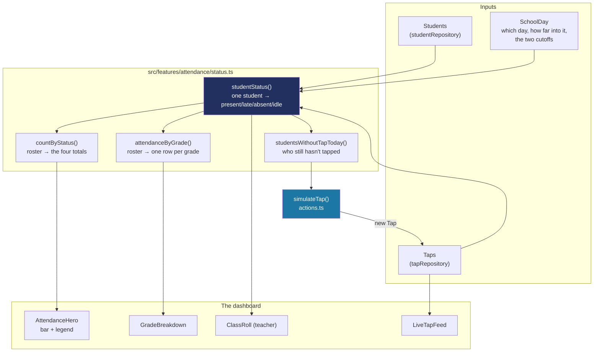
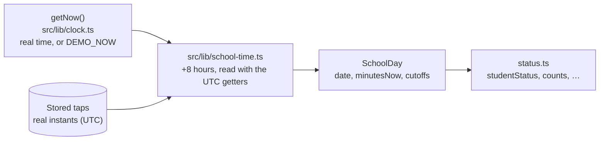

# How attendance is worked out

Step 8 built what a `Tap` *is* (`docs/DATA-MODEL.md`). Step 9 built how it gets *read* (`docs/DATA-ACCESS.md`). Step 13 builds the piece in between those and the screen: **turning a pile of tap records into "who is in school right now"**.

This is a genuinely separate subsystem from both, and it's the one every attendance-shaped screen sits on — the dashboard (Step 13), the attendance page (Step 17), the tap station (Step 19), and any report after that. See `docs/BUILD-LOG.md`'s Step 13, Step 17 and Step 19 entries for the decisions as they were made; this document is the reference for how the mechanism works.

## The one idea to hold on to

**A student's attendance status is never stored. It is always calculated.**

Nothing in the database (or, today, the seed data) says "Juan is present". What exists is:

- a **roster** — every student in the school
- a list of **taps** — "this card was tapped at this gate at this time"

Everything a principal sees is derived from those two lists plus one more input: **what time it is now**. That last one matters more than it looks — the same taps mean different things at 7:50 AM ("most people haven't arrived yet") than at 9:15 AM ("these eight didn't come in").

Why derive instead of store? Because a stored status goes stale and can disagree with the taps that produced it. Deriving it means there is exactly one source of truth (the taps), and any screen that asks the same question gets the same answer.

## The shape of it



## The four statuses, and the two cutoffs that produce them

`studentStatus(studentId, taps, day)` answers one question about one student, and there are only four possible answers — the same four fixed status colors the design system reserves (`docs/STYLING-SYSTEM.md`):

| Status | When | Shown as |
|---|---|---|
| **Present** | They tapped today, at or before the late cutoff | Green |
| **Late** | They tapped today, after the late cutoff | Amber |
| **Not yet tapped** | No tap today, and it's still before the absent cutoff | Grey |
| **Absent** | No tap today, and it's now past the absent cutoff | Red |

The logic is two questions in sequence — *did they tap?*, then *how does the clock compare?*:

```ts
export function studentStatus(studentId: string, taps: Tap[], day: SchoolDay): AttendanceStatus {
  const tap = todaysTap(studentId, taps, day);
  if (tap) {
    return schoolMinutesOf(tap.tappedAt) <= day.lateAfter ? "present" : "late";
  }
  return day.minutesNow >= day.absentFrom ? "absent" : "idle";
}
```

A `SchoolDay` (`src/features/attendance/status.ts`) carries everything the rules need, built once per page by `schoolToday(now, times)` or `schoolDayFor(date, now, times)`:

- **`date`**: the school's calendar date being shown.
- **`minutesNow`**: how far into that day it is. Today, it's the current time. A past day is over (1440), so a student with no tap is absent. A future day hasn't started (0), so nobody is absent yet.
- **`lateAfter`**: 8:05 AM by default (`DEFAULT_ATTENDANCE_TIMES`), an 8:00 start with five minutes' grace. Tap at or before it and you're present; after it, late.
- **`absentFrom`**: 9:00 AM by default. Before this, a student with no tap is just "not yet tapped", since they might still be on the way. From it on, absent.

**Two details that are easy to get wrong:**

*Only the earliest tap of the day counts.* `todaysTap()` sorts and takes the first one. A student who taps twice (a mis-tap, or a future time-out tap) must not be able to turn "present" into "late" with their second tap.

*Taps from other days are ignored.* The date is compared before the time, so yesterday's tap can never make someone look present today.

## School time and the clock (Step 44)

Phase 1 ran on a frozen clock (`DASHBOARD_NOW`, always 9:15 AM on 20 June 2026), and stored the school's clock time as if it were UTC. Step 44 replaced both, because a real tap can't work that way: 7:56 AM in Balanga is 23:56 UTC **the day before**.



- **Store instants, read them on the school's clock in one place.** Every tap, alert and notification time is a real moment. Only `src/lib/school-time.ts` turns one into the school's date (`schoolDateOf`), minutes into the day (`schoolMinutesOf`) or display text (`formatSchoolTime`, `formatSchoolDate`). The Philippines is UTC+8 all year with no daylight saving, so it adds 8 hours and reads the result with the `getUTC…` methods, which give the same answer on every computer. If a school outside the Philippines ever joins, this is the file to change.
- **"Now" comes from `getNow()`** (`src/lib/clock.ts`), on the server only. It's the real time, unless `DEMO_NOW` pins it. Pages hand the resulting `SchoolDay` (or, for the tap station, the pinned time) to their components, so the browser and the server always agree on "now" for a page.
- **`DEMO_NOW`** pins the clock to the demo morning (`"2026-06-20T09:15:00+08:00"`). The browser tests set it in `playwright.config.ts`, so they see the seed data's day on every run. You can set it in `.env` to show the sample data. Never set it on a real server. While it's set, every staff page shows a **Demo clock** badge in the top bar, so it can't go unnoticed.
- **No default "now" anywhere.** Each status function takes its `SchoolDay` explicitly, so TypeScript points at every caller that has to say which day it means.
- **Pages load one day of taps** with `tapRepository.listBySchoolOnDate(schoolId, date)` (from the school's midnight to the next, using the `(schoolId, tappedAt)` index), not the school's whole history. The dashboard's "Needs attention" panel loads each open alert's tap by id instead, since an alert nobody has dealt with can be from an earlier day.

## Aggregating: counts and per-grade rows

Two thin wrappers do all the summarising, and both just call `studentStatus()` in a loop:

- **`countByStatus(students, taps, now)`** → `{ present, late, absent, idle }`. Every student lands in exactly one bucket, so the four always add up to the roster size. That's what makes the segmented bar's proportions honest.
- **`attendanceByGrade(students, taps, now)`** → one row per grade level, each with the grade's student count and its "in school" percentage (present + late, over the grade's total).

`attendanceByGrade` only returns grades that **actually exist at that school**. Two of the three demo schools only have three grade levels each — they'd otherwise show three permanently-empty rows for grades they don't teach.

## "Simulate a tap", end to end

There's no real tap station yet (Step 19, and real hardware in Phase 2), so the dashboard has a button that manufactures one. It is a genuinely useful piece of plumbing to understand, because it's the same path a real tap will take.

`simulateTap()` in `src/features/attendance/actions.ts`:

1. Reads the session. A **teacher** only ever draws from their own advisory class; a principal draws from the whole school.
2. Asks `studentsWithoutTapToday()` who hasn't tapped — **idle students before absent ones**, so the demo tells a "still arriving" story before a "the day already ended" one.
3. Walks that list looking for someone with an **active ID card**. No card, no tap — exactly like the real gate. A student with no card is collected into a separate list instead.
4. Creates the tap through `tapRepository.create()` (idempotent by tap id, like a real station's upload).
5. Calls **`refresh()`**, and returns a typed result saying what actually happened.

### The `refresh()` line is load-bearing

```ts
import { refresh } from "next/cache";
// ...
refresh();
```

Without it the button appears to do nothing. Step 11's dev switcher gets a free re-render because it sets a **cookie**, and Next re-renders the page automatically when a Server Action changes one. `simulateTap` changes *data*, not a cookie — so it gets no such thing, and has to ask. See `docs/LEARNING-LOG.md`'s "Staying put but showing new data" entry for the three-way comparison (`cookie` / `redirect()` / `refresh()`).

### Why it returns a result instead of just running

```ts
export type SimulateTapResult =
  | { tapped: true; studentName: string }
  | { tapped: false; reason: "no-school" | "everyone-in" }
  | { tapped: false; reason: "no-card"; studentNames: string[] };
```

Three different things can happen, and the person clicking deserves to know which. The first version always said "Tap recorded", including when it had tapped nobody — which is how a student with no ID card ended up looking like a bug (`docs/BUILD-LOG.md`, Step 13 review round 1). Now a card-less student is named, and the class roll shows a "No card" (or "Lost") tag on that row instead of "No tap yet", so the reason is visible before anyone clicks anything. (It said "No ID card linked yet" until Step 27.8, which switched it to the same tag every other list uses.)

## The attendance page (Step 17): picking one class, one day

The dashboard's `ClassRoll` always shows "my whole school" or "my one advisory class" — there's no way to pick a *different* class, or look at a day other than today. The attendance page (`src/app/(app)/attendance/page.tsx`) is that browsing screen: a date, grade and section in the URL (same shareable-URL, back-button-works shape as the Students list — see `docs/URL-DRIVEN-LISTS.md`), resolved server-side in `src/features/attendance/attendance-search-params.ts`.

Two things make this resolution non-trivial:

- **The class picker has no "all" option.** Unlike the Students list's grade filter, this page always shows exactly one class at a time — "pick a date and *class*" — so `resolveClassSelection()` has to always return *some* real class, even when the URL names one that doesn't exist (a stale link, a hand-edited query string, or nothing at all yet). It falls back to the first class that actually has students, the same shape as the prototype's own `if (!SECTIONS[grade].includes(section)) section = SECTIONS[grade][0]`.
- **A teacher's own class always wins.** `resolveClassSelection()` takes an optional `lockedTo` — a teacher's advisory grade/section — and when it's set, everything else is ignored outright, not just hidden in the UI. That's the same real server-side guard the Students list's `searchStudents(..., { restrictTo })` already uses: a teacher who hand-edits the URL to another grade/section still only ever sees their own class, because the page never asks the URL what class to show for a locked-in teacher in the first place.

The other wrinkle is the date. The page opens on today on the school's clock (Step 44), and `schoolDayFor(date, now)` judges any other date fairly: a past day is over, so a student with no tap is absent; a future day hasn't started, so nobody is. One exception: a past day with **no taps at all** anywhere in the school shows "No taps that day" instead of a whole class marked absent, because that's almost always a weekend, a holiday or a day the gate was off.

## The tap station (Step 19): where a `Tap` actually comes from

Every `Tap` used everywhere above this point — the dashboard, the attendance page, the seed data itself — has to originate somewhere. The tap station (`src/app/(app)/station/page.tsx`) is that origin point: a kiosk screen with four "Prototype controls" buttons standing in for a real card read (simulate-only, same confirmed scope as Step 16's card link — no manual serial entry or Web NFC), each producing one of the four results CLAUDE.md's domain rules describe.

**Resolving is pure, on purpose.** `src/features/station/resolve-station-tap.ts`'s `resolveStationTap(kind, context, ids)` decides who/what a button press actually taps, given nothing but plain data (`students`, `taps`, `cards`, `now`) and the ids to stamp on whatever it creates. It never touches a repository or `next/cache` itself — which is what lets the exact same function run identically online (fed a fresh fetch by `station-actions.ts`) or offline (fed the kiosk's own already-loaded snapshot, client-side, in `tap-station-kiosk.tsx`).

| Button | What it does | Writes |
|---|---|---|
| Valid card | Picks the first waiting student (`studentsWithoutTapToday`, same order the dashboard's own "Simulate a tap" uses) who has an active card. | A real `Tap`. |
| Already tapped | Finds a student who already has a tap today and reports it back — CLAUDE.md's "repeated taps... are ignored" taken literally. | Nothing. |
| Lost card | Finds a card on file marked `lost` and taps its original owner — same shape the seed data (`src/data/seed/taps.ts`) already established for exactly this scenario. | A `Tap` *and* an `Alert` (`lost_card_tapped`). |
| Unknown card | Fabricates a serial that matches no card on file at all. | A `Tap` with `studentId: null` — `LiveTapFeed` already knew how to render this ("Unknown card", "Not linked to a student") before this step existed. |

**The offline queue works because every press folds into the next one's input.** The kiosk keeps every "recorded" outcome from the current session in `recorded` state, and feeds `[...taps, ...recordedTapsFrom(recorded)]` into the *next* `resolveStationTap` call — so pressing "Valid card" twice in a row, online or offline, always picks two different students, without needing to ask the server in between. Going offline doesn't change *how* resolution happens at all, only *when* the result gets persisted: `syncStationTaps()` (`station-actions.ts`) never re-resolves anything, it only writes down outcomes the kiosk already decided — one at a time for an online tap, or several at once for a queue that's just reconnected.

**One deliberate omission:** the "Lost card" result never names whose card it is, even though the resolved outcome carries that name. A kiosk screen at the gate is something anyone walking past can see — the name belongs to staff, in the dashboard's "Needs attention" panel, not broadcast publicly (CLAUDE.md: students are minors, collect the minimum).

## Quick recipes

**I want to change when "late" starts.** The defaults are `DEFAULT_ATTENDANCE_TIMES` in `src/features/attendance/status.ts` ("08:05" and "09:00"). From Step 44.5 each school sets its own in Settings. The unit tests in `status.test.ts` assert the boundary on both sides.

**I want the app to show a different moment of the school day.** Set `DEMO_NOW` in `.env` and restart `npm run dev`, for example `DEMO_NOW="2026-06-20T08:30:00+08:00"`. Before 9:00 AM un-tapped students read as "not yet tapped" rather than "absent"; before 8:05 AM everyone who has tapped reads as present. Remove it again to get the real clock back.

**I want attendance numbers on a new screen.** Import `countByStatus` / `attendanceByGrade` from `src/features/attendance/status.ts` and feed them a roster and a tap list from the repositories. Don't re-derive statuses by hand — these functions are unit-tested and the screens should agree with each other.

**I want to show one student's status somewhere.** `studentStatus(student.id, taps, day)` returns the status; pass it straight to `<StatusPill status={...} />` (`docs/COMPONENTS.md`), which already knows the colors and labels.

**I want the actual arrival time, not just the status.** `todaysTap(student.id, taps, day)` returns the tap itself; `formatTapTime(tap.tappedAt)` renders it as "7:56 AM".

**I'm showing a time or date anywhere.** Use `formatSchoolTime` / `formatSchoolDate` from `src/lib/school-time.ts` (or `formatTapTime`, the same function). Never `toLocaleTimeString()` or `getHours()`: those use the time zone of whatever computer runs the code.

**I need "now" in a page or server action.** `getNow()` from `src/lib/clock.ts`, then `schoolToday(now, times)`. Never `new Date()` directly, or `DEMO_NOW` won't reach it.

**I want a new screen that browses one class at a time (like the attendance page).** Reuse `classOptionsFromRoster()` and `resolveClassSelection()` from `src/features/attendance/attendance-search-params.ts` rather than writing new grade/section fallback logic — they already handle "the URL names a class that doesn't exist" and "this role is locked to one class" correctly.

**I want to add a fifth kind of simulated tap station outcome.** Add it to `StationTapKind` and `resolveStationTap()` (`src/features/station/resolve-station-tap.ts`) — keep it a pure function of `{ students, taps, cards, now }`, so the kiosk can keep resolving it identically online and offline. Don't touch `station-actions.ts` unless the new outcome needs to write something `syncStationTaps()` doesn't already handle (a `Tap`, optionally an `Alert`).
