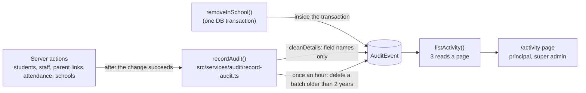

# How the activity log works

Step 60.1 adds a log of what staff did to a school's student data, and the **Activity** page where a principal reads it. It exists so a school can answer "who changed this child's record, and when?", which the Data Privacy Act review will ask. This is a different subsystem from the gate's taps (`docs/GATE.md`): taps are attendance; this is accountability for people's edits. Build story: `docs/BUILD-LOG.md`, "Step 60.1". Recipe: `docs/backend/step-60.1-audit-log.md`.

## The shape of it



## What is stored, and what never is

```prisma
model AuditEvent {
  id         String      @id @default(uuid())
  schoolId   String                          // Cascade: goes with a deleted school (Step 60.5)
  actorId    String?                         // a plain copy of the staff id, no relation; null = a parent (Step 60.2)
  actorRole  Role?
  action     AuditAction                     // student_updated, card_replaced, staff_removed, ...
  targetType AuditTarget                     // student | staff | school
  targetId   String
  details    Json?                           // { fields: ["section", "guardianMobile"] }
  createdAt  DateTime    @default(now())

  @@index([schoolId, createdAt(sort: Desc), id(sort: Desc)])   // the page's order
  @@index([createdAt])                                          // the cleanup, across schools
}
```

The log holds **ids and the names of changed fields**, never what a field was changed to, never a person's name, an email, a card serial or a parent's identity. `details` is cleaned by `cleanDetails` against `AUDIT_FIELDS` (`src/features/audit/types.ts`), so one careless call can't put a minor's data in the log for good. Names on the page are looked up when it opens, so a removed student or staff member shows as "a removed student" and the log itself never held the name.

`actorId` has no relation on purpose: removing a staff member must neither fail on nor erase what they did. A super admin isn't one of a school's staff (their `schoolId` is null), so they're shown by role ("A super admin"), not looked up.

**A parent has no actor at all (Step 60.2).** `parent_account_deleted` is written when a parent deletes their own account, one event per linked child in that child's school, with `actorId` and `actorRole` null and the child as the target. No parent id is kept, because they asked to be deleted; the Activity page says "A parent deleted their parent account, which had access to <child>." with no role in brackets. It is written inside the deletion's own transaction, like `parent_link_removed`.

## Writing an event

```ts
await recordAudit({
  schoolId: session.schoolId,            // always the session's, never from the browser
  actor: actorOf(session),
  action: "student_updated",
  targetType: "student",
  targetId: id,
  details: { fields: changedStudentFields(existing, checked.data, photoChanged) },
});
```

It is called **after** the change succeeded and is best-effort: a failed write is `console.warn("audit: an event could not be written")` with no names, and never fails the school's action. That is a deliberate trade: the actions call separate repositories with no shared transaction, so making every event atomic would mean rebuilding them. Two events are the exception because losing them is the worst case: **removing a parent's access** is written inside `removeInSchool`'s own transaction (`prisma-parent-student-link-repository.ts`), and deleting a student (Step 60.3) will be too.

A card event is written only when the card was actually saved (`applyCard` succeeded), and `student_updated` only when a field changed.

## Keeping it two years

`recordAudit` also runs the retention, at most once an hour per server: it deletes up to 1,000 events older than `AUDIT_RETENTION_MS` (two years). It runs on writes because writes are what grow the table; it isn't tied to someone opening the Activity page, which might never happen. A restart resets the "once an hour" flag, which only means it runs once more, and deleting old rows is safe to repeat. The `createdAt` index finds the rows without reading the table. No cron or scheduler is needed.

## The page

`/activity` (`src/app/(app)/activity/page.tsx`) for principals and super admins; a teacher gets "You don't have access", checked on the server as well as hidden from the menu. The school is the session's own, so a super admin with no school open is asked to pick one; the address can't name a school.

- **Filter chips** (`groups.ts`): Students, ID cards, Staff, Parents, Attendance, School. `?group=cards`.
- **Paging** is by cursor, not page number: `?before=<time>_<id>`, parsed with zod, so a hand-edited address falls back to the newest page. The query (`prisma-audit-repository.ts`) follows the index's own order, so events that share a time are neither skipped nor repeated.
- **Three reads a page** (`list-activity.ts`): the events, the school's staff, and just these students (`StudentRepository.listByIdsInSchool`).

## Quick recipes

**Log a new kind of event:** add the value to `enum AuditAction` in `prisma/schema.prisma` and make a migration; add it to `AUDIT_ACTIONS` (`types.test.ts` fails if the two differ), to one group in `groups.ts` (`groups.test.ts` fails if one is in none), and a sentence in `describe.ts`; then call `recordAudit` after the change in its server action.

**Log a new changed field:** add its name to `AUDIT_FIELDS` and a label in `describe.ts`. Never a value.

**Change how long events are kept:** `AUDIT_RETENTION_MS` in `record-audit.ts`, and the sentence under "Activity" in the page's description.

**See an event in the database:** `select action, "actorRole", "targetType", details, "createdAt" from "AuditEvent" order by "createdAt" desc limit 20;` — there is nothing personal in it to see.
