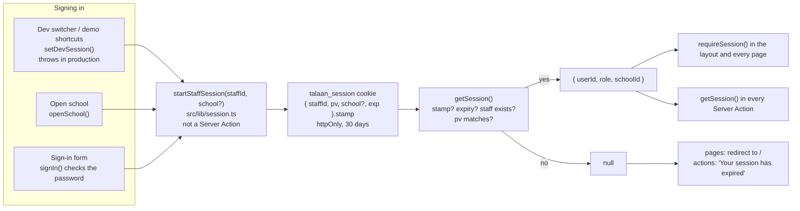
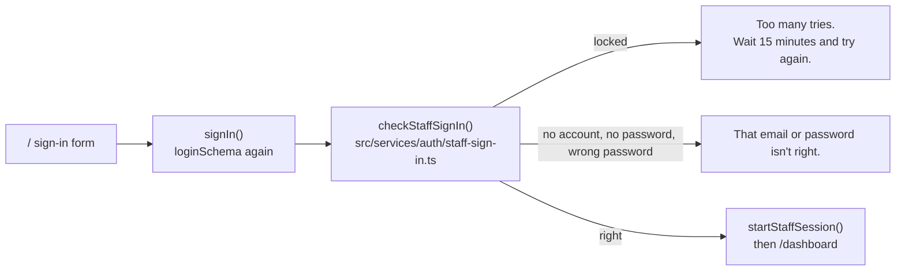
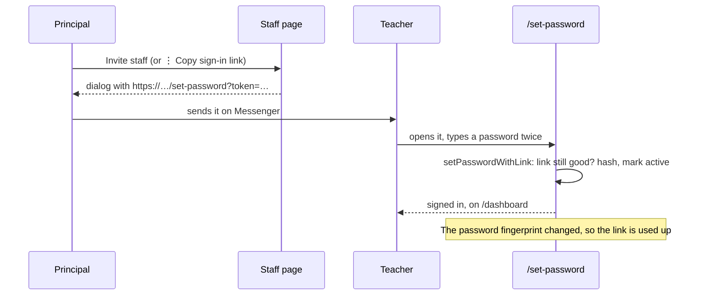

# How sign-in works

Talaan has four kinds of sign-in, one per kind of visitor:

| Who | Proves who they are with | Carries | Built in |
|---|---|---|---|
| Staff (super admin, principal, teacher) | Email and password, first set through a link | A **signed** `talaan_session` cookie | Steps 50, 50.1 and 50.5 |
| Parents, web portal | Email and password | A **signed** `talaan_parent_session` cookie | Step 22; hashed passwords Step 41; signed Step 50.1 |
| Gate tablet, guardhouse TV | A device token typed once | A random `tal_dev_…` token, kept hashed | Steps 43 and 48 (`docs/GATE.md`) |
| Parents, Expo app | Email and password | A random `tal_par_…` token, kept hashed, 30 days from its last use (was 90; owner decision, 2026-10-19) | Steps 53.3, 54.1 |

This page covers the two cookie sessions. For a step-by-step walkthrough of every journey (getting an account, signing in, every page load, signing out, and the planned phone app), see [Talaan Accounts and Sign-in](https://claude.ai/artifact/2cQbiVqHAhz3cYs1Tjtqhz). For what cookies, sessions and JWTs are, and why Talaan signs its own cookie instead of using an auth library, see the interactive page [Talaan Sign-in Options](https://claude.ai/artifact/3AsAcMHFBbZbzjJya1tZAK) and `docs/LEARNING-LOG.md`'s "Cookies, sessions and JWTs" entry.

## The staff session (Step 50)



### The cookie

`src/lib/session-cookie.ts` makes and reads the cookie's value:

```ts
export function makeStaffSessionCookie(contents: StaffSessionCookie, secret: string, now: Date): string {
  const exp = Math.floor(now.getTime() / 1000) + SESSION_MAX_AGE_SECONDS;
  return signValue({ ...contents, exp }, "staff-session", secret);
}
```

The value looks like `eyJzdGFmZklk….tQdbZ2Hik4CI…`: a base64url JSON payload, a dot, and a stamp. `src/lib/signed-value.ts` makes the stamp with HMAC-SHA256 over the purpose and the payload, using `SESSION_SECRET` (`src/lib/env.ts`). Change one character of the payload or the stamp, use another secret, or paste a value made for another purpose (a parent cookie, a set-password link), and `readSignedValue` returns null. It also returns null once `exp` has passed. It never throws, so a garbage cookie just means "signed out".

The payload is readable by anyone holding the cookie, since it's only encoded, not encrypted. It holds ids and a fingerprint, never a password or a student's details.

| Field | What it's for |
|---|---|
| `staffId` | Who signed in. |
| `pv` | `passwordVersion(passwordHash)` (`src/lib/password.ts`): the first 16 characters of a SHA-256 of the stored hash, or `"none"` for an invited account with no password yet. A new password means a new hash, so older cookies stop matching. That's how a password change signs out every other browser, with no sessions table. |
| `school` | The school a super admin opened. Ignored for everyone else. |
| `exp` | 30 days after sign-in, in seconds since 1970. |

### Reading it: `resolveSession`

```ts
export async function resolveSession(raw: string | undefined, deps: SessionDeps): Promise<Session | null> {
  const cookie = readStaffSessionCookie(raw, deps.secret, deps.now);
  if (!cookie) return null;

  const found = await deps.staff.getForSession(cookie.staffId);
  if (!found || passwordVersion(found.passwordHash) !== cookie.pv) return null;

  const { staff } = found;
  if (staff.role !== "super_admin") {
    return { userId: staff.id, role: staff.role, schoolId: staff.schoolId };
  }
  const viewing = cookie.school ? await deps.schools.getById(cookie.school) : null;
  return { userId: staff.id, role: staff.role, schoolId: viewing?.id ?? null };
}
```

- **One database lookup per request.** The stamp proves the cookie is ours. The lookup proves the person is still allowed in: a removed staff member is signed out on their next click, not in 30 days. `getSession` is wrapped in React's `cache`, so the layout and the page share that one lookup.
- **The school only ever comes from this signed cookie.** A principal's or teacher's school is their own, whatever the cookie says. Only a super admin's `school` is read, and only if that school still exists.
- **The real clock.** `getSession` passes `new Date()`, never `DEMO_NOW`: a cookie's expiry is about real time, even when the attendance pages are pinned to the demo morning.

### Pages and actions

| Where | Call | Signed out |
|---|---|---|
| `src/app/(app)/layout.tsx` and every page under it | `requireSession()` | Redirect to `/` |
| Every staff Server Action | `getSession()`, then `if (!session) …` | `{ ok: false, formError: SIGNED_OUT_MESSAGE }` (or a thrown error for the two that already threw) |
| `resolveMonitorViewer`, `resolvePhotoViewer` | `getSession()` | Not allowed (the monitor's not-connected page, a photo 404) |

Each page checks for itself, not only the layout: Next.js doesn't re-run a layout on every navigation, and a Server Action can be called directly without any page at all (`node_modules/next/dist/docs/01-app/02-guides/authentication.md`, "Layouts and auth checks").

### Starting a session

`startStaffSession(staffId, school?)` in `src/lib/session.ts` sets the cookie (httpOnly, `sameSite: "lax"`, `secure` in production, 30 days). It is **not** a Server Action, on purpose. Every exported function in a `"use server"` file is a public endpoint that anyone can call with any arguments, and this function takes any staff id. So it's only called by server code that has already decided the person may sign in:
- `setDevSession` (`src/lib/session-actions.ts`), the dev switcher and demo shortcuts, which throws in production;
- `openSchool` (`src/features/schools/actions.ts`), after checking the caller is a super admin;
- `signIn`, the sign-in form's action, after the password checks out (below).

`endStaffSession()`, next to it, deletes the cookie. Sign out (`signOut` in `src/features/auth/actions.ts`) calls it, clears any theme preview, and goes to `/`.

### Passwords and emails

`Staff.passwordHash` (migration `staff_password`) holds `hashPassword()`'s `scrypt:<salt>:<hash>`, or null for an invited account. `toStaff` never copies it into a `Staff` object; only `StaffRepository.getForSession` returns it, next to the staff member. Emails are unique across every school and stored in lower case, so sign-in will find exactly one person. Adding staff or a school with an email that's already used is refused with "Someone already uses this email."

Seed accounts: every **active** demo staff member's hash is `SEED_STAFF_PASSWORD_HASH` (`src/data/seed/staff-password.ts`), the hash of `Talaan123!`, made once and kept fixed so the browser tests can compute the matching `pv`. Invited demo accounts have no password, the same as a real invited account.

### The browser tests

`e2e/sessions.ts` makes the same signed cookie with `TEST_SESSION_SECRET`, which `playwright.config.ts` gives the test server as `SESSION_SECRET`. `signInAs(context, "principal", baseURL)` works exactly as before.

### Signing in with the form (Step 50.1)



`checkStaffSignIn(input, { staff, throttle, now })` is a plain function, so it's unit-tested without Next.js:

1. **The limit first.** A locked email is refused before the password is looked at, so the right password can't be found by guessing past the limit.
2. **`findForSignIn(email)`** finds the account and its hash, ignoring case.
3. **`passwordMatches` always runs**, against a decoy hash when there's no account or no password yet. Without it, an unknown email would answer a few dozen milliseconds faster than a known one, and that difference alone would tell a stranger which emails have accounts.
4. **One answer for every failure:** "That email or password isn't right." The 5th failure in 15 minutes answers "Too many tries. Wait 15 minutes and try again." instead (`src/features/auth/messages.ts`).

**The limit** (`src/services/auth/login-throttle.ts`) counts wrong passwords per key: `staff:<email>` or `parent:<email>`, so the two never share a count. 5 within 15 minutes lock that key for 15 minutes; a right password clears the count. It lives in the server's memory: on one server that covers every request, and a restart clears it. With several servers, each would count on its own; it would then move to the database. It uses the real clock, never `DEMO_NOW`.

**The page.** `/` sends a signed-in visitor straight to `/dashboard`. The "Try the prototype as" buttons only render outside production, where `setDevSession` works; in production the form is the only way in. **Sign out** is a `<form action={signOut}>` button (`src/components/app-shell/sign-out-button.tsx`) in the top bar (icon only below md) and at the bottom of the mobile drawer, so it works before JavaScript loads.

### First passwords and resets: set-password links (Step 50.5)

Staff never sign themselves up. A new account is **invited**, with no password, until its owner uses a link the app makes and the principal sends however they like (Messenger, Viber, SMS).



- **The token** (`src/services/auth/set-password-link.ts`) is `signValue({ staffId, pv, exp }, "set-password", secret)`: 7 days, its own purpose, and the password fingerprint *when the link was made* (`"none"` for an invited account). Setting a password changes the fingerprint, so a link works once, and a reset link signs the person out of every other browser too. No table of links is kept. A newer link doesn't cancel an older unused one; removing the staff member kills both.
- **Who can make one:** a principal (or a super admin viewing the school) for anyone at that school except themselves, through `createSignInLink` and `inviteStaff` (`src/features/staff/actions.ts`); a super admin for a new school's principal, through `createSchool`; and anyone with the server's terminal, through `npm run staff:link` (below). `makeSignInLink` (`src/features/staff/sign-in-link.ts`) builds the full address from the request (`src/lib/request-origin.ts`) and is not a Server Action.
- **The page** (`src/app/set-password/page.tsx`) reads the token, greets the person by first name and shows their email, never the school. A bad link says "This link has expired or was already used. Ask your principal for a new one." `setPasswordWithLink` reads the token *again* on submit, stores the scrypt hash with `staffRepository.setPassword` (which also marks the account active), and starts the session.
- **The first super admin** on a new server: `npm run staff:link -- --create-super-admin --email … --first-name … --last-name …` creates the account and prints its link's path. `npm run staff:link -- --email …` prints a link for any existing account. Both use the same `SESSION_SECRET` as the app, so the app accepts the link.

### "Forgot your password?" by email (Step 55.5)

Staff can now get a reset link themselves. The sign-in page's **Forgot your password?** goes to `/forgot-password`, which emails the same set-password link, valid for **1 hour** instead of 7 days, to an account that already has a password. The answer is the same for every email, the lookup and the email happen in `after()`, and three limits apply: 3 per email and 20 per network an hour, and 80 emails a day from the whole app. Invited accounts get nothing; their invitation stays the principal's link. After a reset, the sign-in lockout for that email clears and a "password was changed" email goes out. The link's address comes from `APP_URL`, never the request. While a live server's `EMAIL_SENDER` is `log`, the sign-in page keeps the "Ask your principal" note. Full write-up: `docs/EMAIL.md`.

## The parent session

The parent web portal works the same way, with its own cookie and code:

- **`talaan_parent_session`** holds `makeParentSessionCookie(parentId, …)` (`src/lib/session-cookie.ts`): a signed `{ parentId, exp }` with the purpose `parent-session`, 30 days, httpOnly, `secure` in production. A hand-typed parent id, or a staff cookie pasted in its place, is signed out.
- **`resolveParentSession(raw, deps)`** (`src/lib/parent-session.ts`) checks the stamp and that the parent still exists. `getParentSession()` wraps it, and `src/app/parent/(protected)/layout.tsx` redirects to `/parent/login` when it's null.
- **`setParentSession` and `clearParentSession`** live in `parent-session.ts`, which has no `"use server"`. Until Step 50.1 `setParentSession` was in its own `"use server"` file, which made it a public endpoint: anyone could have asked it to sign them in as any parent.
- **`signInParent`** calls `checkParentSignIn` (`src/services/parents/check-parent-sign-in.ts`, Step 53.1): the same limit (key `parent:<email>`) and the same messages as staff. The parent repository's `verifyPassword` checks a decoy hash for an unknown email, so the answer takes as long either way (`docs/PROBLEMS-LOG.md`, P-015).
- **Parent emails are stored trimmed and in lower case** (Step 53.1, migration `parent_email_lowercase`), the same as staff, so sign-in looks them up exactly on the unique email index. `emailSchema` (`src/features/auth/schemas.ts`) trims and lowercases before it checks.

The two sessions never share a cookie: a browser can be signed in as staff and as a parent at the same time.

**The phone app is different.** Parents will mostly use the Expo app (Phase 3), which can't hold this cookie. Step 53.3 gives it a bearer token through `/api/v1/parents/login`, and Step 53.1 had already moved the parent sign-in check into a service that both the web portal and the API call.

- **The token** is `tal_par_` plus 32 random bytes. Only its sha256 is kept (`ParentToken`), and it lasts 30 days from its last use (`src/services/parents/parent-token.ts`; it was 90 until Step 54.1). Opening the app counts as use. The push worker's hourly cleanup deletes sign-ins that are revoked or unused for 30 days, with their push addresses (`docs/PUSH.md`). Sign-out revokes it at once. A gate's `tal_dev_` token is never a parent's.
- **The limits**, in `src/services/auth/login-throttle.ts`, each its own bounded memory:
  - 5 wrong passwords per email in 15 minutes;
  - 30 wrong parent passwords per network in 15 minutes;
  - 100 parent sign-ups per network in an hour.
  - 5 wrong "link a child" tries per parent in 15 minutes (Step 55.1).

  Linking a child also has a limit that memory can't hold, since a restart would reset it: 10 tries per child (school, LRN and last name) in 24 hours, from any account, counted in Postgres (`LinkAttempt`, `src/services/parents/link-attempts.ts`, `docs/SCALING.md` 1.2).
  The network is the last `X-Forwarded-For` entry (`src/lib/client-address.ts`); this computer's own requests are never counted by network. The web portal uses the same limits as the app. `docs/PROBLEMS-LOG.md` P-020 and P-021 say why, and the launch-night risk.
- **Signing a phone out** (Step 53.4) removes its push address (`PushToken`, one per sign-in) and then revokes the token. Each push address belongs to a sign-in, not to the parent directly, so a sign-in cleared after 30 days unused takes its push address with it.
- **Every parent API answer** is copied field by field in `src/features/parents/api-responses.ts`, so the LRN, birth date and guardian never reach a phone. Recipes: `docs/backend/step-53.3-parent-sign-in-api.md` and `step-53.4-parent-api.md`; the full contract is `docs/PARENT-API.md`. So the limit and the single "isn't right" answer apply to the app too.

## Quick recipes

**A new staff page.** Put it under `src/app/(app)/` and start it with `const session = await requireSession();`. Check the role yourself (`hasNavAccess`) if the page isn't for everyone.

**A new staff Server Action.**

```ts
const session = await getSession();
if (!session) return { ok: false, formError: SIGNED_OUT_MESSAGE };
if (!session.schoolId || session.role === "teacher") return { ok: false, formError: "You don't have permission to …" };
```

`SIGNED_OUT_MESSAGE` is in `src/features/auth/messages.ts`. Use `session.schoolId` for every lookup, never a school id the browser sent.

**Sign everyone out.** Change `SESSION_SECRET`. Every cookie's stamp stops matching.

**Sign one person out everywhere.** Send them a password reset link (Staff → ⋮ → Copy password reset link, `npm run staff:link -- --email …`, or they use "Forgot your password?"). When they set a new password, their `pv` changes.

**A new kind of signed value** (a link, another cookie). Add a purpose to `SignPurpose` in `src/lib/signed-value.ts`, sign with `signValue`, read with `readSignedValue`, and check the payload's fields with a Zod schema, as `readStaffSessionCookie` does.
