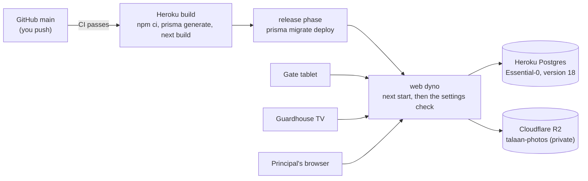

# Deploying: the live server on Heroku

How Bantay Aral runs on the internet (Step 52): what happens between a push to GitHub and the site changing, every setting the server needs, and the commands for looking after it. The app's Heroku name is `bantayaral` in the examples below; swap in the real one if it differs.

## How a deploy works



1. **You push to `main`.** GitHub runs CI (`.github/workflows/ci.yml`). Heroku is set to deploy automatically from `main`, but only after CI passes, so a red build never reaches a school.
2. **Build.** Heroku reads `"engines": { "node": "24.x" }` in `package.json` and installs the same Node as CI and your laptop. Then `npm ci`, whose `postinstall` runs `prisma generate`, then `npm run build`. Afterwards Heroku deletes the development packages, which is why `prisma`, `tsx` and `dotenv` are regular `dependencies`: the release phase and the `heroku run` scripts need them.
3. **Release.** The `Procfile`'s `release:` line runs `npx prisma migrate deploy` once, before the new version takes any traffic. If it fails, Heroku keeps the old version running. A migration is never rolled back by Heroku; see `docs/DATABASE-MIGRATIONS.md`.
4. **Start.** The `web:` line runs `npm start` (`next start`), which listens on the `PORT` Heroku gives it. Before answering any request, `src/instrumentation.ts` runs `checkProductionEnv` (`src/lib/env.ts`). A missing or dangerous setting stops the start, and the logs list each problem by the setting's name, never its value:

   ```
   The server can't start with these settings:
   - SESSION_SECRET is missing or shorter than 32 characters.
   - PHOTO_STORAGE must be "s3": the server's own disk is wiped on every restart.
   ```

```ts
// src/instrumentation.ts
export async function register() {
  if (process.env.NEXT_RUNTIME !== "nodejs") return;
  if (process.env.NODE_ENV !== "production" || process.env.E2E === "1") return;

  const { checkProductionEnv } = await import("@/lib/env");
  const problems = checkProductionEnv(process.env);
  if (problems.length > 0) {
    throw new Error(`The server can't start with these settings:\n- ${problems.join("\n- ")}`);
  }
}
```

The browser tests also run a production server, deliberately with test settings (a pinned clock and photos in a local folder). `playwright.config.ts` sets `E2E=1` for that server only, which skips the check. **Never set `E2E` on Heroku.** The same applies to trying a production build on your laptop (`npm run build && npm start`): it needs `E2E=1` in front, or the real settings.

## One dyno only

**Keep exactly one `web` dyno.** The live monitor's feed (Step 48) and the sign-in throttle (Step 50) both live in the server's memory. With two dynos, a tap recorded by one wouldn't reach a monitor connected to the other, and the throttle would count each dyno separately. `docs/SCALING.md` covers what changes before a second dyno. Check with `heroku ps --app bantayaral`.

The monitor's stream sends a keep-alive every 25 seconds. Heroku's router closes a connection that's silent for 55 seconds, so the monitor stays connected.

## Settings (config vars)

Set with `heroku config:set NAME=value --app bantayaral`. Type secrets yourself; never paste them into a chat or a file in this repository. `heroku config --app bantayaral` lists them.

| Name | Set by | What it's for |
|---|---|---|
| `DATABASE_URL` | Heroku, with the Postgres add-on | The database's address. Heroku can change it during maintenance, so never copy it anywhere. |
| `PGSSLMODE` | you: `no-verify` | Heroku Postgres only accepts encrypted connections, but Node can't verify its certificate. This keeps the encryption without the check (Heroku's own advice for Node). |
| `SESSION_SECRET` | you: `$(openssl rand -base64 32)` | Signs every sign-in cookie and set-password link. Changing it signs everyone out and voids open links. |
| `PHOTO_STORAGE` | you: `s3` | Photos go to R2. The dyno's disk is wiped on every restart and deploy. |
| `S3_ENDPOINT` | you | `https://<account-id>.r2.cloudflarestorage.com` |
| `S3_BUCKET` | you: `talaan-photos` | The private bucket. |
| `S3_ACCESS_KEY_ID`, `S3_SECRET_ACCESS_KEY` | you | An R2 API token with Object Read & Write on `talaan-photos` only. |

Never set on Heroku: `DEMO_NOW` (the server refuses to start) and `E2E` (it would skip the check).

## What it costs

| Piece | Plan | Per month |
|---|---|---|
| Web server | Heroku Basic dyno (never sleeps) | $7 |
| Database | Heroku Postgres Essential-0 (1 GB, 20 connections) | $5 |
| Photos | Cloudflare R2 free tier (10 GB; 500 thumbnails are about 8 MB) | $0 |
| **Total** | | **$12**, covered by the Heroku for GitHub Students credit ($13 a month) |

The credit shows on Heroku's Account → Billing page. Until it does, the card on the account is charged.

## Quick recipes

**Deploy.** Push to `main`. Watch it with `heroku logs --tail --app bantayaral`: expect `prisma migrate deploy` in the release phase, then "Ready". Then open `https://bantayaral.herokuapp.com/api/v1/health`, which answers `{"ok":true,"database":"ok"}`, or a `503` with `"database":"unreachable"`.

**Roll back.** `heroku releases --app bantayaral` lists the versions, then `heroku rollback v<N> --app bantayaral`. This rolls back the code only, not the database.

**Load the demo data (first deploy only).** `heroku run npx prisma db seed --app bantayaral`. The demo staff all use the well-known password `Talaan123!`, so before showing the site to anyone, sign in as your own super admin and give any demo account you use a new password with a reset link. `npm run db:reset` refuses to run anywhere but your laptop, by design.

**Your own super admin.**
```bash
heroku run npm run staff:link -- --create-super-admin --email <you> --first-name <first> --last-name <last> --app bantayaral
```
Open `https://bantayaral.herokuapp.com` followed by the printed path and set your password.

**A sign-in or reset link for someone.** `heroku run npm run staff:link -- --email <email> --app bantayaral`.

**A gate tablet or a monitor.**
```bash
heroku run npm run device:create -- --school school-balanga --kind gate --label "Main gate tablet" --app bantayaral
heroku run npm run device:create -- --school school-balanga --kind monitor --label "Guardhouse TV" --app bantayaral
```
Each prints its token once. On the tablet, open `/gate` and enter the token on its setup screen. On the monitor, open `/gate/display/connect?key=<token>`.

**Look inside the database.** `heroku pg:psql --app bantayaral`. `\q` quits.

**Back up now.** `heroku pg:backups:capture --app bantayaral`. `heroku pg:backups --app bantayaral` lists the backups, including Heroku's automatic ones.

**Change a setting.** `heroku config:set NAME=value --app bantayaral`. Heroku restarts the dyno by itself, and the settings check runs again.
