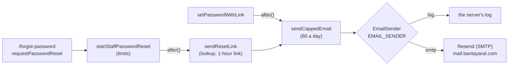

# How the app sends email

Since Step 55.5 the app sends email, for one job: **"Forgot your password?"**. Staff get a link (Step 55.5); parents get a 6-digit code (Step 55.6), through the same pieces. Parents still get attendance news as pushes, never email (`docs/PUSH.md`).

Recipes: `docs/backend/step-55.5-email-staff-reset.md` and `docs/backend/step-55.6-parent-reset.md`. The decisions and their reasons are there; this page is how it works.

## The pieces



| Piece | File |
|---|---|
| The interface, both senders, `canEmailPeople` | `src/lib/email/email-sender.ts` |
| The daily limit, shared by every email | `src/services/auth/capped-email.ts` |
| Staff "Forgot your password?" | `src/services/auth/staff-password-reset.ts` |
| Parents' reset codes (Step 55.6) | `src/services/parents/parent-password-reset.ts`, `src/services/parents/reset-code.ts` |
| The emails' text | `src/services/auth/reset-emails.ts` |
| The limits | `src/services/auth/login-throttle.ts` |
| Settings and their start-up check | `src/lib/env.ts` (`appUrl`, `checkProductionEnv`) |
| The page and its action | `src/app/forgot-password/page.tsx`, `src/features/auth/forgot-password-form.tsx`, `requestPasswordReset` in `src/features/auth/actions.ts` |

## The interface

Like photos (`PhotoStorage`) and pushes (`PushSender`), every email goes through one small interface, so changing provider is a setting, not new code:

```ts
export type EmailMessage = { to: string; subject: string; text: string };
export type EmailResult = { ok: true } | { ok: false; error: string };

export interface EmailSender {
  send(message: EmailMessage): Promise<EmailResult>;
}
```

`send` never throws. A failure comes back as a short code (`EAUTH`, `ETIMEDOUT`), never the address. Emails are plain text: they deliver well, and need no colors.

**`EMAIL_SENDER` picks the sender:**

- **`log`** (the default off a live server) sends nothing. In development and the browser tests it writes the whole email to the terminal, so you can follow a reset link without an email account. On a live server it writes only the subject, since the body holds a working link and Heroku keeps its logs.
- **`smtp`** sends through any SMTP provider with `nodemailer`:

  ```ts
  const mailer = transport({
    host: settings.host,
    port: settings.port,
    secure: settings.port === 465,
    auth: { user: settings.user, pass: settings.password },
    connectionTimeout: SMTP_TIMEOUT_MS,
    greetingTimeout: SMTP_TIMEOUT_MS,
    socketTimeout: SMTP_TIMEOUT_MS,
  });
  ```

  Port 465 opens with TLS; 587 starts plain and upgrades (STARTTLS). Every wait gives up after 10 seconds.

**`canEmailPeople()`** is true with `smtp`, and anywhere but a live server. While a live server is still on `log`, the sign-in page keeps the old "Ask your principal" note instead of the link, so it never says "we've sent a link" when nothing went.

## The daily limit

Resend's free plan sends 100 emails a day. The app stops itself at **80**, counted in `dailyEmailCap`, so one person asking for many resets can't use up the day and leave real ones failing. Every email goes through `sendCappedEmail`, which checks the limit, counts the email, sends it, and logs a failure without the address:

```ts
export async function sendCappedEmail(message: EmailMessage, what: string, deps: CappedEmailDeps): Promise<void> {
  if (dailyCapReached(deps)) {
    console.warn(`email: ${what} not sent, the daily limit is reached`);
    return;
  }
  if (deps.dailyCap.recordFailure(DAILY_EMAIL_KEY, deps.now)) {
    console.warn("email: the daily limit is now reached; no more emails until it clears");
  }
  …
}
```

The count lives in memory, like the sign-in limits, so a restart clears it. Resend's own 100 still holds after a restart.

## What the log says, and what people see

**Where to look when reviewing email.** Every email line in the server's log starts with `email:` and never holds an address or a link, so `heroku logs --app bantayaral --num 500 | grep "email:"` finds them all (locally, read the `npm run dev` terminal). The parent API's error codes and HTTP status numbers live in `docs/PARENT-API.md` ("Errors"); this page is about email only.

**Log lines** (from `src/lib/email/email-sender.ts`, `src/services/auth/capped-email.ts` and `src/services/auth/staff-password-reset.ts`):

| Line | Meaning | What to do |
|---|---|---|
| `email: 1 message to the log sender, not sent: <subject>` | A live server is on `EMAIL_SENDER=log`: the email was **not** sent, only noted. | Expected until Resend is set up. Then set `EMAIL_SENDER=smtp` (Settings below). |
| `email (log sender, not sent) to … Subject: …` and the whole email | The same, off a live server: development or the browser tests. The link is in it, to open by hand. | Nothing. This is how you test locally. |
| `email: <what> failed: EAUTH` | Resend refused the API key. | A new key with sending access for `mail.bantayaral.com`, in `SMTP_PASSWORD`. |
| `email: <what> failed: ETIMEDOUT` (or `ECONNECTION`) | The connection to `smtp.resend.com` hung or was refused. | Usually the port: try `SMTP_PORT=587`. |
| `email: <what> failed: unknown` | The send failed with no error code. | Look at the lines just above it in the log. |
| `email: reset email failed: lookup` (staff) or `email: parent reset code failed: lookup` (parents) | The database lookup before a reset email failed. | Check `/api/v1/health`: the database is likely down. |
| `email: parent reset code not sent, 5 codes for this parent today` | One parent asked for a 6th code in 24 hours (Step 55.6). Counted in the database, so a restart doesn't clear it. | Nothing, unless it happens often: someone may be asking for codes for that parent. |
| `email: the daily limit is now reached; no more emails until it clears` | That was email 80 of the last 24 hours. | Wait. If it happens on a normal day, someone is asking for many resets. |
| `email: <what> not sent, the daily limit is reached` | An email was skipped because of the daily limit. | The same. |

`<what>` names the email: `reset email` (staff link), `parent reset code`, or `password changed email` (both).

**No line at all** after a "Forgot your password?" means nothing was sent on purpose: an unknown or invited email, or a limit. The page said which, for a limit.

**What a person sees** (`src/features/auth/messages.ts`):

| When | The message |
|---|---|
| Any request that passed the limits, known email or not | "If that email belongs to a staff account, we've sent a link to it. It works for 1 hour." |
| Over 3 for one email, or 20 from one network, in an hour | "Too many requests. Wait an hour and try again." |
| The daily limit is reached | "We can't send emails right now. Try again tomorrow, or ask your principal for a reset link." |
| A live server on `log` (`canEmailPeople()` is false) | No reset form: the old "Ask your principal for a password reset link…" note. |
| **Parents** (Step 55.6), any request that passed the limits | "If that email belongs to a parent account, we've sent a 6-digit code to it. It works for 15 minutes." The app gets `202 {}`. |
| Parents, over 3 for one email or 20 from one network in an hour | "Too many requests. Wait an hour and try again." (`429 too_many_tries`) |
| Parents, the daily limit reached **or** a live server on `log` | "We can't send emails right now. Try again later." (`503 unavailable`). The web hides the reset form; the app can't know ahead, so the server refuses instead of answering `202` for an email that would never go. |
| Parents, a wrong, expired, used-up or replaced code | "That code isn't right, or it has expired. Check the newest email, or ask for a new code." (`400 invalid_code`) |

**A live server won't start** without `EMAIL_SENDER`: `checkProductionEnv` (`src/lib/env.ts`) stops it, and the log names the setting (`EMAIL_SENDER must be "smtp" … or "log" …`, or `EMAIL_SENDER="smtp" needs SMTP_HOST, …`). Values are never printed.

## "Forgot your password?" for staff

1. The sign-in page's **Forgot your password?** goes to `/forgot-password`.
2. `requestPasswordReset` checks the email with `emailSchema` (trimmed, lower case) and reads the network address from `X-Forwarded-For`, both before the answer goes.
3. `startStaffPasswordReset` applies the limits, the same for every email, known or not:
   - 3 per email an hour (`staff-reset:<email>`, never shared with the sign-in count);
   - 20 per network an hour;
   - the daily limit.
4. The answer is always the same: "If that email belongs to a staff account, we've sent a link to it. It works for 1 hour." The lookup and the email run in `after()` (from `next/server`), once the answer has gone, so it takes as long either way and gives nothing away.
5. In `after()`: `findForSignIn(email)`. An unknown email gets nothing, and so does an **invited** account (no password yet): its email was typed by a principal and never checked, so staff invitations stay a link the principal sends.
6. The email holds Step 50.5's set-password link, made with `makeSetPasswordToken(…, RESET_EMAIL_LINK_SECONDS)`: 1 hour instead of 7 days, otherwise the same token and the same `/set-password` page. Setting the password changes the password fingerprint, so the link works once and every other browser is signed out (`docs/AUTH.md`).
7. After the new password is set, `setPasswordWithLink` clears that email's sign-in lockout and, for a reset (the account was already active), sends "Your Bantay Aral password was changed".

## "Forgot your password?" for parents (Step 55.6)

Parents are usually on a phone, and a link would open the phone's browser rather than the app, so they get a **6-digit code** instead, typed into the app or the web portal (`/parent/forgot-password`).

1. `startParentPasswordReset` answers `unavailable` when `canEmailPeople()` is false or the daily limit is reached, then applies the limits (3 per email an hour, `parent-reset:<email>`; 20 per network, shared with staff resets). The answer is the same for every email.
2. In `after()`: `findByEmail`. An unknown email gets nothing. Then `countRecent` deletes that parent's rows older than a day and counts the rest: past 5, nothing is sent. Otherwise a new `ParentPasswordReset` row holds the code's HMAC (never the code), valid 15 minutes, and the email goes through `sendCappedEmail` as `parent reset code`.
3. `confirmParentPasswordReset` (code + new password): finds the parent's **newest** code, **spends a try first** (one `UPDATE … WHERE tries < 5`), then compares, so guesses sent together still get 5 checks at most. A right code: one transaction marks it used, stores the new hash, deletes every phone's sign-in (push addresses go with them) and the parent's codes. The web cookie's password fingerprint (`docs/AUTH.md`) signs out every other browser.
4. The caller signs in the phone or browser that did it and sends "Your Bantay Aral password was changed".

### Why links in emails use `APP_URL`

`requestOrigin()` (`src/lib/request-origin.ts`) builds the site's address from the request's own `Origin`, `X-Forwarded-Host` or `Host` header, which anyone can set. A forged "Forgot your password?" request could then make the app email a real teacher a working link to the attacker's site, which would collect the token when clicked ("reset poisoning"). So emailed links use `appUrl()`, from the `APP_URL` setting, joined with `new URL(path, APP_URL)`. A live server sending email requires it to start with `https://`. The principal's copy link keeps `requestOrigin()`: they're signed in and see the link before sending it.

## Resend and the DNS records

The app sends as `no-reply@mail.bantayaral.com` through Resend's SMTP server (`smtp.resend.com`, port 465, user `resend`, the API key as password). Resend's advice is a subdomain, so if its sending reputation ever suffers, `bantayaral.com` itself isn't affected.

Four DNS records at Cloudflare, each **DNS only (grey cloud)**, prove the mail is really yours:

| Record | Name | What it does |
|---|---|---|
| `MX` | `send.mail` | Where bounces go back to Resend. |
| `TXT` (SPF) | `send.mail` | Lists who may send for this name: `v=spf1 include:amazonses.com ~all`. |
| `TXT` (DKIM) | `resend._domainkey.mail` | A public key. Resend signs every email, and Gmail checks the signature against it. |
| `TXT` (DMARC) | `_dmarc` | Tells Gmail what to do with mail that fails the other two: `v=DMARC1; p=none;` (deliver it, but report). Gmail and Yahoo expect one. |

Copy the first three values from Resend's Domains page, which shows them exactly.

## Settings

| Name | Value | Needed |
|---|---|---|
| `EMAIL_SENDER` | `log` or `smtp` | On a live server, always (it won't start without it). Elsewhere it defaults to `log`. |
| `SMTP_HOST`, `SMTP_PORT`, `SMTP_USER`, `SMTP_PASSWORD` | `smtp.resend.com`, `465`, `resend`, the API key | With `smtp`. |
| `EMAIL_FROM` | `Bantay Aral <no-reply@mail.bantayaral.com>` | With `smtp`. |
| `APP_URL` | `https://bantayaral.herokuapp.com` | With `smtp`, starting `https://`. Off a live server it defaults to `http://localhost:3000`. |

`checkProductionEnv` names a missing setting, never its value.

## Quick recipes

**Send a new kind of email.** Write its text as a function in `reset-emails.ts` (or a new file beside it) that returns an `EmailMessage`, using `PRODUCT_NAME`, never "Talaan". Send it with `sendCappedEmail(message, "<what>", { sender: emailSender(), dailyCap: dailyEmailCap, now: Date.now() })`, inside `after()` when it shouldn't hold up the answer. Never put an address or a link in a log line.

**See an email locally.** Leave `EMAIL_SENDER` unset, do the thing that sends it, and read the `npm run dev` terminal.

**Change provider.** Verify the domain with the new provider, add its DNS records, and change the `SMTP_*` settings. For Brevo: `smtp-relay.brevo.com`, port 587. No code changes.

**An email isn't arriving.** `heroku logs --app bantayaral --num 500 | grep "email:"`. `EAUTH` means the key is wrong. `ETIMEDOUT` usually means the port: try 587. "the daily limit is reached" means 80 went out today. No line at all means nothing was sent: an unknown or invited email, or a limit, which the page would have said.

**Raise the daily limit.** Change `maxFailures` in `dailyEmailCap` (`login-throttle.ts`), and only after moving to a plan that allows more.
