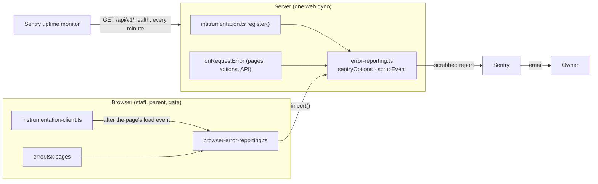

# Error tracking and the uptime check

How Bantay Aral tells the owner something broke (Step 59): error reports through Sentry, an uptime check on the health address, and a deploy that refuses to go live with a setting missing. Recipe: `docs/backend/step-59-error-tracking.md`.

## The one idea to hold on to

Students are minors, so a report carries only what finds the bug, never what identifies a person. Sentry collects a lot by default; every one of those categories is switched off by name, and then `scrubEvent` cleans each report once more before it leaves. Without the setting `NEXT_PUBLIC_SENTRY_DSN`, nothing starts and nothing is sent.



## How the files connect

| File | Job |
|---|---|
| `src/lib/error-reporting.ts` | The one module that knows Sentry. `sentryOptions(dsn)` (every data category off, no breadcrumbs, the ignore list, `beforeSend: scrubEvent`), `startErrorReporting` (once, only with a DSN, only in a production build), `reportError`, `flushReports`, and `reportRequestError` for Next.js's hook, which tags each report with the error's `digest`. |
| `src/lib/browser-error-reporting.ts` | The browser's side. Loads `error-reporting.ts` (and with it Sentry's code) only after the page's `load` event, so it never slows a first screen. `reportBrowserError` for error pages, which skips an error with a `digest`: the server already reported it. |
| `src/instrumentation-client.ts` | Next.js runs it in the browser before the page starts: calls `startBrowserErrorReporting()`. |
| `src/instrumentation.ts` | On the server, starts reports first, before the settings check, so a bad setting is reported (sent and waited for, 2 s) before the throw. `export { reportRequestError as onRequestError }` sends every server error in a page, an action or an API route. |
| `next.config.ts` | `withSentryConfig`, only for its bundle trimming: tracing, Replay and debug code left out. No source maps, no token, no network during the build. |
| `scripts/check-settings.ts` | Heroku's release phase: `releaseCheck(process.env)` (`src/lib/env.ts`), the same check the server runs at start-up. Exit 1 refuses the release. |
| `Procfile` | `release: npx tsx scripts/check-settings.ts && npx prisma migrate deploy` |

## What a report holds

Checked for real on 2026-10-23, against a fake Sentry on the laptop. A browser error on `/login?q=Juan+Dela+Cruz` after typing an email into the form arrived as:

```json
"request": { "url": "http://localhost:3199/login" },
"exception": { "values": [{ "type": "Error", "value": "Sentry test from the browser", "stacktrace": { … } }] },
"sdk": { "settings": { "infer_ip": "never" } }
```

No query, no email, no IP, no breadcrumbs. A server-side `PrismaClientValidationError` whose message quoted a student arrived with `"value": "PrismaClientValidationError"`. A server error from a route called with `?q=Juan+Dela+Cruz` and a cookie arrived as `"request":{"url":"…/api/v1/…","method":"GET"}`, with no query, cookie or name.

| Sent | Never sent |
|---|---|
| The error's type, message and stack trace, with a few lines of the source code around each line | IP addresses (`userInfo: false`), cookies, request and response headers |
| The page's address without anything after `?` or `#` | Request and response bodies (`httpBodies: []`): names, mobiles, passwords |
| Browser, operating system, the deploy's commit (`release`) | Query strings: search text such as `?q=Juan` |
| Whether a visit ended normally or with an error (Sentry's "sessions") | Breadcrumbs (`maxBreadcrumbs: 0`): clicks record button labels and photo descriptions |
| | Variable values in server stack frames (`stackFrameVariables: false`) |
| | A database error's message (replaced by its type in `scrubEvent`) |
| | Console logs, Session Replay, performance tracing |

Ids (random UUIDs) can appear in a page's address. They aren't names. Sentry keeps reports 30 days on the free plan.

## Noise that's ignored

`IGNORED_ERRORS` in `error-reporting.ts`: "Failed to fetch", "Load failed", "NetworkError when attempting to fetch resource", and the gate's own "Check-in failed", "Roster failed", "Tap failed". An offline gate tablet (Step 58) would otherwise use up the month's 5,000 reports.

## What it costs

- Sentry Developer plan: **$0**. 5,000 errors a month, one user, 30 days, one uptime monitor. Past 5,000, reports are refused until next month; nothing is billed.
- The browser: **+0.6 KB** before a page has loaded, **+31 KB** (compressed) fetched once it has, then cached. Measured with a real browser on 2026-10-23: `/login` 148.3 KB without Sentry, 148.9 KB at the `load` event with it, 180.3 KB once Sentry's code arrives. Without the trimming it would have been +76 KB, all of it before the page could show.

## Setting it up (the owner, once)

1. **Make the account:** sentry.io, sign up (the free Developer plan). When it asks where to keep the data, pick one; this can't be changed later.
2. **Make the project:** platform **Next.js**. Skip the setup wizard: the code is already in place.
3. **Privacy:** Project Settings → Security & Privacy. Turn on **Prevent Storing of IP Addresses**. Leave **Data Scrubber** and **Use Default Scrubbers** on.
4. **The DSN:** Project Settings → Client Keys (DSN) → copy it. Then, **before** the deploy, since the build copies it into the code:
   ```bash
   heroku config:set NEXT_PUBLIC_SENTRY_DSN="https://…" --app bantayaral
   ```
   Setting it starts a release (and a restart) but doesn't rebuild: push afterwards (or `git commit --allow-empty` and push) so the browser code has it.
5. **Emails:** Sentry emails new issues by default (Alerts → the project's default alert). Check User Settings → Notifications has email on.
6. **The uptime monitor:** Alerts (or Insights) → Uptime Monitors → add one: `https://bantayaral.com/api/v1/health`, checked every minute, for this project. It counts a 503 (`"database":"unreachable"`) as down, as it should.

## Quick recipes

- **A new kind of noise fills the reports:** add its message (or a regular expression) to `IGNORED_ERRORS` in `src/lib/error-reporting.ts`, with a test in `error-reporting.test.ts`.
- **Turn reports off:** `heroku config:unset NEXT_PUBLIC_SENTRY_DSN --app bantayaral`, then deploy.
- **Change provider:** `error-reporting.ts`, `browser-error-reporting.ts`'s import, and `next.config.ts`. Nothing else knows Sentry.
- **Check a report has no personal data:** open it in Sentry, look at "Request" and "Exception": a page address with no `?`, no user, no breadcrumbs.
- **Test that reports arrive:** on the live site, the browser console: `setTimeout(() => { throw new Error("Sentry test") })`. Without `setTimeout`, an error typed into the console isn't the page's own and isn't caught.
- **A deploy refused at the release phase:** `heroku releases:output --app bantayaral` shows which setting. Set it, then `heroku releases:retry --app bantayaral` or push again.
