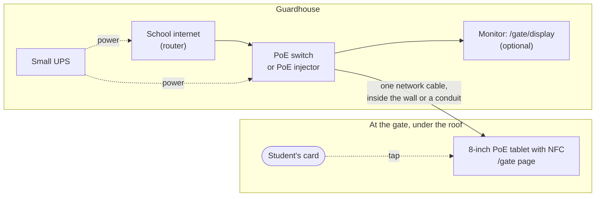
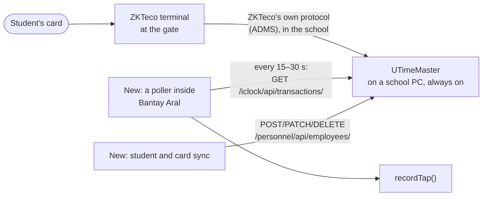
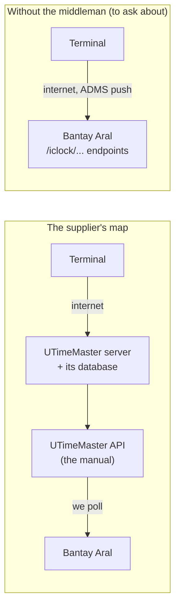
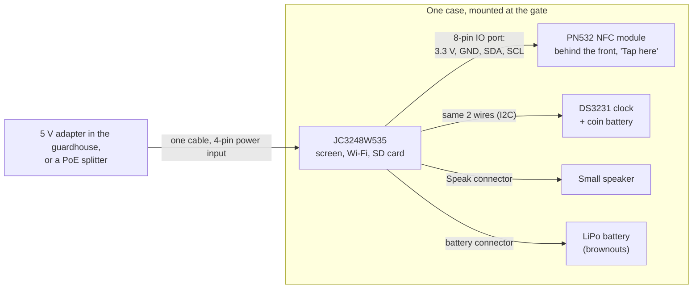

# Gate hardware: what to buy

A buying guide, started on 2026-11-10 from a market search, and kept up to date as samples are tested and decisions are made. [`docs/GATE-HARDWARE.md`](GATE-HARDWARE.md) explains the *kinds* of gate (tablet page, native app, guardhouse PC, Raspberry Pi box, ESP32 board) and how each behaves. This document is about **real products**: what's on the market, what it costs, what to ask a seller, and how to test a sample before buying more.

**The problem it answers (owner, 2026-11-10):** a tablet with NFC built in is too expensive. A cheap phone or tablet plus the USB reader needs an OTG cable and a charging cable, and those wires are exposed at the gate, where they get pulled, bent or stolen. What can be bought that reads our cards, mounts securely, hides its wires and survives a school gate?

**Nothing here changes the plan.** The pilot still runs the `/gate` page with the USB reader (Step 47). Every option below talks to the same `POST /api/v1/gate/taps`.

## Contents
- [The short answer](#the-short-answer)
- [First rule: it must read our stickers](#first-rule-it-must-read-our-stickers)
- [The options at a glance](#the-options-at-a-glance)
- [A. Wall-mount tablet on one network cable (recommended)](#a-wall-mount-tablet-on-one-network-cable-recommended)
- [B. A phone with its own NFC, in a locked case](#b-a-phone-with-its-own-nfc-in-a-locked-case)
- [C. Hide what we already have](#c-hide-what-we-already-have)
- [D. A ready-made attendance terminal (Hikvision, ZKTeco)](#d-a-ready-made-attendance-terminal-hikvision-zkteco)
  - [A supplier's UTimeMaster API, evaluated (2026-11-11)](#a-suppliers-utimemaster-api-evaluated-2026-11-11)
  - [A terminal with a "cloud solution WebSocket + JSON protocol", evaluated (2026-11-11)](#a-terminal-with-a-cloud-solution-websocket--json-protocol-evaluated-2026-11-11)
    - [Candidate device: TIMY TM-Q11](#candidate-device-timy-tm-q11-alibaba-listing-pasted-by-the-owner-on-2026-11-11)
    - [The seller's two SDKs, reviewed](#the-sellers-two-sdks-reviewed-2026-11-11)
- [E. An industrial network card reader](#e-an-industrial-network-card-reader)
  - [Cheaper readers like the IND2 (researched 2026-11-11)](#cheaper-readers-like-the-ind2-researched-2026-11-11)
- [Our own reader: from prototype to a finished unit](#our-own-reader-from-prototype-to-a-finished-unit)
- [Mounting it so it lasts](#mounting-it-so-it-lasts)
- [Testing a sample before buying more](#testing-a-sample-before-buying-more)
- [Decisions and open questions](#decisions-and-open-questions)
- [Quick recipes](#quick-recipes)
- [Sources](#sources)

## The short answer

**Buy one sample of an 8-inch wall-mount Android tablet that has NFC built in and runs on one network cable (PoE).** About US$86–200 (roughly ₱5,000–11,600 at about ₱58 to the dollar), before shipping and import duties.

- One network cable carries both power and internet, and it can come straight out of the wall behind the tablet. No OTG adapter, no USB reader, no charger at the gate.
- It's made to be screwed to a wall, in a housing that's harder to pry off than a stand.
- It runs our `/gate` page, so the student still sees their photo and "Time in".

If the sample passes the [tests](#testing-a-sample-before-buying-more), that becomes the standard gate. Keep the cheaper ready-made attendance terminals (option D) in reserve for schools that want the toughest, cheapest box and can do without a photo at the gate.

## First rule: it must read our stickers

Our cards are NFC stickers: **13.56 MHz, ISO 14443-A, with a 7-byte serial** (NFC Tools on a phone shows "ISO 14443-3A", see `docs/ARCHITECTURE.md`'s open question 1). Most attendance devices are sold in two versions that look the same:

| Version name contains | Frequency | Reads our stickers? |
|---|---|---|
| **MF**, Mifare, IC card, NFC, 13.56 MHz | 13.56 MHz | Usually yes. Ask the seller to confirm NTAG213/NTAG215 |
| **EM**, ID card, 125 kHz, proximity | 125 kHz | **No, never** |

For example, Hikvision's DS-K1T320**MF**X reads Mifare cards and the DS-K1T320**EF**X reads EM cards. Buying the wrong letter means a device that can't see a single student's card.

**The number it sends matters too.** Our USB reader types the first 4 bytes as 10 decimal digits; Android's own NFC gives the full 7 bytes. `normalizeCardSerial` (`src/features/students/card-serial.ts`) accepts both, and hex with or without colons. A new reader that sends some other format (8 hex digits with no colons in reverse order, say, or the full 7 bytes as one decimal number) needs checking against it before the device is used. See [Testing a sample](#testing-a-sample-before-buying-more).

## The options at a glance

| | What it is | Rough price | Photo at the gate | Wires at the gate | New code |
|---|---|---|---|---|---|
| **A. Wall-mount PoE tablet with NFC** ⭐ | A sealed 8–10" Android panel made for walls | US$86–200 from China; US$299–399 from Western sellers | Yes | One network cable, inside the wall | None or small |
| **B. Phone with NFC in a locked case** | Any Android phone with NFC | About ₱8–10k phone + US$40–110 case | Yes | One charging cable, hidden | Small |
| **C. Hide the current tablet and reader** | A locked tablet case; the reader behind a thin panel | US$40–110 case + a powered hub | Yes | Hidden, but OTG with charging is unreliable | None |
| **D. Ready-made attendance terminal** | Hikvision or ZKTeco card terminal | ₱4,000–7,700 (Hikvision DS-K1T320MFX in the Philippines) | A tiny screen only | One cable | **Large**: a translator per brand |
| **E. Industrial network card reader** | A sealed reader that sends each tap to a web address | Price not found | No | One network cable | Small to medium |

Prices are from web listings found on 2026-11-10, not quotes. Import costs to the Philippines weren't checked.

## A. Wall-mount tablet on one network cable (recommended)

These are sold for meeting-room booking screens and staff time clocks. **PoE** ("Power over Ethernet") means one ordinary network cable carries both power and internet, so the tablet has no charger and no battery to swell.

Because the power comes from the guardhouse, **one small UPS there keeps the gate, the router and the monitor running through a brownout.** That is simpler than a battery at the gate.

### Listings found (2026-11-10)

| Seller | Model | Listed price | Notes |
|---|---|---|---|
| Alibaba (various factories) | 8" Android 13, RK3566, 2 GB / 32 GB, PoE | US$86–93 | NFC not stated in that listing; ask |
| Alibaba (various factories) | 8" RK3568 with NFC and PoE | US$107–115 | Android version not stated |
| Hopestar | 8" PoE + NFC, wall mount | US$98 | Android version not stated |
| Sinmar | 8"/10" "anti-theft" industrial PoE tablet with NFC | US$130 (bulk) | Made for public spaces |
| Raypodo | 8" PoE, RK3568 | US$138 (Android 11) – US$200 (Android 14) | NFC is an add-on module |
| Geekland | GKWF8058T 8" with front NFC; 10" models | About US$299–399 | US seller: more support, Google Play on some models, but older Android on others |

### Ask the seller before ordering

1. **How does the NFC give the card number to an app?** This decides how much code we need:

   | Their answer | Works with `/gate` today? |
   |---|---|
   | "It types the number like a keyboard" (keyboard emulation, HID) | **Yes, as it is.** The same path as our USB reader (`createScanBuffer`) |
   | "It's Android's own NFC" (works with apps like NFC Tools) | **Yes**, with the "Use this tablet's NFC" button (Web NFC in Chrome), pressed each time the page opens. A native gate app (`docs/GATE-HARDWARE.md` option 3) would remove the button |
   | "Use our SDK" or "serial port" only | **No.** Needs a native gate app that uses their SDK |

2. **Does it have Google Play and Chrome?** Some of these tablets ship plain Android with neither. Web NFC needs Chrome.
3. **Which Android version?** Prefer Android 11 or newer. Some listings still show Android 4.2 or 7.1, which are too old for a current Chrome.
4. **Does it read NTAG213 / NTAG215 serials?** Ask for a short video of it reading one, if possible.
5. **Is the PoE standard 802.3af or 802.3at?** It decides which PoE switch or injector to buy. Ask whether one is included.
6. **Is there a lockable or tamper-screw mount?** Most come with a wall bracket; ask what stops someone lifting the tablet off it.

### What it costs in total (one gate)

| Part | Rough cost |
|---|---|
| 8" PoE NFC tablet | US$86–200 (₱5,000–11,600) |
| Shipping and import duties | Not checked yet |
| PoE switch or injector, in the guardhouse | Small; price not checked yet |
| Network cable run from the guardhouse to the gate, and a conduit | Depends on the distance |
| Small UPS in the guardhouse | Not checked yet (shared with the router and the monitor) |

### Its weak spots

- **Needs a cable to the gate.** If the guardhouse is far away or the cable can't be routed, a model with Wi-Fi and a DC power input works too, but then the power cable is back.
- **A Chinese factory's support is thin.** Buy one sample, keep it for spare parts knowledge, and buy more of exactly the same model.
- **Software updates are rare** on these tablets. They only need to run Chrome and our page, but stay on the newest Android the seller offers.

## B. A phone with its own NFC, in a locked case

A phone with NFC needs no USB reader and no OTG adapter: only a charging cable, which can be hidden in the case or the wall.

- **The catch is the antenna.** A phone's NFC antenna is on its back, so the student has to tap the back of the phone. One way: mount the phone with its back to the students, behind a thin acrylic panel, and its screen facing the guard.
- **Phones (Philippine prices found):** Redmi Note 14 4G about ₱8,000–9,000; Samsung Galaxy A17 LTE about ₱9,290. **NFC on the Philippine versions wasn't confirmed** for either; check the official spec page or test in the store with NFC Tools.
- **Locked cases with hidden cables:** Brateck, CTA Digital and Manhattan sell wall enclosures with a key lock and internal cable routing for about US$40–110. Most are sized for tablets, not phones; a phone may need a custom acrylic box.
- **Web NFC needs the "Use this tablet's NFC" button** each time the page opens. A native gate app removes it.
- **A phone that's always charging** should have its charge limit on (Samsung: "Protect battery", about 85%), or its battery will swell.

## C. Hide what we already have

The cheapest start: keep the current tablet and USB reader, and hide them.

- A lockable tablet enclosure with internal cable routing (US$40–110).
- The USB reader behind a thin plastic or wood panel. Readers usually read through a few millimetres; test ours.
- **The weak spot: charging and the reader at the same time.** Adapters that promise "OTG + charging" exist (USB-C with a PD input), but buyers report some that only charge *or* connect, not both. A powered USB-C hub with "PD passthrough" is safer. Buy it from a seller that accepts returns, and test it with *our* tablet for a full day before trusting it.
- It's still several parts in a box, so it's a stop-gap until option A is tested.

## D. A ready-made attendance terminal (Hikvision, ZKTeco)

Wall-mounted card terminals built for office doors and factory gates: cheap, tough, one cable, a beep and a small screen. They can send each tap to a web address on their own, which is what "webhook" means here.

| Model | Price found | Notes |
|---|---|---|
| Hikvision DS-K1T320**MF**X (face + Mifare card) | ₱4,000–7,700 in the Philippines (Carousell, eBuyPH, Beyond Hygiene) | Turn face recognition off: it photographs minors |
| Hikvision DS-K1T804AMF (fingerprint + Mifare) | About ₱3,600 (eBuyPH, an older listing) | |
| ZKTeco M200Plus / M300Plus (IC card, ADMS) | About US$160–180 in the US | Philippine prices: ask a local distributor |

**Why it's the most work, even though the hardware is cheap:**

- **Each brand speaks its own protocol, not ours.** Our gate API takes `{ clientTapId, cardSerial, clientTappedAt }` with a device token. These devices can't be configured to send that. We'd build a small translator endpoint per brand that receives their format and calls `recordTap()`:
  - **ZKTeco "ADMS" (Push SDK):** the device calls the server at `/iclock/cdata` and `/iclock/getrequest`, in plain HTTP. Several open-source servers (Laravel, Odoo) show how. The easier of the two. Check whether the model supports HTTPS.
  - **Hikvision "ISAPI" or "ISUP":** event push to an HTTP or HTTPS address is documented, but the full documentation is behind Hikvision's partner portal and an NDA. Forum users report the "HTTP listening" setting missing from some firmware.
- **They expect each card to be registered on the device.** An unknown card may show "not registered" and buzz, which confuses students. We'd keep the device's card list in sync with ours (no names needed, just card numbers).
- **No photo for the student.** The guard sees the photo on `/gate/display` instead.
- **Their own clock.** Taps saved while offline carry the device's time, so its time setting (NTP) must be right.

**Worth it when:** many gates are needed and the toughest, cheapest box matters more than a photo at the gate. It would be its own planned step (a translator for one brand, plus the card sync), started only after one test unit proves it reads our stickers and sends events to our server.

### A supplier's UTimeMaster API, evaluated (2026-11-11)

A Philippine supplier answered the owner's inquiry with the **"UTimeMaster API User Manual"** (31 pages). UTimeMaster is ZKTeco's time-attendance software. Here is how it would fit together:

**What the manual offers** (re-read section by section on 2026-11-11, after the owner pointed out that the first reading missed things):

| Section | What's there | What it means for us |
|---|---|---|
| 2–3. Tokens | Two kinds for a system user: `POST /api-token-auth/` (a fixed "Token") and `/jwt-api-token-auth/` (a JWT). The screenshots' sidebar also lists `jwt-api-token-refresh`. Staff (employee) versions: `/staff-api-token-auth/`, `/staff-jwt-api-token-auth/` | A JWT expires and can be refreshed; the plain "Token" kind is the simpler one for a server-to-server poller. The lifetime of either isn't stated |
| 4. Using a token | Header `Authorization: Token …` or `Authorization: JWT …` | Easy to send from our server |
| 5. Devices | `GET /iclock/api/terminals/` (filters: `sn`, `alias`, `area`, `page`, `limit`) and `/terminals/<id>/`. Each terminal has `state`, `terminal_tz` (`8` = UTC+8), `last_activity`, `push_ver`, `push_time`, `transfer_time` (`"00:00;14:05"`), `transfer_interval` (`10`) and an `area` | We can read each terminal's time zone, and see whether it's online (`state`, `last_activity`). The `push_*` fields show the terminals talk to UTimeMaster with ZKTeco's push protocol |
| 6. Employees | List, get, create (`POST`), update (`PATCH`), delete. Fields include **`card_no`**, `emp_code`, names, `department`, **`area`** (a list), `verify_mode`, `dev_privilege`, `app_status`, `self_password` | **The card number lives on the employee.** A punch's `emp_code` leads to the employee, and from there to the card |
| 7. Departments | CRUD | Not needed (could hold grade and section) |
| 8. Areas | CRUD. Terminals and employees both have an area | **This is how a card reaches the terminal:** UTimeMaster sends an employee to the terminals in that employee's area. We create the student with the gate's area, and UTimeMaster does the rest |
| 9. Positions | CRUD | Not needed |
| 10. Transactions | `GET /iclock/api/transactions/`. Filters: `page`, `limit`, `emp_code`, `terminal_sn`, `start_time`, `end_time`. Each punch: `id`, `emp_code`, `punch_time`, **`upload_time`**, `punch_state`, `verify_type`, `terminal_sn`, `terminal_alias`, `is_attendance` | **No filter by id or by upload time**, and the sort order isn't stated. `upload_time` shows when a punch actually arrived, so the delay can be measured |

- **Hosting:** the examples use school-network addresses (`192.168.218.8:8090`), but the screenshots run on a public internet address (`18.139.223.45:8081`). So UTimeMaster can run on an internet server, not only on a school PC. The tables say "HTTPS Method", yet every address shown is `http://`.
- **The full parameter lists aren't in the PDF:** it points to the server's own pages, `/api/docs/` and `/api/personnel_docs/` (for example `#employees-create`). Access to a demo server would show them.

**What doesn't match our code:**

| Our gate expects (`POST /api/v1/gate/taps`, `recordTap()`) | UTimeMaster gives |
|---|---|
| The card serial (`rawSerial`), matched to a card | No card number in a punch, only `emp_code`. But `emp_code` leads to the employee, which has `card_no`, so we look the card up ourselves |
| A UUID tap id (`clientTapId`, `z.uuid()`), so a resent tap counts once | A whole-number `id` |
| The tap's time in ISO with a time zone | `"punch_time": "2019-03-04 09:50:00"`, local time with no zone. The terminal's own zone is in the Device API (`terminal_tz: 8`), so the conversion is known |
| The gate sends each tap the moment it's read | **No webhook or push** in the manual. We would have to ask "anything new?" again and again (polling) |
| An unknown or lost card still reaches the server (alerts) | A card the terminal doesn't know is refused on the terminal; whether it's ever listed is unknown |

**Verdict: compatible only through a connector we'd write. Nothing plugs in as it is.** `recordTap()` itself doesn't change. A connector would turn each punch into a tap, in four parts:

1. **Sync students to "employees":** each student becomes an employee (`POST /personnel/api/employees/`) with a code, the card number in `card_no`, and the gate terminals' `area`. UTimeMaster then sends the employee to those terminals by itself. Changes go out whenever a card is linked, replaced or lost (`PATCH`, `card_no` changed or cleared) or a student is removed (`DELETE`). To keep minors' data down, use a code rather than real names (whether names are required is in the server's `#employees-create` page, not the PDF), and leave `app_status` at `0` (no app sign-in). The card number has to be written in the format the terminal reads (to test: probably the 4-byte UID as a decimal number, in some byte order).
2. **A poller,** started beside the push worker (`src/instrumentation.ts`). Every 15–30 seconds it fetches new punches, then for each one:
   - looks up `emp_code` → student → the student's active card;
   - turns the punch id into a fixed UUID, so the same punch always gets the same `clientTapId`;
   - converts `punch_time` to ISO using the terminal's `terminal_tz`;
   - calls `recordTap()`.

   The manual has no filter by id or upload time, only `start_time` and `end_time`, and no stated order. So the poller asks for a recent window of punch times each round, pages through it with `page` and `limit`, and lets the fixed `clientTapId` skip punches already recorded (`recordTap()` already answers a repeated id without storing it twice). A punch saved offline arrives late with an old `punch_time`; to catch those, the window reaches back further (a few hours, for example), and `upload_time` shows how late they actually come. Re-reading a window costs a few requests per round, not a migration.
3. **Connecting to UTimeMaster:** if it runs on an internet server (as in the manual's screenshots and the supplier's map), our server calls it directly; insist on HTTPS. If it runs on a school PC, it needs a tunnel (Cloudflare Tunnel is free), or a public address with a port opened. Either way, the manual's addresses are plain HTTP with a password, so encryption has to be added, not assumed.
4. **Settings, tests and docs:** the address and login for each school's UTimeMaster (environment variables for the pilot), unit tests with recorded sample answers, a recipe.

**Rough size: three plan steps** (the sync, the poller, the connection and its setup), about the size of Steps 45–47 together. This estimate is uncertain until a real terminal and UTimeMaster are tested.

**Advantages:**
- Tough, cheap, wall-mounted hardware made for this job, with a local supplier and warranty.
- The terminal stores punches itself while the network is down, and sends them later.
- No tablet, browser, OTG cable or charger at the gate.
- The school also has its own copy of attendance in UTimeMaster.

**Disadvantages:**
- **An extra server for UTimeMaster, always on, and probably a licence** (cost unknown; ask). On a school PC, it's one more thing to fail where nobody fixes computers; on an internet server, it's a monthly bill. Either works against "cheap to run, easy to operate".
- **The Employee API returns each employee's password hash** (`self_password`). Anyone holding our API token can read them. Students would have no app sign-in (`app_status: 0`), but the token still needs guarding like a password.
- **Slower notifications:** the terminal's upload plus our polling adds seconds. The monitor's live feed lags the same way.
- **Lost-card and unknown-card alerts may be lost:** the terminal decides locally, and the manual shows no way to read refused cards.
- **No photo for the student** at the gate; only the terminal's beep and small screen.
- **Students' records in a second system,** on a school PC: more personal data to protect under the Data Privacy Act, and two places to keep in step.
- **A thin manual:** typos (`/iclock/api/transctions/` in one place), no error codes, no token lifetime, no sort order, and no meaning given for `punch_state` or `verify_type`.

**A likely better path with the same terminal: skip UTimeMaster.** ZKTeco terminals can usually send punches straight to a server of our choice (ADMS, the "Push SDK", at `/iclock/cdata`). That would mean:
- no Windows PC and no licence;
- punches pushed to us the moment they happen;
- users sent to the terminal through the same protocol.

That is a different document from this manual. It's worth asking the supplier for it.

**The supplier's "Biometrics Integration Map" (2026-11-11).** The supplier then sent a one-slide diagram: *Biometrics → Internet → Database (PostgreSQL, MySQL, SQL Server or Oracle) → API → Website*. Read with the manual, it shows the same middleman, hosted on the internet instead of a school PC:

- **Better than the school-PC reading:** with UTimeMaster on a server on the internet, there's no PC at the school and no tunnel into the school network.
- **Unchanged:** it's still the manual's API, so still polling, punches still have no card number, and students still have to be copied in as employees. The connector is the same size.
- **Not answered by the slide:** who runs and pays for the UTimeMaster server and its database (UTimeMaster is likely Windows software, so a Windows server), whether the terminal-to-server link is encrypted, and how fast punches reach the API.
- **A firm no:** if "Database" means they'd write punches straight into a database we read, or into our own Postgres, decline. That would skip `recordTap()`: the 2-minute window, the lost-card alert, the parent notification written in the same transaction, and the school check. The only way into Bantay Aral's data is its API.
- **Biometrics:** the slide leads with fingerprint and face readers. For students, use the card only, and enrol no fingerprints or faces. They are minors' biometric data, which the Data Privacy Act protects more strictly than other personal data, and we don't need them.

**Questions for the supplier, checked against the manual** (2026-11-11):

| # | Question | What the manual already says | Still ask? |
|---|---|---|---|
| 1 | Which terminal model? 13.56 MHz (MF/IC)? Does it read NTAG213/215? A demo unit? | Nothing | **Yes** |
| 2 | Licence cost? Windows only? Cloud-hosted? | Partly: the screenshots run on a public internet address, so it can be hosted online. Cost and operating system: nothing | **Yes**: cost, and who hosts it |
| 3 | Webhooks or real-time push to an outside address? | Answered: none. Transactions can only be listed | No |
| 4 | Can the terminal send straight to our server (ADMS / Push SDK) without UTimeMaster? The protocol document? | Nothing. The terminals' `push_*` fields show they already use that protocol with UTimeMaster | **Yes** |
| 5 | Is a tap by an unregistered or deleted card recorded anywhere? | Nothing | **Yes** |
| 6 | Format of `card_no`? | Partly: it's a text field on each employee; the format isn't stated | Yes, or test on a demo |
| 7 | How fast do punches reach UTimeMaster? | Partly: each terminal has `transfer_time`, `transfer_interval` and `push_time`, and each punch has `upload_time`. Whether punches arrive at once isn't explained | Measure on a demo (`upload_time` − `punch_time`) |
| 8 | Do ids always increase? Filter by id or upload time? | Answered: filters are only `page`, `limit`, `emp_code`, `terminal_sn`, `start_time`, `end_time`. No id or upload-time filter; order not stated | No; the poller re-reads a time window instead |
| 9 | `emp_code` limits? Token lifetime? | Partly: a JWT can be refreshed (`jwt-api-token-refresh`), and there's a plain "Token" kind. Limits and lifetimes are on the server's own docs pages, not in the PDF | Get demo access to `/api/docs/` and `/api/personnel_docs/` |
| 10 | Who hosts the Database and API boxes in the integration map, and the monthly cost? HTTPS? | Partly: a public server in the screenshots; tables say "HTTPS" but every address is `http://` | **Yes** |
| 11 | Same as 4, for our own address | Nothing | **Yes** (with 4) |
| 12 | *New:* demo-server access (a login for `/api/docs/` and `/api/personnel_docs/`) and a demo terminal | — | **Yes**: it answers 6, 7 and 9 by testing |

**The short list to send:** 1, 2 (with 10), 4, 5 and 12.

### A terminal with a "cloud solution WebSocket + JSON protocol", evaluated (2026-11-11)

Another supplier sent **"cloud solution WEBSOCKET+JSON protocol", version 3.0** (42 pages, revised 2016–2025). The document doesn't name the terminal. It covers fingerprint, face, palm, password, card and QR terminals, and access controllers with up to 4 doors.

**How it works:** the terminal connects **out** to our server over a WebSocket (RFC 6455; "default listen port is 7788") and keeps the connection open. Both sides then send JSON messages over it:

| Direction | Messages that matter to us |
|---|---|
| Terminal → server | `reg` (on connecting: serial `sn`, model, firmware, capacities, its clock). `sendlog` (each punch **as it happens**: `enrollid`, `time`, `mode` 3 = card, `inout`, and a `logindex`). `senduser` (a user added on the keypad) |
| Server → terminal, our reply | To `reg`: `result`, **`cloudtime`** (sets the terminal's clock). To `sendlog`: `result`, `logindex`, and for "server mode" devices `access` and **`message`, shown on the screen** |
| Server → terminal, any time | `setuserinfo` (add a user; `backupnum: 11` + `record` = the card number), `deleteuser` (`backupnum: 11` deletes just the card), `enableuser` (`enflag: 0` disables), `getnewlog` (fetch logs not yet sent), `settime`, `getdevcap`, `reboot` |

**Compared with our code and the UTimeMaster API:**

| | This protocol | Fit |
|---|---|---|
| Taps reach us | **Pushed the moment they happen**, straight from the terminal, with no PC or middle server | ✅ What we wanted from ZKTeco's ADMS |
| Resent taps count once | `sn` + `logindex` → a fixed `clientTapId` | ✅ |
| Taps saved while offline | The terminal keeps logs (`logsize` up to 100,000) and `getnewlog` fetches unsent ones | ✅ |
| The terminal's clock | We set it in the reply to `reg` (`cloudtime`), and again with `settime` | ✅ Better than UTimeMaster |
| The card number in a tap | ❌ Only `enrollid` (the user's number on the terminal). As with UTimeMaster, each student is first sent to the terminal with their card (`setuserinfo`, `backupnum: 11`), and `enrollid` leads back to the student | Needs a number per student (our ids are UUIDs) and a sync |
| Card number format | `record` is a plain number (`2352253`); its byte order isn't stated | Test with our stickers |
| Lost and unknown cards | Not covered: a card the terminal doesn't know is refused on the terminal | ❌ Same gap as UTimeMaster. Disabling a student or deleting their card stops the tap, but we'd see nothing |
| Showing the student's name | Only via "server mode" (`message` in the reply), described for AI face devices; the QR reply has `username`, `message`, font size and colour | Ask whether card terminals support it |
| **Security** | `reg` carries only the serial number: **no password, token or signature**. TLS (`wss://`) isn't mentioned | ❌ Anyone who knows a serial could send fake taps. Needs `wss://` at least, and checks of our own |
| **Where it connects** | A WebSocket on port 7788 | ❌ for our server as it is: see below |

**The big difference from everything so far: Bantay Aral can't accept a WebSocket today.** It runs `next start` on one Heroku dyno (`docs/DEPLOY.md`), and Next.js route handlers don't take WebSocket connections. Heroku itself carries WebSockets, but only on ports 80/443, not 7788. Two ways to add it:

1. **A custom server:** our own small Node.js server that runs Next.js and also accepts the terminals' WebSockets, on the same dyno. No extra cost, but it changes how the app starts, and it needs a WebSocket library (a new dependency, to approve).
2. **A small separate "bridge" service** that holds the terminals' connections and calls our existing `POST /api/v1/gate/taps` for each punch. The app itself doesn't change. It costs a second dyno (about US$7 a month on the current plan).

Either way the server must ping the terminals: Heroku closes a connection that's quiet for 55 seconds (the monitor's stream already sends a keep-alive every 25 seconds for this reason).

**What the work would be, roughly four plan steps:**
1. The WebSocket door (custom server or bridge), with keep-alive, and terminals recognised by serial number against `Device` rows.
2. `sendlog` → `recordTap()`: `enrollid` → student → card, `sn` + `logindex` → `clientTapId`, the time read in Manila time, and the reply.
3. Sending students and cards to each terminal (`setuserinfo`, `deleteuser`, `enableuser`), kept in a queue for terminals that are offline. Needs a number per student on the terminal (a migration).
4. Setup, tests and docs.

**Advantages:**
- Direct and real-time: no UTimeMaster, no PC, no licence, no polling.
- The clock is set by us, and offline taps are fetched and counted once.
- A JSON protocol that's clearly documented, revised as recently as December 2025.
- The screen may be able to show our message.

**Disadvantages:**
- A WebSocket door is new infrastructure: a custom server or a second dyno.
- No authentication or TLS documented.
- The card number isn't in a tap, so a sync is needed, and lost/unknown-card alerts are lost.
- Many of these terminals are face or fingerprint readers: switch those off for students, and ignore `image` (a photo with each punch on face models).

**Questions for this supplier:**
1. Which terminal model and price? Does it read 13.56 MHz NTAG213/215 stickers, and in what number format is `record` (backupnum 11) stored?
2. Can the terminal connect with **`wss://` (TLS) to a domain on port 443**? Can we set the path (for example `wss://bantayaral.com/terminal`)?
3. Is there any secret, password or token a terminal sends to prove it's ours, beyond `sn`?
4. Does a **card terminal** support "server mode", where our reply's `message` shows on the screen?
5. Is a tap by an **unknown card** sent to the server at all?
6. Does the terminal reconnect by itself, and resend unacknowledged `sendlog` messages, after a drop?
7. Can face recognition, fingerprint and punch photos be switched off completely?

#### Candidate device: TIMY TM-Q11 (Alibaba listing, pasted by the owner on 2026-11-11)

| | From the listing |
|---|---|
| Seller | Timmy Intelligent Control Technology Co., Limited (Hong Kong; 1 year on Alibaba; store rating 4.7/5 from 2 reviews; the product has no reviews). Lists the Philippines among its main markets |
| Price | **₱4,779.69** each for 1–49 (₱4,521 for 50+, ₱4,069 for 500+). **Sample ₱4,715.10.** Free air shipping, guaranteed delivery by 13 December. **The seller's own quote (Louis Lee, 2026-11-10): US$74 per unit + US$18 express shipping = US$92 for one sample** (about ₱5,300), delivered within 3 days of payment |
| Seller's answers so far (chat, 2026-11-09/10) | "Q11 can push data to customer server, and it can meet all specification data as you asked." Mentions Wi-Fi/TCP/IP, server/domain settings, a device ID, heartbeats and an SDK. **The ten written questions weren't answered one by one** (card frequency, UID format, unregistered cards, screen text, IP rating). The seller also said nothing suggests the device's own firmware can be replaced, so the integration is on our server's side. Sent two SDKs on 2026-11-10: `c#cloud sdk-2512.zip` (7 MB) and `JAVA SDK_CLOUD.zip` (1 MB), not yet reviewed |
| What it is | "QR Code Time Attendance & Access Control" terminal, Linux, **4.3" colour touch screen** |
| Reads | QR code, ID/IC card, RFID, NFC, password |
| Connections | TCP/IP, Wi-Fi (optional), Wiegand 26/34, "Cloud", USB host |
| Power | DC 12 V / 2 A. **PoE optional, backup battery optional** |
| Capacity | 100,000 users, 1,000,000 logs |
| Not stated | Outdoor rating (IP), the cloud protocol's name, whether the server can set the screen's text for a card tap |

**Why it's interesting:**
- About ₱4,800 delivered, cheaper than AralLink's ₱7,000 and the CT9's ₱11,500. It has a bigger screen than either, and no face or fingerprint reader to switch off.
- "Server QR code" mode means the terminal can ask a server and show its answer. The WebSocket protocol above has exactly that (`sendqrcode`, with `username`, `message`, font size and colour in the reply). So **that protocol is probably this terminal's "Cloud" option**, but that isn't confirmed.

**Careful:**
- **"IC" is listed under optional functions.** The standard unit may read only 125 kHz ID cards, which can't read our stickers. Order the **IC (13.56 MHz) version**, and have the seller confirm in writing that it reads NTAG213/215.
- If its cloud mode is the WebSocket protocol, everything in the evaluation above applies: a WebSocket door on our side, no documented authentication or TLS, no card number in a tap.
- Indoor device: mount it under a roof.

**Ask the seller** (on top of the seven questions above):
1. Is the TM-Q11's "Cloud" the "cloud solution WEBSOCKET+JSON protocol" v3.0? If not, send its protocol document.
2. Price of the sample **with IC (13.56 MHz), PoE and the backup battery**.
3. When a **card** (not a QR code) is tapped, can the server's reply set the screen's text, as with `sendqrcode`?
4. Is there a "server mode" for cards, where the terminal sends every card number to the server instead of checking its own user list? That would put the card number in each tap and keep lost/unknown-card alerts.

**Suggested:** if the answers are good, buy **one sample** (about ₱4,700, plus the IC, PoE and battery options) and test it with our stickers before any code is written.

#### The seller's two SDKs, reviewed (2026-11-11)

The owner saved both in `~/Downloads/timy/`. They were read, not run.

| | `c#cloud sdk-2512` | `Java_SDK202106` |
|---|---|---|
| What it is | A **sample server**: a Windows service (C#, .NET 4, SuperWebSocket library), with logs from its developer's own test devices (2019–2021) | A **sample server**: Java, Spring, Tomcat and MySQL |
| Protocol | The same "websocket+json protocol 3.0" PDF the supplier sent before (English and Chinese) | Version 2.4 of it |

**What they settle:**
- **There's no device firmware to reprogram.** Both are servers that the terminal connects to. Bantay Aral would speak the same protocol itself (in TypeScript); neither sample would be used as-is.
- **The terminal is set up with a server IP address and port 7788.** From "Device Menu Settings.txt": *Comm set → server → server req (yes), server ip (PC IP or server ip), serPortNO (7788)*. The Java setup guide says the same. **No domain name and no TLS anywhere.** Both samples listen with plain `ws://` and no certificate (the C# config names its server "SecureSuperWebSocket", but it's plain TCP).
- **No authentication:** both samples accept any terminal that sends `reg`; the serial number is the only identity.
- **A card tap carries no card number,** confirmed by real traffic in the C# sample's logs. There are 75 card taps (`"mode":3`), every one with only an `enrollid` (1, 2, 3, 4, 5, 20, 2991, 4992) and a time. Face taps by an unregistered person came through as `enrollid: 99999999`. No log shows what an unregistered **card** sends.
- **The screen can show our text for every tap:** the sample's reply to `sendlog` includes `"access":1` and `"message":"…"` ("will display at notice"). The code also handles `sendpin` (a typed PIN; the reply can set `name`, `message`, `voice` and `voiceindex`) and `sendqrcode`. `sendpin` isn't in the PDF.
- **A contradiction to test:** the PDF says `backupnum` 10 = password and 11 = card; the C# code treats 10 as card and 11 as password.

**What it means for Bantay Aral:**
- **Heroku can't take these terminals directly.** Heroku has no fixed IP address, and it only accepts connections on ports 80/443, not 7788.
- Unless the firmware accepts a domain name and port 443, a **small bridge server with a fixed IP** is needed. It would listen on port 7788, accept only known serial numbers, and pass each tap to `POST /api/v1/gate/taps` over HTTPS with a gate token. A small server like this typically costs around US$5 a month, plus its upkeep (updates, keeping it running), which works against "easy to operate".
- **The link from the terminal to the bridge is unencrypted over the internet.** Send the terminal as little as possible: an `enrollid` and a card number, and no names. Put the student's name in the reply's `message` instead, which also travels unencrypted, but only for a moment.
- The rest of the earlier evaluation stands: we'd sync students and cards to the terminal, and lost/unknown-card alerts are lost unless the terminal reports unknown cards.

**Ask the seller before paying** (the answers decide between "direct to Heroku" and "needs a bridge"):
1. Can the TM-Q11's firmware use a **domain name** instead of an IP, and **port 443 with `wss://`**?
2. What does the terminal send when an **unregistered card** is tapped (an `enrollid` like 99999999, the card number, or nothing)?
3. Can it run in a **"server mode" for cards**, sending the card number to the server (as `sendqrcode` and `sendpin` do) so the server decides?
4. For a card, is `backupnum` **10 or 11**? Does `record` hold the card number as a decimal of its first 4 bytes, and in which byte order?
5. Confirm in writing: the unit shipped is the **13.56 MHz (IC) version** and reads NTAG213/215.

## E. An industrial network card reader

A sealed reader with no screen that sends each card to a web address by itself. Example found: **Inveo RFID IND2**, rated IP65 (sealed against rain and dust), PoE, reads 13.56 MHz Mifare, and has an HTTP/HTTPS client and MQTT. No price was found.

It's a store-bought version of the Raspberry Pi box in `docs/GATE-HARDWARE.md` (option 5): tough and simple, with a light and a beep and no screen. Before buying, confirm it can send a `POST` with an `Authorization` header (then it can call our API directly), or plan a small translator endpoint. A cheaper, simpler model from the same maker (Nano RFID PoE) sends a `GET` only and doesn't read Mifare, so it doesn't fit.

The do-it-yourself version, an ESP32 board with a PN532 NFC chip (about US$10 in parts and a 3D-printed case), is `docs/GATE-HARDWARE.md` option 6.

### Cheaper readers like the IND2 (researched 2026-11-11)

**Why this was looked at:** the owner likes the Inveo RFID IND2 LCD, but it costs **US$393.52** before tax (Inveo's shop), much of that for features we'd never use (Modbus, relays, digital inputs). A competitor, **AralLink**, sells a similar-looking yellow reader with a small screen for **₱7,000** (about US$120), markup included. The question: is there a cheaper Chinese reader, perhaps the one they rebrand?

**Careful on the Inveo page:** the screenshot had the **125 kHz (EM4100)** version selected. That one can't read our stickers. The right choice is the 13.56 MHz (Mifare) version.

**AralLink:** nothing about it turned up online. Its pictures look like computer renders, so they say nothing about what's inside. At ₱7,000 retail, the parts probably cost US$30–70. That fits either a rebranded Chinese reader or the maker's own ESP32 board in a moulded case. That last kind is built from parts costing roughly US$25–55 (an estimate: ESP32 board, PN532 NFC module, small OLED screen, clock module, buzzer, case, power supply).

**The shortlist:**

| | What it is | Price found | Sends each tap to a web address | Screen | Notes |
|---|---|---|---|---|---|
| **CiVinTec CT9 family** (Shenzhen) | Wall reader made for "cloud" access control and attendance; Wi-Fi, PoE, some with 4G | **About US$199** (₱11,500), order of 1; some listings US$299 for 10 | Yes: "HTTP cloud" mode. The exact format (JSON? our header?) needs their protocol document | Yes; some models have a 3.5" touch screen | 13.56 MHz (ISO 14443A) and 125 kHz. Offers OEM (your logo). One Alibaba listing (US$609) says its SDK and software are sold separately: ask |
| **d-logic µFR Nano Online** (Serbia) | Small Wi-Fi reader built on an ESP32; an Ethernet version too | **About €98** (₱6,300) at ShopNFC | **Yes, documented:** "master mode" sends each card's UID and the reader's serial by HTTP POST to a set address, and the server's answer can send commands back | No | No case for outdoors. d-logic calls it a legacy product, not for new projects; ask for its successor |
| **Inveo BoxID LED HF Wi-Fi** | The IND2's smaller sibling | About US$328 (TME) | Yes (HTTP(S) client) | LED only (the BoxID LCD costs more) | Still expensive |
| **Shenzhen RDM Tag Master RDM560-Q-N** (OLED, LAN/Wi-Fi reader; checked 2026-11-11) | Small 13.56 MHz reader (ISO 14443A, reads 0–8 cm) with an OLED screen, "Wi-Fi + TCP/IP (PoE)" | No price found (Alibaba's page can't be read by tools; open it in a browser) | **Probably not:** listings say "TCP/IP", never HTTP, and another RDM listing says it "typically" only outputs the card serial. A raw TCP reader can't reach Bantay Aral on Heroku, which only accepts web (HTTP) requests | Yes (OLED); whether the server can set its text is unknown | Compatible only if it has an **HTTP client mode**; otherwise it needs a box at the school to translate. Ask before buying |
| **Shenzhen Rami RM530** | 13.56 MHz Wi-Fi/TCP reader | No price found | Not confirmed | Not stated | Offers OEM/ODM |
| **Our own ESP32 reader** (`docs/GATE-HARDWARE.md` option 6) | ESP32 + PN532 + OLED + clock, in a moulded or 3D-printed case | Parts about US$25–55 (estimate) | **Calls our own API directly**, with the device token: no translator | Yes (small OLED: name, "Time in") | Reads the full 7-byte ID. Needs firmware (C++), a case, and our own testing. Probably closest to how AralLink reaches ₱7,000 |

**What every Chinese supplier has to answer** (the reader must fit our API, or we write a translator):
1. Does it read **NTAG213/NTAG215** stickers (13.56 MHz, ISO 14443A), and does it send the **full 7-byte UID**?
2. Can it send each tap by **HTTP POST to an address we set, over HTTPS**, with **our own header** (`Authorization: Bearer …`)? What does the body look like (JSON or form, which fields)? Send the protocol document.
3. Does it **store taps while offline** and resend them later, with the time they happened? How many?
4. Can the **screen show text from the server's answer** (the student's name, "Time in")?
5. **Wi-Fi, PoE, or both?** What power supply?
6. Is it made for outdoors, or under a roof only (IP rating)?
7. **Your logo (OEM): minimum order, and the price at 1, 10, 50 and 100 units?** Shipping to the Philippines?
8. Firmware updates: how, and do they cost anything? Is any software or SDK sold separately?

**Suggested plan:**
- Order **one CT9 sample** (ask the eight questions first), and possibly **one µFR Nano Online**, whose HTTP POST is already documented.
- For AralLink's price, with Bantay Aral's own branding, the **own ESP32 reader** is the likely path. Parts for one prototype cost about ₱1,500–3,000. It needs firmware written and tested; it's a separate project from this app, and would get its own plan if chosen.

## Our own reader: from prototype to a finished unit

Planned on 2026-11-11 around the Guition JC3248W535 (the board chosen above). The same path works for any of the boards considered.

### What goes inside

The PN532 and the clock hang off the same four wires (3.3 V, ground, SDA, SCL), because I2C is a shared bus: each chip has its own address (PN532 0x24, DS3231 0x68).

### Pin plan (proposed 2026-11-11; check against the official schematic or a multimeter before soldering)

Everything that blinks, beeps or reads connects to the **board**, never to the PN532 module. The PN532 has a few spare pins of its own (P30, P31…), but driving a light through the NFC chip is slower and more complicated, and ties the light to the reader.

| What | Where on the JC3248W535 | Notes |
|---|---|---|
| Power for the PN532 and the DS3231: **3.3 V**, GND | Most likely the **HC1.0 4-pin connector**, which is probably a Qwiic-style port (GND, 3.3 V, SDA, SCL). **Measure it with a multimeter first** | **Both modules on 3.3 V, not 5 V** (revised 2026-11-11): the DS3231 module's pull-up resistors lift SDA and SCL to its own supply voltage, and the ESP32's pins only tolerate 3.3 V. The PN532 V3 also runs on 3.3 V. If the PN532 makes the board restart (it draws up to about 150 mA), move only the PN532's VCC to 5 V |
| Power for the light (WS2812), if added | **4-pin power port** (VIN 5 V, GND) | The community pinout doesn't show 5 V on the 8-pin port |
| PN532 + DS3231 **SDA** | 8-pin port, **GPIO 5** | A second I2C bus, separate from the touch controller's |
| PN532 + DS3231 **SCL** | 8-pin port, **GPIO 6** | |
| PN532 **IRQ** | 8-pin port, **GPIO 7** | "A card is here" |
| ~~PN532 RST~~ | — | Not on the red V3 module, which has only RSTO, an output. GPIO 15 stays spare |
| **DS3231 clock** | **The same 4 wires as the PN532:** 3.3 V, GND, SDA (GPIO 5), SCL (GPIO 6) | I2C is a shared bus: the clock answers at 0x68 (its memory chip at 0x57), the PN532 at 0x24, so they don't clash. The blue ZS-042 module has a 4-pin pass-through (SCL, SDA, VCC, GND) at its far end, so the wires can run board → clock → PN532. Its 32K and SQW pins stay unconnected. If the HC1.0 port turns out to carry SDA and SCL on its own pins, the bus moves there instead of GPIO 5/6 |
| **Light** (optional): one WS2812 LED, a stick or a ring | 8-pin port, **GPIO 16** (data), power from 5 V | One data wire drives any number of colour LEDs |
| **Sound** | The board's **"Speak" connector** + a small speaker | Its amplifier's pins are still unknown (ask for the schematic). Fallback: an active buzzer module on GPIO 9 |
| Spare | GPIO 9, GPIO 14 | **GPIO 46 left unused:** the chip checks it at start-up |

**The screen is the first light.** At 3.5 inches, a full green, amber or red screen after each tap is visible from a few metres. A WS2812 light bar is worth adding only if the guards want the status visible from farther away, or in bright sun.

### Three stages

| Stage | What it looks like | How things connect | Good for |
|---|---|---|---|
| **1. Bench prototype** | Board on the desk, PN532 and clock on a breadboard | Female–female jumper wires from the 8-pin cable to the modules. No soldering | Writing and testing the firmware (Steps R1–R6) |
| **2. Pilot unit** | Everything in one plastic case at the gate | **Soldered** wires or crimped JST plugs (jumper wires shake loose), strain relief (hot glue or cable ties), the PN532 stuck behind the front panel | The first school, and a spare |
| **3. Small production** | Identical units, quick to assemble | A small **adapter board (custom PCB)** that holds the PN532 module and the clock and plugs into the 8-pin port with one cable; a **3D-printed case** designed for it | Selling to more schools |

Stage 3's adapter board is a simple design that can be ordered from JLCPCB or PCBWay (typically a few US dollars for 5 boards, plus shipping). It turns a dozen hand-soldered wires into one plug, so every unit is wired the same and a repair is a swap.

### The case

- **Plastic, never metal, in front of the PN532:** metal blocks NFC. The PN532 reads through about 2–3 mm of plastic, with a few centimetres of range.
- **Layout:** the screen at the top, the "Tap here" spot with the PN532 behind it underneath, and the speaker behind small holes.
- **Options:** a ready-made ABS project box with a window cut for the screen (cheapest for stage 2), or a 3D-printed case (local 3D printing services, or design one once and reuse it).
- **Keep reachable:** the USB-C port (firmware updates) and the TF slot, from the inside, behind the cover screws.
- **Heat and humidity:** under a roof, out of the afternoon sun, with small vent holes at the bottom and top. Keep the LiPo away from the warmest spot. A spray of conformal coating on the boards guards against humidity (optional, stage 3).
- **Tamper screws** on the cover, and the case fixed to the wall or a pole from inside.

### Why not a ready-made USB NFC reader on the board's USB-C? (owner question, 2026-11-11)

A cased USB reader (like the one we already have) plugged into the board's USB-C looks simpler, but:
- **It takes the board's only USB-C port,** which is also how firmware is loaded and debugged, and possibly how the board is powered.
- **The board would have to act as a USB "host"** and supply 5 V to the reader. The ESP32-S3 can do it, but in the Arduino tools it's much harder than reading a PN532, and whether this board's USB-C port gives out 5 V isn't known.
- **It sends only the first 4 bytes** of the card's ID, reversed (the limit we already work around), where the PN532 gives all 7.

**Decision suggested: keep the PN532 inside the board's case.** The case is the enclosure, and only one box sits at the gate.

**Later, for gates exposed to rain:** a weatherproof (IP65) wall-mount 13.56 MHz access reader with **Wiegand** output, wired to two spare pins, is the sturdier alternative. Its Wiegand-34 output gives 4 bytes of the ID, like the USB reader. It usually needs 12 V and a simple level shift to 3.3 V, and the screen then sits in its own box beside it.

### Power

- **Prototype:** a good 5 V 2 A USB-C adapter into the board's USB-C. One cable does power and programming.
- **Finished unit:** the **4-pin power input** (JST 1.25), wired to a 5 V supply inside the case. That leaves USB-C free for updates. Until the schematic confirms it's safe, **don't connect USB-C and the 4-pin input at the same time.**
- **Simplest:** a good 5 V 2 A adapter in the guardhouse or a nearby outlet, with one cable to the board's 4-pin power input (or USB-C).
- **One network cable (PoE):** a PoE splitter with a 5 V output at the reader, fed from a PoE switch or injector in the guardhouse on the UPS. The board uses Wi-Fi, so the cable only carries power, unless an Ethernet module is added later.
- **Brownouts:** the LiPo on the battery connector, if the seller confirms the board charges it.

### Parts to buy with the board (for stages 1 and 2)

- ~~PN532 NFC module~~, ~~the board~~, ~~DS3231 clock~~ and ~~jumper wires~~: bought 2026-11-11
- A **small breadboard**: the clock and the PN532 share four lines, which a breadboard joins without soldering
- A **1.0 mm (SH1.0 / "Qwiic") 4-pin to Dupont cable** for the board's HC1.0 port. It's a smaller plug than JST 1.25, so the JST cables don't fit it
- **Finding the cables on Shopee** (Shopee pages can't be searched from here). Search for "**1.25mm 8P to dupont**", "**MX1.25 8pin dupont**" and "**SH1.0 4P dupont**" / "**qwiic dupont cable**". A mixed kit ("SH1.0 / JST1.25 / ZH1.5 / PH2.0 / XH2.54 to Dupont") covers both. Pick the **female** Dupont end, 15–20 cm. **Not JST-PH**: despite the name, PH is 2.0 mm and won't fit. In Chinese listings "JST1.25" usually means the Molex PicoBlade-style "MX1.25" plug; JST **GH** 1.25 (with a latch) is a different plug. Compare against the board's connector, or the cables in its box, before buying
- **What the owner found (2026-11-11):** MX1.25 **8-pin** cables on Shopee come with **bare wires** at the other end; the Dupont-ended ones stop at 6 pins. **Chosen: the 8-pin bare-wire cable** (a 6-pin plug doesn't fit an 8-pin socket reliably). For the bench, solder each bare wire to a pin of a 1×8 male header strip and cover the joints with heat-shrink, so it plugs into the breadboard. Or tin the wire ends with solder and push them straight in. For the pilot unit, the same bare wires get soldered straight to the modules. Only 3–5 of the 8 wires are used (SDA, SCL, IRQ, then the light and buzzer); fold the rest back and tape them. Which wire is which GPIO gets checked in Step R1 with a small pin-test program and the multimeter, before any module is connected
- **The SH1.0 4-pin cable with bare wires** is fine too, handled the same way (a 1×4 header strip, or tinned ends). Don't trust the wire colours on cheap cables: the usual Qwiic order is black GND, red 3.3 V, blue SDA, yellow SCL, but the multimeter decides. If this port carries 3.3 V, GND, SDA and SCL, **this one 4-wire cable feeds the clock and the PN532 entirely**, and the 8-pin port only adds IRQ (and later the light and buzzer)
- DS3231 clock module with its coin battery. The common blue "ZS-042" module tries to charge its battery: use the rechargeable **LIR2032** in it, not a CR2032, or pick a DS3231 module without a charging circuit
- A **USB-C data cable** (not a charge-only cable) for programming, and a multimeter (to check pins and battery polarity before connecting)
- **JST 1.25 mm to female Dupont** cables (8-pin and 4-pin), so the board's ports reach jumper wires without soldering
- Male header pins for the red PN532 (a 4-pin and an 8-pin strip, 2.54 mm). They usually come in the bag, loose, to be soldered on
- JST 1.25 mm cables: one 8-pin, one 4-pin (power), one 2-pin (speaker, battery), if not included
- Female–female jumper wires and a small breadboard (stage 1)
- **Sound (main): a small speaker, 8 Ω, 1 W (2 W also fine), about 20–28 mm, with an MX1.25 / JST 1.25 mm 2-pin plug**, for the board's "Speak" connector. Search "8 ohm 1W speaker 1.25mm". Louder than any buzzer, and it can play different sounds (and later a voice). Bare-wire versions are fine (an MX1.25 2-pin plug is then needed). **A 4 Ω 2 W speaker is also fine** (owner found one, 2026-11-11): the small class-D amplifiers on boards like this are usually rated for 4 Ω. It's louder, and draws more current at full volume, so the firmware keeps the volume moderate. 8 Ω stays the safer choice when both are offered at the same price
- **Sound (backup, cheap): one passive buzzer module, 3-pin (VCC, GND, I/O), 3.3–5 V**, on GPIO 9 if the speaker's amplifier can't be driven. Passive, not active: an active buzzer has one fixed tone, while a passive one can beep differently for "recorded" and "see the guard"
- **Light (optional): a WS2812B 8-LED stick** (3 pins: 5V, GND, DIN), on GPIO 16, powered from the 5 V port, with a 330 Ω resistor in the data wire and a 470–1000 µF capacitor across its power. One data wire, any colour, bright enough for a status bar. Not a ring around the tap spot: an LED ring's copper over the PN532's antenna shortens its range. Keep the light above or below the tap area. If the colours glitch (the data signal is 3.3 V, the LEDs run on 5 V), add a 74AHCT125 level shifter
- (Rejected for the light: a plain 5 mm RGB LED. It needs 3 pins and 3 resistors, and is much dimmer)
- A microSD card (4–16 GB)
- For stage 2: a soldering iron and solder (or ask a local electronics repair shop), heat-shrink tubing, an ABS project box that fits the board (its front is 94.5 × 62 mm) plus the PN532 (about 43 × 41 mm)

## Mounting it so it lasts

Whatever is bought:

- **Under the roof**, out of direct rain and afternoon sun. Indoor tablets aren't waterproof, and screens fade.
- **Where the guard can see it.** Being watched protects it better than any lock.
- **Chest height**, so students tap rather than lean on it, with the card spot clearly marked (a sticker or an outline: "Tap here").
- **Tamper screws** (the kind that need a special bit) instead of ordinary screws, and no cable loops to pull.
- **Cables inside the wall or in a metal or PVC conduit**, entering the device from behind.
- **Surge protection** on the guardhouse power, and a UPS for brownouts.
- **A spare** of whatever is used at the gate kept in the school office, and an Android phone with NFC as the emergency gate (`docs/GATE-HARDWARE.md`, "Backups").

## Testing a sample before buying more

Before ordering a second unit of anything:

1. **It reads our stickers.** In the admin, open a student and tap a sticker in the Card serial field (or on `/gate`). The number has to come through and match. If the device sends a format `normalizeCardSerial` doesn't accept, write down exactly what it typed: that's a small code change, not a reason to give up on the device.
2. **It reads every sticker we bought**, not just one, and from the side students will actually tap.
3. **The `/gate` page works on it:** set it up with a gate token, tap ten linked cards quickly, and check every one lands (Time in, then Already tapped).
4. **It survives a power cut:** unplug the PoE cable, plug it back in, and see whether the gate page comes back by itself. If not, test a kiosk browser app or app pinning.
5. **A full school day:** leave it running from 6 AM to 6 PM with the screen on. Check it's still responsive and not hot.
6. **The mount:** try to lift it off the wall without tools.

Record each sample's result in the table below.

## Decisions and open questions

| Date | | |
|---|---|---|
| 2026-11-10 | **Researched** | The options above. Recommendation: order one 8" PoE tablet with NFC as a sample (option A) |
| | Open | Which seller and model for the sample, after the [six questions](#ask-the-seller-before-ordering) |
| | Open | Is there a way to run a network cable from the guardhouse to the gate at the pilot school? If not, a Wi-Fi model with DC power |
| | Open | Option D (Hikvision or ZKTeco) for schools with many gates: test one unit first; a translator per brand would be its own planned step |
| 2026-11-11 | **Evaluated** | A Philippine supplier's UTimeMaster API manual: compatible only through a connector (student sync + poller + a tunnel to the school's PC), about three plan steps. Suggested: ask the supplier [these questions](#a-suppliers-utimemaster-api-evaluated-2026-11-11), especially for the terminal's direct-push (ADMS) document, which would avoid the Windows PC |
| 2026-11-11 | **Decided** (owner) | Not pursuing the supplier's UTimeMaster route; reviewing the other options instead. The evaluation stays above for reference |
| 2026-11-11 | **Researched** | [Cheaper readers like the Inveo IND2](#cheaper-readers-like-the-ind2-researched-2026-11-11) (US$393.52), prompted by AralLink's ₱7,000 reader. Shortlist: CiVinTec CT9 (about US$199), d-logic µFR Nano Online (about €98), or an ESP32 reader of our own (parts about US$25–55) |
| 2026-11-11 | **Evaluated** | A terminal's ["cloud solution WebSocket + JSON protocol"](#a-terminal-with-a-cloud-solution-websocket--json-protocol-evaluated-2026-11-11): real-time push straight to us (good), but it needs a WebSocket door we don't have (a custom server or a second dyno), has no documented authentication or TLS, and taps carry no card number. About four plan steps. Seven questions for the supplier |
| 2026-11-11 | **Candidate** | [TIMY TM-Q11](#candidate-device-timy-tm-q11-alibaba-listing-pasted-by-the-owner-on-2026-11-11), ₱4,780 on Alibaba (sample ₱4,715, free shipping): 4.3" screen, QR and card, probably the WebSocket protocol. Must be the IC (13.56 MHz) version. Ask four more questions, then consider one sample |
| 2026-11-11 | **Reviewed** | [The seller's C# and Java SDKs](#the-sellers-two-sdks-reviewed-2026-11-11): sample servers for the same WebSocket protocol, nothing to reprogram on the device. The terminal is set to a server **IP and port 7788**, plain `ws://`, no authentication, and taps carry no card number. Without domain + `wss://` support it needs a bridge server with a fixed IP (about US$5 a month). Seller's quote: US$74 + US$18 shipping. Five questions to ask before paying |
| 2026-11-11 | **Decided** (owner) | **TM-Q11 paused:** it would likely need an extra bridge server, which the owner doesn't want at this stage. **Build our own ESP32 reader** (`docs/GATE-HARDWARE.md` option 6), which calls `POST /api/v1/gate/taps` directly with a gate token, so no server changes. Plan to be approved first |
| 2026-11-11 | **Parts, proposed** (owner) | The owner is choosing parts on Shopee. First suggestion: an "ESP32 LVGL 2.8 inch 240×320 touch display, WROOM" board, most likely the **ESP32-2432S028R ("Cheap Yellow Display")**: ESP32-WROOM-32, 2.8" colour touch screen, RGB LED, speaker connector and microSD on one board. **Judged a good base**: the PN532 and the DS3231 clock share one I2C bus on its spare pins (GPIO 22 and 27), the onboard LED and speaker replace a separate light and buzzer, and the colour screen could later show the student's photo. Limits: an original ESP32 (no PSRAM, 4 MB flash), few free pins, indoor only. Confirm the model printed on the back and the screen driver (ILI9341 or ST7789) |
| 2026-11-11 | **Parts, proposed** (owner) | Second suggestion: **LilyGO T-Display-S3** (ESP32-S3, 1.9" ST7789 170×320 screen, USB-C). Compared with the Cheap Yellow Display: **more memory** (8 MB PSRAM, 16 MB flash on the usual N16R8 version), **many more free pins**, and a **built-in LiPo battery charger** (a small battery rides through brownouts). Smaller screen, no touch (on this version), and no onboard LED or speaker (add a buzzer and an LED). Judged the better base for the real gate reader; the CYD stays a fine, cheaper prototype board |
| 2026-11-11 | **Parts, proposed** (owner) | Third suggestion: **DIYMORE ESP32-S3 4.3"/5" IPS board** (₱1,538 for 4.3" with touch, Diymore Store, ships from China). Module listed as "ESP32-S3 N4RE" (unclear: probably 4 MB flash with PSRAM). A big screen could show the student's photo, but: such large screens use most of the chip's pins and memory, 4 MB of flash can't hold 500 photo thumbnails (an SD card would be needed), more power and no battery charger, a bigger target at a gate, and the pinout isn't in the listing. Touch isn't needed. **Judged: not for the first prototype**; a candidate for a later "photo" version only if it's the N16R8 module with a microSD slot and a published pinout |
| 2026-11-11 | **Parts, proposed** (owner) | Fourth suggestion: **ESP32-S3 3.5" capacitive touch board**, 320×480 IPS, AXS15231B driver, **TF (microSD) slot**, **lithium battery support**, 5 V, about 150 mA. It matches the Guition JC3248W535 (not confirmed by the listing). **Judged the strongest single-board option if it checks out:** a 3.5" screen big enough for the student's photo, the SD card holds every photo thumbnail, and the battery rides through brownouts. To confirm with the seller: flash/PSRAM (want N16R8), which pins are free for I2C (the PN532 and the DS3231), whether the battery connector charges, and the price. The AXS15231B screen chip is less common: the Arduino_GFX library supports it, TFT_eSPI doesn't, so the screen code takes a little more care |
| 2026-11-11 | **Photos checked** | The listing's back view shows, in a black case with four corner mounting holes: a **JST 1.25 2-pin battery connector with a battery switch button**, USB-C, a **JST 1.25 4-pin power input**, a **speaker connector** ("Speak"), a **JST 1.25 8-pin IO port**, a **JST 1.25 4-pin** and an **HC1.0 4-pin** connector, and Boot/Reset buttons. The front is 94.5 × 62 mm, with a 73.4 × 49 mm screen. **The TF slot isn't visible from the back.** A later angled photo (owner, same day) shows a thin card slot in the middle of the bottom edge, almost certainly the TF slot: settled, unless the seller says otherwise. When mounted, that edge has to stay reachable, or the card has to be fitted before mounting. Good signs: the 8-pin IO port and the 4-pin ports should give free pins for the PN532 and the DS3231 (likely I2C), and the speaker connector replaces a buzzer. To ask: a photo of all four edges showing the TF slot, the pinout of the 8-pin and both 4-pin connectors, the module (want N16R8), whether the battery connector charges, and whether there's a clock chip on board |
| 2026-11-11 | **Seller's link checked** | The seller sent [Deep-start9527/guition_product_demo](https://github.com/Deep-start9527/guition_product_demo). Its `demo_arduino/JC3248W535` folder confirms the model is the **Guition JC3248W535**. **Its board settings (`ESP32S3-board-setting.png`) use 16 MB flash and OPI PSRAM, so the module is the N16R8** ✅. The demo code (LVGL 8.4, Espressif-style display driver, Arduino ESP32 core 3.3.7) gives only the screen pins (QSPI on GPIO 45, 47, 21, 48, 40, 39; backlight GPIO 1) and the touch controller (I2C on **SDA GPIO 4, SCL GPIO 8**, address 0x3B). Nothing on the connectors, SD card, speaker, battery or a clock chip, and no schematic. **Community pinout** ([done.land](https://done.land/components/microcontroller/families/esp/esp32/developmentboards/esp32-s3/guitionjc3248w535/), unofficial, with some inconsistencies): the 4-pin port next to USB is VIN, TX (GPIO 43), RX (GPIO 44), GND; the **8-pin IO port is GPIO 5, 6, 7, 15, 16, 46, 9, 14**; GPIO 12 goes to the SD card. **Fits the reader:** the ESP32-S3 can put a second I2C bus on any two free pins, so the PN532 and the DS3231 can share one (for example GPIO 5 and 6) without touching the touch controller's bus. Avoid GPIO 46 (a boot pin). Still open: the official schematic, battery charging, and the speaker's amplifier |
| 2026-11-11 | **Parts, proposed** (owner) | **ITEAD PN532 NFC module:** PN532 chip, onboard antenna, 13.56 MHz, ISO 14443 Type A and B (so NTAG213), up to 3 cm range, SPI/I2C/UART selectable, 3.3–5.5 V supply, up to 150 mA. **Judged: works.** It uses the same PN532 chip and the same libraries as the common red "PN532 V3". Points: its listing mentions SPI and a Raspberry Pi 20-pin header, so confirm the I2C pins (SDA, SCL) are reachable on a plain 2.54 mm header and how I2C mode is selected (switches or jumpers); check its size for the case; 3 cm is plenty for a tap. The red PN532 V3 remains the more common choice (smaller, more examples), if the price is similar |
| 2026-11-11 | **Photos checked** | The ITEAD module's back shows an 8-hole row labelled **SCK, MI, MO/SDA/TX, NSS/SCL/RX, IRQ, RST, GND, 5V**, and a mode table: **SET0 H + SET1 L = I2C** (L L = UART, L H = SPI). The 2×10 header is for plugging onto a Raspberry Pi, and the 12-hole row along the top exposes raw chip pins: **neither is needed**. **Wiring for our reader: 6 wires**: 5V, GND, SDA (MO/SDA/TX), SCL (NSS/SCL/RX), plus IRQ (tells the board a card is there) and RST (lets the board restart the NFC chip if it hangs). The 8-hole row has no pins fitted: solder a 1×8 header strip (or wires) to it. The large antenna area is a bigger target to tap, not a longer range (still about 3 cm). For the case: the 2×10 header sticks up on one side, so leave room or remove it |
| 2026-11-11 | **Bought** (owner) | The **Guition JC3248W535** board and a PN532 module. **Changed the same day to the red "PN532 V3"** (owner: the blue ITEAD-style module's extra functions aren't needed). The red V3 is smaller (about 43 × 41 mm), with a **4-pin header (GND, VCC, SDA, SCL)** for I2C and an **8-pin side header (SCK, MISO, MOSI, SS, VCC, GND, IRQ, RSTO)**. Its two small switches select the mode: **I2C = switch 1 ON, switch 2 OFF** (check the table printed on the board). Wiring: 4 wires (VCC, GND, SDA, SCL) plus **IRQ** from the side header. **RSTO is the chip's reset *output*, so there's no reset wire.** If the NFC chip ever hangs, the firmware restarts it in software. Header pins often come loose in the bag and need soldering. Still to buy for the bench prototype: the DS3231 clock, a speaker, cables and headers, a USB-C cable and charger, and a microSD card (list in [Parts to buy with the board](#parts-to-buy-with-the-board-for-stages-1-and-2)) |
| 2026-11-12 | **Evaluated** | A reader supplier's answers (Martin; model not named yet, OLED screen): **raw TCP socket only** for now (to a local or cloud TCP server), no HTTP; would make an **HTTP version** on request. Said yes to the 7-byte ID (the answer was just "Yes" to an either/or question, so not confirmed), to the server's reply setting the OLED text, and to storing taps offline. **US$75 a unit below 100**; logo and shipping not answered. **As it is, it doesn't fit:** Heroku only takes HTTP(S), so raw TCP needs a bridge server with a fixed address (about US$5 a month), the same reason the TM-Q11 was paused. **Only the HTTP version could compete** with our own ESP32 reader (parts about US$25–55), and only if it does HTTPS to a domain name with our `Authorization` header. Follow-up questions sent to the owner to forward |
| 2026-11-12 | **Candidate** | **HRET H111 bus validator** (Shenzhen, quoted by Alex): Android 14, RK3566, 3 GB RAM / 16 GB, 5" 800×480 screen (touch optional), Mifare ISO 14443A/B reader, QR scanner, Wi-Fi 6, **RJ45 Ethernet**, 4G, 2× USB-A, a relay, 3 W speaker, DC 12–36 V (no PoE), −30 to 70 °C, optional battery. **US$199 sample, US$169–189 in quantity**; vendor SDK offered. **The first "buy" option that can run our existing `/gate` page with no server change and no bridge**: Chrome opens `/gate?token=…` over HTTPS. Card reading has two routes: Web NFC, only if the built-in reader goes through Android's standard NFC (often SDK-only on these devices, so ask), or **a USB keyboard-mode reader in a USB-A port, which works either way**. Points against: 3–7 times the ESP32 reader's parts cost, mostly bus features we'd never use (4G, GPS, SIM/PSAM slots); Google Play may be missing (Chrome would be side-loaded); Web NFC needs a tap on a button after each restart, so get the touch-screen option or use the USB reader. Questions for the seller drafted |
| | Open | A native gate app (`docs/GATE-HARDWARE.md` option 3), needed only if the chosen tablet's NFC is SDK-only, or to remove the Web NFC button |

**Sample results:**

| Date | Device | Reads stickers? | Number format | `/gate` works? | Power cut | Full day | Verdict |
|---|---|---|---|---|---|---|---|
| | | | | | | | |

## Quick recipes

**A school asks what to buy for its gate.** Start with [The options at a glance](#the-options-at-a-glance). Ask: can a network cable reach the gate from the guardhouse? Do they want the student to see their photo? How many gates? Then point at the tested model in the sample results.

**A seller offers a cheaper device.** Check [the first rule](#first-rule-it-must-read-our-stickers) (MF, not EM), then the [six questions](#ask-the-seller-before-ordering). If it passes, buy one, not ten, and run [the tests](#testing-a-sample-before-buying-more).

**Re-check the prices** before quoting a school. Search the model names in the tables on Alibaba, Shopee, Lazada and Carousell; prices above are from 2026-11-10 listings, not quotes.

## Sources

Checked on 2026-11-10.

- Wall-mount PoE tablets: [Geekland 10" glass mount with NFC](https://geekland.co/product/10-1-glass-wall-mount-android-poe-tablet-w-led-bar-nfc-rfid/), [Geekland 8" with front NFC](https://geekland.co/product/gkwf8058t-8-inch-android-tablet-for-digital-signage-with-poe-wifi-bt-nfc/), [Alibaba PoE tablets](https://www.alibaba.com/product-detail/POE-Android-Tablet-8-10-13_1601236785431.html), [Alibaba 8" PoE buyer's guide](https://electronics.alibaba.com/product/8inch-poe-android-tablet), [Hopestar 8" PoE NFC](https://www.hopestarmonitor.com/sale-53672689-8-inch-wall-mount-android-tablet-with-10-point-capacitive-touch-poe-and-nfc-for-meeting-room-booking.html), [Sinmar anti-theft PoE NFC](https://sinmarinternational.com/product/8-10-13-3-15-6-all-in-one-touchscreen-industrial-android-poe-rk3568-panel-pc-copy/), [Raypodo 8" PoE](https://raypodo.com/product/raypodo-8-inch-poe-tablet-with-rk3568/)
- Hikvision: [DS-K1T320MFX, Beyond Hygiene (PH)](https://beyondhygiene.net/product/hikvision-2-4-inch-face-recognition-terminal/), [Carousell PH](https://www.carousell.ph/hikvision-ds/q/), [eBuyPH](https://ebuyph.com/product/hikvision-ds-k1t320mfx-value-series-face-access-terminal/), [third-party integration](https://partner.hikvision.com/tpp/OpenCapabilities), [forum: HTTP listening missing from some firmware](https://ipcamtalk.com/goto/post?id=969887)
- ZKTeco: [ADMS server package (Laravel)](https://packagist.org/packages/dewanlab/laravel-zkteco-adms-core), [M200Plus/M300Plus listing](https://www.neweggbusiness.com/p/9B-0YH-03RB-000A8)
- Industrial reader: [Inveo RFID IND2](https://sklep.inveo.com.pl/en/rfid-readers/136-rfid-ind2-lcd-en.html), [Inveo Nano RFID PoE](https://sklep.inveo.com.pl/en/rfid-readers/118-nano-rfid.html), [Inveo BoxID manual](https://docs.inveo.com.pl/en/boxid/manual/), [Inveo BoxID LCD](https://sklep.inveo.com.pl/en/rfid-readers/162-boxid-lcd.html)
- Cheaper network readers (checked 2026-11-11): [CiVinTec PoE HTTP cloud NFC reader](https://civintec.en.made-in-china.com/product/UEDpzQiuoYVG/China-Poe-TCP-IP-HTTP-Cloud-NFC-Smart-Card-Reader-Dynamic-Qr-Code-Access-Control-Reader-with-Sdk.html), [CiVinTec Wi-Fi reader with display](https://www.made-in-china.com/video-channel/civintec_ArCRxXvDOaWU_Wi-Fi-Cloud-Data-TCP-IP-Remote-Door-Access-Controller-Display-Screen-Qr-NFC-Reader-with-1-or-2-Relays.html), [CiVinTec CT9 PRO sheet](https://www.civintec.com/uploadfile/202607/c0f7788059661ae.pdf), [CT9 on Alibaba](https://www.alibaba.com/product-detail/CT9-WiFi-Rfid-Reader-With-Display_1600775641038.html), [d-logic µFR Nano Online master mode](https://www.d-logic.com/knowledge_base/16993-2/), [µFR Nano Online at ShopNFC](https://www.shopnfc.com/en/nfc-readers-writers/302-ufr-nano-online-nfc-reader-wifi-bluetooth-ethernet.html), [RDM OLED Wi-Fi reader](https://www.alibaba.com/product-detail/OLED-Display-13-56mhz-Lan-Ethernet_60820638121.html), [Rami RM530](https://spanish.alibaba.com/product-detail/13-56Mhz-nfc-reader-wifi-rfid-60572757637.html), [Elechouse PN532 V4](https://www.elechouse.com/product/pn532-nfc-rfid-module-v4/)
- Enclosures: [Brateck anti-theft wall enclosure](https://www.computeralliance.com.au/?p=143919), [CTA Digital locking enclosure](https://ctadigital.com/products/7713), [Manhattan secure wall holder](https://reach.dog/shop/manhattan-support/products/manhattan-en-secure-wall-mountable-tablet-and-ipad-holder-462105)
- Power: [OTG adapter with charging, buyer reports](https://www.newegg.com/p/359-027R-00AB8), [Linovision PoE to USB-C](https://linovision.com/products/poe-to-usb-c-converter-data-and-charging-through-one-cable-ieee802-3af-at-poe-convert-to-usb-type-c-with-10-100mbps-ethernet-9v-2-22a-or-5v-2a-output-suitable-for-phones-and-tablets)
- Phones and tablets (PH): [Redmi Note 14](https://www.pinoytechnoguide.com/?p=28775), [Galaxy A17 LTE](https://www.pinoytechnoguide.com/?p=29976), [Xiaomi Pad 8 (no NFC)](https://www.pinoytechnoguide.com/tablets/xiaomi-pad-8)
- Do-it-yourself: [Prismo, ESP32 + PN532](https://hackaday.io/project/206354-prismo), [ELECHOUSE network RFID reader](https://www.elechouse.com/docs/network-rfid-reader-v01h/product-overview/)
