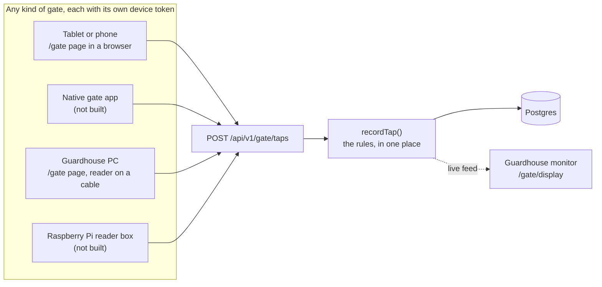
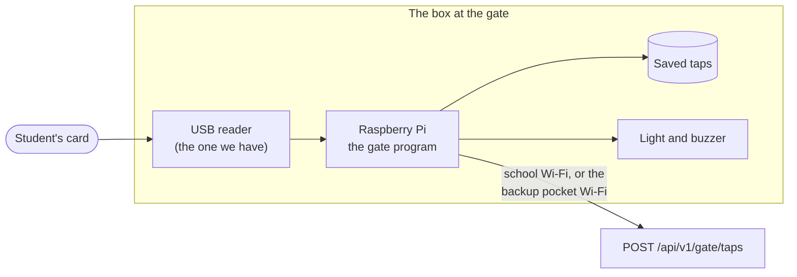
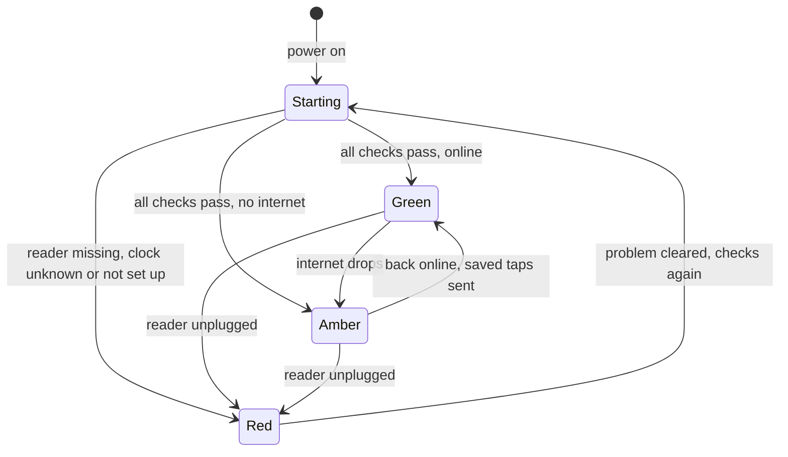
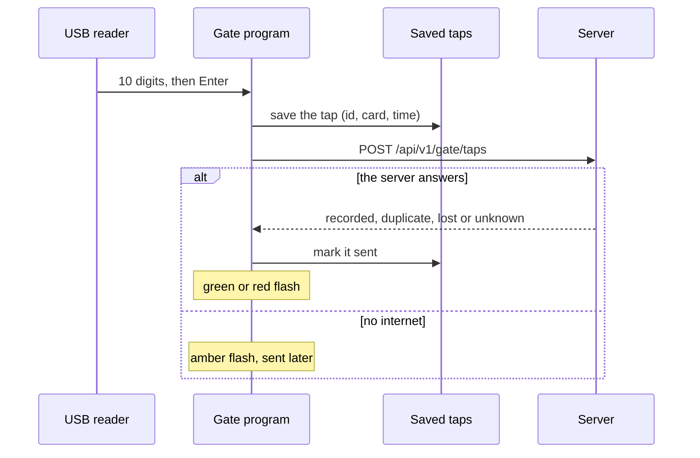

# Gate hardware: which kind of gate for which school

A discussion document, started on 2026-10-14 and kept up to date as decisions are made. Schools differ: some have Wi-Fi at the gate and some don't, some want a screen there and some only a reader. So Bantay Aral can offer more than one kind of gate.

**Nothing here changes the plan.** The pilot keeps the planned setup: the `/gate` page on an Android tablet with the USB reader (Step 47, built), with offline taps next (Step 58). For what happens to a tap once it reaches the server, see `docs/GATE.md`.

## Contents
- [The one idea: the server doesn't care what's at the gate](#the-one-idea-the-server-doesnt-care-whats-at-the-gate)
- [Which gate for which school](#which-gate-for-which-school)
- [Options 1 and 2: the `/gate` page in a browser (the plan)](#options-1-and-2-the-gate-page-in-a-browser-the-plan)
- [Option 3: a native Android gate app](#option-3-a-native-android-gate-app)
- [Option 4: a reader wired to the guardhouse PC](#option-4-a-reader-wired-to-the-guardhouse-pc)
- [Option 5: the Raspberry Pi reader box](#option-5-the-raspberry-pi-reader-box)
- [Option 6: an ESP32 Wi-Fi reader board](#option-6-an-esp32-wi-fi-reader-board)
- [Assigning a device to a school: pairing codes](#assigning-a-device-to-a-school-pairing-codes)
- [Backups, whatever the gate](#backups-whatever-the-gate)
- [Decisions and open questions](#decisions-and-open-questions)
- [Quick recipes](#quick-recipes)

## The one idea: the server doesn't care what's at the gate

Every gate does three things:
1. read a card;
2. give the tap its own id and the time;
3. send `{ clientTapId, cardSerial, clientTappedAt }` to `POST /api/v1/gate/taps`, with its device token.

Everything else is decided on the server, in `recordTap()`: whose card it is, double reads, lost cards, time in or time out, and who gets notified. It already copes with taps that arrive late (the gate's own time is kept if it's up to 7 days old), twice (the same tap id gets the same answer and isn't stored again) or out of order (the 2-minute double-read window looks both ways). So a tablet page, a phone app and a box with a reader are just different gates. A school's choice of hardware never means a backend rewrite, and one school can mix them.

## Which gate for which school

| | At the gate | What the student gets | Needs | Status |
|---|---|---|---|---|
| **1. Tablet + USB reader** (the plan) | A tablet, with the reader plugged in | Photo, name, Time in or Time out | Wi-Fi at the gate, power, a stand | Built (Step 47). Offline taps: Step 58 |
| **2. Android phone or tablet with its own NFC** | The device only | Same as 1 | Same as 1, in Chrome | Built: the "Use this tablet's NFC" button |
| **3. Native Android gate app** | A tablet or phone | Same as 1 | Same as 1 | Not built (an idea) |
| **4. Reader wired to the guardhouse PC** | The reader only | The reader's own beep | A PC used only for this, a cable, a UPS | Works today, no new code |
| **5. Raspberry Pi reader box** | The reader, a light and a buzzer | A green, amber or red light, and a sound | Power, and Wi-Fi, a network cable or a SIM | Not built (owner interested, 2026-10-14) |
| **6. ESP32 Wi-Fi reader board** | One small box | A light and a sound | Power and Wi-Fi | Not built (an idea) |

In every option the guard can watch each student's photo and name on the guardhouse monitor (`/gate/display`). With no screen at the gate (options 4 to 6), that monitor is the identity check.

## Options 1 and 2: the `/gate` page in a browser (the plan)

What the page already does on the tablet: it keeps its token, the roster and the photo thumbnails in the browser's storage, reads the USB reader with no text box (so no on-screen keyboard pops up), asks the screen to stay on, and shows an orange bar when it doesn't have the keyboard. In Chrome on Android it can also read cards with the device's own NFC. Step 58 adds offline taps.

Its weak spots at an unattended gate:
- Clearing Chrome's data wipes the token, the roster, the photos and any taps waiting to be sent.
- After a power cut or a restart, someone has to open the page again. Chrome doesn't; a kiosk browser app can.
- The USB reader only works while the page has the keyboard.
- The device's own NFC works only in Chrome, needs someone to tap "Use this tablet's NFC" each time the page opens, and may not work in kiosk browser apps (test first). The card goes where the NFC antenna is, usually the back, so the stand has to leave that spot open.

Free ways to harden it, with no code:
- Android's app pinning (some phones call it "pin windows") keeps Chrome on the gate page.
- Developer options → Stay awake keeps the screen on while charging.
- The tablet's own battery rides through brownouts.
- Tap a test card each morning.

## Option 3: a native Android gate app

What an app adds over the page:
- Its own storage, which clearing Chrome's data can't touch. Only uninstalling removes it.
- It opens by itself after a power cut, set as the tablet's home app.
- It gets every scan from the USB reader, whatever was last touched on screen, and can tell when the reader is unplugged.
- The device's own NFC is on whenever the app is open, with no button.

What it costs: a second app to build and keep up. Updates need a new build (or an over-the-air update, for code-only changes) instead of arriving with every deploy.

iPhones can't use their own NFC for a gate either way: iOS reads NFC only in a pop-up a person has to open. iPhones and iPads can still use the USB reader with the page.

**One app or two?** A gate mode inside the parent app can work, but `docs/PARENT-APP-BRIEF.md` rules it out on purpose ("Parents only, always"). The suggestion is **one codebase, two apps.** Expo can build two apps from one project, each with its own name and package id. The gate app reuses the parent app's code, colours and tap card, and:
- parents never meet a "parent or staff?" question that exists only for one or two tablets per school;
- the gate's device settings (screen always on, starts by itself, locked to one app, NFC) stay out of the app parents download;
- a fix to one never forces an update of the other;
- it's Android only, and installs straight onto the school's tablets, with no Play Store.

If one app is wanted anyway: no question on the first screen, just a small "Set up this device as a gate" link on the Android sign-in screen.

## Option 4: a reader wired to the guardhouse PC

The reader sits at the gate, and a cable runs to a PC in the guardhouse that shows `/gate` full screen. The guard sees each student's photo on the PC, so it doubles as the monitor. It works today, with no new code: it's the same page as the tablet's.

- **The PC is used only for this.** If someone opens another window, the reader types the next cards into it. Chrome's kiosk mode (Chrome started with `--kiosk`) keeps the page in front.
- **The PC stays on, with a UPS** for brownouts. A tablet has its own battery; a PC doesn't.
- **Cable length:** a plain USB cable reaches about 5 m. Longer needs an active USB extension cable, or an extender that runs over a network cable.
- **The student only hears the reader's own beep,** which means "card seen", not "recorded". The guard confirms on screen.

## Option 5: the Raspberry Pi reader box

A Raspberry Pi is a complete small computer on one board, about the size of a credit card, with Wi-Fi built in. The USB reader plugs into it, and a light and a buzzer are wired to it. It runs one small Bantay Aral program, with no screen, no browser and no keyboard. So **no PC is needed: the box is the computer.**

### Turning it on

Plug in the power. Nothing else.
1. The Pi starts up, in under a minute.
2. The gate program starts by itself (the system runs it as a service).
3. It checks itself: is the reader there, is the clock right, is the box set up for a school, is there internet.
4. The light goes **green** (ready) or **amber** (ready, no internet yet).

Nobody presses a button, opens a browser or types anything, and the same happens after every power cut.

### The lights

| Light | Means | Takes taps? |
|---|---|---|
| Green | Ready and connected | Yes |
| Amber | Ready, but no internet: taps are saved on the box and sent later | **Yes** |
| Red | Can't take taps: the reader is missing, the clock can't be trusted, the storage is full, or the box isn't set up (or its token was switched off) | No |
| Off | No power, or starting up | No |

After each tap the light flashes for a moment, with a sound, then goes back:

| Flash | Means |
|---|---|
| Green, short beep | Recorded, or already tapped in the last 2 minutes. Either way, the student can go |
| Amber, short beep | Saved on the box, to be sent when the internet is back |
| Red, long buzz | See the guard: a lost card, or a card that isn't linked |

**No internet is amber, not red.** That's the most important rule: a missing connection never stops taps. Many USB readers also beep by themselves on every read, so the box's "see the guard" sound has to be clearly different.

### A tap, step by step

1. A card touches the reader, which types its 10 digits and presses Enter.
2. The program reads them straight from the reader. There's no window, so there's no keyboard focus to lose.
3. It gives the tap an id and the time, and **saves it on the box first**.
4. It sends the tap to the server.
5. The server's answer picks the flash and the sound, and the saved tap is marked as sent.
6. If sending fails, the tap stays saved (amber flash) and is sent later, oldest first. Because the id was made on the box, a tap sent twice still counts once.

Because every tap is saved before it's sent, a power cut, a crash or a dropped connection halfway through never loses one.

### When something goes wrong: how it fixes itself

| What happens | What the box does by itself | If that doesn't fix it |
|---|---|---|
| The internet drops | Amber. Keeps taking and saving taps, reconnects by itself, tries the backup network, and sends what's saved once it's back | Check the school Wi-Fi, or the pocket Wi-Fi's load |
| The gate program crashes | The system restarts it within seconds | — |
| The whole box freezes | The Pi's built-in watchdog notices and restarts it | — |
| A power cut | Starts by itself when the power returns. Saved taps are still there, and the clock is still right (its battery) | — |
| The reader is unplugged or stops answering | Red. Keeps looking, and goes back to green by itself when the reader is back | Unplug and replug the reader |
| The memory card wears out or is damaged (the most common real Pi failure, often from power cuts) | Mostly prevented: a high-endurance card, a read-only system with the taps kept apart, and a UPS | Swap in the spare card kept at the school (a minute's job) |
| Nobody notices a box is down | Checks in with the server every few minutes, so staff can see "offline since 7:42" | — |
| The box is dead | — | Use the backup gate (see [Backups](#backups-whatever-the-gate)) |

**The guard's whole job:** if the light stays red, replug the reader. Still red: unplug the box's power for 10 seconds. Still red: call, and use the backup gate.

### Internet: Wi-Fi, a cable or a SIM

| Connection | How | Cost | Notes |
|---|---|---|---|
| School Wi-Fi | The box joins it, like a phone | Free | The signal at the gate may be weak; a Wi-Fi extender helps |
| A network cable | Into the Pi's network port | A cable | The most reliable, if a cable can reach |
| Pocket Wi-Fi with a prepaid SIM (Globe, Smart, DITO) | The box knows it as a second Wi-Fi network and switches to it by itself | About ₱800–1,500 for the device (older listings), plus load | The simplest backup, and a tablet gate can use it too. Keep it on power, and check the model is fine plugged in all day |
| A SIM dongle or SIM board in the box | The Pi uses the SIM directly | The part, plus load | One gadget fewer, more setup |

**Suggested:** the school Wi-Fi (or a cable) first, and a pocket Wi-Fi as the backup, on the same power as the box. The box reports which network it's on, so staff can see when it's running on backup data.

**A detail for when it's built:** the Pi's own system moves to the backup by itself only when the school Wi-Fi disappears. When the Wi-Fi is still there but the school's internet is down, the gate program has to notice (the server stops answering), switch to the backup, and try the school's Wi-Fi again every few minutes.

**Data used: small** (an estimate). About 1,000 taps on a school day (500 students, in and out), a few KB each, plus the check-ins, comes to well under 1 GB a month. A box running only on the SIM still fits a small monthly promo. Don't let a SIM-only box download system updates: one big update can use more data than a month of taps.

### Power

The box uses a few watts, about as much as a phone charger: about ₱50 a month in electricity for the box and a pocket Wi-Fi left on all the time (an estimate, at about ₱12 per kWh). For brownouts, a small UPS, or a power bank that can charge and power at the same time, keeps the box and the pocket Wi-Fi running. The school's own router loses power in a brownout too, which is why the pocket Wi-Fi belongs on the backup power. Saved taps survive a power cut anyway; backup power just keeps the taps flowing during one.

### The clock matters

Each tap carries the box's own time, so a tap saved while offline keeps the moment it happened. The server only overrules a device clock that's more than 5 minutes ahead or more than 7 days behind (`chooseTapTime` in `src/services/taps/tap-time.ts`). So a box whose clock was an hour off would record every offline tap an hour off, and the server would accept them.
- The **Raspberry Pi 5** has a clock built in, which keeps time with the power off once its small battery is fitted.
- Older and smaller models (the Pi 4, the Zero 2 W) have no such clock, and need a clock module added.
- The program treats a time it can't trust as red, rather than guess.

### What's in the box, and roughly what it costs

List prices as of October 2026. Raspberry Pi raised its 2 GB models on 1 October 2026; the 1 GB models didn't change. Local shops charge more, so check before quoting a school.

| Part | Why | Rough price |
|---|---|---|
| Raspberry Pi 5, 1 GB | Plenty for one small program, and the clock is built in | about US$45–50 |
| Its clock battery | Keeps the time through power cuts | about US$6 |
| The official power supply | Steady power; a weak charger causes odd faults | about US$12 |
| A high-endurance microSD card, 32 GB | Lasts much longer than an ordinary card | about US$10–15 |
| A case, a light (or a small "traffic light" board) and a buzzer | What the student sees and hears | about US$10–15 |
| A weatherproof box | It's outdoors | about US$5–10 |
| **Total, before the reader** | | **about US$90–110, roughly ₱5,000–6,500** (at about ₱58 to the dollar) |

Plus the USB reader (we have one), and if wanted, a pocket Wi-Fi and a small UPS. Instead of the USB reader, an NFC module can be wired to the Pi. It reads the card's full 7-byte ID, where the USB reader sends only the first 4 bytes.

**An honest comparison:** that's about the price of a budget tablet, not less. The box wins on other things: only a cheap reader sits outside to be rained on, dropped or stolen; it starts and fixes itself; it never loses the keyboard; and it keeps no names or photos. The cheapest option is the ESP32 board (option 6).

### Privacy

The box keeps only card numbers, tap times and tap ids, and only until they're sent. It never needs names, photos or anything else about a student. (The server's answer includes the student's name for gates with a screen; the box ignores it.) A stolen box holds nothing about students, and its token can be switched off on the server (a Devices page would make that one click).

### Setting a box up

Once, before it goes to a school:
1. Write the system and the gate program onto the memory card.
2. Add the school's gate token (from `npm run device:create` today, or a pairing code later).
3. Add the Wi-Fi networks: the school's first, the pocket Wi-Fi second.
4. Label the box and the spare card.

Later, if schools set boxes up themselves:
- the box opens its own setup Wi-Fi when it can't connect, so someone at the school picks the Wi-Fi from a phone;
- that same setup page takes a pairing code from the Devices page, instead of a token in a file.

### What the server needs

To start, **nothing**: the box uses the same tap address as the tablet, with a gate token. Later, when boxes are in real use:
- a check-in from each box every few minutes, so staff can see one that's gone quiet. Today the tablet sends none (decided 2026-10-09), but a box has no screen for anyone to notice;
- a Devices page (see [pairing codes](#assigning-a-device-to-a-school-pairing-codes));
- optionally, the list of active card numbers (no names), so the box can flash red for an unknown card even while offline.

### What would be built

A small program in its own repository, kept as simple as the gate page. It reads the reader, saves taps, sends them, runs the light and the sound, checks itself and checks in. It would be written in TypeScript (like the rest of Bantay Aral) or Python (the usual language for Pi hardware), decided when it's built.

`npm run tap:record` is the closest thing today: the reader with no browser, printing each answer in the terminal. The box would do the same over the internet (through the tap address rather than straight into the database), plus saving taps offline, the light, and starting by itself.

## Option 6: an ESP32 Wi-Fi reader board

A tiny, cheap Wi-Fi board with an NFC chip, a light and a buzzer, in one small box: no computer, no USB reader. It reads the card's full 7-byte ID and can save taps in its own memory while offline. The catch: it's programmed in C++ (firmware), which makes it the hardest to build and to update, and it needs a clock module for offline times. It's the cheapest per gate, so it's worth it once many gates are needed.

## Assigning a device to a school: pairing codes

Today a gate gets its token from `npm run device:create`, run in the terminal. For many schools, a Devices page in Settings would be better:
1. The principal clicks "Add gate" and gets a short code or a QR code.
2. It's entered once on the device: the tablet's setup screen, the app's, or the box's setup page.
3. The device is now that school's gate, until the principal switches it off.

The principal's password never sits on a shared device, and each device can be switched off on its own. The same page would show each device's last check-in, and for a box, which network it's on and how many taps are waiting. **Not planned yet.**

## Backups, whatever the gate

From the most common problem to the rarest:
1. **No internet:** taps are saved on the device and sent later (Step 58 for the tablet; built into the box). Parents are notified only once a tap reaches the server.
2. **The school's Wi-Fi is down:** a pocket Wi-Fi with a prepaid SIM, which the device switches to by itself.
3. **A brownout:** the tablet's own battery; a UPS for a PC or a box, and for the pocket Wi-Fi.
4. **The gate itself fails:** a backup gate. Any Android phone with NFC can open `/gate` in Chrome with its own gate token and read cards with its own NFC, with no extra hardware (test it with our cards first). A spare USB reader works with any laptop.
5. **Nobody noticed:** check-ins and a Devices page showing a gate that's gone quiet, and later a message to the principal (Step 59, "Know when something breaks").

## Decisions and open questions

| Date | | |
|---|---|---|
| 2026-10-14 | **Decided** (owner) | The pilot keeps the planned setup: `/gate` on an Android tablet with the USB reader, with offline taps in Step 58 |
| 2026-10-14 | **Decided** (owner) | Gate options are discussed in this document |
| | Open | Offer reader-only gates? The owner is interested in the Raspberry Pi box (option 5) |
| | Open | A native gate app: build one? If so, its own app from the parent app's codebase, or a mode inside the parent app? |
| | Open | Should a box with no screen check in every few minutes? (The tablet doesn't, decided 2026-10-09) |
| 2026-10-15 | **Decided** (owner) | A Devices page for principals and super admins, built after Step 53: add a gate or a monitor, and its token (or the monitor's link) is shown once. Pairing codes may come later. The owner is having the page's design drafted first |
| | Open | Pairing codes instead of a token shown once |
| | Open | Devices inside Settings, or its own menu item |

## Quick recipes

**A school asks which gate to get.** Start from [Which gate for which school](#which-gate-for-which-school), and ask four things: is there Wi-Fi at the gate? Do they want a screen at the gate? Is there a guardhouse with power? Who will switch it on in the morning?

**See what a reader box would do, today, on a Mac.** Run `npm run tap:record -- --token tal_dev_…`, click the terminal, and tap a sticker on the USB reader. Each line printed is what a box would act on. (More in `docs/GATE.md`, "Try the gate without the tablet".)

**Add a new kind of gate.** Make a gate device for it (`npm run device:create -- --school … --kind gate --label "…"`). Have it send `{ clientTapId, cardSerial, clientTappedAt }` to `POST /api/v1/gate/taps` with `Authorization: Bearer <token>`. Make the id on the device (a UUID), save the tap before sending it, and resend with the same id until the server answers. Nothing on the server changes.

**Try an Android phone as a backup gate.** Make a second gate device for it, open `/gate?token=…` in Chrome on an Android phone with NFC, tap "Use this tablet's NFC", and hold a card to the back of the phone.

**Re-check the prices** before quoting a school. The prices above were checked on 2026-10-14: Raspberry Pi's 1 October 2026 price change ([OMG! Ubuntu](https://www.omgubuntu.co.uk/2026/10/raspberry-pi-2gb-costs-how-much-now), [Notebookcheck](https://www.notebookcheck.net/Raspberry-Pi-announces-new-price-hikes-for-2-GB-Pi-4-and-Pi-5.1413412.0.html)), shop listings for the 1 GB Pi 5 ([BerryBase](https://www.berrybase.de/en/raspberry-pi/raspberry-pi-computer/boards/)) and its clock battery ([Kiwi Electronics](https://www.kiwi-electronics.com/en/raspberry-pi-boards-cases-addons-and-accessories-59/general-accessories-for-the-raspberry-pi-69/rtc-battery-for-raspberry-pi-5-11586)), and pocket Wi-Fi in the Philippines ([Saily](https://saily.com/blog/pocket-wifi-philippines/), older listings).
