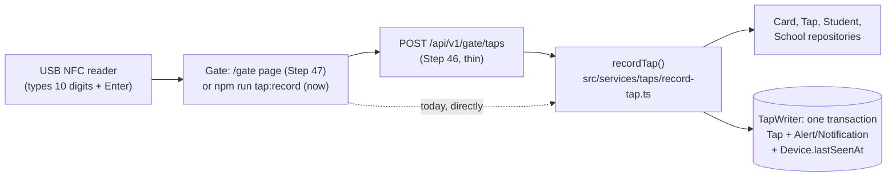
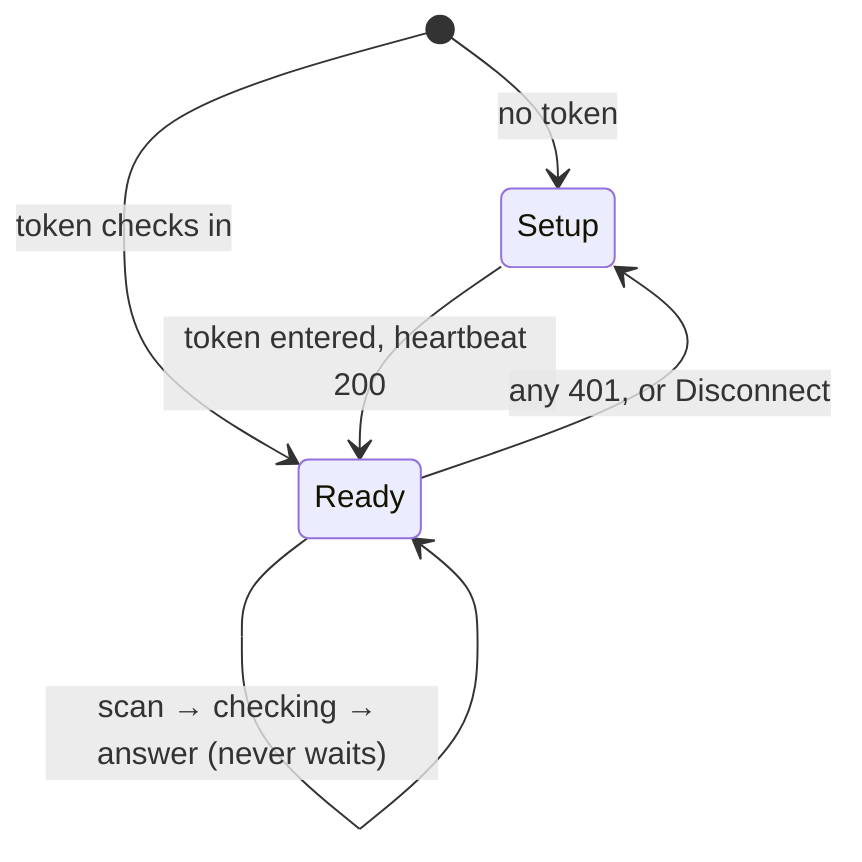
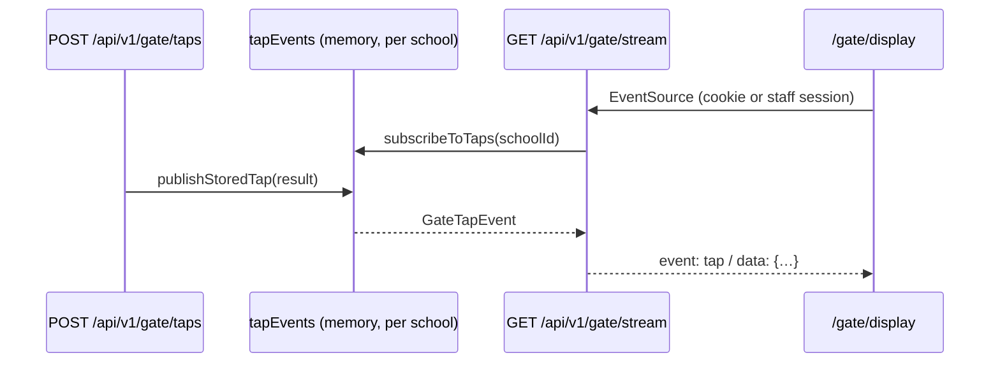

# The gate: from a card on the reader to a stored tap

How a real tap at the school gate becomes a row in the database. This page covers the server side, built in Steps 44.7 and 45. The gate's web address (Step 46), the `/gate` tablet page (Step 47) and the guardhouse monitor (Step 48) will extend it.

## The one idea to hold on to

**The gate only reports; the server decides.** The tablet sends "this card was read at this time, and this tap's id is …". Everything else lives in one plain function on the server, `recordTap()`: whose card it is, whether it's a double read, whether parents hear about it, and whether it raises an alert. The same function is called by the terminal command now and by the web address later, so the rules exist in exactly one place.



## The two addresses the gate calls (Step 46)

| Address | Answers |
|---|---|
| `POST /api/v1/gate/taps` | `{ clientTapId, cardSerial, clientTappedAt }` in, `toGateTapResponse(recordTap(…))` out. `401` for a bad token, `403` for a monitor, `400` for a bad body. An unreadable card is still `200 { "outcome": "invalid_serial" }`, because it's an answer for the screen, not an error. |
| `GET /api/v1/gate/roster` | `{ cards: [{ serial, studentId }], students: [{ id, firstName, lastName, gradeLevel, section }] }`, active cards only, with an `ETag`. Asking again with `If-None-Match` gives `304` and no body when nothing changed. |

Both start with `authenticateGate()` (`src/services/devices/authenticate-gate.ts`), which accepts only an active **gate** device. The routes themselves (`src/app/api/v1/gate/*/route.ts`) hold no rules: they check, call, and reshape.

## The `/gate` page (Step 47)

`src/app/gate/page.tsx` renders `GateKiosk` (`src/features/gate/gate-kiosk.tsx`), outside the staff shell, with no staff sign-in. The pieces:

| File | Job |
|---|---|
| `gate-client.ts` | Everything kept on the tablet (token, roster with its ETag in `localStorage`, photos in Cache Storage `talaan-gate-photos`) and the three calls (heartbeat, roster, taps). `forgetGate()` wipes it all. |
| `scan-buffer.ts` | Key presses become scans, with no input field (which would open Android's keyboard). Enter ends a scan, and a gap over 100 ms starts over, so a person's slow typing never becomes a card. |
| `repeat-filter.ts` | The same card read again within 5 seconds of its **last** read isn't sent (Step 56): a card held on a reader that re-reads it every second is sent once. The screen keeps showing that card. A read whose send fails is forgotten (`forget`), so the same card read again is tried at once. The server's 2-minute rule is still the real guard. |
| `roster-match.ts` | Who a scan probably is, from the tablet's roster, by the server's rule (exact, else the first 4 bytes, never a guess), so the photo shows before the server answers. |
| `gate-display.ts` | What the screen says for each state: checking, each outcome, or not sent. |
| `tap-card.tsx` | How each state looks (2026-10-12): `TapCard`, the newest tap (portrait, badge, name, then a TIME IN / TIME OUT stamp or what to do next), and `TapListItem`, one row of Recent. Shared with the guardhouse monitor, so both screens look alike. Time out is blue (`--status-out`). |

A scan gets its own UUID and is sent at once (unless it repeats the last card within 5 seconds). Its entry updates when its own answer arrives, so three quick taps are three requests in flight together. Any `401` from any call wipes the tablet and returns to setup.



## The guardhouse monitor (Step 48)



- **Who may watch** (`monitorViewerFrom` in `src/features/gate/monitor-viewer.ts`): a **monitor** device by its `talaan_monitor` cookie, or a principal or super admin session with a school. Never a gate device and never a teacher. The school always comes from that viewer.
- **Connecting a TV:** make a monitor device (`npm run device:create -- --kind monitor …`), then open `/gate/display/connect?key=<token>` on the TV once. The route checks it's a monitor key, sets the httpOnly cookie for 400 days, and redirects to `/gate/display`.
- **One server only:** `tapEvents` lives in the server's memory. On one Heroku dyno that's every viewer. On more than one, swap it for Postgres `LISTEN/NOTIFY` behind the same `publishTap`/`subscribeToTaps`.

## The card serial

A card's serial is its NFC UID. Your USB reader doesn't type it the way NFC Tools shows it: it sends only the **first 4 bytes**, as one **10-digit decimal number**, lowest byte first. `normalizeCardSerial` (`src/features/students/card-serial.ts`) turns anything a reader or a person types into the stored form:

```ts
if (READER_DIGITS.test(trimmed)) {
  const value = Number(trimmed);
  if (value > LARGEST_FOUR_BYTES) return null;
  const bytes = [value & 0xff, (value >>> 8) & 0xff, (value >>> 16) & 0xff, (value >>> 24) & 0xff];
  return bytes.map(toHexByte).join(":");
}
```

`0211299923` is `0x0C982E53`. Lowest byte first gives `53:2E:98:0C`, which is the start of the `53:2E:98:0C:14:00:01` NFC Tools shows. Hex (4 or 7 bytes, any separators, any case) is accepted too.

Because a card can be stored with 4 bytes or 7, both linking and matching look at the **first 4 bytes**:

- **Linking** (`checkSerial` in `card-changes.ts`, Step 44.7; checked when the card is read and again on Save) refuses a card whose first 4 bytes match another active card at the school. This reader couldn't tell the two apart.
- **Matching** (`matchCard`, Step 45) takes the exact serial first, then the card that shares the first 4 bytes. An active card beats a lost one, and two equal candidates give "unknown card" rather than a guess.

Both use `CardRepository.listBySerialPrefix(schoolId, firstFourBytes)`, one query for the exact card and any twin.

## `recordTap()`, step by step

```ts
const serial = normalizeCardSerial(input.rawSerial);
if (!serial) return { outcome: "invalid_serial" };

const stored = await deps.taps.getById(input.clientTapId);
if (stored && stored.schoolId === device.schoolId) return replay(stored, deps);

const tappedAt = chooseTapTime(input.clientTappedAt, input.receivedAt);
const candidates = await deps.cards.listBySerialPrefix(device.schoolId, firstFourBytes(serial));
const card = matchCard(serial, candidates);
const cardSerial = card?.serial ?? serial;

const previousTap = await deps.taps.findByCardBetween(device.schoolId, cardSerial, at - DEBOUNCE_MS, at + DEBOUNCE_MS);
if (previousTap) return { outcome: "duplicate", previousTap, student };
```

1. **Not a serial:** stop, store nothing.
2. **The same tap id again:** this is a resend, for example after a dropped connection. The answer is the same as the first time, worked out from the stored tap, with `replayed: true`. Nothing new is written. The tap id is made by the gate, which is what makes a resend safe.
3. **The time:** the gate's own clock, so an offline tap keeps when it happened. If that clock is more than 5 minutes ahead or more than 7 days behind the server, the server's time is used instead (`chooseTapTime`).
4. **The card:** `matchCard`. The tap stores the **card's own serial**, so a 4-byte read of a 7-byte card is stored under one serial every time. **No active or lost card of this school** (retired, none at all, or another school's) is an **unknown card**: answered `unknown_card` and **never stored** (changed 2026-10-13). It's nobody's attendance, and because nothing is stored, the same card tapped again is unknown again, never "already tapped". The guard's monitor still sees it every time.
5. **Debounce:** the same card within 2 minutes, **before or after**, is one pass through the gate. It's answered as `duplicate` with the earlier tap, and nothing is stored. "Before or after" matters once offline taps can arrive out of order. This first check is the quick one; step 7 checks again under a lock, since two reads arriving together can both pass it (Step 56).
6. **What to write:**

| Card | Tap's `studentId` | Also written | Outcome |
|---|---|---|---|
| active | the student | a notification, if `shouldNotifyParents(setting, direction)` | `recorded`, with `direction` (time in/out) and `notified` |
| lost | **none** (Step 57), so it's nobody's time in or out | a `lost_card_tapped` alert whose `studentId` is the owner | `lost_card`, naming the owner |
| retired, none, or another school's | — | **no tap stored** (step 4) | `unknown_card` |

   **Why a lost card's tap has no student (Step 57).** It used to keep the owner's `studentId`, so the alert could name them. Every attendance count reads that field, so the tap counted as the owner arriving, and turned their real arrival into a "time out" (and a "left school" push). Now the owner is on the alert, and every count leaves the tap out on its own. If it really was the owner, staff use **Record time in** (Step 55). A gate's resend of a stored tap is answered from its alert: an alert means `lost_card`, whatever the card's status is now. Staff mark an alert handled from the dashboard's "Needs attention" (principals and super admins); the dashboard loads at most 10 open alerts with their taps in one query, and the monitor and the live feed ask only about the few taps they show (`alertRepository.listForTaps`). Recipe: `docs/backend/step-57-lost-cards-and-alerts.md`.

7. **One transaction** (`TapWriter.record`): the tap, then the alert or notification, then the gate's `lastSeenAt`. If any part fails, none is kept. If the tap id turns out to be taken (two copies of one tap racing), the writer answers `"exists"` and `recordTap` gives the replay answer.

   **One read, one tap (Step 56).** Before writing anything, the transaction takes a lock on this card at this school, `pg_advisory_xact_lock(hashtextextended('tap-card|<school>|<serial>', 0))`, which Postgres frees when the transaction ends. Under it: this tap id already stored → `"exists"`; a tap of the card in the 2-minute window → `"duplicate"` (nothing written, and `recordTap` answers "Already tapped" with that tap); otherwise write. A second read of the same card waits a few milliseconds for the first to commit, then sees its tap. Reads of other cards never wait.

   ```mermaid
   sequenceDiagram
       participant A as Read 1 (card X)
       participant B as Read 2 (card X), 50 ms later
       participant DB as Postgres
       A->>DB: quick check: none
       B->>DB: quick check: none
       A->>DB: lock card X · check · insert · commit (lock freed)
       B->>DB: lock card X (waits for A)
       B->>DB: check: A's tap → "duplicate", nothing written
   ```

   It relies on Postgres's default isolation, Read Committed, where each statement sees what was committed before it started; the transaction must keep that default. A time in recorded by hand (Step 55) takes the same lock when the student has a card, with the whole school day as its window, so a gate read landing in between can't make a time in and a time out. The test that proves it, `src/services/taps/record-tap.pg.test.ts`, holds a second transaction mid-write and checks that the writer waits: without the lock it fails every time.

The direction comes from `deriveTapKind` (1st tap of the day is time in, 2nd time out, and so on, as in `docs/ATTENDANCE-MODEL.md`). Who gets notified is `shouldNotifyParents`, shared with Phase 1's `notifyParentsForTap` (`docs/NOTIFICATIONS.md`), so the gate and the demo buttons can't disagree.

## What the result carries to a screen

`TapStudent` is only `id`, `firstName`, `lastName`, `gradeLevel` and `section`. The LRN, birth date and guardian never leave the server through a tap. A unit test checks the exact keys, so adding a field there is a deliberate decision, not an accident.

## How the files connect

```
src/features/students/card-serial.ts     normalizeCardSerial, firstFourBytes, findSerialConflict (44.7)
src/features/students/card-actions.ts    checkCardSerial: the drawer's Card serial field (44.7)
src/features/students/card-changes.ts    checkSerial, prepareCardChange: linked by the form's Save (2026-10-12)
src/features/attendance/notify-parents.ts  shouldNotifyParents: the school's notification rule
src/services/taps/match-card.ts          which card a serial means
src/services/taps/tap-time.ts            which time a tap gets
src/services/taps/record-tap.ts          recordTap(): the whole decision
src/data/repositories/card-repository.ts listBySerialPrefix (+ Prisma version)
src/data/repositories/tap-repository.ts  findByCardBetween (+ Prisma version)
src/data/repositories/tap-writer.ts      TapWriter: the one-transaction write (Prisma version only)
scripts/record-tap.ts                    npm run tap:record: taps from the terminal
```

`recordTap(input, deps)` takes its repositories as an argument (the real ones by default), so its unit tests run against in-memory stand-ins with no database. The one thing only a real database can prove, that the transaction keeps or drops everything together, is what `npm run tap:record` exercises.

## Quick recipes

**The reader beeps but the gate does nothing.**
1. Click on the gate page. The reader types into whichever window has the keyboard, and the page shows an orange bar when it doesn't have it.
2. Click into any text box and tap. No digits there either means a USB problem: unplug and replug the reader (it happens after a computer sleeps).
3. A `db:reset` deletes the gate device, so make a new token.

Since 2026-10-12 a click on Disconnect or Cancel no longer swallows later taps (`onKey` in `gate-kiosk.tsx`).

**The gate shows initials instead of a photo.**
- Check that the student has a photo: their row in Students shows it.
- A photo added after the gate page opened appears within 5 minutes (`ROSTER_EVERY_MS`), or straight away after a reload.
- Before 2026-10-12, a reload showed initials for everyone (`photosLoadedFor` in `gate-kiosk.tsx` fixed it).

**Change how a state looks** (a colour, a word on the badge, the stamp's label). Edit the `KIND` table in `src/features/gate/tap-card.tsx`. Both the gate and the monitor follow it.

**Try the real gate page on a laptop.** Run `npm run dev`, open `http://localhost:3000/gate?token=<a gate token>`, plug in the USB reader and tap. No reader? Click the page and type a card's 10 digits quickly (or paste them), then press Enter.

**Try the gate without the tablet.** Create a gate device with `npm run device:create -- --school school-balanga --kind gate --label "Main gate tablet"` and copy the token. Run `npm run tap:record -- --token tal_dev_…`, click the terminal, and tap stickers on the USB reader. Each line printed is what the gate screen will show.

**Change the debounce window.** It's `DEBOUNCE_MS` in `src/services/taps/record-tap.ts`, and the same window goes to the writer's locked check. The tests in `record-tap.test.ts` use 1:59 (duplicate) and 2:01 (a new tap). Move them with it. The gate's own 5-second filter is `REPEAT_WINDOW_MS` in `src/features/gate/repeat-filter.ts`; `e2e/gate.spec.ts` waits past it before a second read.

**Change who gets notified.** Change `shouldNotifyParents` in `notify-parents.ts`. Both the gate and the demo buttons follow it, and its table test lists every case.

**Add a new outcome** (for example, a card that's suspended). Add it to `RecordTapResult` first. TypeScript then points at every place that has to handle it: `replay`, the branch that builds the write, and the terminal script's `describe`.
