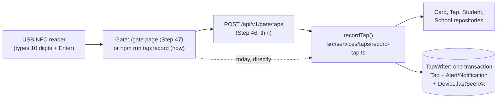

# The gate: from a card on the reader to a stored tap

How a real tap at the school gate becomes a row in the database. This page covers the server side, built in Steps 44.7 and 45. The gate's web address (Step 46), the `/gate` tablet page (Step 47) and the guardhouse monitor (Step 48) will extend it.

## The one idea to hold on to

**The gate only reports; the server decides.** The tablet sends "this card was read at this time, and this tap's id is …". Everything else lives in one plain function on the server, `recordTap()`: whose card it is, whether it's a double read, whether parents hear about it, and whether it raises an alert. The same function is called by the terminal command now and by the web address later, so the rules exist in exactly one place.



## The card serial

A card's serial is its NFC UID. Your USB reader doesn't type it the way NFC Tools shows it: it sends only the **first 4 bytes**, as one **10-digit decimal number**, lowest byte first. `normalizeCardSerial` (`src/features/students/card-serial.ts`) turns anything a reader or a person types into the stored form:

```ts
if (READER_DIGITS.test(trimmed)) {
  const value = Number(trimmed);
  if (value > LARGEST_FOUR_BYTES) return null;
  const bytes = [value & 0xff, (value >>> 8) & 0xff, (value >>> 16) & 0xff, (value >>> 24) & 0xff];
  return bytes.map(toHexByte).join(":");
}
```

`0211299923` is `0x0C982E53`. Lowest byte first gives `53:2E:98:0C`, which is the start of the `53:2E:98:0C:14:00:01` NFC Tools shows. Hex (4 or 7 bytes, any separators, any case) is accepted too.

Because a card can be stored with 4 bytes or 7, both linking and matching look at the **first 4 bytes**:

- **Linking** (`linkRealCard`, Step 44.7) refuses a card whose first 4 bytes match another active card at the school. This reader couldn't tell the two apart.
- **Matching** (`matchCard`, Step 45) takes the exact serial first, then the card that shares the first 4 bytes. An active card beats a lost one, and two equal candidates give "unknown card" rather than a guess.

Both use `CardRepository.listBySerialPrefix(schoolId, firstFourBytes)`, one query for the exact card and any twin.

## `recordTap()`, step by step

```ts
const serial = normalizeCardSerial(input.rawSerial);
if (!serial) return { outcome: "invalid_serial" };

const stored = await deps.taps.getById(input.clientTapId);
if (stored && stored.schoolId === device.schoolId) return replay(stored, deps);

const tappedAt = chooseTapTime(input.clientTappedAt, input.receivedAt);
const candidates = await deps.cards.listBySerialPrefix(device.schoolId, firstFourBytes(serial));
const card = matchCard(serial, candidates);
const cardSerial = card?.serial ?? serial;

const previousTap = await deps.taps.findByCardBetween(device.schoolId, cardSerial, at - DEBOUNCE_MS, at + DEBOUNCE_MS);
if (previousTap) return { outcome: "duplicate", previousTap, student };
```

1. **Not a serial:** stop, store nothing.
2. **The same tap id again:** this is a resend, for example after a dropped connection. The answer is the same as the first time, worked out from the stored tap, with `replayed: true`. Nothing new is written. The tap id is made by the gate, which is what makes a resend safe.
3. **The time:** the gate's own clock, so an offline tap keeps when it happened. If that clock is more than 5 minutes ahead or more than 7 days behind the server, the server's time is used instead (`chooseTapTime`).
4. **The card:** `matchCard`. The tap stores the **card's own serial** when one matched, so a 4-byte read of a 7-byte card is stored under one serial every time.
5. **Debounce:** the same card within 2 minutes, **before or after**, is one pass through the gate. It's answered as `duplicate` with the earlier tap, and nothing is stored. "Before or after" matters once offline taps can arrive out of order.
6. **What to write:**

| Card | Tap's `studentId` | Also written | Outcome |
|---|---|---|---|
| active | the student | a notification, if `shouldNotifyParents(setting, direction)` | `recorded`, with `direction` (time in/out) and `notified` |
| lost | the owner, so the alert can name them | a `lost_card_tapped` alert | `lost_card` |
| retired, none, or another school's | `null` | nothing | `unknown_card` |

7. **One transaction** (`TapWriter.record`): the tap, then the alert or notification, then the gate's `lastSeenAt`. If any part fails, none is kept. If the tap id turns out to be taken (two copies of one tap racing), the writer answers `"exists"` and `recordTap` gives the replay answer.

The direction comes from `deriveTapKind` (1st tap of the day is time in, 2nd time out, and so on, as in `docs/ATTENDANCE-MODEL.md`). Who gets notified is `shouldNotifyParents`, shared with Phase 1's `notifyParentsForTap` (`docs/NOTIFICATIONS.md`), so the gate and the demo buttons can't disagree.

## What the result carries to a screen

`TapStudent` is only `id`, `firstName`, `lastName`, `gradeLevel` and `section`. The LRN, birth date and guardian never leave the server through a tap. A unit test checks the exact keys, so adding a field there is a deliberate decision, not an accident.

## How the files connect

```
src/features/students/card-serial.ts     normalizeCardSerial, firstFourBytes, findSerialConflict (44.7)
src/features/students/card-actions.ts    linkRealCard: the drawer's Card serial field (44.7)
src/features/attendance/notify-parents.ts  shouldNotifyParents: the school's notification rule
src/services/taps/match-card.ts          which card a serial means
src/services/taps/tap-time.ts            which time a tap gets
src/services/taps/record-tap.ts          recordTap(): the whole decision
src/data/repositories/card-repository.ts listBySerialPrefix (+ Prisma version)
src/data/repositories/tap-repository.ts  findByCardBetween (+ Prisma version)
src/data/repositories/tap-writer.ts      TapWriter: the one-transaction write (Prisma version only)
scripts/record-tap.ts                    npm run tap:record: taps from the terminal
```

`recordTap(input, deps)` takes its repositories as an argument (the real ones by default), so its unit tests run against in-memory stand-ins with no database. The one thing only a real database can prove, that the transaction keeps or drops everything together, is what `npm run tap:record` exercises.

## Quick recipes

**Try the gate without the tablet.** Create a gate device with `npm run device:create -- --school school-balanga --kind gate --label "Main gate tablet"` and copy the token. Run `npm run tap:record -- --token tal_dev_…`, click the terminal, and tap stickers on the USB reader. Each line printed is what the gate screen will show.

**Change the debounce window.** It's `DEBOUNCE_MS` in `src/services/taps/record-tap.ts`. The tests in `record-tap.test.ts` use 1:59 (duplicate) and 2:01 (a new tap). Move them with it.

**Change who gets notified.** Change `shouldNotifyParents` in `notify-parents.ts`. Both the gate and the demo buttons follow it, and its table test lists every case.

**Add a new outcome** (for example, a card that's suspended). Add it to `RecordTapResult` first. TypeScript then points at every place that has to handle it: `replay`, the branch that builds the write, and the terminal script's `describe`.
