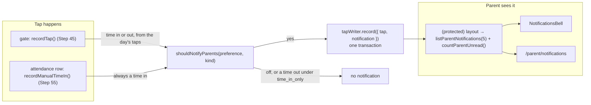

# How parent notifications work (Step 24)

SMS was dropped from the plan on 2026-09-22; this is the **in-app channel only** — a bell and a feed inside the parent portal, driven by the same simulated-tap mechanism the staff dashboard already uses. This doc covers the whole mechanism: how a tap becomes a notification, who sees it, and where the Phase 1 simplifications are.

Where this goes next: Phase 2 turns the `Notification` row into a notification outbox (written in the same transaction as the tap, then sent by a worker), and Phase 3 delivers it as real push to a separate parent-only Expo app through Firebase Cloud Messaging. See `docs/ARCHITECTURE.md`.

## The one idea to hold on to

**A notification is created once, at tap time — never derived at read time.** When a tap is recorded, the app immediately decides (from the school's preference) whether parents should hear about it, and writes one `Notification` row. When a parent later opens their bell or feed, the app just *reads* that row — it never re-derives anything. This is the opposite of how attendance status works (`docs/ATTENDANCE-MODEL.md`: present/late/absent are computed on read from raw taps), and for a good reason: a school's notification preference is a *moment-in-time* decision. If the principal turns notifications off tomorrow, yesterday's "your child tapped in" should still be in the feed — the parent was told, and the record of being told should survive the setting change.

Everything else in this file is a consequence of that one idea.

## The shape of it

A notification is a small, flat record (`src/features/parents/schemas.ts`):

```ts
notificationSchema = z.object({
  id: z.string().min(1),
  schoolId: z.string().min(1),
  studentId: z.string().min(1),
  kind: z.enum(["time_in", "time_out"]),
  tappedAt: z.iso.datetime(),
  read: z.boolean(),
});
```

Two deliberate design choices, both documented at the schema itself:

- **It copies the tap's data (`studentId`, `tappedAt`) rather than referencing the tap by id.** No `tapId` foreign key in Phase 1 — the mock layer has nothing real to join against, and a flat copy is simpler and works forever. Phase 2 can add `tapId` once a real Tap API exists.
- **It has no `parentId`.** A notification is "about student X tapping", not "for parent Y". Parents are joined in through `ParentStudentLink`s at read time, which is what makes one notification serve every guardian of a child.

`kind` is *derived from the tap sequence* (never stored as a label on a tap — same "derive, don't store" principle as attendance): a student's 1st tap of the day is a time-in, the 2nd is a time-out, the 3rd is a time-in again, and so on. That rule lives in `deriveTapKind()` (`src/features/attendance/status.ts`) and counts only that student's same-day taps strictly before this one (same-timestamp ties break by id, so the sequence is always deterministic).

## The flow, end to end



The rule is one function, `shouldNotifyParents` (`src/features/attendance/notify-parents.ts`):

```ts
export function shouldNotifyParents(preference: NotificationPreference, kind: NotificationKind): boolean {
  if (preference === "off") return false;
  return kind === "time_in" || preference === "time_in_and_time_out";
}
```

### The two places a tap is written

1. **The gate**, `recordTap()` (`src/services/taps/record-tap.ts`, Step 45): works out time in or time out from the student's taps that day, asks `shouldNotifyParents`, and hands the tap, any lost-card alert and any notification to `tapWriter.record()`, which writes them **in one transaction**. A lost card raises an alert instead of a notification (telling a parent "your lost card was tapped" before staff has seen it would be noise), and an unknown card has nobody to notify.
2. **A time in recorded by hand**, `recordManualTimeIn()` (`src/services/taps/record-manual-time-in.ts`, Step 55): always a time in, so it asks `shouldNotifyParents(preference, "time_in")` and writes through the same `tapWriter`. Its fixed id per student per day means a second click can't send a second notification (`docs/ATTENDANCE-MODEL.md`, "Recording a time in by hand").

Until Step 55.1 a third place existed: the `/station` simulated kiosk and the dashboard's "Simulate a tap" wrote the tap first and the notification after, through a helper called `notifyParentsForTap`. Both are gone, and so is the helper: every notification is now written in the same transaction as its tap.

## Reading it back: the parent side

Since Step 53.2 the read path is `src/services/parents/notifications.ts`, and it never loads a parent's whole history (`docs/SCALING.md` 2.2):

- **`listParentNotifications(parentId, { before, limit })`** gives one page, newest first by `(tappedAt, id)`. For each linked child, one after another, it asks for at most `limit + 1` below the cursor (`listPageForStudent`), then merges them in the same order and keeps `limit`. A notification goes out with only the child's name, because the bell and the feed are browser components.
- **`countParentUnread(parentId)`** counts each child's unread, newest first so Postgres can stop early, and stops at 10. The bell shows "9+" from 10, so counting further would be wasted work.
- **The cursor** (`src/features/parents/notification-cursor.ts`) is base64url of `<tappedAt>|<id>`, in `?before=` on the web and the API's `nextBefore`. A bad one means the first page. Ids must be a lowercase UUID or the seed's `notification-0001`: Postgres's `en_US` collation skips hyphens on its first pass, so for ids of other shapes it can order two tied rows differently from JavaScript (`docs/PROBLEMS-LOG.md`, P-017).

Its two consumers:

- The **bell** (`NotificationsBell`, rendered in `src/app/parent/(protected)/layout.tsx`'s header) gets the five newest and the count. The actions' `refresh()` re-renders the layout, which is how the badge clears in place after "Mark all as read".
- The **page** (`/parent/notifications`) shows 30, grouped by day, with "Show older" and "Back to newest". "Mark all as read" shows from the count, so unread items on older pages still show it.

Each child is read within their own link's `schoolId`, the school the server checked when the child was linked. Since Step 53 a `Parent` has no school of its own, so one account can follow children at several schools. The layout and the page share one read of the links per render (`src/features/parents/parent-links.ts`, React's `cache`).

Marking read goes through two server actions in `src/features/parents/notification-actions.ts`, both gated on `getParentSession()`. Each is one write, limited to each of the parent's linked children **at that child's school** (`markReadForChildren`, `markAllReadForChildren`), so a parent can only mark their own children's notifications read, and another parent's id gets the same answer as a made-up one:

- `markNotificationRead(id)` — one item (the bell's item click and the feed's unread-row click).
- `markAllNotificationsRead()` — everything currently unread (the bell's and the page's "Mark all as read" buttons).

## Pushing it to the phone (Step 54)

The `Notification` row is also the push outbox. `pushedAt` stays null until the push worker has made one `PushDelivery` per phone, in the same transaction that sets it. The worker then sends them through Expo. Any code that writes a notification should call `wakePushWorker()` afterwards, so the push goes at once rather than at the next 5-minute check. The gate route and `recordTimeIn` do. The full story is in `docs/PUSH.md`.

## Where Phase 1 deliberately simplifies

- **Shared read state.** One `read` flag per notification, shared by every guardian of the same child — Step 20's approved model, no schema change. Phase 2 moves to per-parent records.
- **Live taps can only be time-ins today.** The simulate button and the station only ever produce a student's first tap of the day, so a *live* time-out notification can't be created in Phase 1. The alternation logic (`deriveTapKind`) and the preference gating are unit-tested instead (`status.test.ts`, `notify-parents.test.ts`), and the seed data includes a `time_out` notification so the rendering is real on screen.
- **No pagination or search on the feed.** The mock data is tiny; both arrive with Phase 2's database. The page already says so in its own comment.

## Quick recipes

**I want a new way to record taps.** Build the tap and, when `shouldNotifyParents(school.notificationPreference, kind)` says so, its notification, then write both with `tapWriter.record()` so they're saved together or not at all, as `recordTap()` and `recordManualTimeIn()` do. Call `wakePushWorker()` afterwards when a notification was written (Step 54). Taps with `studentId: null` notify nobody, and a lost-card tap raises an alert instead.

**I want to change when notifications fire.** Edit `shouldNotifyParents()` (`src/features/attendance/notify-parents.ts`). Every combination of setting and kind has a unit test in `notify-parents.test.ts`; extend those before the behavior. Both tap writers use it, so they can't disagree.

**I want a new screen to show notifications.** Call `listParentNotifications(parentId, { before, limit }, deps)` from `src/services/parents/notifications.ts`: it returns one page of `{ notification, student }` (the student's id and name only), newest first, and `nextBefore` for the next page. Never load every notification. Reuse `notificationKindLabel()` for the "tapped in / tapped out" wording and `formatTapTime()`/`formatTapDate()` for the times, so every screen spells and formats them identically.

**I want per-parent read state (Phase 2).** Add a `parentId` to the notification records (or a separate read-receipt table), and update `countUnreadForStudent`, `markReadForChildren` and `markAllReadForChildren` in the notification repository, and their callers in `src/services/parents/notifications.ts`, which funnels every read, count and mark through one function each.

**I want to see the full sequence of a student's taps (bell → details, Phase 2).** The `Notification` carries no tap list — it's a flat copy. Join back through `tapRepository.listByStudent(notification.studentId)` filtered to the same day, or wait for the Phase 2 `tapId` column and join directly.
