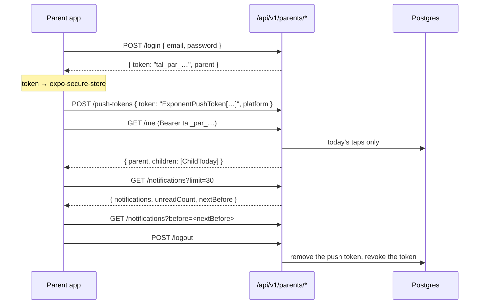

# The parent API

The contract between this backend and the Bantay Aral parent app (Expo, its own repository). Every address the app may call is here, with a `curl` example and a real answer from the local server. The app's repository keeps a copy of this file as `docs/TALAAN-API.md` (`mobile/README.md`, "How to start the new repository"). **When this file and the app's starter kit (`mobile/starter/`) disagree, this file wins.** Built in Steps 53.3 (sign-in) and 53.4 (notifications, push tokens, photos); Step 55.6 added the password reset.

Rules for changing it: a new field may be added at any time, since the app ignores fields it doesn't know. Renaming or removing a field, or changing what a status code means, needs a new version (`/api/v2/…`), because phones already in parents' hands still call the old one.

**These values never change in `/api/v1`** (Step 59.6): a day's `status` (`present`, `late`, `absent`, `idle`), a tap's `kind` (`time_in`, `time_out`) and a school's `notificationPreference` (`off`, `time_in_only`, `time_in_and_time_out`). The app drops a child it can't read, so a new value would hide that child on every phone not yet updated; a new value means `/api/v2`. A test holds the server to it (`src/features/parents/api-responses.test.ts`). A new **notification** `kind` may still be added, as `guardian_linked` was: the app must hide a kind it doesn't know. A day with no class (Step 63, later) will come as `flexible: true` plus a new field, never a fifth status.



## Basics

- **Server:** `EXPO_PUBLIC_API_URL` in the app, for example `https://bantayaral.herokuapp.com`. Locally, `http://localhost:3000`.
- **JSON** in and out. Send `Content-Type: application/json` with every body.
- **Times** are ISO strings with the school's offset, `2026-06-19T07:56:00.000+08:00`. Show them on the school's clock, whatever the phone's time zone.
- **Dates** are `YYYY-MM-DD` on the school's calendar.

## Signing in, and the token

- Sign-up and login answer with a `token` starting `tal_par_`. It's shown once. Keep it in `expo-secure-store`, never in AsyncStorage or a log.
- Send it on every other request: `Authorization: Bearer tal_par_…`.
- One token per phone. It works until the parent signs out on that phone, or until it goes **30 days without being used** (owner decision, 2026-10-19; it was 90). Any request keeps it alive, so **call the API every time the app opens and every time it comes back to the foreground** (`/me`, and register the push token): a parent who opens the app at least once a month never signs in again. After 30 days unused, the sign-in is deleted with its push address, pushes stop, and the next request gets `401`.
- **Any `401` means signed out.** Clear the token and everything cached, and show sign-in.
- The server stores only the token's sha256. Signing out revokes it at once.

```bash
curl -s -X POST http://localhost:3000/api/v1/parents/login -H 'Content-Type: application/json' \
  -d '{"email":"parent-one@balanga.example","password":"Talaan123!","deviceLabel":"curl"}'
TOKEN=tal_par_…   # from the answer
```

## The addresses

| Method and address | Token | Body or query | Success |
|---|---|---|---|
| `GET /api/v1/parents/schools` | no | | `200 { schools: [{ id, name }] }` |
| `POST /api/v1/parents/signup` | no | `{ firstName, lastName, mobile, email, password, deviceLabel? }` | `201 { token, parent }` |
| `POST /api/v1/parents/login` | no | `{ email, password, deviceLabel? }` | `200 { token, parent }` |
| `POST /api/v1/parents/password-reset` | no | `{ email }` | `202 {}` |
| `POST /api/v1/parents/password-reset/confirm` | no | `{ email, code, password, deviceLabel? }` | `200 { token, parent }` |
| `POST /api/v1/parents/logout` | yes | | `204` |
| `GET /api/v1/parents/me` | yes | | `200 { parent, children: [ChildToday] }` |
| `POST /api/v1/parents/children` | yes | `{ schoolId, lrn, lastName, birthDate }` | `201 { child: ChildToday }` |
| `GET /api/v1/parents/children/:id/taps` | yes | `?date=YYYY-MM-DD` (today if left out) | `200 { date, status, flexible, taps: [{ at, kind }] }` |
| `GET /api/v1/parents/notifications` | yes | `?before=<nextBefore>&limit=30` | `200 { notifications: [Item], unreadCount, nextBefore }` |
| `POST /api/v1/parents/notifications/:id/read` | yes | | `204` |
| `POST /api/v1/parents/notifications/read-all` | yes | | `204` |
| `POST /api/v1/parents/push-tokens` | yes | `{ token, platform }` | `204` |
| `GET /api/v1/photos/<key>` | yes | the path in `child.photo` | `200`, the image |

### The shapes

```ts
type ParentJson = { id: string; firstName: string; lastName: string; email: string; mobile: string };

type ChildToday = {
  id: string;
  firstName: string;
  lastName: string;
  gradeLevel: number; // 7 to 12
  section: string;
  photo: string | null; // "/api/v1/photos/…", loaded with the same token
  school: { id: string; name: string; notificationPreference: "off" | "time_in_only" | "time_in_and_time_out" };
  today: {
    date: string;
    status: "present" | "late" | "absent" | "idle"; // idle: no tap yet
    flexible: boolean; // a weekend: no late or absent
    timeIn: string | null; // the first tap: the arrival, which present or late comes from
    timeOut: string | null; // the last tap, only when it's a time out (none after in, out, in)
    tapCount: number;
    latest: { at: string; kind: "time_in" | "time_out" } | null; // the newest tap (Talaan Step 59.3); with one tap, the time in
  };
};

type Item = {
  id: string;
  childId: string;
  childName: string; // "Juan Cruz"
  kind: "time_in" | "time_out" | "guardian_linked";
  at: string;
  read: boolean;
  // guardian_linked only (Step 55.2): who linked; null once their account is deleted.
  guardian?: { firstName: string; lastName: string } | null;
};
```

### `GET /schools`, `POST /signup`, `POST /login`

```bash
curl -s http://localhost:3000/api/v1/parents/schools
```

```json
{"schools":[{"id":"school-balanga","name":"Balanga City National Science High School"},{"id":"school-crimsonridge","name":"Crimson Ridge National High School"},{"id":"school-oceanview","name":"Oceanview National High School"}]}
```

Sign-up asks for no school: one account covers children at any number of schools, and each child is linked with its own. There's no `confirmPassword`; the app checks that itself if it asks twice. A sign-up sent again after a lost answer gets `409 conflict` ("email taken"): the app treats that as "sign in instead". `deviceLabel` is a name the parent could recognise later, such as the phone's model.

### `POST /password-reset` and `POST /password-reset/confirm` (Step 55.6)

A parent who forgot their password gets a 6-digit code by email, then sends it with a new password. Two screens in the app:

1. **Email.** `POST /password-reset { email }`. The answer is `202 {}` for **any** email that passes the limits, whether or not it has an account, so show the same text every time: "If that email belongs to a parent account, we've sent a 6-digit code to it. It works for 15 minutes." The email arrives within a minute, subject "Your Bantay Aral password reset code", the code in the body (never the subject).
2. **Code and new password.** `POST /password-reset/confirm { email, code, password, deviceLabel? }`. The answer is the same as login, `200 { token, parent }`: store the token, then **register the push address again**, because the reset removed it.

```bash
curl -s -X POST http://localhost:3000/api/v1/parents/password-reset -H 'Content-Type: application/json' \
  -d '{"email":"parent-one@balanga.example"}' -w " %{http_code}\n"
# {} 202   ← and the npm run dev terminal shows the email, with the code

curl -s -X POST http://localhost:3000/api/v1/parents/password-reset/confirm -H 'Content-Type: application/json' \
  -d '{"email":"parent-one@balanga.example","code":"<the 6 digits>","password":"Talaan123!","deviceLabel":"curl"}'
# {"token":"tal_par_…","parent":{…}}
```

- **Keep only the email between the two screens**, in the screen's state, not SecureStore. A code field: `keyboardType="number-pad"`, `textContentType="oneTimeCode"` (iOS) and `autoComplete="one-time-code"` (Android), so the keyboard can offer the code from the email. Trim it and check it's 6 digits before sending.
- **A code works for 15 minutes, once, and for 5 tries.** Only the newest code works: asking again makes the older one useless. Offer "Send a new code", waiting 30 seconds after each send.
- **Every failed code gets one answer**, `400 invalid_code`: wrong, expired, used up, replaced by a newer one, or an email with no account. Show its message and keep what was typed.
- **A reset signs the parent out everywhere else:** every other phone's token stops working (its next request gets `401`) and its push address is removed; every web portal session ends. The parent gets "Your Bantay Aral password was changed" by email.
- **Limits:** 3 codes per email and 20 requests per network in an hour (`429 too_many_tries`), at most 5 codes per parent a day (past that, nothing more is sent, with the same `202`), and wrong codes count with wrong passwords against the network's 30 in 15 minutes.
- **A `5xx` after confirm** (the server failed after the code was accepted): the password may already be the new one, and the code is used. Go to sign-in with the new password.
- **`503 unavailable`** means no email can go right now: the app's 80 emails a day are used up, or the server isn't set up to send email yet. The server says so rather than answering `202` for an email that would never arrive (a server on `EMAIL_SENDER=log` only notes emails in its log; `docs/EMAIL.md`). Show the message: "We can't send emails right now. Try again later."

### `GET /me`

```bash
curl -s http://localhost:3000/api/v1/parents/me -H "Authorization: Bearer $TOKEN"
```

```json
{
  "parent": { "id": "parent-balanga-1", "firstName": "Roberto", "lastName": "Salvador", "email": "parent-one@balanga.example", "mobile": "09170000001" },
  "children": [
    {
      "id": "student-0001", "firstName": "Juan", "lastName": "Cruz", "gradeLevel": 7, "section": "Rizal", "photo": null,
      "school": { "id": "school-balanga", "name": "Balanga City National Science High School", "notificationPreference": "time_in_and_time_out" },
      "today": { "date": "2026-10-16", "status": "absent", "flexible": false, "timeIn": null, "timeOut": null, "tapCount": 0, "latest": null }
    }
  ]
}
```

Only today's taps, never a history. On a weekend `flexible` is `true`: show "Came in" for `present` and "No tap" for `idle`, never Absent.

### `POST /children` (link a child)

```bash
curl -s -X POST http://localhost:3000/api/v1/parents/children -H "Authorization: Bearer $TOKEN" \
  -H 'Content-Type: application/json' -d '{"schoolId":"school-balanga","lrn":"…","lastName":"…","birthDate":"2012-03-14"}'
```

`201 { child: ChildToday }`. No student with those details at that school: `404 not_found`. Already linked: `409 conflict`. The school removed this parent from this child (Step 55.4): `403 link_blocked`, until the school allows them again. A removed child also disappears from `/me`, and its taps and photo answer `404`.

**Wrong tries are limited** (Step 55.1): 5 wrong tries by one parent in 15 minutes answer `429 too_many_tries` ("Too many tries. Wait 15 minutes and try again."). And 10 tries for one child (school, LRN and last name) in 24 hours, from anyone, lock linking that child: `429 too_many_tries`, "Too many tries for this student. Try again tomorrow.", even with the right details. Show the message as it is; there's nothing for the parent to fix but to wait.

### `GET /children/:id/taps`

```bash
curl -s "http://localhost:3000/api/v1/parents/children/student-0001/taps?date=2026-06-19" -H "Authorization: Bearer $TOKEN"
```

`{ date, status, flexible, taps: [{ at, kind }] }`, every tap that day, labelled time in or time out by its order. A child who isn't this parent's gets `404`, the same as one that doesn't exist.

### `GET /notifications` (the feed)

```bash
curl -s "http://localhost:3000/api/v1/parents/notifications?limit=2" -H "Authorization: Bearer $TOKEN"
```

```json
{"notifications":[{"id":"notification-0003","childId":"student-0001","childName":"Juan Cruz","kind":"time_out","at":"2026-06-19T16:05:00.000+08:00","read":true},{"id":"notification-0002","childId":"student-0002","childName":"Maria Ramos","kind":"time_in","at":"2026-06-19T07:57:00.000+08:00","read":true}],"unreadCount":0,"nextBefore":"MjAyNi0wNi0xOFQyMzo1NzowMC4wMDBafG5vdGlmaWNhdGlvbi0wMDAy"}
```

- **Newest first**, across all the parent's linked children.
- **`limit`** is 30 when left out, and is kept between 1 and 50 (`limit=500` gives 50). Anything but a whole number is `400`.
- **Paging:** pass `nextBefore` back as `before` for the next, older page. It's `null` on the last page. It's opaque: send it back exactly as received, URL-encoded, and never build or read one. A `before` the server didn't make is `400` (`fields.before`), never quietly the first page. An empty `before=` means the first page.
- **`unreadCount`** counts unread notifications across all the children, **and stops at 10**. 10 means "10 or more": show "9+" from 10.
- **Read marks are shared** by a child's guardians for taps: one notification row per child, not per parent. When one parent reads it, it's read for the other too, and their `unreadCount` drops.
- **`guardian_linked`** (Step 55.2): another parent account linked one of this parent's children. Only the guardians already linked get one, each their own (read marks aren't shared), and never the parent who linked. Show it as: "An account named Ana Santos linked to Juan Cruz. If you don't know them, contact the school." With `guardian: null`: "A parent account linked to Juan Cruz. …". `at` is when they linked. **Every kind must be handled:** don't show an unknown `kind` as a tap.

  ```json
  {"id":"…","childId":"student-0001","childName":"Juan Cruz","kind":"guardian_linked","at":"2026-10-22T18:12:00.000+08:00","read":false,"guardian":{"firstName":"Ana","lastName":"Santos"}}
  ```

### `POST /notifications/:id/read` and `POST /notifications/read-all`

```bash
curl -s -X POST http://localhost:3000/api/v1/parents/notifications/notification-0001/read \
  -H "Authorization: Bearer $TOKEN" -o /dev/null -w "%{http_code}\n"
curl -s -X POST http://localhost:3000/api/v1/parents/notifications/read-all \
  -H "Authorization: Bearer $TOKEN" -o /dev/null -w "%{http_code}\n"
```

Both `204`, also when it was read already. An id that isn't about one of the parent's children is `404`.

### `POST /push-tokens`

```bash
curl -s -X POST http://localhost:3000/api/v1/parents/push-tokens -H "Authorization: Bearer $TOKEN" \
  -H 'Content-Type: application/json' -d '{"token":"ExponentPushToken[xxxxxxxxxxxxxxxxxxxxxx]","platform":"android"}' \
  -o /dev/null -w "%{http_code}\n"
```

- `token` is what `getExpoPushTokenAsync()` gives: `ExponentPushToken[…]` or `ExpoPushToken[…]`, at most 200 characters. `platform` is `ios` or `android`. Anything else is `400`.
- Register after sign-in, whenever Expo gives a new token, and on every app start. Sending the same token again costs one read and writes nothing.
- **One push address per signed-in phone.** A new token for the same sign-in replaces the old one. A phone that signs in as another parent moves its push address to that parent.
- Sign-out removes it. A sign-in left unused for 30 days is cleared within the hour, push address included.
- **What a push looks like** (Step 54): no title (Step 59.6: Android already shows the app's name at the top, so a title of "Bantay Aral" showed it twice), body "Juan tapped in at 7:56 AM" (the child's first name only), `data: { notificationId, childId }` so a tap can open the feed at that entry, `sound: "default"`, `priority: "high"`, Android `channelId: "attendance"`. The app must create the `attendance` channel before it registers its token: Android doesn't show a push sent to a channel the phone doesn't have.
- **A link notice's push** (Step 55.2): body "A new parent account was linked to Juan", no adult's name and no time; same `data` and channel.
- **Which phones:** every push address of every parent linked to the child (a link notice: only its one recipient), whose sign-in isn't revoked and was used in the last 30 days. A push may arrive a few minutes late: the tap's time is saved at the gate, and the push says that time. How it's sent: `docs/PUSH.md`.

### `POST /logout`

```bash
curl -s -X POST http://localhost:3000/api/v1/parents/logout -H "Authorization: Bearer $TOKEN" -o /dev/null -w "%{http_code}\n"
```

`204`. This phone's push address is removed and its token stops working. Then clear everything locally.

### Photos

`child.photo` is a path. Put the server's address in front, and send the same `Authorization` header (`expo-image` takes headers on its `source`). A parent's token loads **only their own linked children's** photos, any photo of theirs. Every other photo is `404`, the same as one that doesn't exist. Each photo is a 4:5 portrait, 256 × 320, WebP or JPEG. A new photo always gets a new path, so a photo can be cached for as long as its path stays the same (the server says `immutable`). A phone keeps a photo it has loaded even after the child is unlinked.

## Errors

Every error has one shape:

```json
{"error":{"code":"invalid_input","message":"Check the highlighted fields.","fields":{"before":"Send nextBefore back exactly as it came"}}}
```

| Code | Status | When | What the app does |
|---|---|---|---|
| `invalid_input` | 400 | a field failed the server's checks; `fields` has a message per field | show each message under its field |
| `unauthorized` | 401 | no token, or not a working one | sign out, go to sign-in |
| `wrong_credentials` | 401 | wrong email or password (`"That email or password isn't right."`) | show the message, keep the email |
| `too_many_tries` | 429 | 5 wrong passwords for one email in 15 minutes, 30 wrong passwords or reset codes from one network in 15 minutes, 100 sign-ups from one network in an hour, 5 wrong "link a child" tries by one parent in 15 minutes, 10 tries for one child in 24 hours, or 3 reset codes for one email (20 requests from one network) in an hour | show the message; the form stays usable |
| `invalid_code` | 400 | a reset code that's wrong, expired, used up or replaced, or an email with no account (Step 55.6): "That code isn't right, or it has expired. Check the newest email, or ask for a new code." Never `401`, which means "signed out". | show the message, keep what was typed |
| `unavailable` | 503 | no email can go right now (Step 55.6): the day's 80 are used up, or the server isn't set up to send email yet (`EMAIL_SENDER=log`) | show the message; try again later |
| `not_found` | 404 | not theirs, or doesn't exist (never "forbidden") | "That's no longer available", then refresh |
| `conflict` | 409 | email taken, child already linked | show the message |
| `link_blocked` | 403 | linking a child the school removed this parent from (Step 55.4): "This child can't be linked to your account. Contact your child's school." | show the message |

The `message` is plain, friendly English, ready to show as it is. **A code the app doesn't know: show its `message`**, the same as `conflict`; new codes may be added.

`link_blocked` is the one `403`. "Never forbidden" above is about not revealing whether something exists; this answer only comes after the LRN, last name and birth date matched, so it tells the parent nothing they didn't type. A body that isn't JSON is `400` with no `fields`.

## What the app never receives

The LRN, the birth date, the guardian's name and mobile, the card serial, and anything about other students. The answers are built field by field (`src/features/parents/api-responses.ts`), and `api-responses.test.ts` checks the exact keys, so a new field on a student never reaches a phone by accident.

## How it's built

| Piece | File |
|---|---|
| Routes (thin: token, input, a service, the answer) | `src/app/api/v1/parents/*/route.ts` |
| Reading a request: the token, the body, the address, the links once | `src/features/parents/api-request.ts` |
| The answers and the error shape | `src/features/parents/api-responses.ts` |
| Tokens | `src/services/parents/parent-token.ts` |
| Push addresses, and signing a phone out | `src/services/parents/push-tokens.ts` |
| The password reset: codes, limits, signing out everywhere | `src/services/parents/parent-password-reset.ts`, `reset-code.ts` |
| Sign-up, sign-in, link a child, the day, the feed | `src/services/parents/*.ts`, shared with the web portal |
| Photos | `src/services/photos/photo-viewer.ts` |
| Browser test, API only | `e2e/parent-api.spec.ts` |

## Quick recipes

- **Add an address:** a route under `src/app/api/v1/parents/`, starting with `requireParent(request)`. Put the rule in a service under `src/services/parents/`, the answer in a `to…Json` function with a key test, and a row in the table above. Then copy this file to the app's repository again (`mobile/README.md`, "Keeping it current").
- **Add a field to an answer:** add it to its `to…Json` and to the test's expected keys, then to the shapes above. Adding is safe; renaming or removing needs `/api/v2`.
- **Try it by hand:** `docs/COMMANDS.md`, section 7d.
