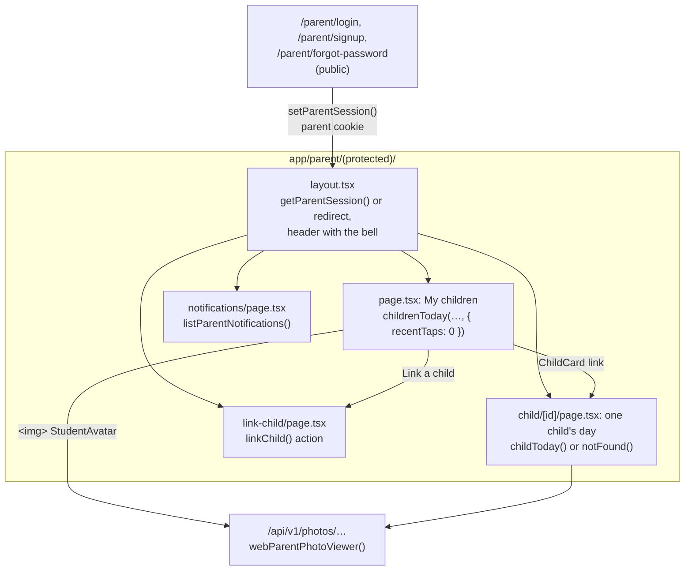

# The parent portal on the web

The pages under `/parent`: how a parent signs in, sees their children, opens one child's day, reads notifications and links a child. They're the same rules the parent app uses through the API (`docs/PARENT-API.md`). The services under `src/services/parents/` are shared, so the web and the app can't disagree.

Since Step 59.5 the home looks like the parent app's home (`talaan_parents_app`, `src/components/child/child-card.tsx` and `src/components/home/home-header.tsx`): the same heading, illustration, card and words. When the app's card changes, this one should follow.

## How the pages connect

| File | What it does |
|---|---|
| `src/lib/parent-session.ts` | The parent cookie: `getParentSession()`, `setParentSession()`, `clearParentSession()`. `httpOnly`, `sameSite: "lax"`, `secure` in production. A changed password signs every browser out (`pv`, Step 55.6). |
| `src/app/parent/(protected)/layout.tsx` | Guards every page below it, and loads the bell's newest 5 notifications and the unread count. |
| `src/app/parent/(protected)/page.tsx` | "My children": `HomeHeading` (the heading, the line under it and the school illustration), one `ChildCard` per child, then "Link a child". |
| `src/features/parents/child-card.tsx` | The card: photo, name (the card's one link), class, status, the times panel, "N taps today". `childPath(id)` is where it leads. |
| `src/app/parent/(protected)/child/[id]/page.tsx` | One child's day: today's taps numbered In/Out (`DayTapList`) and the last 10 taps. Its own `loading.tsx` and `not-found.tsx`. |
| `src/services/parents/children-today.ts` | `childrenToday()` for every linked child, `childToday()` for one, both through `readChild()`: each child at their link's school, judged by that school's times. |
| `src/app/parent/(protected)/notifications/page.tsx` | The feed, 30 at a time (`?before=`), with "Mark all as read". |
| `src/app/parent/(protected)/link-child/page.tsx` | The school picker and the LRN, last name and birth date form (`linkChild` in `src/features/parents/auth-actions.ts`). |
| `src/features/parents/parent-links.ts` | A parent's links, read once per page render, shared by the layout and the page. |
| `src/services/photos/photo-viewer.ts` | `webParentPhotoViewer()`: who a photo request is from when it's a parent on the web. |

## What each page reads

- **The home** reads, per child: the student, their school (once per school), and today's taps. It doesn't read recent taps (Step 59.5), so it costs the same in a child's sixth year as in their first.
- **A child's day** finds the link first. A student this parent isn't linked to answers `notFound()` before anything about them is read, the same as one who doesn't exist. Then it reads today's taps and the newest 10.
- **The layout** reads the bell's 5 newest notifications and an unread count capped at 10 (Step 53.2).

## Photos

A photo is never a public file. `/<student>/<random>.jpeg">` is checked on every request:

1. `resolvePhotoViewer(authorization)`, the usual viewers: the app's `tal_par_` token, a gate's token, the guardhouse TV's cookie, then the staff cookie.
2. Only when that said no **and** there's no `Authorization` header: `webParentPhotoViewer()`, the parent cookie with that parent's links.

`canViewPhoto` then lets a parent see a photo only when the key's school and student are one of their links. Anything else is 404, never 403, so the address doesn't reveal whether a photo exists. `StudentAvatar` is a plain ``, not `next/image`: the image optimizer would fetch the photo without the viewer's cookie.

## Quick recipes

- **Change what the card shows.** Edit `child-card.tsx` and its test, `child-card.test.tsx`. Check the app's card first (`talaan_parents_app/src/components/child/child-card.tsx`) so the two stay alike, and use status tokens only (`bg-status-present`, `bg-status-out`, `bg-status-idle`), never a palette class.
- **Add a parent page.** Put it under `src/app/parent/(protected)/` so the layout guards it. Still call `getParentSession()` in the page itself (a layout isn't re-run on every navigation). Read through `parentLinks`, and answer `notFound()` for anything not linked to this parent.
- **Show something more for one child.** Add it to `readChild()` only if both the home and the child's page need it. Otherwise read it in `child/[id]/page.tsx`, after `childToday()` has found the link.
- **Try it locally.** `npm run dev`, then sign in at `/parent/login` as a demo parent (password `Talaan123!`; `parent-one@oceanview.example` has two children). To see which parents exist and when one's password was changed, see `docs/LEARNING-LOG.md`, "Which parent accounts are in my local database?".
