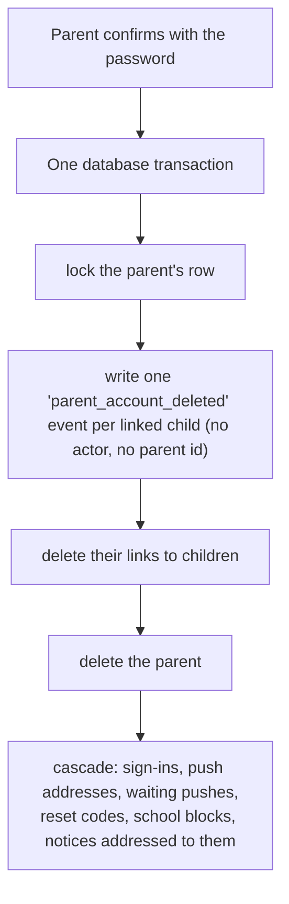
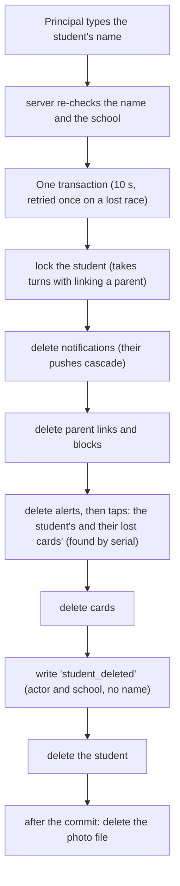

# Privacy: what is kept, and what can be deleted

Step 60 answers the question a school will ask under the Data Privacy Act: "what do you keep about my child, and can you delete it?" This page grows as its parts are built. It is the technical record, not legal advice; the wording of a privacy notice comes from the school (Step 60.4). The activity log is in `docs/AUDIT-LOG.md`.

| Part | Step | State |
|---|---|---|
| The activity log of who changed what | 60.1 | built |
| A parent deletes their own account | 60.2 | built (below) |
| Export and delete one student | 60.3 | built (below) |
| Privacy notice and consent | 60.4 | not built |
| Export and delete a whole school | 60.5 | not built |

## A parent deletes their own account (Step 60.2)

From **Account** in the parent portal, or `DELETE /api/v1/parents/me` in the app (`docs/PARENT-API.md`), with the account's password. The password is checked by the same code and limits as sign-in, against the account's own email from the database.

| Goes | Stays |
|---|---|
| the account, and its email (free to sign up with again) | the children's records, taps and shared notifications: they are the school's |
| every sign-in and every phone's push address, and pushes still waiting to be sent | the other guardians of the same child, and their links |
| password-reset codes, and a block the school put on this parent | the school's own record that it removed them (`parent_link_removed` in Activity) |
| their links to children, and notices addressed to them | other guardians' link notices, which then say "A parent account" instead of a name |

**Not in our power to recall** (say so if asked):
- A push already delivered to a phone. It carries the child's first name and sits in the phone's notification centre, and in Expo's and Apple's or Google's push services for as long as they keep it. A push that was already being sent when the account was deleted can still go out once.
- A password-reset email, which sits in the email provider's logs (the provider keeps its own retention).
- Database backups. A deleted row stays in a backup until the backup expires (Heroku's retention for the plan).
- The in-memory sign-in limit, which remembers a wrong-password count for the email for up to 15 minutes. A restart clears it.

**Never kept:** the activity log holds no parent id and no name for this event, and error reports to Sentry carry no request body (`src/lib/error-reporting.ts`, tested for the delete request).

**The app's part:** on `204` it must clear its stored token, push registration and everything local, and go to sign-in (`docs/PARENT-API.md`, `mobile/starter/docs/PLAN.md` M3).

### Why it is built the way it is

- **The parent's row is locked first.** A link-a-child, a sign-in or a school removing the parent runs at the same moment as a delete in some small fraction of cases; locking first makes them wait, then fail cleanly instead of leaving a half-deleted account. Both this delete and the school's "remove parent" retry once on a deadlock (`isDeadlock`, `retryOnce` in `src/data/repositories/prisma-errors.ts`), and a link that loses the race to the delete is retried once and, if it still can't, answered as "no match".
- **A wrong password is `403 wrong_password`, never `401`.** The app signs out on any `401`.
- **A school's block on a parent goes with the account.** It was per parent id, so it never stopped a new account; linking a child still needs the LRN, last name and birth date, and the log keeps that the school removed them.
- **Accepted:** someone with a stolen session can lock the owner out of signing in with five wrong deletes, as they already can through sign-in. A sign-in in the very instant of its own delete can return an error page once.

## Export and delete one student (Step 60.3)

From the **Privacy** section at the bottom of a student's drawer, for a principal or a super admin with a school open (a teacher has no access, and the download answers 403). The school is always the session's own, so another school's student is "not found".

**Download** (`/students/<id>/export`, a JSON file, never cached): the student's record, photo thumbnail, cards, taps (and taps of their lost card), alerts, the time-in and time-out notices, and the *names* of linked parents with the day they linked. Not other students, not a parent's email or mobile, not which gate read a tap, not which staff member did what, not parent block history. The download is recorded in Activity ("downloaded the data of …").

**Delete**: type the student's full name (the server checks it again, so a direct request can't skip it). One database transaction, with the `student_deleted` event inside it:

| Goes | Stays |
|---|---|
| the student, their cards (the serial is free again) | the school, staff and other students |
| every tap of theirs and every tap of their lost card, with its alert | the parents' accounts (they just have one child fewer; a parent can delete their own, Step 60.2) |
| alerts, time-in and time-out notices, "a parent linked" notices, and pushes still waiting | activity events about the student: a random id and field names, no name; they show as "a removed student" |
| every parent link and any school block on a parent for them | `LinkAttempt` rows: a hash that expires within 24 hours |
| the photo file (current thumbnail) | |

**Not in our power to recall, or only after a while** (say so if asked):
- Backups hold the rows until they expire.
- A browser may keep the photo for up to a year (`Cache-Control: private, max-age=31536000`).
- A gate tablet keeps the student's name, photo and card until its next roster check (within 5 minutes). A tap it sends for them after that is answered as an unknown card and saved as nothing; one queued offline is answered the same way.
- The guardhouse monitor's live list and an open dashboard can show the student until refreshed.
- A push already being sent can still reach a phone once, with the child's first name.
- Thumbnails from earlier photo replacements can linger in storage: it can't list files, and a replaced photo is deleted best-effort (`students/actions.ts`). A failed delete of the *current* photo is logged at error level with its key (never a name); the photo address works for anyone holding the key until the file is removed, so someone must delete that key by hand.

### Why it is built the way it is

- **Notifications are deleted before the links**, the order the push worker takes them in (it locks notification rows, then takes a share of the links), so the delete waits for a push in progress instead of deadlocking with it. A Postgres test holds a fan-out open to prove it.
- **One retry.** A tap saved for the student in the same instant makes the final `DELETE` fail on its foreign key (`P2003`, proved by a test); the second run deletes that tap too. The tap writer, in turn, answers `"gone"` when the student vanishes mid-tap, so a gate never gets a 500.
- **Not soft delete.** A flag would still keep the data, the opposite of the request.
- **The events stay.** They hold a random id and field names, no personal data, and are the school's evidence of who deleted what.

## Quick recipes

**See what a deleted parent left in the database:** nothing of theirs, by design. `select * from "AuditEvent" where action = 'parent_account_deleted'` shows only the child's id and the school.

**Delete a parent's account by hand (support):** there is no tool, on purpose: the parent does it themselves with their password. If they've lost it, they reset it first (Step 55.6), then delete.
