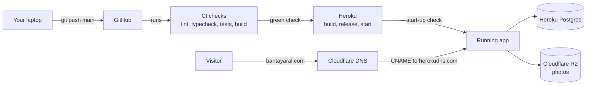
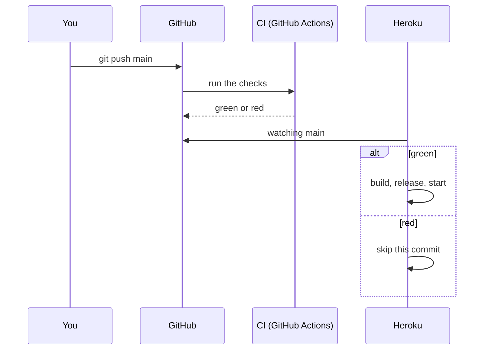
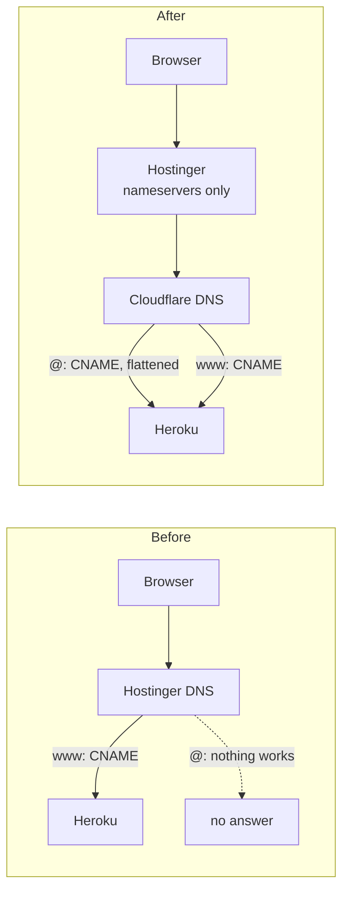

# Problems log

Every problem hit while building and running Bantay Aral, from the day it happened, with what caused it and what was done about it. It's meant to be read months later by someone who wasn't there, so each entry says what was seen, not just what was changed.

**How to add an entry.** Give it the next number, today's date, and a title that names the symptom ("Server answers every request with 500"), not the fix. Fill in the same headings as the entries below, and add a diagram when the problem involves more than one system. When an entry is fixed, update its **Status** in place and in the index; don't start a new entry. Questions that were only confusion, with nothing broken, go in `docs/LEARNING-LOG.md` instead. The table at the end of each section links to them.

Related: `docs/BUILD-LOG.md` has the full story of each step, and `docs/DEPLOY.md` explains how the live server works.

## Index

| # | Date | Problem | Area | Status |
|---|---|---|---|---|
| [P-001](#p-001--2026-10-13--the-start-up-check-would-have-stopped-every-browser-test-run) | 2026-10-13 | The start-up check would have stopped every browser test run | CI, Playwright | Resolved |
| [P-002](#p-002--2026-10-13--npm-ci-would-refuse-to-install-after-moving-three-packages) | 2026-10-13 | `npm ci` would refuse to install after moving three packages | Build | Resolved |
| [P-003](#p-003--2026-10-13--the-recipe-opened-the-gate-with-a-token-in-the-address) | 2026-10-13 | The recipe opened the gate with a token in the address | Docs | Resolved |
| [P-004](#p-004--2026-10-13--unclear-how-code-gets-to-heroku-and-why-the-first-deploy-didnt-start) | 2026-10-13 | Unclear how code gets to Heroku, and why the first deploy didn't start | Deploy | Resolved |
| [P-005](#p-005--2026-10-13--ci-failed-at-typecheck-after-the-push) | 2026-10-13 | CI failed at Typecheck after the push | CI | Resolved |
| [P-006](#p-006--2026-10-13--the-bare-domain-couldnt-point-at-heroku-from-hostinger) | 2026-10-13 | The bare domain couldn't point at Heroku from Hostinger | Domain | Resolved |
| [P-007](#p-007--2026-10-13--the-live-site-answered-every-request-with-500) | 2026-10-13 | The live site answered every request with 500 | Heroku, settings | Resolved |
| [P-008](#p-008--2026-10-13--the-r2-secret-access-key-couldnt-be-found-again) | 2026-10-13 | The R2 secret access key couldn't be found again | Cloudflare R2 | Resolved |
| [P-009](#p-009--2026-10-13--the-bucket-wasnt-named-talaan-photos) | 2026-10-13 | The bucket wasn't named `talaan-photos` | Cloudflare R2 | Resolved |
| [P-010](#p-010--2026-10-13--a-missing-setting-gives-500s-instead-of-a-crashed-dyno) | 2026-10-13 | A missing setting gives 500s instead of a crashed dyno | Heroku, Next.js | Open: owner decides |
| [P-011](#p-011--2026-10-14--heroku-run-answered-run-command-not-found) | 2026-10-14 | `heroku run` answered `run: command not found` | Heroku CLI, docs | Resolved |
| [P-012](#p-012--2026-10-15--prisma-migrate-dev-refused-to-drop-a-column-here) | 2026-10-15 | `prisma migrate dev` refused to drop a column here | Prisma, building | Resolved |
| [P-013](#p-013--2026-10-15--a-sign-in-test-still-picked-a-school-at-sign-up) | 2026-10-15 | A sign-in test still picked a school at sign-up | Playwright | Resolved |
| [P-014](#p-014--2026-10-16--parent-emails-were-stored-as-typed-and-every-sign-in-read-the-whole-table) | 2026-10-16 | Parent emails were stored as typed, and every sign-in read the whole table | Database, sign-in | Fixed, waiting for the owner's checks |
| [P-015](#p-015--2026-10-16--parent-sign-in-answered-faster-for-an-email-with-no-account) | 2026-10-16 | Parent sign-in answered faster for an email with no account | Security, sign-in | Fixed, waiting for the owner's checks |

---

## Going live on Heroku (Step 52, 2026-10-13)

How the pieces connect. Most problems below happened at one of these arrows.



### P-001 · 2026-10-13 · The start-up check would have stopped every browser test run
- **Where:** Step 52, found while reading the recipe against the code, before writing anything.
- **Symptom (predicted):** every Playwright run, locally and in CI, would fail to start its server.
- **Cause:** the new start-up check refuses to run a production server with `DEMO_NOW` set or photos on local disk. Playwright starts a production server (`npm run start`) on purpose, with exactly those test settings.
- **Options weighed:**
  - Only check when Heroku asks: forget the flag on Heroku, and there's no check at all.
  - Check only when Heroku's own `DYNO` variable exists: that ties the code to one host.
  - Let only the test server opt out with `E2E=1`.
- **Solution:** the last option, chosen by the owner. The check is on by default in production, and `playwright.config.ts` sets `E2E=1` for its own server. `E2E` must never be set on Heroku.
- **Status:** Resolved.
- **More:** `src/instrumentation.ts`, `docs/BUILD-LOG.md` Step 52.

### P-002 · 2026-10-13 · `npm ci` would refuse to install after moving three packages
- **Where:** Step 52, `package.json`.
- **Symptom (predicted):** "package.json and package-lock.json are not in sync" on Heroku and in CI.
- **Cause:** Heroku deletes development-only packages after building, but the release phase and start-up still need `prisma`, `tsx` and `dotenv`, so they moved to `dependencies`. The lockfile records which list each package is in, so it had to change too.
- **Solution:** `npm install --package-lock-only` rewrote the lockfile. `git diff` confirmed no version changed.
- **Status:** Resolved.

### P-003 · 2026-10-13 · The recipe opened the gate with a token in the address
- **Where:** the Step 52 recipe's "Verify it worked".
- **Symptom:** the recipe said to open `/gate?token=…`. That does nothing: the gate takes its token on its setup screen (Step 47).
- **Solution:** the recipe and `docs/DEPLOY.md` were corrected.
- **Status:** Resolved.

### P-004 · 2026-10-13 · Unclear how code gets to Heroku, and why the first deploy didn't start
- **Where:** Heroku dashboard, Deploy tab.
- **Symptom:** two questions. Should it be "Connect GitHub" or "Heroku Git"? And where in the CI file is the step that deploys?
- **Cause:** the deploy isn't in the CI file at all. Heroku watches GitHub and waits for CI's result. Automatic deploys also only react to pushes made *after* they're turned on.



- **Solution:** Connect GitHub with **Wait for CI to pass before deploy** ticked. The first deploy is started once by hand (Manual deploy → **Deploy Branch**); every later one is automatic. No Heroku key is stored in GitHub.
- **Status:** Resolved.
- **More:** Step 52 recipe, Stages F and G. Learning log: "Connect GitHub, or Heroku Git?" and "Where in CI is the deploy to Heroku part?".

### P-005 · 2026-10-13 · CI failed at Typecheck after the push
- **Where:** GitHub Actions, the Typecheck step.
- **Symptom:**
  ```
  src/lib/env.test.ts#L4
  Conversion of type '{ SESSION_SECRET: string; DATABASE_URL: string; … }' to type 'ProcessEnv'
  may be a mistake because neither type sufficiently overlaps with the other.
  ```
  The first guess was "CI failed because the deploy isn't set up properly". It wasn't that: CI never uses Heroku's settings (see P-004).
- **Cause:** Next.js's own types (`node_modules/next/types/global.d.ts`) make `NODE_ENV` a required part of `process.env`. The test's sample settings had none, so even the `as NodeJS.ProcessEnv` cast was refused. The unit tests had passed, because Vitest runs TypeScript without checking its types. Only `npm run typecheck` does.
- **Solution:** the sample now includes `NODE_ENV: "production"` (true of a live server anyway), with a type annotation instead of a cast:
  ```ts
  const GOOD: NodeJS.ProcessEnv = {
    NODE_ENV: "production",
    SESSION_SECRET: "x".repeat(32),
    // …
  };
  ```
- **Lesson:** "tests pass" and "types are fine" are separate results. The routine before every commit runs both.
- **Status:** Resolved (2026-10-15). CI went green, and Heroku deployed after it by itself.

### P-006 · 2026-10-13 · The bare domain couldn't point at Heroku from Hostinger
- **Where:** Hostinger DNS, for `bantayaral.com`.
- **Symptom:** `www.bantayaral.com` could point at Heroku with a CNAME record, but the bare `bantayaral.com` couldn't. Each way out failed in turn:

| Tried | Result |
|---|---|
| CNAME on `@` | Not allowed. That's a rule of DNS itself: the bare domain can't be a CNAME. |
| ALIAS on `@` | Hostinger doesn't offer this record type. |
| A or AAAA on `@` | Needs a fixed IP address, and Heroku doesn't give one (its addresses change). AAAA is just A for IPv6. |
| Hostinger redirect `bantayaral.com` → `www.bantayaral.com` | Refused: "you cannot redirect a domain to itself". |
| `.htaccess` redirect on Hostinger hosting | No Hostinger hosting on this domain, so nowhere to put it. |
| Hostinger's "SSL active" | Not relevant. A certificate only works on the server that answers for the name, and that's Heroku. |

- **Cause:** Hostinger's DNS can't make the bare domain follow a name that changes address.
- **Solution:** move the DNS (not the domain) to Cloudflare. Hostinger still owns and renews the domain, but its nameservers now point at Cloudflare. Cloudflare can CNAME the bare domain ("CNAME flattening"). Both records are **DNS only** (grey cloud); the orange-cloud proxy would stop Heroku from issuing its certificates.



- **Detail:** Heroku gives **each name its own target**, so the bare domain needs its own `heroku domains:add bantayaral.com`, not a copy of the `www` target.
- **Status:** Resolved. Heroku's logs at 11:00 UTC show requests for `host=bantayaral.com` arriving with `tls=true`.
- **More:** the step-by-step guide with a checklist, [Bantay Aral Domain Setup](https://claude.ai/artifact/CM9JHW2WGCbuYUpbqqMbLA). Learning log: "Pointing a Hostinger domain at a DNS target".

### P-007 · 2026-10-13 · The live site answered every request with 500
- **Where:** Heroku, right after the first deploy.
- **Symptom:** every page returned a bare error, and `heroku logs` repeated:
  ```
  Error: An error occurred while loading instrumentation hook: The server can't start with these settings:
  - PHOTO_STORAGE="s3" needs S3_SECRET_ACCESS_KEY.
  heroku[router]: … host=bantayaral.com … status=500
  ```
- **Cause:** the `S3_SECRET_ACCESS_KEY` setting was missing on Heroku. The start-up check (`checkProductionEnv` in `src/lib/env.ts`) caught it, as designed. Without it, the site would have looked fine until the first photo upload failed.
- **Solution:** set it, typed straight from Cloudflare (see P-008 if it's lost):
  ```
  heroku config:set S3_SECRET_ACCESS_KEY="…" --app bantayaral
  ```
  To see which settings exist without showing their values: `heroku config --app bantayaral | cut -d: -f1`. A typo in a name counts as missing.
- **Check:** `curl https://bantayaral.com/api/v1/health` returns `{"ok":true,"database":"ok"}`.
- **Status:** Resolved (2026-10-15). The live site loads, and the gate and monitor work.

### P-008 · 2026-10-13 · The R2 secret access key couldn't be found again
- **Where:** Cloudflare, R2 API tokens.
- **Symptom:** nowhere in the Cloudflare dashboard shows the secret access key.
- **Cause:** Cloudflare shows a secret key **once**, on the page right after the token is created, and keeps only a fingerprint of it. That's normal for secret keys.
- **Solution:** create a new token: **R2 Object Storage → Manage API tokens → Create API token**, Object Read & Write, limited to the photos bucket, TTL Forever. Set **both** new values on Heroku (a secret only works with its own key ID), then delete the old token:
  ```
  heroku config:set S3_ACCESS_KEY_ID="…" S3_SECRET_ACCESS_KEY="…" --app bantayaral
  ```
- **Lesson:** save a secret in a password manager the moment it's shown.
- **Status:** Resolved (2026-10-15). A new token's values are set on Heroku, and the site starts.

### P-009 · 2026-10-13 · The bucket wasn't named `talaan-photos`
- **Where:** Cloudflare R2.
- **Symptom:** the bucket was created as "Bantay Aral Photos", while the docs say `talaan-photos`. Would the code look for the wrong name?
- **Cause:** no problem in the code. It uses whatever `S3_BUCKET` says (`src/lib/storage/photo-storage.ts`). `talaan-photos` only appears in the docs' examples and the tests' sample data.
- **Solution:** these three must use the same exact name:
  - the bucket itself
  - the bucket the API token is limited to
  - `S3_BUCKET` on Heroku

  R2 names are lowercase letters, numbers and hyphens only, so copy the real name from the R2 list:
  ```
  heroku config:set S3_BUCKET="<exact name>" --app bantayaral
  ```
- **Watch out:** a wrong bucket name doesn't stop the server from starting. It only fails at the first photo upload. Step 52's "Verify it worked" (add a photo to a demo student) is what proves it.
- **Status:** Resolved (2026-10-15). The owner added a photo to a student on the live site, and it shows.

### P-010 · 2026-10-13 · A missing setting gives 500s instead of a crashed dyno
- **Where:** Heroku with Next.js, found from P-007's logs.
- **Symptom:** the recipe said the server "refuses to start" with a bad setting. In fact the dyno stayed `up` and answered every request with `500`, logging the reason again on every request.
- **Cause:** when `register()` in `src/instrumentation.ts` throws, Next.js logs it and keeps the process running. It doesn't exit.
- **Effect:** still safe, because nothing half-works. But it's less visible: `heroku ps` shows the dyno as `up`, not crashed, so you only find out from the logs or the health check.
- **Possible fix:** make the check end the process, so Heroku reports "crashed" and retries. This is a small code change.
- **Related (2026-10-15):** the owner asked for friendly error pages with a way to report a problem, instead of a bare "server error". Added to Step 59 in `docs/PLAN.md`. Heroku's own "down for a moment" page (`ERROR_PAGE_URL`) only shows when the server isn't running, so it works together with this fix.
- **Status:** Open. The owner decides whether to do it; recommended as a task in Step 59.

### P-011 · 2026-10-14 · `heroku run` answered "run: command not found"
- **Where:** the Heroku CLI on your laptop (version 11), running a script on the live server, typed exactly as `docs/DEPLOY.md` said at the time.
- **Symptom:**
  ```
  ❯ heroku run npm run device:create -- --school school-balanga --kind gate --label "Main gate tablet" --app bantayaral
  Running run npm run device:create --school school-balanga --kind gate --label "Main gate tablet" --app bantayaral on ⬢ bantayaral... up, run.3007
  /bin/bash: line 1: run: command not found
  ```
  The clue is the `Running` line: an extra `run` in front of `npm`, and the `--` is gone. Nothing reached the database, so no half-made device needs cleaning up.
- **Cause:** a bug in how the Heroku CLI rebuilds the command before sending it (`revertSortedArgs` in its `lib/run/helpers.js`). It walks through every word typed after `heroku` and keeps each one that also appears in the command. Its own sub-command, `run`, matches the `run` of `npm run`, so it's kept as well, and the server is asked to run `run npm run …`. The same line had two more faults:
  - the CLI swallows the `--`, which npm needs to pass the options on to the script;
  - `--app bantayaral` came after the `--`, so the CLI sent it to the server as part of the script instead of reading it. (It still found the app, from the `heroku` git remote.) Even without the extra `run`, the script would have stopped on an option it doesn't know, `--app`.

  `heroku run npx prisma db seed --app bantayaral` worked because no word repeats `run` and there's no `--`. Our docs had the broken form for `device:create` and `staff:link` since Step 52, but this was its first real use.

  ```mermaid
  flowchart LR
      subgraph Before["Before: no quotes"]
          A1["heroku run npm run device:create<br/>-- … --app bantayaral"] --> B1["Heroku CLI keeps every word<br/>that matches, its own run too"]
          B1 -->|"run npm run device:create …"| C1["Dyno: bash"]
          C1 --> D1["run: command not found"]
      end
      subgraph After["After: one quoted argument"]
          A2["heroku run --app bantayaral<br/>#quot;npm run device:create -- …#quot;"] --> B2["Heroku CLI reads --app,<br/>passes the quoted text unchanged"]
          B2 -->|"npm run device:create -- …"| C2["Dyno: bash, then npm"]
          C2 --> D2["scripts/create-device.ts<br/>prints the token"]
      end
  ```
- **Options weighed:**
  1. **Quote the whole script as one argument, with `--app` first.** The CLI then sees a single argument that isn't an option and sends it as it is. Same npm script names as on the laptop. Chosen.
  2. Skip npm: `heroku run --app bantayaral -- npx tsx scripts/create-device.ts --school …`. Also works, but it's a different command from the laptop one, and it still relies on the CLI's word matching.
  3. Wait for a Heroku CLI fix. Nothing to wait on, and option 1 works on every version.
- **Solution:** double quotes around the whole script, single quotes inside for a label with spaces:
  ```
  heroku run --app bantayaral "npm run device:create -- --school school-balanga --kind gate --label 'Main gate tablet'"
  ```
  The same shape for `staff:link`. Updated in `docs/DEPLOY.md`, `docs/COMMANDS.md` (7b and 7c), and the Step 52 and Step 50.5 recipes.
- **Check:** the `Running` line starts with `Running npm run device:create -- --school …` (no `run` before `npm`), and the output ends with `Created gate "Main gate tablet" for …`, a device id and a `tal_dev_…` token.
- **Status:** Resolved (2026-10-15). With the quoted form, the owner made the gate and monitor devices on the live server, and both work.

### Questions along the way (no problem, just confusion)
Answered in `docs/LEARNING-LOG.md`, section "Putting it on the internet (Step 52)":

| Date | Question |
|---|---|
| 2026-10-13 | What actually happens when "deploying to Heroku" starts? |
| 2026-10-13 | What does `heroku config:set SESSION_SECRET="$(openssl rand -base64 32)"` do? |
| 2026-10-13 | What are `PGSSLMODE=no-verify` and `PHOTO_STORAGE=s3` for? |
| 2026-10-13 | Connect GitHub, or Heroku Git? |
| 2026-10-13 | How do I point a Hostinger domain at a DNS target? |
| 2026-10-13 | Where in CI is the deploy-to-Heroku part? |
| 2026-10-13 | What does "The server can't start with these settings" mean? |
| 2026-10-13 | Where is the R2 secret access key? |
| 2026-10-13 | Does the bucket have to be called `talaan-photos`? |
| 2026-10-15 | Where does a school's ID come from, and how do I find a new school's? |
| 2026-10-15 | Do I have to make every gate and monitor with a Heroku command? |
| 2026-10-15 | P-010: what "bad setting" means, and what's being decided |

---

## The parent API, part 1 (Step 53, 2026-10-15)

### P-012 · 2026-10-15 · `prisma migrate dev` refused to drop a column here
- **Where:** building Step 53 on the laptop, in the tool's terminal (one that can't answer questions).
- **Symptom:**
  ```
  • You are about to drop the column `schoolId` on the `Parent` table, which still contains 6 non-null values.
  Error: Prisma Migrate has detected that the environment is non-interactive, which is not supported.
  ```
- **Cause:** `migrate dev` asks "are you sure?" before a change that deletes data, and stops when nobody can answer. Nothing was wrong with the change: every link already keeps its child's school, so the column held nothing that's needed.
- **Options weighed:**
  1. Ask the owner to run `migrate dev` in their own terminal. It works, but stalls the step on a round trip.
  2. **`prisma migrate diff`**, which writes the same SQL without asking, into a new migration folder, then `prisma migrate deploy` to apply it. Chosen.
  3. `migrate dev --create-only`. It asks the same question, so it fails the same way.
- **Solution:** the commands are in the Step 53 recipe's "What changed while building". The generated SQL was read before applying it: drop the foreign key, the index, then the column.
- **Status:** Resolved. The local database is up to date (`npx prisma migrate status`). Heroku applies the migration by itself at the next deploy.

### P-013 · 2026-10-15 · A sign-in test still picked a school at sign-up
- **Where:** the owner's `npx playwright test` run for Step 53.
- **Symptom:**
  ```
  2 failed
    [mobile] › e2e/login.spec.ts:75:7 › Login › parent sign-in redirects to link-child for a new parent
    [desktop] › e2e/login.spec.ts:75:7 › Login › parent sign-in redirects to link-child for a new parent
  ```
- **Cause:** that test signs a parent up, and still clicked "Your child's school", a field Step 53 moved from sign-up to "Link a child". While building, only `e2e/parent.spec.ts` and `e2e/isolation.spec.ts` were checked for it; `e2e/login.spec.ts` signs a parent up too and was missed.
- **Solution:** the two lines that picked the school are gone from `e2e/login.spec.ts`. A search of every test (`grep -rn "Your child's school" e2e src`) now finds the label only on "Link a child" and in the tests that link a child.
- **Lesson:** when a form changes, search the tests for its labels, not only the tests named after it.
- **Status:** Resolved. The rerun passed, and Step 53 was approved on 2026-10-16.

---

## The parent API, part 2 (Step 53.1, 2026-10-16)

Both problems below were found while planning Step 53.1, in a review of the code with the systems-architect (two plan rounds, before anything was built). Nobody had hit them yet.

### P-014 · 2026-10-16 · Parent emails were stored as typed, and every sign-in read the whole table
- **Where:** `src/data/repositories/prisma-parent-repository.ts` (sign-up, sign-in, "email taken"), on the live database and the laptop alike.
- **Symptom:** nothing visible yet. The code searched like this:
  ```ts
  db.parent.findFirst({ where: { email: { equals: email.trim(), mode: "insensitive" } } });
  ```
  and the sign-up form kept the email exactly as typed (`z.email(...)`, no lowercasing).
- **Cause:** a case-insensitive search can't use `Parent.email`'s unique index, which compares exactly, so Postgres reads every parent row for every sign-in and sign-up. The index is also case-sensitive, so `Ana@x.com` and `ana@x.com` could both be saved by two sign-ups at once. Staff emails didn't have this problem: they're lowercased before they're stored (Step 50).
- **Options weighed:**
  1. An index on `lower(email)`. Prisma can't describe it in `schema.prisma`, so it would live only in hand-written SQL.
  2. **Store every parent email trimmed and in lower case, and look it up exactly.** The existing unique index then does both jobs. Chosen.
- **Solution:** `emailSchema` (trim, lowercase, then check), `normalizeEmail` in the parent repository, and migration `parent_email_lowercase`, which lowercases existing rows (Step 53.1's recipe). Before changing anything, the migration counts emails that would collide once lowercased, and stops with a message naming this entry if there are any.
- **If the migration stops on Heroku** with "email address(es) belong to more than one parent account once lowercased":
  ```mermaid
  flowchart LR
      R["Release phase:<br/>prisma migrate deploy"] -->|DO block raises| F["Release fails.<br/>The old code keeps running."]
      F --> M["Merge the accounts<br/>by hand"]
      M --> X["prisma migrate resolve<br/>--rolled-back"]
      X --> D["Deploy again"]
  ```
  1. Find them: `heroku pg:psql --app <name> -c 'SELECT lower(trim(email)), count(*) FROM "Parent" GROUP BY 1 HAVING count(*) > 1;'`
  2. For each pair, move the spare account's links to the account the parent uses (`UPDATE "ParentStudentLink" SET "parentId" = '<kept>' WHERE "parentId" = '<spare>';`, skipping a child both already link), then delete the spare account.
  3. `heroku run --app <name> "npx prisma migrate resolve --rolled-back parent_email_lowercase"` (quoted, as P-011 explains). It's `--rolled-back`, not `--applied`, because nothing in the file ran. Until this is done, every deploy stops with Prisma's `P3009` error.
  4. Deploy again.
- **After the deploy**, check that nobody signed up on the old code while the new release was starting: `heroku pg:psql --app <name> -c 'SELECT count(*) FROM "Parent" WHERE email <> lower(trim(email));'` should be 0. If it isn't, run the migration's `UPDATE` line the same way.
- **Status:** Fixed, waiting for the owner's checks and the deploy.

### P-015 · 2026-10-16 · Parent sign-in answered faster for an email with no account
- **Where:** `verifyPassword` in `src/data/repositories/prisma-parent-repository.ts`.
- **Symptom:** nothing visible. For an unknown email the function returned before checking any password, so the answer came back tens of milliseconds sooner than for a registered email with a wrong password.
- **Cause:** checking a password (scrypt) is slow on purpose. Skipping it for unknown emails let anyone measure which emails have an account, without ever signing in. Staff sign-in already avoided this (Step 50.1) by checking a decoy hash, but the parent repository was written before that and never got it.
- **Options weighed:**
  1. A decoy check in a service. It can't work, because the parent repository never hands its password hash out.
  2. **The decoy check inside the repository's `verifyPassword`.** Chosen.
- **Solution:** `verifyPassword` always runs scrypt, against `decoyPasswordHash()` (`src/lib/password.ts`, now shared with staff sign-in) when the email has no account. A unit test checks the decoy is used.
- **Still open, on purpose:** sign-up's "An account with this email already exists" also tells a stranger the email is registered. Closing that means confirming an email by sending to it, which waits for the email service (Step 55.5). The sign-in limit also counts per email only, so trying many emails isn't limited yet. Step 53.3 adds a limit per address.
- **Status:** Fixed, waiting for the owner's checks.
