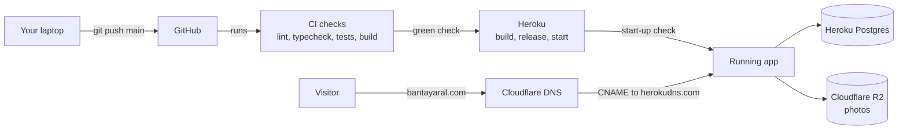
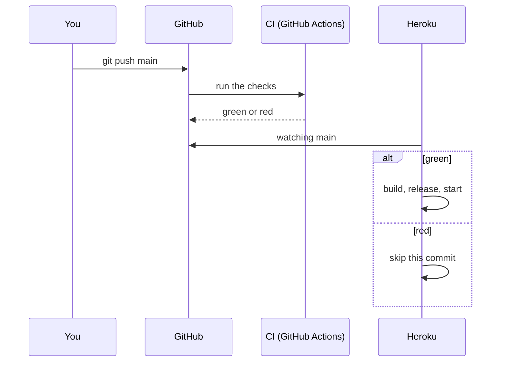
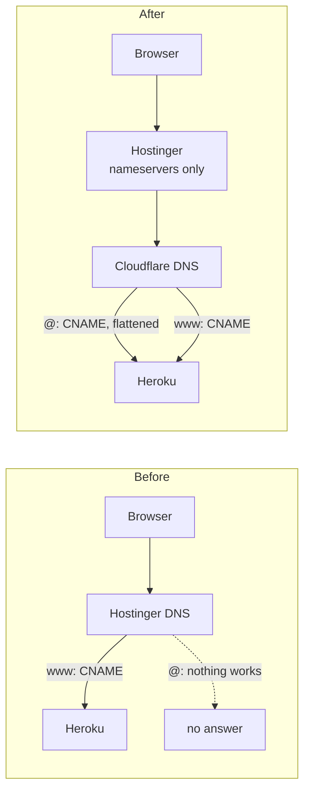
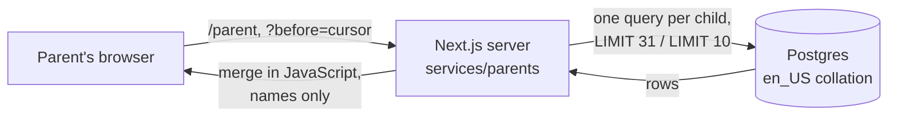
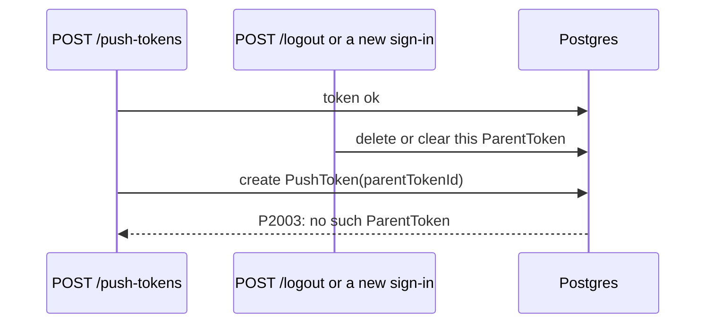

# Problems log

Every problem hit while building and running Bantay Aral, from the day it happened, with what caused it and what was done about it. It's meant to be read months later by someone who wasn't there, so each entry says what was seen, not just what was changed.

**How to add an entry.** Give it the next number, today's date, and a title that names the symptom ("Server answers every request with 500"), not the fix. Fill in the same headings as the entries below, and add a diagram when the problem involves more than one system. When an entry is fixed, update its **Status** in place and in the index; don't start a new entry. Questions that were only confusion, with nothing broken, go in `docs/LEARNING-LOG.md` instead. The table at the end of each section links to them.

**Kind** (added 2026-10-16, owner request) says what a fix was worth:
- **Security**: it closes a way to reach, guess or leak something.
- **Performance**: it makes the app do less work, which is what keeps it on the cheap plans as schools grow. These entries carry measured numbers from the benchmark below.
- **Other**: everything else, with what it was (build, setup, tests, docs, correctness, reliability).

Related: `docs/BUILD-LOG.md` has the full story of each step, and `docs/DEPLOY.md` explains how the live server works.

## Index

| # | Date | Problem | Kind | Area | Status |
|---|---|---|---|---|---|
| [P-001](#p-001--2026-10-13--the-start-up-check-would-have-stopped-every-browser-test-run) | 2026-10-13 | The start-up check would have stopped every browser test run | Other: tests | CI, Playwright | Resolved |
| [P-002](#p-002--2026-10-13--npm-ci-would-refuse-to-install-after-moving-three-packages) | 2026-10-13 | `npm ci` would refuse to install after moving three packages | Other: build | Build | Resolved |
| [P-003](#p-003--2026-10-13--the-recipe-opened-the-gate-with-a-token-in-the-address) | 2026-10-13 | The recipe opened the gate with a token in the address | Security | Docs | Resolved |
| [P-004](#p-004--2026-10-13--unclear-how-code-gets-to-heroku-and-why-the-first-deploy-didnt-start) | 2026-10-13 | Unclear how code gets to Heroku, and why the first deploy didn't start | Other: deploy | Deploy | Resolved |
| [P-005](#p-005--2026-10-13--ci-failed-at-typecheck-after-the-push) | 2026-10-13 | CI failed at Typecheck after the push | Other: build | CI | Resolved |
| [P-006](#p-006--2026-10-13--the-bare-domain-couldnt-point-at-heroku-from-hostinger) | 2026-10-13 | The bare domain couldn't point at Heroku from Hostinger | Other: setup | Domain | Resolved |
| [P-007](#p-007--2026-10-13--the-live-site-answered-every-request-with-500) | 2026-10-13 | The live site answered every request with 500 | Other: setup | Heroku, settings | Resolved |
| [P-008](#p-008--2026-10-13--the-r2-secret-access-key-couldnt-be-found-again) | 2026-10-13 | The R2 secret access key couldn't be found again | Other: setup | Cloudflare R2 | Resolved |
| [P-009](#p-009--2026-10-13--the-bucket-wasnt-named-talaan-photos) | 2026-10-13 | The bucket wasn't named `talaan-photos` | Other: setup | Cloudflare R2 | Resolved |
| [P-010](#p-010--2026-10-13--a-missing-setting-gives-500s-instead-of-a-crashed-dyno) | 2026-10-13 | A missing setting gives 500s instead of a crashed dyno | Other: reliability | Heroku, Next.js | Fixed in Step 59.1 (live once deployed) |
| [P-011](#p-011--2026-10-14--heroku-run-answered-run-command-not-found) | 2026-10-14 | `heroku run` answered `run: command not found` | Other: docs | Heroku CLI, docs | Resolved |
| [P-012](#p-012--2026-10-15--prisma-migrate-dev-refused-to-drop-a-column-here) | 2026-10-15 | `prisma migrate dev` refused to drop a column here | Other: build | Prisma, building | Resolved |
| [P-013](#p-013--2026-10-15--a-sign-in-test-still-picked-a-school-at-sign-up) | 2026-10-15 | A sign-in test still picked a school at sign-up | Other: tests | Playwright | Resolved |
| [P-014](#p-014--2026-10-16--parent-emails-were-stored-as-typed-and-every-sign-in-read-the-whole-table) | 2026-10-16 | Parent emails were stored as typed, and every sign-in read the whole table | Performance | Database, sign-in | Fixed: the live database is lowercased at the next deploy |
| [P-015](#p-015--2026-10-16--parent-sign-in-answered-faster-for-an-email-with-no-account) | 2026-10-16 | Parent sign-in answered faster for an email with no account | Security | Security, sign-in | Resolved |
| [P-016](#p-016--2026-10-16--a-capped-count-still-sorted-every-unread-row) | 2026-10-16 | A capped count still sorted every unread row | Performance | Prisma, database | Resolved |
| [P-017](#p-017--2026-10-16--postgres-and-javascript-order-some-ids-differently) | 2026-10-16 | Postgres and JavaScript order some ids differently | Other: correctness | Database, paging | Resolved |
| [P-018](#p-018--2026-10-16--the-bell-sent-each-childs-full-record-to-the-browser) | 2026-10-16 | The bell sent each child's full record to the browser | Security (privacy) | Privacy, parent portal | Resolved |
| [P-019](#p-019--2026-10-16--parent-pages-loaded-every-tap-and-notification-ever) | 2026-10-16 | Parent pages loaded every tap and notification ever | Performance | Parent portal, database | Resolved |
| [P-020](#p-020--2026-10-16--the-sign-in-limit-could-be-flooded-or-walked-around) | 2026-10-16 | The sign-in limit could be flooded, or walked around with many emails | Security | Sign-in | Resolved |
| [P-021](#p-021--2026-10-16--a-schools-launch-night-could-trip-the-address-limit) | 2026-10-16 | A school's launch night could trip the address limit | Other: known risk | Sign-in | Open: watch the logs |
| [P-022](#p-022--2026-10-16--the-parent-api-test-tapped-a-child-the-station-tests-had-already-tapped) | 2026-10-16 | The parent API test tapped a child the station tests had already tapped | Other: tests | Playwright | Resolved |
| [P-023](#p-023--2026-10-16--saving-a-push-address-as-the-phone-signed-out-answered-500) | 2026-10-16 | Saving a push address as the phone signed out answered 500 | Other: correctness | Parent API, database | Resolved |
| [P-024](#p-024--2026-10-16--a-browser-test-couldnt-load-the-prisma-client) | 2026-10-16 | A browser test couldn't load the Prisma Client | Other: tests | Playwright, Prisma | Resolved |
| [P-025](#p-025--2026-10-16--two-type-errors-in-step-54s-tests) | 2026-10-16 | Two type errors in Step 54's tests | Other: tests | TypeScript | Resolved |
| [P-026](#p-026--2026-10-19--the-live-server-answered-internal-server-error-after-step-54s-deploy) | 2026-10-19 | The live server answered "Internal Server Error" after Step 54's deploy | Other: reliability | Heroku, settings | Resolved (prevention: P-041) |
| [P-027](#p-027--2026-10-20--the-new-browser-test-found-its-student-already-tapped) | 2026-10-20 | The new browser test found its student already tapped | Other: tests | Playwright | Resolved |
| [P-028](#p-028--2026-10-21--a--as-a-last-name-linked-any-child-and-_-matched-staff-emails) | 2026-10-21 | A "%" as a last name linked any child, and "_" matched staff emails | Security | Child linking, staff sign-in | Resolved (deploy pending) |
| [P-029](#p-029--2026-10-21--the-monitor-test-lost-count-when-an-old-tap-dropped-off-the-list) | 2026-10-21 | The monitor test lost count when an old tap dropped off the list | Other: tests | Playwright, `/gate/display` | Resolved |
| [P-030](#p-030--2026-10-22--two-browser-tests-linked-the-same-child-at-once) | 2026-10-22 | Two browser tests linked the same child at once | Other: tests | Playwright, parent portal | Resolved |
| [P-031](#p-031--2026-10-22--the-dev-server-refused-the-new-notification-kind) | 2026-10-22 | The dev server refused the new notification kind | Other: setup | Prisma, `npm run dev` | Resolved |
| [P-032](#p-032--2026-10-22--the-sign-in-photo-loads-late-on-wide-screens) | 2026-10-22 | The sign-in photo loads late on wide screens | Performance | Next.js `Image`, sign-in | Fixed: owner to confirm the warning is gone |
| [P-033](#p-033--2026-10-23--a-1-issue-badge-after-sending-a-reset-link) | 2026-10-23 | A "1 Issue" badge after sending a reset link | Other: development | `npm run dev`, `/forgot-password` | Not reproduced: watch |
| [P-034](#p-034--2026-10-23--the-app-would-have-been-told-a-code-was-sent-when-nothing-went) | 2026-10-23 | The app would have been told a code was sent when nothing went | Other: correctness | Parent API, email (plan review) | Resolved |
| [P-035](#p-035--2026-10-23--the-parent-sign-in-page-would-have-frozen-the-email-setting-at-build) | 2026-10-23 | The parent sign-in page would have frozen the email setting at build | Other: correctness | Next.js, parent portal | Resolved |
| [P-036](#p-036--2026-10-23--the-demo-reset-never-emptied-the-parents) | 2026-10-23 | The demo reset never emptied the parents | Other: tests | Playwright, demo data | Resolved |
| [P-037](#p-037--2026-10-23--the-race-test-passed-without-the-lock) | 2026-10-23 | The race test passed without the lock | Other: tests | Postgres, Vitest | Resolved |
| [P-038](#p-038--2026-10-23--the-new-postgres-test-found-no-studentid-column) | 2026-10-23 | The new Postgres test found no `studentId` column | Other: setup | Prisma, Vitest, test database | Resolved |
| [P-039](#p-039--2026-10-23--the-alert-test-made-taps-the-app-cant-read) | 2026-10-23 | The alert test made taps the app can't read | Other: tests | Vitest, Zod | Resolved |
| [P-040](#p-040--2026-10-23--a-parent-api-test-was-told-too-many-tries) | 2026-10-23 | A parent API test was told "too many tries" | Other: tests | Playwright, sign-in limits | Fixed: owner to re-run |
| [P-041](#p-041--2026-10-23--the-live-server-stopped-again-email_sender-wasnt-set) | 2026-10-23 | The live server stopped again: `EMAIL_SENDER` wasn't set | Other: reliability | Heroku, settings | Prevented from Step 59; owner sets `EMAIL_SENDER` |
| [P-042](#p-042--2026-10-23--three-ways-the-new-offline-gate-could-still-lose-taps) | 2026-10-23 | Three ways the new offline gate could still lose taps | Other: correctness | `/gate`, code review | Resolved |
| [P-043](#p-043--2026-10-23--withsentryconfig-is-not-a-function) | 2026-10-23 | `withSentryConfig is not a function` | Other: setup | Sentry, `next.config.ts` | Resolved |
| [P-044](#p-044--2026-10-23--the-live-sites-nextjs-has-two-critical-security-holes) | 2026-10-23 | The live site's Next.js has two critical security holes | Security | Next.js 16.3.8 | Fixed locally (16.4.3); deploy pending |
| [P-045](#p-045--2026-10-25--a-problem-report-would-have-skipped-the-privacy-clean) | 2026-10-25 | A problem report would have skipped the privacy clean | Security (privacy) | Sentry, error page | Resolved |
| [P-046](#p-046--2026-10-25--the-heading-read-somethingwent-wrong) | 2026-10-25 | The heading read "Somethingwent wrong" | Other: accessibility | Error page | Resolved |
| [P-047](#p-047--2026-10-25--stopping-on-a-bad-setting-could-have-stopped-a-build) | 2026-10-25 | Stopping on a bad setting could have stopped a build | Other: build | `src/instrumentation.ts` | Resolved |
| [P-048](#p-048--2026-10-25--sendfeedback-doesnt-exist-in-the-server-build) | 2026-10-25 | `sendFeedback` doesn't exist in the server build | Other: build | Sentry, Turbopack | Resolved |
| [P-049](#p-049--2026-10-25--processexit-warned-in-the-edge-build) | 2026-10-25 | `process.exit` warned in the Edge build | Other: build | `src/instrumentation.ts`, Turbopack | Resolved |
| [P-050](#p-050--2026-10-25--a-script-tag-warning-on-the-error-page-in-development) | 2026-10-25 | A "script tag" warning on the error page, in development | Other: development | `npm run dev`, next-themes | Known: development only, watch |


## Benchmarks: what the performance fixes are worth at 5,000 students (2026-10-16)

**How it was measured.**
- **The data:** a scratch database (`talaan_bench`, dropped afterwards) with one school of **5,000 students** and **7,500 parents** (1.5 per student), and one school year of data: 200 school days, a time in and a time out each, so **2 million taps and 2 million notifications** (939 MB). Two children had six years of history (2,400 of each). One of them had a parent who never reads, so all 2,400 notifications stayed unread.
- **The code:** a throwaway script ran the old code (rebuilt line for line from before the fix) and the new code through the real Prisma repositories: 5 warm-up runs, then 20–100 timed runs, median and 95th percentile.
- **Where:** the owner's laptop, with Postgres on the same machine.

| What | Before | After | Difference |
|---|---|---|---|
| A parent page (the bell plus the home page), child in their **1st year** | 800 rows read, **216 KB** to the browser, 5.2 ms | 19 rows, **2.7 KB**, 1.9 ms | 42× fewer rows, 80× less data |
| The same, child in their **6th year** | 4,800 rows, **1.3 MB**, 11.5 ms (95th: 15.4 ms) | 19 rows, **2.7 KB**, 2.2 ms | 250× fewer rows, 480× less data; **the same as year 1** |
| Unread count, 2,400 unread (P-016) | load all and count in JavaScript: 4.4 ms | capped count, newest first: 0.20 ms | 22× faster (the first capped try, ordered by id: 0.49 ms) |
| Find a parent by email, 7,500 parents (P-014) | case-insensitive search of every row: 2.45 ms | exact lookup on the index: 0.23 ms | 11× faster; the old way grows with every parent, the new one barely moves |

**What it means for a busy morning at 5,000 students.** The pushes go out as students tap in, and most parents open the app or portal within half an hour. Say 7,500 page opens:

| Per morning | Before, 1st year | Before, 6th year | After, any year |
|---|---|---|---|
| Rows the database reads | 6 million | 36 million | 0.14 million |
| Data sent from the dyno | 1.6 GB | 9.7 GB | 20 MB |
| Server time on the laptop | 39 s | 86 s | 16 s |
| Data on each parent's phone per school year (one open a day) | 43 MB | 260 MB | 0.5 MB |

**On the Basic dyno.** The laptop times are the easy part. A Basic dyno has one shared CPU and 512 MB of memory, and Heroku Basic runs exactly one dyno, so it can't add a second at the rush. The bigger cost was size: in a burst of 25 opens a second (a fifth of the parents in the first minute), the old code in a child's sixth year would send about 32 MB a second and hold a few megabytes of rows per request in memory. That's the kind of load that shows up as slow pages and memory warnings (Heroku's R14) on a 512 MB dyno. The new code sends about 70 KB a second for the same burst. These are estimates from the measured sizes, not a load test on Heroku.

**On the bill.** Today's plan is $12 a month (`docs/DEPLOY.md`). When one Basic dyno can't keep up, the next step is Standard dynos, about $25 a month each, and it takes two to gain anything ($50), or one Standard-2X with 1 GB ($50). Heroku's list prices; check heroku.com/pricing before deciding. So the old pages would likely have pushed a 5,000-student school from **$12 to about $55 a month** within a year or two. The new pages keep these screens inside the $12 plan whatever the number of years. The database size doesn't change: paging reads less, it doesn't store less (storage is `docs/SCALING.md` section 6). Parents gain too: on prepaid data, 260 MB a year just to open the portal is real money.

**To check it on the live server**, compare the router's `service=` time for `GET /parent` in `heroku logs --tail --app bantayaral` before and after the deploy.

---

## Going live on Heroku (Step 52, 2026-10-13)

How the pieces connect. Most problems below happened at one of these arrows.



### P-001 · 2026-10-13 · The start-up check would have stopped every browser test run
- **Where:** Step 52, found while reading the recipe against the code, before writing anything.
- **Symptom (predicted):** every Playwright run, locally and in CI, would fail to start its server.
- **Cause:** the new start-up check refuses to run a production server with `DEMO_NOW` set or photos on local disk. Playwright starts a production server (`npm run start`) on purpose, with exactly those test settings.
- **Options weighed:**
  - Only check when Heroku asks: forget the flag on Heroku, and there's no check at all.
  - Check only when Heroku's own `DYNO` variable exists: that ties the code to one host.
  - Let only the test server opt out with `E2E=1`.
- **Solution:** the last option, chosen by the owner. The check is on by default in production, and `playwright.config.ts` sets `E2E=1` for its own server. `E2E` must never be set on Heroku.
- **Status:** Resolved.
- **More:** `src/instrumentation.ts`, `docs/BUILD-LOG.md` Step 52.

### P-002 · 2026-10-13 · `npm ci` would refuse to install after moving three packages
- **Where:** Step 52, `package.json`.
- **Symptom (predicted):** "package.json and package-lock.json are not in sync" on Heroku and in CI.
- **Cause:** Heroku deletes development-only packages after building, but the release phase and start-up still need `prisma`, `tsx` and `dotenv`, so they moved to `dependencies`. The lockfile records which list each package is in, so it had to change too.
- **Solution:** `npm install --package-lock-only` rewrote the lockfile. `git diff` confirmed no version changed.
- **Status:** Resolved.

### P-003 · 2026-10-13 · The recipe opened the gate with a token in the address
- **Where:** the Step 52 recipe's "Verify it worked".
- **Symptom:** the recipe said to open `/gate?token=…`. That does nothing: the gate takes its token on its setup screen (Step 47).
- **Solution:** the recipe and `docs/DEPLOY.md` were corrected.
- **Impact (security):** a gate token in an address would end up in the browser's history, server logs and any shared screenshot, and anyone holding it can record taps as that gate.
- **Status:** Resolved.

### P-004 · 2026-10-13 · Unclear how code gets to Heroku, and why the first deploy didn't start
- **Where:** Heroku dashboard, Deploy tab.
- **Symptom:** two questions. Should it be "Connect GitHub" or "Heroku Git"? And where in the CI file is the step that deploys?
- **Cause:** the deploy isn't in the CI file at all. Heroku watches GitHub and waits for CI's result. Automatic deploys also only react to pushes made *after* they're turned on.



- **Solution:** Connect GitHub with **Wait for CI to pass before deploy** ticked. The first deploy is started once by hand (Manual deploy → **Deploy Branch**); every later one is automatic. No Heroku key is stored in GitHub.
- **Status:** Resolved.
- **More:** Step 52 recipe, Stages F and G. Learning log: "Connect GitHub, or Heroku Git?" and "Where in CI is the deploy to Heroku part?".

### P-005 · 2026-10-13 · CI failed at Typecheck after the push
- **Where:** GitHub Actions, the Typecheck step.
- **Symptom:**
  ```
  src/lib/env.test.ts#L4
  Conversion of type '{ SESSION_SECRET: string; DATABASE_URL: string; … }' to type 'ProcessEnv'
  may be a mistake because neither type sufficiently overlaps with the other.
  ```
  The first guess was "CI failed because the deploy isn't set up properly". It wasn't that: CI never uses Heroku's settings (see P-004).
- **Cause:** Next.js's own types (`node_modules/next/types/global.d.ts`) make `NODE_ENV` a required part of `process.env`. The test's sample settings had none, so even the `as NodeJS.ProcessEnv` cast was refused. The unit tests had passed, because Vitest runs TypeScript without checking its types. Only `npm run typecheck` does.
- **Solution:** the sample now includes `NODE_ENV: "production"` (true of a live server anyway), with a type annotation instead of a cast:
  ```ts
  const GOOD: NodeJS.ProcessEnv = {
    NODE_ENV: "production",
    SESSION_SECRET: "x".repeat(32),
    // …
  };
  ```
- **Lesson:** "tests pass" and "types are fine" are separate results. The routine before every commit runs both.
- **Status:** Resolved (2026-10-15). CI went green, and Heroku deployed after it by itself.

### P-006 · 2026-10-13 · The bare domain couldn't point at Heroku from Hostinger
- **Where:** Hostinger DNS, for `bantayaral.com`.
- **Symptom:** `www.bantayaral.com` could point at Heroku with a CNAME record, but the bare `bantayaral.com` couldn't. Each way out failed in turn:

| Tried | Result |
|---|---|
| CNAME on `@` | Not allowed. That's a rule of DNS itself: the bare domain can't be a CNAME. |
| ALIAS on `@` | Hostinger doesn't offer this record type. |
| A or AAAA on `@` | Needs a fixed IP address, and Heroku doesn't give one (its addresses change). AAAA is just A for IPv6. |
| Hostinger redirect `bantayaral.com` → `www.bantayaral.com` | Refused: "you cannot redirect a domain to itself". |
| `.htaccess` redirect on Hostinger hosting | No Hostinger hosting on this domain, so nowhere to put it. |
| Hostinger's "SSL active" | Not relevant. A certificate only works on the server that answers for the name, and that's Heroku. |

- **Cause:** Hostinger's DNS can't make the bare domain follow a name that changes address.
- **Solution:** move the DNS (not the domain) to Cloudflare. Hostinger still owns and renews the domain, but its nameservers now point at Cloudflare. Cloudflare can CNAME the bare domain ("CNAME flattening"). Both records are **DNS only** (grey cloud); the orange-cloud proxy would stop Heroku from issuing its certificates.



- **Detail:** Heroku gives **each name its own target**, so the bare domain needs its own `heroku domains:add bantayaral.com`, not a copy of the `www` target.
- **Status:** Resolved. Heroku's logs at 11:00 UTC show requests for `host=bantayaral.com` arriving with `tls=true`.
- **More:** the step-by-step guide with a checklist, [Bantay Aral Domain Setup](https://claude.ai/artifact/CM9JHW2WGCbuYUpbqqMbLA). Learning log: "Pointing a Hostinger domain at a DNS target".

### P-007 · 2026-10-13 · The live site answered every request with 500
- **Where:** Heroku, right after the first deploy.
- **Symptom:** every page returned a bare error, and `heroku logs` repeated:
  ```
  Error: An error occurred while loading instrumentation hook: The server can't start with these settings:
  - PHOTO_STORAGE="s3" needs S3_SECRET_ACCESS_KEY.
  heroku[router]: … host=bantayaral.com … status=500
  ```
- **Cause:** the `S3_SECRET_ACCESS_KEY` setting was missing on Heroku. The start-up check (`checkProductionEnv` in `src/lib/env.ts`) caught it, as designed. Without it, the site would have looked fine until the first photo upload failed.
- **Solution:** set it, typed straight from Cloudflare (see P-008 if it's lost):
  ```
  heroku config:set S3_SECRET_ACCESS_KEY="…" --app bantayaral
  ```
  To see which settings exist without showing their values: `heroku config --app bantayaral | cut -d: -f1`. A typo in a name counts as missing.
- **Check:** `curl https://bantayaral.com/api/v1/health` returns `{"ok":true,"database":"ok"}`.
- **Status:** Resolved (2026-10-15). The live site loads, and the gate and monitor work.

### P-008 · 2026-10-13 · The R2 secret access key couldn't be found again
- **Where:** Cloudflare, R2 API tokens.
- **Symptom:** nowhere in the Cloudflare dashboard shows the secret access key.
- **Cause:** Cloudflare shows a secret key **once**, on the page right after the token is created, and keeps only a fingerprint of it. That's normal for secret keys.
- **Solution:** create a new token: **R2 Object Storage → Manage API tokens → Create API token**, Object Read & Write, limited to the photos bucket, TTL Forever. Set **both** new values on Heroku (a secret only works with its own key ID), then delete the old token:
  ```
  heroku config:set S3_ACCESS_KEY_ID="…" S3_SECRET_ACCESS_KEY="…" --app bantayaral
  ```
- **Lesson:** save a secret in a password manager the moment it's shown.
- **Status:** Resolved (2026-10-15). A new token's values are set on Heroku, and the site starts.

### P-009 · 2026-10-13 · The bucket wasn't named `talaan-photos`
- **Where:** Cloudflare R2.
- **Symptom:** the bucket was created as "Bantay Aral Photos", while the docs say `talaan-photos`. Would the code look for the wrong name?
- **Cause:** no problem in the code. It uses whatever `S3_BUCKET` says (`src/lib/storage/photo-storage.ts`). `talaan-photos` only appears in the docs' examples and the tests' sample data.
- **Solution:** these three must use the same exact name:
  - the bucket itself
  - the bucket the API token is limited to
  - `S3_BUCKET` on Heroku

  R2 names are lowercase letters, numbers and hyphens only, so copy the real name from the R2 list:
  ```
  heroku config:set S3_BUCKET="<exact name>" --app bantayaral
  ```
- **Watch out:** a wrong bucket name doesn't stop the server from starting. It only fails at the first photo upload. Step 52's "Verify it worked" (add a photo to a demo student) is what proves it.
- **Status:** Resolved (2026-10-15). The owner added a photo to a student on the live site, and it shows.

### P-010 · 2026-10-13 · A missing setting gives 500s instead of a crashed dyno
- **Where:** Heroku with Next.js, found from P-007's logs.
- **Symptom:** the recipe said the server "refuses to start" with a bad setting. In fact the dyno stayed `up` and answered every request with `500`, logging the reason again on every request.
- **Cause:** when `register()` in `src/instrumentation.ts` throws, Next.js logs it and keeps the process running. It doesn't exit.
- **Effect:** still safe, because nothing half-works. But it's less visible: `heroku ps` shows the dyno as `up`, not crashed, so you only find out from the logs or the health check.
- **Possible fix:** make the check end the process, so Heroku reports "crashed" and retries. This is a small code change.
- **Related (2026-10-15):** the owner asked for friendly error pages with a way to report a problem, instead of a bare "server error". Added to Step 59 in `docs/PLAN.md`. Heroku's own "down for a moment" page (`ERROR_PAGE_URL`) only shows when the server isn't running, so it works together with this fix.
- **Status:** Fixed in Step 59.1 (2026-10-25, owner-approved recipe): on a running live server, `register()` now ends the process after the report is flushed, so Heroku marks the dyno crashed, shows the "down for a moment" page (`ERROR_PAGE_URL`) and restarts it. A build still only logs the throw (see P-047). Live once deployed.

### P-011 · 2026-10-14 · `heroku run` answered "run: command not found"
- **Where:** the Heroku CLI on your laptop (version 11), running a script on the live server, typed exactly as `docs/DEPLOY.md` said at the time.
- **Symptom:**
  ```
  ❯ heroku run npm run device:create -- --school school-balanga --kind gate --label "Main gate tablet" --app bantayaral
  Running run npm run device:create --school school-balanga --kind gate --label "Main gate tablet" --app bantayaral on ⬢ bantayaral... up, run.3007
  /bin/bash: line 1: run: command not found
  ```
  The clue is the `Running` line: an extra `run` in front of `npm`, and the `--` is gone. Nothing reached the database, so no half-made device needs cleaning up.
- **Cause:** a bug in how the Heroku CLI rebuilds the command before sending it (`revertSortedArgs` in its `lib/run/helpers.js`). It walks through every word typed after `heroku` and keeps each one that also appears in the command. Its own sub-command, `run`, matches the `run` of `npm run`, so it's kept as well, and the server is asked to run `run npm run …`. The same line had two more faults:
  - the CLI swallows the `--`, which npm needs to pass the options on to the script;
  - `--app bantayaral` came after the `--`, so the CLI sent it to the server as part of the script instead of reading it. (It still found the app, from the `heroku` git remote.) Even without the extra `run`, the script would have stopped on an option it doesn't know, `--app`.

  `heroku run npx prisma db seed --app bantayaral` worked because no word repeats `run` and there's no `--`. Our docs had the broken form for `device:create` and `staff:link` since Step 52, but this was its first real use.

  ```mermaid
  flowchart LR
      subgraph Before["Before: no quotes"]
          A1["heroku run npm run device:create<br/>-- … --app bantayaral"] --> B1["Heroku CLI keeps every word<br/>that matches, its own run too"]
          B1 -->|"run npm run device:create …"| C1["Dyno: bash"]
          C1 --> D1["run: command not found"]
      end
      subgraph After["After: one quoted argument"]
          A2["heroku run --app bantayaral<br/>#quot;npm run device:create -- …#quot;"] --> B2["Heroku CLI reads --app,<br/>passes the quoted text unchanged"]
          B2 -->|"npm run device:create -- …"| C2["Dyno: bash, then npm"]
          C2 --> D2["scripts/create-device.ts<br/>prints the token"]
      end
  ```
- **Options weighed:**
  1. **Quote the whole script as one argument, with `--app` first.** The CLI then sees a single argument that isn't an option and sends it as it is. Same npm script names as on the laptop. Chosen.
  2. Skip npm: `heroku run --app bantayaral -- npx tsx scripts/create-device.ts --school …`. Also works, but it's a different command from the laptop one, and it still relies on the CLI's word matching.
  3. Wait for a Heroku CLI fix. Nothing to wait on, and option 1 works on every version.
- **Solution:** double quotes around the whole script, single quotes inside for a label with spaces:
  ```
  heroku run --app bantayaral "npm run device:create -- --school school-balanga --kind gate --label 'Main gate tablet'"
  ```
  The same shape for `staff:link`. Updated in `docs/DEPLOY.md`, `docs/COMMANDS.md` (7b and 7c), and the Step 52 and Step 50.5 recipes.
- **Check:** the `Running` line starts with `Running npm run device:create -- --school …` (no `run` before `npm`), and the output ends with `Created gate "Main gate tablet" for …`, a device id and a `tal_dev_…` token.
- **Status:** Resolved (2026-10-15). With the quoted form, the owner made the gate and monitor devices on the live server, and both work.

### Questions along the way (no problem, just confusion)
Answered in `docs/LEARNING-LOG.md`, section "Putting it on the internet (Step 52)":

| Date | Question |
|---|---|
| 2026-10-13 | What actually happens when "deploying to Heroku" starts? |
| 2026-10-13 | What does `heroku config:set SESSION_SECRET="$(openssl rand -base64 32)"` do? |
| 2026-10-13 | What are `PGSSLMODE=no-verify` and `PHOTO_STORAGE=s3` for? |
| 2026-10-13 | Connect GitHub, or Heroku Git? |
| 2026-10-13 | How do I point a Hostinger domain at a DNS target? |
| 2026-10-13 | Where in CI is the deploy-to-Heroku part? |
| 2026-10-13 | What does "The server can't start with these settings" mean? |
| 2026-10-13 | Where is the R2 secret access key? |
| 2026-10-13 | Does the bucket have to be called `talaan-photos`? |
| 2026-10-15 | Where does a school's ID come from, and how do I find a new school's? |
| 2026-10-15 | Do I have to make every gate and monitor with a Heroku command? |
| 2026-10-15 | P-010: what "bad setting" means, and what's being decided |

---

## The parent API, part 1 (Step 53, 2026-10-15)

### P-012 · 2026-10-15 · `prisma migrate dev` refused to drop a column here
- **Where:** building Step 53 on the laptop, in the tool's terminal (one that can't answer questions).
- **Symptom:**
  ```
  • You are about to drop the column `schoolId` on the `Parent` table, which still contains 6 non-null values.
  Error: Prisma Migrate has detected that the environment is non-interactive, which is not supported.
  ```
- **Cause:** `migrate dev` asks "are you sure?" before a change that deletes data, and stops when nobody can answer. Nothing was wrong with the change: every link already keeps its child's school, so the column held nothing that's needed.
- **Options weighed:**
  1. Ask the owner to run `migrate dev` in their own terminal. It works, but stalls the step on a round trip.
  2. **`prisma migrate diff`**, which writes the same SQL without asking, into a new migration folder, then `prisma migrate deploy` to apply it. Chosen.
  3. `migrate dev --create-only`. It asks the same question, so it fails the same way.
- **Solution:** the commands are in the Step 53 recipe's "What changed while building". The generated SQL was read before applying it: drop the foreign key, the index, then the column.
- **Status:** Resolved. The local database is up to date (`npx prisma migrate status`). Heroku applies the migration by itself at the next deploy.

### P-013 · 2026-10-15 · A sign-in test still picked a school at sign-up
- **Where:** the owner's `npx playwright test` run for Step 53.
- **Symptom:**
  ```
  2 failed
    [mobile] › e2e/login.spec.ts:75:7 › Login › parent sign-in redirects to link-child for a new parent
    [desktop] › e2e/login.spec.ts:75:7 › Login › parent sign-in redirects to link-child for a new parent
  ```
- **Cause:** that test signs a parent up, and still clicked "Your child's school", a field Step 53 moved from sign-up to "Link a child". While building, only `e2e/parent.spec.ts` and `e2e/isolation.spec.ts` were checked for it; `e2e/login.spec.ts` signs a parent up too and was missed.
- **Solution:** the two lines that picked the school are gone from `e2e/login.spec.ts`. A search of every test (`grep -rn "Your child's school" e2e src`) now finds the label only on "Link a child" and in the tests that link a child.
- **Lesson:** when a form changes, search the tests for its labels, not only the tests named after it.
- **Status:** Resolved. The rerun passed, and Step 53 was approved on 2026-10-16.

---

## The parent API, part 2 (Step 53.1, 2026-10-16)

Both problems below were found while planning Step 53.1, in a review of the code with the systems-architect (two plan rounds, before anything was built). Nobody had hit them yet.

### P-014 · 2026-10-16 · Parent emails were stored as typed, and every sign-in read the whole table
- **Where:** `src/data/repositories/prisma-parent-repository.ts` (sign-up, sign-in, "email taken"), on the live database and the laptop alike.
- **Symptom:** nothing visible yet. The code searched like this:
  ```ts
  db.parent.findFirst({ where: { email: { equals: email.trim(), mode: "insensitive" } } });
  ```
  and the sign-up form kept the email exactly as typed (`z.email(...)`, no lowercasing).
- **Cause:** a case-insensitive search can't use `Parent.email`'s unique index, which compares exactly, so Postgres reads every parent row for every sign-in and sign-up. The index is also case-sensitive, so `Ana@x.com` and `ana@x.com` could both be saved by two sign-ups at once. Staff emails didn't have this problem: they're lowercased before they're stored (Step 50).
- **Options weighed:**
  1. An index on `lower(email)`. Prisma can't describe it in `schema.prisma`, so it would live only in hand-written SQL.
  2. **Store every parent email trimmed and in lower case, and look it up exactly.** The existing unique index then does both jobs. Chosen.
- **Solution:** `emailSchema` (trim, lowercase, then check), `normalizeEmail` in the parent repository, and migration `parent_email_lowercase`, which lowercases existing rows (Step 53.1's recipe). Before changing anything, the migration counts emails that would collide once lowercased, and stops with a message naming this entry if there are any.
- **If the migration stops on Heroku** with "email address(es) belong to more than one parent account once lowercased":
  ```mermaid
  flowchart LR
      R["Release phase:<br/>prisma migrate deploy"] -->|DO block raises| F["Release fails.<br/>The old code keeps running."]
      F --> M["Merge the accounts<br/>by hand"]
      M --> X["prisma migrate resolve<br/>--rolled-back"]
      X --> D["Deploy again"]
  ```
  1. Find them: `heroku pg:psql --app <name> -c 'SELECT lower(trim(email)), count(*) FROM "Parent" GROUP BY 1 HAVING count(*) > 1;'`
  2. For each pair, move the spare account's links to the account the parent uses (`UPDATE "ParentStudentLink" SET "parentId" = '<kept>' WHERE "parentId" = '<spare>';`, skipping a child both already link), then delete the spare account.
  3. `heroku run --app <name> "npx prisma migrate resolve --rolled-back parent_email_lowercase"` (quoted, as P-011 explains). It's `--rolled-back`, not `--applied`, because nothing in the file ran. Until this is done, every deploy stops with Prisma's `P3009` error.
  4. Deploy again.
- **After the deploy**, check that nobody signed up on the old code while the new release was starting: `heroku pg:psql --app <name> -c 'SELECT count(*) FROM "Parent" WHERE email <> lower(trim(email));'` should be 0. If it isn't, run the migration's `UPDATE` line the same way.
- **Impact (performance):** at 7,500 parents, finding a parent by email went from 2.45 ms to 0.23 ms (the benchmark above). The old search reads every parent, so it grows with every school that joins. It also stops two accounts that differ only by case.
- **Status:** Fixed, and the owner's checks passed. Waiting for the deploy, which lowercases the live emails.

### P-015 · 2026-10-16 · Parent sign-in answered faster for an email with no account
- **Where:** `verifyPassword` in `src/data/repositories/prisma-parent-repository.ts`.
- **Symptom:** nothing visible. For an unknown email the function returned before checking any password, so the answer came back tens of milliseconds sooner than for a registered email with a wrong password.
- **Cause:** checking a password (scrypt) is slow on purpose. Skipping it for unknown emails let anyone measure which emails have an account, without ever signing in. Staff sign-in already avoided this (Step 50.1) by checking a decoy hash, but the parent repository was written before that and never got it.
- **Options weighed:**
  1. A decoy check in a service. It can't work, because the parent repository never hands its password hash out.
  2. **The decoy check inside the repository's `verifyPassword`.** Chosen.
- **Solution:** `verifyPassword` always runs scrypt, against `decoyPasswordHash()` (`src/lib/password.ts`, now shared with staff sign-in) when the email has no account. A unit test checks the decoy is used.
- **Still open, on purpose:** sign-up's "An account with this email already exists" also tells a stranger the email is registered. Closing that means confirming an email by sending to it, which waits for the email service (Step 55.5). The sign-in limit also counts per email only, so trying many emails isn't limited yet. Step 53.3 adds a limit per address.
- **Impact (security):** someone with a list of emails could have learned which ones have a parent account here, a first step for phishing a parent or guessing passwords, without ever signing in.
- **Status:** Resolved: the owner's checks passed.

---

## The parent API, part 3 (Step 53.2, 2026-10-16)



### P-016 · 2026-10-16 · A capped count still sorted every unread row
- **Where:** planning the unread count for `countUnreadForStudent` (`src/data/repositories/prisma-notification-repository.ts`), against the local database.
- **Symptom:** a throwaway script with `log: ["query"]` showed what `count({ where, take: 10 })` sends:
  ```
  SELECT COUNT(*) FROM (SELECT id FROM "Notification" WHERE … ORDER BY "id" ASC LIMIT $4 OFFSET $5) AS "sub"
  ```
- **Cause:** with `take` and no order, Prisma orders by `id`. To find the 10 lowest ids, Postgres has to collect and sort **every** matching unread row first, so the cap saved nothing.
- **Options weighed:**
  1. A partial index on unread rows. It's a migration, and it leaves the sort in place.
  2. **Order by `tappedAt` newest first, one count per child.** Then Postgres can walk the `(studentId, tappedAt)` index backwards and stop at the 10th unread row. Chosen.
- **Solution:** `orderBy: [{ tappedAt: "desc" }]` on the count; the logged SQL then reads `ORDER BY "tappedAt" DESC LIMIT`. The service counts each child in turn and stops at 10.
- **Still open, on purpose:** for a child whose parent reads everything, Postgres still checks every one of that child's rows (about 400 a year) before it knows there are fewer than 10 unread. Measure it with `EXPLAIN (ANALYZE, BUFFERS)`, and add a partial index only if it shows up.
- **Impact (performance):** for a child with 2,400 unread notifications, counting them for the bell went from 4.4 ms (loading them all) to 0.20 ms; the first capped try, ordered by id, took 0.49 ms (the benchmark above).
- **Status:** Resolved: the owner's checks passed.

### P-017 · 2026-10-16 · Postgres and JavaScript order some ids differently
- **Where:** Step 53.2's paging. Each child's page comes from Postgres (`ORDER BY "tappedAt" DESC, "id" DESC`), then the pages are merged in JavaScript, and both must agree on the order of two notifications in the same millisecond.
- **Symptom:** checked on the local database while building:
  ```
  Postgres:   ab < a-c
  JavaScript: a-c < ab
  ```
- **Cause:** the database uses the `en_US.utf8` collation, which skips hyphens on its first pass. JavaScript's `<` compares character codes, where `-` comes before letters. The plan's cursor allowed any id of `[a-z0-9-]`, which two architect reviews accepted. If two siblings tapped in the same millisecond with ids like these, "Show older" could have repeated one or skipped one.
- **Options weighed:**
  1. Sort with the "C" collation in SQL. Prisma can't set a collation on `orderBy`.
  2. **Accept only the two id shapes that exist:** a lowercase UUID (every id the server makes) or the seed's `notification-0001`. Hyphens fall in the same places within each shape, and the two shapes differ at the first character, so both orders agree. Chosen.
- **Solution:** `NOTIFICATION_ID` in `src/features/parents/notification-cursor.ts`. Encoding a cursor for any other id throws, so a mistake shows up instead of quietly looping "Show older" back to page one. `src/data/repositories/prisma-notification-paging.test.ts` pages tied rows of both shapes across two children on the real database.
- **Status:** Resolved: the owner's checks passed.

### P-018 · 2026-10-16 · The bell sent each child's full record to the browser
- **Where:** `NotificationsBell` and `NotificationList`, both client components, since Step 24. Found by the architect's review of Step 53.2's code.
- **Symptom:** nothing visible. Each notification item carried the whole `Student` (birth date, LRN, guardian's name and mobile) as a prop, and props of a client component are sent to the browser in the page's data.
- **Cause:** `ParentNotificationItem.student` was typed as the full `Student`, and the screens only ever showed the name.
- **Solution:** the type is now `Pick<Student, "id" | "firstName" | "lastName">`, and `listParentNotifications` copies only those. CLAUDE.md: students are minors, collect and send the minimum.
- **Impact (security, privacy):** every parent page carried each linked child's birth date, LRN and guardian's mobile into the browser, where anyone with the device could read them. The parent has the right to see that data, but CLAUDE.md asks for the minimum, since the students are minors. The same fix cut each page's bell data from up to 1.3 MB to under 3 KB (P-019).
- **Status:** Resolved: the owner's checks passed.

### P-019 · 2026-10-16 · Parent pages loaded every tap and notification ever
- **Where:** the parent home page (`src/app/parent/(protected)/page.tsx`) and the bell in the parent layout, on every parent page. Found in the 2026-10-13 review (`docs/SCALING.md` 2.2) and fixed in Step 53.2.
- **Symptom:** nothing visible with the demo's handful of rows. With a year of real data, each open read 800 rows and sent 216 KB to the browser; by a child's sixth year, 4,800 rows and 1.3 MB.
- **Cause:** the home page loaded each child's whole tap history to show today's status and a history list. The bell loaded every notification ever to show 5 and a count, and passed them all to a client component, which sends them to the browser.
- **Options weighed:** see `docs/backend/step-53.2-paged-parent-data.md`. Chosen: today's taps plus the last 10, the newest 5 notifications, a count that stops at 10, and the feed 30 at a time with a cursor.
- **Impact (performance):** a parent page now reads 19 rows and sends 2.7 KB in any year, against 4,800 rows and 1.3 MB in a child's sixth year. At 5,000 students that's 20 MB instead of up to 9.7 GB sent each morning, which keeps these pages on the Basic dyno ($12 a month in all) instead of about $55 (the benchmark above).
- **Status:** Resolved: the owner's checks passed.

---

## The parent API, part 4 (Step 53.3, 2026-10-16)

Both found in Step 53.3's plan review with the systems-architect, before the parent API opened sign-in to phones.

### P-020 · 2026-10-16 · The sign-in limit could be flooded, or walked around
- **Where:** `src/services/auth/login-throttle.ts`, and parent sign-up (`registerParent`).
- **Symptom:** nothing visible yet. Three gaps in the code:
  - The limit counted only per email, so trying one password against many emails was never slowed.
  - Its memory had no ceiling. Above 1,000 entries, every wrong try walked the whole list, and recent entries were never removed, so an attacker rotating emails or addresses (one IPv6 phone has billions) could grow it and slow every sign-in.
  - Sign-up had no limit at all, though each one runs the slow password hash and its "email taken" answer shows which emails are registered.
- **Cause:** the limit was built for the web form (Step 50.1), where one person types one email. A public API for phones makes scripted tries cheap.
- **Options weighed:**
  1. A limit table in the database. Right for several servers, but one dyno doesn't need it yet (`docs/SCALING.md` section 5).
  2. **Bounded in-memory limits, one per kind.** Chosen.
- **Solution (Step 53.3):**
  - Separate limiters for staff emails, parent emails, parent addresses (30 wrong passwords in 15 minutes) and sign-ups per address (100 an hour), so one can't push another's lockouts out.
  - Each remembers at most 10,000 keys, drops the oldest that isn't locked (never a live lockout), and cleans stale entries at most once a minute.
  - Addresses come from the last `X-Forwarded-For` entry (`src/lib/client-address.ts`), with IPv6 counted by its /64.
  - Both limits are checked before any password is hashed.
- **Impact (security):** guessing passwords across many parent accounts from one network now stops after 30 tries in 15 minutes, a flood of fake addresses can't exhaust memory or slow sign-in, and collecting "email taken" answers is capped at 100 an hour per network.
- **Status:** Resolved: the owner's checks passed.

### P-021 · 2026-10-16 · A school's launch night could trip the address limit
- **Where:** the per-address limits from P-020, on a night when a school signs its parents up together.
- **Symptom:** none yet; this is a known risk, kept on purpose. A hundred parents on the school's Wi-Fi, or behind one mobile carrier's shared address (carrier-grade NAT is common in the Philippines), all count as **one** address.
- **Cause:** a per-address limit can't tell many real parents on one network from one stranger trying many emails.
- **Options weighed:**
  1. No address limit. Leaves P-020 open.
  2. **Generous limits:** 100 sign-ups an hour, counting only forms that pass their checks, so typos don't use up the allowance; and 30 wrong passwords in 15 minutes. Chosen. A wrong password is rare once signed in, since a phone stays signed in for 90 days.
  3. An allow-list for a school's own address on launch night. Possible later, if it happens.
- **What to watch:** the server logs `Parent sign-in locked for 15 minutes: too many wrong passwords from one address.` or `Parent sign-up locked for an hour: too many sign-ups from one address.` (never the email or the address). On a launch night, check `heroku logs --app bantayaral | grep "locked"`.
- **Status:** Open: watch the logs at the first school's launch.

### P-022 · 2026-10-16 · The parent API test tapped a child the station tests had already tapped
- **Where:** `e2e/parent-api.spec.ts`, "sign up, link a child, see a tap, then sign out", in the owner's full `npm run test:e2e`.
- **Symptom:** `1 failed [desktop] › e2e/parent-api.spec.ts:41:7 › Parent API (Step 53.3) › sign up, link a child, see a tap, then sign out`. It passed when run alone, and in the smaller run made while building the step.
- **Cause:** the test's child, Bayani Macapagal, had no seed tap. The tap-station tests tap "the next student with no tap yet", so in the full run they could tap him first. The test's own tap then came inside the 1-2 minute repeat window, was treated as the same pass through the gate, and stored nothing, so its expectations failed. The smaller run hadn't included the station tests.
- **Options weighed:**
  1. Run the API test before the station tests. Playwright's order isn't something to rely on, and it breaks again with more workers.
  2. **A child the station never picks.** Chosen.
- **Solution:** the test uses Divine Garcia, a Balanga student with an LRN, an active card and a seed tap at 07:35, whom no other test uses. Because she's already tapped, the station tests skip her, and the test clock (09:15) is far past the repeat window, so the test's tap is recorded. It now checks it counted too: her day reads time in (the seed tap), then time out (the test's tap). The test's comment points here.
- **Lesson:** a browser test that needs a student in a particular state should take one no other test changes, and say why in a comment.
- **Status:** Resolved: the owner's full run passed.

---

## The parent API, part 5 (Step 53.4, 2026-10-16)

### P-023 · 2026-10-16 · Saving a push address as the phone signed out answered 500
- **Where:** `POST /api/v1/parents/push-tokens`, `replace` in `src/data/repositories/prisma-push-token-repository.ts`. Found by the systems-architect's review of Step 53.4's code, before anyone ran it.
- **Symptom (expected, not seen):** a `500` with Prisma's `P2003` ("Foreign key constraint failed") in the server log, instead of the API's own error shape.
- **Cause:** the route checks the token, then writes a `PushToken` pointing at it. If the same phone signs out, or the parent signs in elsewhere and clears this sign-in as stale (`deleteStale`), between those two moments, the `ParentToken` row is gone and the `create` has nothing to point to. Only `P2002` (a clash) was caught.



- **Options weighed:**
  1. Leave it: rare, and the app retries. But a `500` looks like a server fault in the logs, and the app's one error handler expects the API's shape.
  2. **Catch `P2003` and answer `401`**, which is what the phone would get on its next request anyway. Chosen.
- **Solution:** `isForeignKeyViolation` in `src/data/repositories/prisma-errors.ts`. `replace` answers `"signed_out"`, and `registerPushToken` turns that into `401 unauthorized`. A unit test in `push-tokens.test.ts` covers it.
- **Status:** Resolved: the owner's checks passed.

---

## Push notifications (Step 54, 2026-10-16)

### P-024 · 2026-10-16 · A browser test couldn't load the Prisma Client
- **Where:** `e2e/parent-api.spec.ts`, while building Step 54. The test needs to see what the push worker did, which no address shows, so it read the `PushDelivery` table directly.
- **Symptom:** `npx playwright test --list parent-api` found no tests:
  ```
  Warning: Failed to load the ES module: …/src/generated/prisma/client.ts.
  SyntaxError: Cannot use 'import.meta' outside a module
     at parent-api.spec.ts:4
  ```
- **Cause:** Prisma 7's generated client is an ES module that uses `import.meta`. Playwright loads test files as CommonJS, where `import.meta` doesn't exist.
- **Options weighed:**
  1. A test-only address on the server that reports deliveries. That's a door into minors' data on every server, just for a test.
  2. Import `pg` directly in the test. It's only a dependency of a dependency (`@prisma/adapter-pg`), not ours.
  3. **A small script run with `tsx`**, the way `e2e/global-setup.ts` already runs `create-test-devices.ts`. Chosen.
- **Solution:** `e2e/push-delivery.ts` prints one delivery's status as JSON, and the test runs it with `execFileSync("npx", ["tsx", …])` against the test database, polling until the push is sent. `--list` now loads the file (14 tests).
- **Lesson:** a Playwright test can't import the Prisma Client. Reach the database through a `tsx` script.
- **Status:** Resolved: the owner's checks passed.

### P-025 · 2026-10-16 · Two type errors in Step 54's tests
- **Where:** the owner's `npm run typecheck`, after Step 54 was built. I'd run the tests, but not the type check, which is the owner's.
- **Symptom:**
  ```
  src/data/repositories/prisma-notification-repository.test.ts:5:7 - error TS2741: Property 'pushedAt' is missing in type '{ …; createdAt: Date; }' but required in type '{ …; pushedAt: Date | null; }'.
  src/services/push/push-sender.test.ts:84:40 - error TS2352: Conversion of type '{ PUSH_SENDER: string; }' to type 'ProcessEnv' may be a mistake … Property 'NODE_ENV' is missing
  ```
- **Cause:**
  1. An older test builds a whole Prisma `Notification` row by hand, and the new `pushedAt` column made that row incomplete.
  2. Next.js types `process.env.NODE_ENV` as required, so a settings object without it can't be cast to `ProcessEnv`.

  Vitest strips types without checking them, so both tests still passed.
- **Solution:** the row gets `pushedAt: null`, and the test's name now says it drops `pushedAt` too. The settings objects include `NODE_ENV: "test"`, with no cast, like `env.test.ts`.
- **Lesson:** a new column breaks every hand-built row of that table in the tests. Search the tests for the model's row type when adding one. A passing Vitest run doesn't mean the types are right: only `npm run typecheck` checks them.
- **Status:** Resolved: the owner's checks passed.

## The live server (2026-10-19)

### P-026 · 2026-10-19 · The live server answered "Internal Server Error" after Step 54's deploy
- **Where:** Heroku, release v20 (`Deploy b1a3315a`, Steps 54 and 54.1 together, since v19 was Step 53.4). Every page and API address: `/`, `/dashboard`, `/parent/signup`, `/gate/display`.
- **Symptom:** the browser showed `Internal Server Error` (21 bytes). `heroku logs --app bantayaral`, on every request:
  ```
  Error: An error occurred while loading instrumentation hook: The server can't start with these settings:
  - PUSH_SENDER must be "expo" (send pushes) or "log" (only log them, until the parent app can receive them).
  heroku[router]: at=info method=GET path="/" host=bantayaral.com … status=500 bytes=21
  ```
- **Cause:** Step 54 made `PUSH_SENDER` a required setting on a live server (`checkProductionEnv` in `src/lib/env.ts`), so whether pushes really go out is always chosen on purpose. `docs/DEPLOY.md` says to run `heroku config:set PUSH_SENDER=log` **before** pushing Step 54, but it wasn't set: `heroku config` lists `DATABASE_URL`, `PGSSLMODE`, `PHOTO_STORAGE`, the four `S3_…` settings and `SESSION_SECRET`, and no `PUSH_SENDER`. CI and the tests passed because they never see Heroku's settings: the check runs only on the live server, when it starts. As in P-010, the failed check didn't stop the dyno; it answered 500 to everything.

  ```mermaid
  flowchart LR
      Push["git push (Steps 54, 54.1)"] --> CI["CI: lint, tests, build ✓<br/>(no Heroku settings)"]
      CI --> Release["Heroku release phase:<br/>prisma migrate deploy ✓"]
      Release --> Web["web dyno starts"]
      Web --> Check{"checkProductionEnv:<br/>PUSH_SENDER set?"}
      Check -- "no" --> E500["every request: 500"]
      Check -- "yes (after the fix)" --> OK["pages load"]
  ```
- **Options weighed:**
  1. **Set the missing setting now:** `heroku config:set PUSH_SENDER=log --app bantayaral`. Heroku restarts the dyno by itself, and the check passes. Pushes are only logged until the parent app's M7, as planned. Immediate fix.
  2. **Roll back to v19** (`heroku rollback v19`). Brings the site back, but undoes Steps 54 and 54.1 while v20's migrations stay in the database ahead of the code. Worse than option 1.
  3. **Prevent it next time: check the settings in Heroku's release phase.** The Procfile's `release:` line already runs the migrations before a new version goes live. Running the same settings check there first means a missing setting fails the *release*, and Heroku keeps the old version running instead of serving 500s. A small code change with its own commit, decided by the owner. It also covers most of P-010.
- **Solution:** option 1, typed by the owner. Option 3 proposed.
- **Check:** `heroku config --app bantayaral` lists `PUSH_SENDER`; `https://bantayaral.com/api/v1/health` answers; the log has no "can't start with these settings" line after the restart.
- **Status:** Resolved: `PUSH_SENDER` was set and the server ran through Step 54.1. Option 3 wasn't built, and the same thing happened again with `EMAIL_SENDER` (P-041).

### P-027 · 2026-10-20 · The new browser test found its student already tapped
- **Where:** the owner's `npm run test:e2e`, Step 55's new test in `e2e/attendance.spec.ts`, desktop project only.
- **Symptom:**
  ```
  > 41 |     await button.click();
  locator resolved to <button disabled … aria-label="Record time in for Ricardo Marasigan" …>
  1 failed
    [desktop] › e2e/attendance.spec.ts:29:7 › Attendance: record a time in by hand (Step 55) › records an untapped student's time in from their row, once
  ```
- **Cause:** every browser test shares one test database, reset once per run. `station.spec.ts`'s "Valid card" taps the next waiting Balanga student **who has a card**, in roster order, and in the full run it got to Ricardo Marasigan before the attendance test did, so his button was correctly disabled. Run alone (as while building), `attendance.spec.ts` passed. The phone project's student, Manuel Flores, has no card, which is why that one passed.
- **Options weighed:** (1) run the station tests after this one (Playwright doesn't promise an order across files); (2) reset or remove his taps in the test (more code, and it hides the clash); (3) **pick students the station can never tap: ones with no card.** Chosen.
- **Solution:** the desktop test records Teresa Lazaro (Grade 8 – Bonifacio, no card), and a comment says why both students are cardless.
- **Lesson:** a browser test that writes to the shared database needs data no other spec can reach. Here, "no card" puts a student out of the station's reach.
- **Status:** Resolved: `station.spec.ts` and `attendance.spec.ts` pass together.

### P-028 · 2026-10-21 · A "%" as a last name linked any child, and "_" matched staff emails
- **Where:** `findForLink` in `src/data/repositories/prisma-student-repository.ts` (link a child, web and app) and `findRowByEmail` in `prisma-staff-repository.ts` (staff sign-in, invites). Found by the systems-architect in Step 55.1's code review, then confirmed against the test database.
- **Symptom:** with Jose Pascual's LRN and birth date, every one of these last names found him:
  ```
  "Pascual" -> Jose Pascual
  "%" -> Jose Pascual
  "P%" -> Jose Pascual
  "_ascual" -> Jose Pascual
  "Pascua_" -> Jose Pascual
  ```
- **Cause:** both lookups used Prisma's `equals` with `mode: "insensitive"`, which Postgres runs as `ILIKE`. In `ILIKE`, `%` means "anything" and `_` means "any one character", and Prisma doesn't escape them. The last name only has to be non-empty, so `%` matched every child. An email may contain `_`, so `_dmin@talaan.example` found `admin@talaan.example`.
  ```mermaid
  flowchart LR
      Form["link a child:<br/>LRN, last name '%', birth date"] --> Repo["findForLink"]
      Repo -->|"lastName ILIKE '%'"| PG[("Postgres")]
      PG -->|"matches any name"| Linked["child linked<br/>(arrivals, photo)"]
  ```
- **Impact (security):** since Step 38, anyone with a child's LRN and birth date could link that child without knowing their last name, and see when they arrive and leave, and their photo. With Step 55.1's new limit it would also have been a way around it: each spelling (`%`, `%%`, `P%`…) gets its own count. For staff, each `_` variant of an email had its own "5 wrong passwords" count, so a password could be guessed past the lock, still needing the password itself. No sign it was used: the live database has no real parents yet.
- **Options weighed:** (1) escape `%`, `_` and `\` before the query (relies on how Prisma builds the query); (2) **compare exactly what is stored.** Chosen: staff emails are stored trimmed and in lower case (`inviteStaff`, the seed), so the lookup is an exact match on the unique index, which is also faster. For the child, the database finds the student by school, LRN and birth date, and the last name is compared in code after trimming and lowercasing (the same as the limit's key).
- **Solution:** both lookups changed; `prisma-lookups.pg.test.ts` checks that `%`, `_` and `%ascual%` find nobody and that case and spaces still don't matter, against real Postgres. No other `mode: "insensitive"` is left in `src/`.
- **Before deploying:** check that every live staff email is already lower case, since the exact match won't find one that isn't: `heroku pg:psql --app bantayaral -c 'SELECT count(*) FROM "Staff" WHERE email <> lower(trim(email));'` should be `0`. If it isn't: `UPDATE "Staff" SET email = lower(trim(email));` the same way.
- **Status:** Resolved in code (Step 55.1); live after the next deploy.

### P-029 · 2026-10-21 · The monitor test lost count when an old tap dropped off the list
- **Where:** the owner's `npm run test:e2e` after Step 55.1, `e2e/gate-monitor.spec.ts`, desktop project.
- **Symptom:**
  ```
  > 38 |     await expect(mentions).toHaveCount(before + 1, { timeout: 5_000 });
  Locator:  getByText('Francisco Custodio', { exact: true })
  Expected: 2
  Received: 1
  ```
  The page snapshot showed the new tap had arrived: "Francisco Custodio · Time out · 9:15 AM".
- **Cause:** the test counted how often the student's name showed, before and after a gate tap. The monitor keeps only the latest taps, and Steps 55 and 55.1 added more taps to Balanga's demo morning ("Record time in" in `attendance.spec.ts` and `parent.spec.ts`). So his demo-morning "Time in" was the oldest entry on the list and dropped off just as the new "Time out" arrived: one entry in, one out, still 1. The monitor itself worked.
- **Options weighed:** (1) show more entries on the monitor (changes the product to suit a test); (2) **count the student's entries showing the direction the gate just answered.** Chosen: an old entry leaving can't lower that count, and the new tap is always the newest, so it can't be the one that drops off.
- **Solution:** the test counts entries (list items, or the "Newest tap" panel) with the name **and** "Time in" or "Time out", and expects one more of the direction in the gate's answer.
- **Lesson:** a test that counts things on a capped list breaks when other tests add data. Count something only the action under test can add.
- **Status:** Resolved: the full browser suite passed twice in a row (85 passed).

## Telling a child's other guardians (Step 55.2, 2026-10-22)

### P-030 · 2026-10-22 · Two browser tests linked the same child at once
- **Where:** Step 55.2's new test in `e2e/parent.spec.ts` ("a child's other guardian is told…"), while building, phone project.
- **Symptom:**
  ```
  Error: expect(locator).toHaveCount(expected) failed
  Locator:  locator('main').getByText(/linked to/)
  Expected: 0
  Received: 1
  ```
  The page snapshot showed, in the new parent's own feed: "An account named Test Parent linked to Carmen Sison. If you don't know them, contact the school."
- **Cause:** the test linked `student-0006`, which is **Carmen Sison**, the same child the file's first test links. Playwright runs the two at the same time, and both new parents are called "Test Parent". This test's parent linked first, then the other test's parent linked her, so this parent was told, which is exactly what the feature should do. The test's "the parent who linked sees no notice" check counted any "linked to" text, not its own.
  ```mermaid
  sequenceDiagram
      participant A as This test's parent
      participant B as First test's parent
      participant DB as Test database
      A->>DB: links Carmen (told: parent-balanga-1)
      B->>DB: links Carmen (told: parent-balanga-1 and A)
      A->>DB: reads own feed: "Test Parent linked to Carmen" (B's link)
  ```
- **Options weighed:** (1) run the file's tests one after another (slower, and hides the clash); (2) a different child (every Balanga child linked in the seed either has no LRN, or another test links them too); (3) **give this test's parent a name of its own ("Noticed Parent") and check for that exact sentence.** Chosen: a notice about another parent in this feed is correct, so the test only has to rule out its own.
- **Solution:** `signUpNewParent` takes an optional first name; the test checks for "An account named Noticed Parent linked to Carmen Sison." being absent from its own feed and present in `parent-balanga-1`'s.
- **Lesson:** the same as P-027: a test that writes shared data checks for something only it can have made.
- **Status:** Resolved: `e2e/parent.spec.ts` passes (3 passed).

### P-031 · 2026-10-22 · The dev server refused the new notification kind
- **Where:** the owner's `npm run dev`, linking Juan Cruz (two guardians) on `/parent/link-child` while reviewing Step 55.2.
- **Symptom:**
  ```
  PrismaClientValidationError:
  Invalid `prisma.notification.createMany()` invocation:
  …
        kind: "guardian_linked",
  …
  Invalid value for argument `kind`. Expected NotificationKind.
      at eval (src/data/repositories/prisma-parent-student-link-repository.ts:81:9)
  ```
- **Cause:** the dev server had been running since 2026-10-21 20:11, and the step's `npx prisma generate` ran on 2026-10-22 at 12:31. A running server keeps the Prisma Client it loaded at start, whose list of `NotificationKind` values has no `guardian_linked`, and Prisma checks values against that list before sending anything to Postgres. The client on disk was already right (`src/generated/prisma/enums.ts` has `guardian_linked`), which is why the tests, each a fresh process, passed.
- **Options weighed:** none needed: nothing in the code was wrong.
- **Solution:** stop `npm run dev` and start it again after any migration or `prisma generate`. Added to the Step 55.2 recipe's "If something goes wrong".
- **Lesson:** a schema change isn't live in a server that was already running; restart it, the same as after a dependency change.
- **Status:** Resolved: after a restart, the owner linked a child and the notices showed (2026-10-22).

### P-032 · 2026-10-22 · The sign-in photo loads late on wide screens
- **Where:** the owner's `npm run dev`, `/parent/login` (and `/login`, which uses the same panel), while reviewing Step 55.4.
- **Symptom:**
  ```
  [browser] Image with src "/brand/sign-in-photo.jpg" was detected as the Largest Contentful Paint (LCP). Please add the `loading="eager"` property if this image is above the fold.
  ```
- **Cause:** `SignInPhoto` (`src/features/auth/login-art-panel.tsx`, Step 51.6) uses `next/image` with its default `loading="lazy"`. From 1280 px wide it's the largest thing on the page, so the browser counts the page as loaded only when the photo is, and a lazy image starts downloading later than it could. Phones are unaffected: the photo is hidden below 1280 px (`hidden xl:block`).
- **Impact (performance):** a later Largest Contentful Paint on desktop sign-in; the target is Lighthouse 90+ on login (CLAUDE.md). Not measured yet.
- **Options weighed:** (1) **`loading="eager"`**, as Next.js suggests: the photo starts at once; on a phone it's hidden, and its `sizes` (`0px` below 1280 px) makes the browser pick the smallest copy, so the extra download there should be tiny (to check). (2) `preload`: adds a `<link>` in the page's head, so even phones fetch it early; more than needed. (3) Leave it: it's a dev-only hint, but the score target is real.
- **Solution:** (1), as its own commit once Step 55.4 is committed (one change per commit). Then check the phone's network panel for the photo's size, and the desktop LCP.
- **Measured after the fix** (production build, Playwright, a throwaway spec): a phone (360 px) now downloads the hidden photo's smallest copy, `w=256`, **8.7 KB** (it downloaded nothing before, since a lazy image that's hidden is never fetched); a 1280 px screen downloads `w=640`, **27.4 KB**, from the start. On a local server the largest paint is under 60 ms either way, so the gain only shows on a real network: Lighthouse on the live `/login` is the measure.
- **Status:** Fixed (`loading="eager"`, 2026-10-23); `e2e/login.spec.ts` passes. The owner confirms the dev warning is gone.

### P-033 · 2026-10-23 · A "1 Issue" badge after sending a reset link
- **Where:** the owner's running `npm run dev`, `/forgot-password` at 360 px, during Step 55.5's visual check (a Playwright screenshot script).
- **Symptom:** Next.js's development badge said "1 Issue" in the screenshot taken after "Send reset link". No error text was captured: the script didn't listen to the console on that run.
- **Cause:** unknown. The same steps, repeated with a console and page-error listener and a fresh email, showed no error and no badge. Most likely the dev server was recompiling while Step 55.5's files changed (the server was started before `nodemailer` was installed, and the memory note says a new package isn't verified until a fresh `npm run dev`).
- **Options weighed:** (1) chase it now: nothing to chase without the text; (2) note it and watch for it during the owner's review with a freshly started dev server.
- **Solution:** (2). If the badge comes back, click it and copy the error into this entry.
- **Status:** Not reproduced. The owner restarts `npm run dev` for the review (the new package) and watches for it.

## Parents reset a forgotten password (Step 55.6, 2026-10-23)

### P-034 · 2026-10-23 · The app would have been told a code was sent when nothing went
- **Where:** Step 55.6's plan, found by the systems-architect's review before any code.
- **Symptom:** none yet; it would have been: the live server on `EMAIL_SENDER=log` answers the app's `POST /password-reset` with `202 {}`, the app says "we've sent a 6-digit code", and no email ever arrives.
- **Cause:** the log sender reports success (`src/lib/email/email-sender.ts`, `return { ok: true }`) though it only writes to the log. Step 55.5 hid the staff link with `canEmailPeople()` on the page, but the app has no page on the server to hide anything on.
  ```mermaid
  sequenceDiagram
      participant App as Parent app
      participant API as Server (EMAIL_SENDER=log)
      participant Log as Heroku log
      App->>API: POST /password-reset
      API->>Log: "email: 1 message to the log sender, not sent"
      API-->>App: 202 {} (planned) → 503 unavailable (fixed)
  ```
- **Options weighed:** (1) let the app ask the server first whether email works (a new address, and a promise the server can't keep a second later); (2) **the reset service itself answers `unavailable` when `canEmailPeople()` is false, and the API says `503`.**
- **Solution:** (2). `startParentPasswordReset` checks `canEmail` before anything else; `docs/PARENT-API.md`, `docs/EMAIL.md` and `docs/COMMANDS.md` section 9 say what `503` means.
- **Status:** Resolved before the code was written; `parent-password-reset.test.ts` checks it.

### P-035 · 2026-10-23 · The parent sign-in page would have frozen the email setting at build
- **Where:** `src/app/parent/login/page.tsx` and the new `src/app/parent/forgot-password/page.tsx`, while building.
- **Symptom:** none seen; found while reading the pages. Both read `canEmailPeople()` (from `EMAIL_SENDER`) but nothing else per request, so Next.js would prerender them once, at `npm run build`.
- **Cause:** a page with no cookies, headers or other request-time call is built as a static page. Heroku builds once per deploy; `heroku config:set EMAIL_SENDER=smtp` only restarts the dyno. So after switching email on, "Forgot your password?" would stay hidden until the next deploy, and the reverse after switching it off. The staff pages don't have the problem: they read the sign-in cookie.
- **Options weighed:** (1) `export const dynamic = "force-dynamic"`; (2) **`await connection()` from `next/server`**, this Next.js version's documented way to say "render per request" (`node_modules/next/dist/docs/01-app/03-api-reference/04-functions/connection.md`).
- **Solution:** (2), at the top of both pages. They're light (no database), so rendering per request costs next to nothing.
- **Status:** Resolved in Step 55.6.

### P-036 · 2026-10-23 · The demo reset never emptied the parents
- **Where:** the owner's `npm run test:e2e` while reviewing Step 55.6.
- **Symptom:** 3 failed, all signed in as the demo parent with a ready-made cookie (`signInAs(…, "parent")`), and all landing on "Parent sign in":
  ```
  [mobile]  e2e/isolation.spec.ts:64  … picking Balanga with an Oceanview student's details finds no match
            Error: locator.click: Test timeout of 30000ms exceeded. waiting for getByLabel('Your child\'s school')
  [mobile]  e2e/parent.spec.ts:138    … a child's other guardian is told when a new parent links them (Step 55.2)
            Locator: locator('main').getByText('An account named Noticed Parent linked to Carmen Sison.')  Error: element(s) not found
  [desktop] e2e/isolation.spec.ts:64  (the same as mobile)
  ```
- **Cause:** `prisma/reset-demo.ts` emptied the database with `TRUNCATE "School" CASCADE`, on the rule that every table links back to a school. Since Step 53 a parent belongs to no school, so the six demo parents (made 2026-10-13) and every parent a test had signed up (231 rows) survived every reset. The seed's `upsert` with `update: {}` then left each demo parent's old hash alone. Step 55.6 gave the test cookie the fingerprint of the new fixed demo hash, which the database didn't have, so the cookie was refused.
  ```mermaid
  flowchart LR
      R["db:reset: TRUNCATE School CASCADE"] --> S["schools, students, links… emptied"]
      R -. "no link to School since Step 53" .-> P["Parent rows kept, old hash"]
      C["test cookie: pv of the fixed hash"] --> X{"pv matches?"}
      P --> X
      X -->|no| L["signed out → /parent/login"]
  ```
- **Options weighed:** (1) make the seed overwrite each demo parent's hash (`update: { passwordHash }`): fixes the symptom, but test parents keep piling up; (2) **empty `Parent` too: `TRUNCATE "School", "Parent" CASCADE`**, which is what the reset's comment always promised ("Empties every table").
- **Solution:** (2). Every other table links back to a school or a parent, so the two together empty everything. After a reset the test database holds the 6 demo parents, all with the fixed hash.
- **Status:** Resolved. `npx playwright test e2e/isolation.spec.ts e2e/parent.spec.ts e2e/parent-api.spec.ts e2e/login.spec.ts`: 59 passed, 13 skipped (the usual per-width skips). `npm run db:reset` on your own database now removes parent accounts you made by hand too, as it always did for everything else.

## One read, one tap (Step 56, 2026-10-23)

### P-037 · 2026-10-23 · The race test passed without the lock
- **Where:** `src/services/taps/record-tap.pg.test.ts`, while building Step 56, run on purpose with the lock line deleted from `prisma-tap-writer.ts` (the architect's plan review warned of this).
- **Symptom:** three runs without the lock:
  ```
  run 1:  × gives two reads that both passed the quick check one tap and one Already tapped
          × stores one of a gate read and a time in by hand for the same card at once
          Tests  2 failed | 3 passed (5)
  run 2:  × stores one of a gate read and a time in by hand for the same card at once
          Tests  1 failed | 4 passed (5)
  run 3:  (the same as run 2)
  ```
  "Stores one of two writes of one card sent at the same moment" **passed all three times without the fix.**
- **Cause:** `Promise.all` starts two requests together, but nothing makes both reach the check before either writes. The first often commits before the second even checks, so the second sees the tap and the test passes for the wrong reason. A race test that leaves the timing to chance tests the timing, not the fix.
  ```mermaid
  sequenceDiagram
      participant A as Request 1
      participant B as Request 2
      participant DB as Postgres
      A->>DB: check · insert · commit
      B->>DB: check (sees A's tap): "duplicate", with or without the lock
  ```
- **Options weighed:** (1) run it many times in a loop (slower, and still chance); (2) a hook inside the writer for tests to pause it (test-only code in the real writer); (3) **hold the first request open from the test itself**: a separate transaction takes the card's lock, inserts a tap and doesn't commit, then the real writer is called and must still be waiting 300 ms later, and must answer `"duplicate"` after the commit.
- **Solution:** (3). The lock's key is shared through `tapCardLockKey()`. Without the lock, the writer doesn't wait, doesn't see the uncommitted tap, and stores a second one: the test failed 3 out of 3 runs. With the lock it passes. The two chance-based tests stay as extra checks of the whole service.
- **Lesson:** to test a race, force both sides into the gap and show the test fails without the fix.
- **Status:** Resolved.

## Lost cards and alerts (Step 57, 2026-10-23)

### P-038 · 2026-10-23 · The new Postgres test found no `studentId` column
- **Where:** `src/data/repositories/prisma-alert-repository.pg.test.ts`, the first run while building Step 57.
- **Symptom:**
  ```
  PrismaClientKnownRequestError:
  Invalid `db.alert.create()` invocation
  The column `studentId of relation Alert` does not exist in the current database.
  ```
- **Cause:** there are two local databases. `npx prisma migrate dev` updates the development one (`DATABASE_URL`). The `*.pg.test.ts` files use the browser tests' database (`E2E_DATABASE_URL`), which only `npm run test:e2e`'s set-up brings up to date. In the routine, `npm test` runs **before** `npm run test:e2e`, so after any step with a migration, the Postgres tests meet the old tables first.
  ```mermaid
  flowchart LR
      M["npx prisma migrate dev"] --> D[("talaan (dev)")]
      T["npm test (*.pg.test.ts)"] --> E[("test database")]
      P["npm run test:e2e set-up"] -->|migrate deploy| E
  ```
- **Options weighed:** (1) migrate the test database by hand after each new migration (the existing command in `docs/COMMANDS.md`, "Postgres tests"); (2) have Vitest migrate it before the Postgres tests run (a set-up file: slower `npm test`, and a new moving part); (3) run `test:e2e` before `test` (the browser tests take minutes; the quick checks should come first).
- **Solution:** (1) for this step: the test database is already migrated, so your `npm test` finds the new column. (2) is worth doing if this happens again.
- **Status:** Resolved (the test database was migrated while building).

### P-039 · 2026-10-23 · The alert test made taps the app can't read
- **Where:** the same new test, its second run.
- **Symptom:** `ZodError: … "format": "uuid" … "path": ["id"], "message": "Invalid UUID"` from `toTap`, in `listOpen`.
- **Cause:** the test made its taps' ids as `tap-<uuid>`. The database takes any text, but the app checks every tap it reads (`tapSchema`), and a tap's id must be a UUID, since the gate makes it.
- **Options weighed:** loosen `tapSchema` (no: a real tap's id is always a UUID) or give the test's taps real UUIDs.
- **Solution:** each test tap gets its own `crypto.randomUUID()`. 3 of 3 pass.
- **Status:** Resolved.

### P-040 · 2026-10-23 · A parent API test was told "too many tries"
- **Where:** `e2e/parent-api.spec.ts`, "a reset code sets a new password and signs every other phone out (Step 55.6)", in the owner's `npm run test:e2e` for Step 57. Step 57 doesn't touch parent sign-in.
- **Symptom:**
  ```
  Expected: 401
  Received: 429
  > 324 |     expect((await signIn("testpass123")).status()).toBe(401);
  1 failed · 17 skipped · 94 passed
  ```
- **Cause:** each test fakes its own address in `X-Forwarded-For`, from a counter at the top of the file (`203.0.113.10`, `.11`, …). Playwright runs tests in parallel (`fullyParallel: true`), and **every worker loads the file on its own, with its own counter starting at 10**. So two tests in two workers can draw the same address. One of them, "30 wrong passwords from one address lock it", locks its address for 15 minutes on purpose; the reset test that drew the same address then hits the lock on its first sign-in. Locally, `reuseExistingServer` adds a second way: a server left running remembers the last run's lock, and the counter hands out the same addresses again.
  ```mermaid
  flowchart LR
      W1["worker 1: lock test<br/>address .11"] -->|30 wrong passwords| L["server: .11 locked 15 min"]
      W2["worker 2: reset test<br/>address .11 (its own counter)"] -->|sign in| L
      L -->|429| W2
  ```
- **Options weighed:** (1) run the file's tests one after another (`test.describe.configure({ mode: "serial" })`: slower, and doesn't fix a reused server); (2) add the worker's number to the address (fixes workers, not the reused server); (3) **a random address** from IPv6's documentation range, `2001:db8::/32`, varied in the /64 part that the limits count by: about 4 billion choices, so neither workers nor old locks collide.
- **Solution:** (3), in `freshAddress()`. The limits treat these exactly like real IPv6 addresses (`clientAddressKey` keys IPv6 by its /64), so the tests still check the limits for real.
- **Status:** Fixed; owner to re-run `npm run test:e2e`.

## The live server (2026-10-23)

### P-041 · 2026-10-23 · The live server stopped again: `EMAIL_SENDER` wasn't set
- **Where:** Heroku, the first deploy since Step 54.1, carrying Steps 55 to 56 (07:55 UTC, 3:55 PM in the Philippines, after the gate's morning). Step 57 was committed but not yet pushed.
- **Symptom:** `heroku logs --app bantayaral`:
  ```
  app[web.1]: Error: An error occurred while loading instrumentation hook: The server can't start with these settings:
  app[web.1]: - EMAIL_SENDER must be "smtp" (send emails) or "log" (only log them, until email is set up).
  ```
  As in P-010, the dyno stays `up` but answers every request with 500.
- **Cause:** Step 55.5 made `EMAIL_SENDER` a required setting on a live server (`checkProductionEnv`, `src/lib/env.ts`). `docs/DEPLOY.md` says to set it before pushing Step 55.5, but nothing makes a deploy wait for it. It's P-026 again, with a different setting.
  ```mermaid
  flowchart LR
      Push["git push (Steps 55–56)"] --> Release["release phase:<br/>prisma migrate deploy ✓"]
      Release --> Web["web dyno starts"]
      Web --> Check{"EMAIL_SENDER set?"}
      Check -- "no" --> E500["every request: 500"]
  ```
- **Options weighed:**
  1. **Set it now:** `heroku config:set EMAIL_SENDER=log --app bantayaral`. Heroku restarts the dyno, and the check passes. Emails are only logged (subjects only) until Resend is set up, and the sign-in page keeps "Ask your principal".
  2. **Roll back** to the last working release. Brings the site back but leaves Steps 55–56's migrations ahead of the code. Worse.
  3. **Prevent a third time** (P-026's option 3): run the same settings check in Heroku's **release phase**, before `prisma migrate deploy` (`Procfile`: `release: <check settings> && npx prisma migrate deploy`). When a release command fails, Heroku doesn't switch to the new version, so the old one keeps serving, the migrations don't run, and the release log says which setting is missing. A small script reusing `checkProductionEnv`, no new package.
- **Solution:** option 1 now, typed by the owner. Option 3 built in Step 59 (`scripts/check-settings.ts`, the `Procfile`'s `release:` line): from that deploy on, a missing setting refuses the release and the old version keeps serving.
- **Check:** `heroku config --app bantayaral` lists `EMAIL_SENDER`; `https://bantayaral.herokuapp.com/api/v1/health` answers `{"ok":true,"database":"ok"}`; no "can't start with these settings" line after the restart. Once Step 57 is pushed too, its live check prints `0` (before that it printed `5`, on 2026-10-23: Step 57's migration hadn't run yet, which was expected). `heroku pg:psql` needs a `psql` this Mac doesn't have ("The local psql command could not be located"), so through the Docker database's:
  ```bash
  docker exec -it talaan-postgres psql "$(heroku config:get DATABASE_URL --app bantayaral)" -c 'SELECT count(*) FROM "Tap" t JOIN "Alert" a ON a."tapId" = t.id WHERE t."studentId" IS NOT NULL;'
  ```
- **Status:** Open: the owner sets `EMAIL_SENDER`.

## The gate keeps taps while offline (Step 58, 2026-10-23)

### P-042 · 2026-10-23 · Three ways the new offline gate could still lose taps
- **Where:** `src/features/gate/gate-client.ts`, `tap-sender.ts`, `gate-kiosk.tsx`, found by the architect's code review of Step 58 before the owner's checks. Read from the code, not seen running.
- **Symptom:** none yet; three paths that would delete or overwrite saved taps:
  1. `sendTap` called any 4xx other than 401/403 "refused", and the sender then **deleted the tap**, showing "Couldn't read the card". A school's web filter or login portal answering the POST with 404, 405 or 407 would delete every tap sent through it.
  2. Each sender kept its own copy of the line and **saved the whole copy** on every change. After Disconnect and a quick reconnect, a send still on its way from the old sender (up to 10 s) saved the old line over the new sender's taps.
  3. A new `?token=` link replaced the token but **kept the saved gate** (label and school). With the server unreachable, the gate started with the old school's id, so the old school's taps went out under the new token and came back "unknown card".
  ```mermaid
  sequenceDiagram
      participant Old as Old sender
      participant New as New sender
      participant LS as localStorage
      Old->>LS: save [a]
      Note over Old: Disconnect; "a" still on its way
      New->>LS: save [a, b]
      Old-->>Old: "a" answered
      Old->>LS: save [] (its own copy): "b" lost
  ```
- **Cause:** the first build treated "the server refused it" as final, though a 4xx can come from something between the tablet and the server. The sender treated its in-memory copy as the truth, though another sender can share the same storage. And the saved gate was keyed to nothing.
- **Options weighed:** for 1, keep deleting only on this app's own 400 (it still can't tell a proxy's 400 from ours) or **never delete on an error answer** (a tap the server truly refuses ends up stuck, retried every 10 minutes: harmless). For 2, **re-read storage on every change**, or ignore answers once stopped (both done). For 3, **forget the saved gate when the token changes**, and trust the server's school once a check-in works.
- **Solution:** all three as bolded above, each with a test (`gate-client.test.ts`, `tap-sender.test.ts`). The same review also led to 502, 503 and 504 not counting toward "stuck" (Heroku answers 503 while restarting), a new tap waiting while the line is being sent, and a fallback for tablets without `AbortSignal.timeout`.
- **Lesson:** a waiting line on a device has to treat the device's storage as the only truth, and "refused" as a guess.
- **Status:** Resolved.

## Know when something breaks (Step 59, 2026-10-23)

### P-043 · 2026-10-23 · `withSentryConfig is not a function`
- **Where:** `next.config.ts`, the first build with Sentry's build step, while measuring its bundle trimming.
- **Symptom:**
  ```
  ⨯ Failed to load next.config.ts
  TypeError: (0 , _nextjs.withSentryConfig) is not a function
      at Object.<anonymous> (next.config.compiled.js:13:47)
  ```
- **Cause:** in `@sentry/nextjs` 11, the build helper lives in its own entry point, `@sentry/nextjs/config` (`package.json` `exports`: `.`, `./config`, …). The guides' `import { withSentryConfig } from "@sentry/nextjs"` loads the server SDK instead, which has no such function.
- **Options weighed:** none needed once the `exports` map showed it.
- **Solution:** `import { withSentryConfig } from "@sentry/nextjs/config"`. The build passes.
- **Status:** Resolved.

### P-044 · 2026-10-23 · The live site's Next.js has two critical security holes
- **Where:** `npm audit --omit=dev`, run while adding Sentry (Step 59). Not caused by it: the same findings are there without Sentry.
- **Symptom:**
  ```
  next  >=16.0.0 <=16.4.0
  critical  Unauthenticated Remote Code Execution in Image Optimization API when SVG files are used  GHSA-2464-fhr4-w9xw
  critical  Unauthenticated Remote Code Execution in `use cache` functions returning typed arrays    GHSA-673q-mjm6-r5xr
  high      Denial of Service in App Router using Server Actions                                    GHSA-p3m5-59mp-jv5r
  ```
  The live site runs 16.3.8, and uses Next.js's image resizing (student photos, the sign-in photo) and Server Actions throughout.
- **Cause:** bugs in Next.js itself, fixed in 16.4.1 and later (16.4.2 is current).
- **Options weighed:** (1) **upgrade Next.js to 16.4.2** as its own commit, with the full routine, then deploy; (2) wait for the next step's deploy (leaves the live site open meanwhile); (3) `npm audit fix --force` (would also move other packages at once, harder to review). The other findings (`sharp`, Prisma's `deepmerge-ts` and `mysql2`, and Sentry's bundled `vite` and `source-map-js`) are high, not critical, and mostly build-time; they go in the same upgrade where a plain `npm audit fix` covers them.
- **Solution:** option 1. On 2026-10-25 the owner ran `npm install --save-exact next@16.4.3 eslint-config-next@16.4.3` (16.4.3 had come out by then). `npm audit --omit=dev` then showed only one finding left, a moderate one in `nodemailer` 10.0.16 (`addressparser`: a crafted address with quotes, `;` or `>` could add a recipient; GHSA-8c8m-p3m8-cjg8, GHSA-m943-m63m-w62w, GHSA-85x2-q946-cp5h). Low risk here, since the only address passed in is an email already checked as a plain email format, but fixed in the same commit with `npm install --save-exact nodemailer@10.2.1`. npm's "outside the stated dependency range" only meant the exact pin.
- **Status:** Fixed locally (Next.js 16.4.3, nodemailer 10.2.1); live once the owner deploys the upgrade commit.

## One error page (Step 59.1, 2026-10-25)

### P-045 · 2026-10-25 · A problem report would have skipped the privacy clean
- **Where:** `src/lib/error-reporting.ts`, while planning "Report this problem" (found before it was built).
- **Symptom:** none yet. Reading Sentry's own code showed that `beforeSend`, where Step 59's `scrubEvent` runs, is only called for error events:
  ```js
  // node_modules/@sentry/core/build/esm/client.js, processBeforeSend
  if (isErrorEvent(processedEvent) && beforeSend) { … }
  function isErrorEvent(event) { return event.type === void 0; }
  ```
  A problem report is sent as user feedback, `type: "feedback"`, so it would have gone out without the clean: the page's full address with its query (`?q=Juan`) and the request data Sentry attaches on its own.
- **Cause:** Sentry has separate hooks per kind of event; `beforeSend` is only for errors.
- **Options weighed:** (1) clean only the fields `sendProblemReport` sets itself, which misses what Sentry adds later; (2) a Sentry event processor that runs `scrubEvent` on every feedback event, after Sentry has added its own data.
- **Solution:** option 2, in `startErrorReporting`: `Sentry.addEventProcessor((event) => (event.type === "feedback" ? scrubEvent(event) : event))`. `sendProblemReport` also strips the query itself and never sets a name or an email (tested in `error-reporting.problem-report.test.ts`).
- **Status:** Resolved.

### P-046 · 2026-10-25 · The heading read "Somethingwent wrong"
- **Where:** `src/features/errors/error-screen.tsx`, found by its first Vitest run.
- **Symptom:**
  ```
  Expected element to have text content:
    Something went wrong
  Received:
    Somethingwent wrong
  ```
- **Cause:** the design puts "Something" and "went wrong" on two lines in two colors, written as two `block` spans with nothing between them. On screen the line break hides it, but the text itself has no space, so copy-paste, search, and some screen readers get "Somethingwent".
- **Options weighed:** none needed.
- **Solution:** a `{" "}` between the two spans. The test now checks the heading's text.
- **Status:** Resolved.

### P-047 · 2026-10-25 · Stopping on a bad setting could have stopped a build
- **Where:** `src/instrumentation.ts`, while building P-010's fix (found before it ran).
- **Symptom:** none yet. `register()` already skips the push worker "while building", so Next.js runs it during `npm run build` too. A build counts as a live server (`NODE_ENV` is `production`), so a Mac or CI build without every live setting would have hit `process.exit(1)` part-way through, where before it only logged the throw.
- **Cause:** P-010's fix ends the process, and the same code runs during a build.
- **Options weighed:** (1) stop only when `DYNO` is set (Heroku), which leaves `npm run start` on the Mac answering 500s; (2) keep throwing during a build (`NEXT_PHASE === "phase-production-build"`) and stop everywhere else.
- **Solution:** option 2. A build behaves exactly as before, and any running live server with a bad setting stops.
- **Status:** Resolved.

### P-048 · 2026-10-25 · `sendFeedback` doesn't exist in the server build
- **Where:** `src/lib/error-reporting.ts`, the first `npm run dev` load of `/design-system/throw`. Vitest and `tsc` had both passed.
- **Symptom:**
  ```
  ./src/lib/error-reporting.ts:1:1
  Error: Export sendFeedback doesn't exist in target module
  The export sendFeedback was not found in module [project]/node_modules/@sentry/nextjs/build/esm/edge/index.js [instrumentation-edge] (ecmascript).
  Did you mean to import captureFeedback?
  ```
- **Cause:** `@sentry/nextjs` has a different entry per runtime (`package.json` `exports`: `browser`, `node`, `edge`). `sendFeedback` is only in the browser one, but this file is built for the server and Edge too, through `src/instrumentation.ts`. Turbopack checks `Sentry.sendFeedback` against each build's real exports. The TypeScript types merge all three entries, so `tsc` couldn't see it.
- **Options weighed:** (1) a browser-only module for the report, which the server-side rendering of the error page would still compile against the server entry; (2) `captureFeedback`, which all three entries export, and wait for Sentry's answer the way `sendFeedback` does inside (`client.on("afterSendEvent")`, matched on the event id).
- **Solution:** option 2, with a 15-second limit before "Could not send the report". Tested with a fake client in `error-reporting.problem-report.test.ts`: its own answer, another event's answer, a refusal, no answer, and no client.
- **Status:** Resolved.

### P-049 · 2026-10-25 · `process.exit` warned in the Edge build
- **Where:** `src/instrumentation.ts`, the dev server's log after P-010's fix.
- **Symptom:**
  ```
  ⚠ ./src/instrumentation.ts:35:7
  Warning: A Node.js API is used (process.exit at line: 35) which is not supported in the Edge Runtime.
  ```
- **Cause:** Next.js builds `instrumentation.ts` for the Edge runtime as well. The early `return` for anything but Node.js doesn't stop the build from checking the code after it.
- **Options weighed:** (1) Next.js's own pattern, a separate file per runtime (`register.node`, `register.edge`), which moves the whole start-up; (2) only the stop in its own module, imported where the code already runs on Node.js only.
- **Solution:** option 2: `src/lib/stop-server.ts`, imported with `await import()` at the point it's needed. After restarting the dev server (it repeated its cached warning until then), the log was clean.
- **Status:** Resolved.

### P-050 · 2026-10-25 · A "script tag" warning on the error page, in development
- **Where:** `npm run dev`, `/design-system/throw`. The dev overlay shows "2 Issues": the deliberate error and this one.
- **Symptom:**
  ```
  Encountered a script tag while rendering React component. Scripts inside React components are never executed when rendering on the client.
  ```
- **Cause:** after a server error, React rebuilds the page around the error page in the browser, and the root layout's theme provider (next-themes) renders an inline `<script>`. React warns about that only in development. It doesn't show on `/design-system` or `/forgot-password`, only after an error.
- **Effect:** none seen. Light and dark are right in the screenshots at 360 and 1280 px, and the browser tests' production build doesn't print it.
- **Options weighed:** none yet. Watch it: if a flash of the wrong theme shows on the live error page, revisit.
- **Status:** Known: development only, watch.

| Date | Owner question (answered in `docs/LEARNING-LOG.md`) |
|---|---|
| 2026-10-25 | If the server itself is broken, how can Heroku show our error page? |
