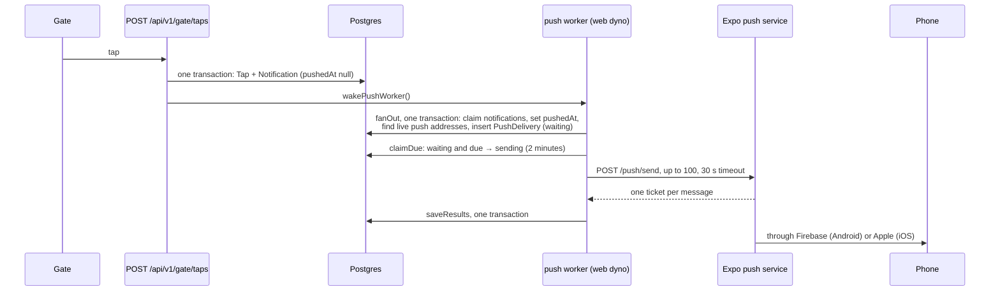
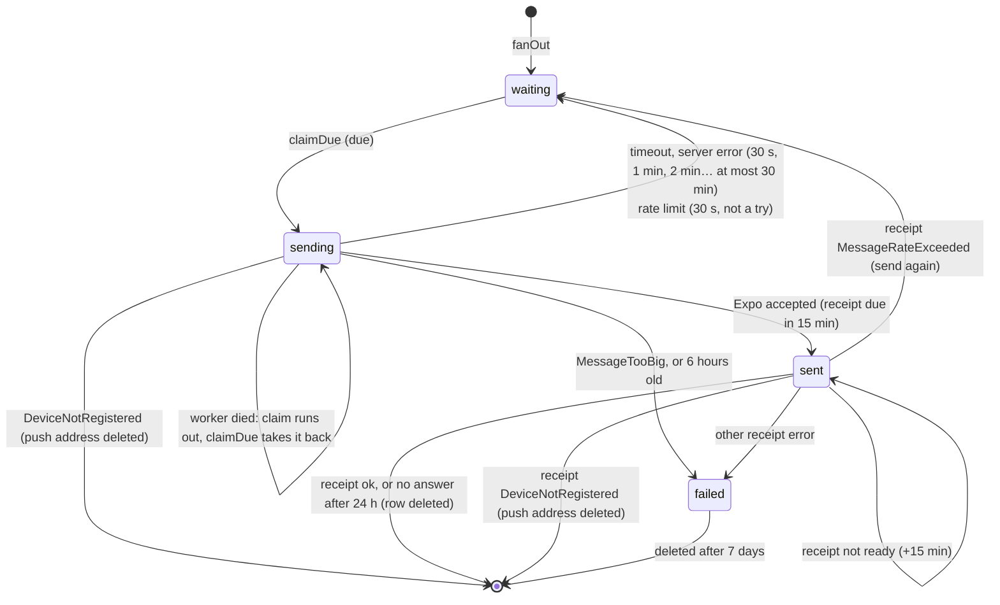

# Push notifications

How a tap at the gate becomes a buzz on a parent's phone (Steps 54 and 54.1). The short version: the tap writes a `Notification`, a worker inside the web server turns it into one `PushDelivery` per phone, and sends those through Expo's push service. About 15 minutes later Expo's receipt says how it went, and a delivered push's row is deleted. Nothing is lost on the way, nothing successful is kept, and it costs nothing extra to run.

Related: `docs/NOTIFICATIONS.md` (when a notification is made, and the feed), `docs/PARENT-API.md` (how the app registers its push address), the recipes `docs/backend/step-54-push-notifications.md` and `step-54.1-push-receipts.md`, and the owner's plain explanation with the numbers, "Bantay Aral Push Flow" (https://claude.ai/artifact/PgnXN3SSqE8DMRTudHWqAa).

## The owner's rules (2026-10-19)

- **The tap's saved time is what matters.** A push carries that time to the parent, and may be a few minutes late.
- **Background checks run every 5 minutes.** A new tap still wakes the worker at once.
- **Nothing about a successful push is kept.** Failed ones are kept 7 days.
- **A parent's sign-in lasts 30 days from its last use**, and opening the app counts. After that, no more pushes until the parent signs in again.

The same rules, for everyone, are in `README.md` ("Parent notifications: the rules").

## The one idea to hold on to

**The `Notification` row is the outbox.** It's written in the same database transaction as the gate's tap, so if the tap is stored, so is the promise to tell the parents. `Notification.pushedAt` is null until the worker has made that notification's deliveries. The worker sets it in the same transaction that writes them, so a crash can never leave a notification "pushed" with nobody to push to.



## Which phones get a push

Every push address (`PushToken`) of every parent linked to the child at that notification's school (only the notice's recipient for a link notice, Step 55.2), whose sign-in (`ParentToken`) **isn't revoked and was used in the last 30 days** (owner decision, 2026-10-19; Step 54 had "however long unused"). Opening the app counts as use: the app calls the API when it starts, which moves `lastUsedAt` forward (at most once an hour).

A phone stops getting pushes when:
- **30 days pass without the app being opened.** The hourly cleanup deletes that sign-in, with its push address. The parent signs in again to get pushes again;
- the parent signs out on it (logout deletes its push address);
- Expo answers `DeviceNotRegistered`, because the app is gone from it (the push address is deleted);
- the same phone signs in as another parent (the address moves to that sign-in).

## What the phone shows

```json
{
  "to": "ExponentPushToken[…]",
  "title": "Bantay Aral",
  "body": "Juan tapped in at 7:56 AM",
  "data": { "notificationId": "…", "childId": "student-0001" },
  "sound": "default",
  "channelId": "attendance",
  "priority": "high"
}
```

The **first name only**: the lock screen is visible to anyone near the phone, the text passes through Expo, Google and Apple, and students are minors. `toPushMessage` (`src/services/push/push-message.ts`) builds it.

**A removed link (Step 55.4)** takes its parent's deliveries about that child that are still `waiting` or `sending` with it (a "sending" one that comes back as "retry" would otherwise be `waiting` again). The fan-out's phone lookup ends with `FOR SHARE OF l`, so a link being removed waits for a fan-out in progress, and the removal then finds those deliveries too. Only a push already handed to Expo can still arrive.

A link notice (Step 55.2) reads **"A new parent account was linked to Juan"**: no adult's name and no time on the lock screen; the feed has the details. It uses the same `attendance` channel, since Android drops a push sent to a channel the app hasn't made.

## A delivery's life



The send rules are in `resultFor` (`src/services/push/send-due.ts`), and the receipt rules in `receiptOutcome` (`src/services/push/check-receipts.ts`). After Expo refuses a whole batch (`http_400`), each message is sent on its own, and one refused alone fails only if another got through; if none did, the whole batch retries (Step 54.1). Every time is the database's clock (`now()`, `createdAt`), never the app's, which the browser tests pin to a June morning. A notification more than 6 hours old when it's fanned out (after an outage) isn't pushed at all. It's always in the feed, and the worker logs the count.

## Receipts (Step 54.1)

Expo answers a push twice. The **ticket**, straight away, means "accepted". The **receipt**, about 15 minutes later, means "delivered to Apple or Google", or gives an error. It doesn't say whether the parent read it. The tap's time is already saved, so receipts are read for two things only:

| Receipt | Then |
|---|---|
| ok | the row is deleted: nothing about a success is kept |
| `DeviceNotRegistered` | the app is gone from that phone: its push address is deleted |
| `MessageRateExceeded` | Expo was too busy and never sent it: sent again, within the 6 hours |
| any other error | failed (`InvalidCredentials` and `MismatchSenderId` are logged as errors: every push is broken) |
| not ready yet | asked again 15 minutes later; after 24 hours, deleted as if delivered |

Each sent row has a `receiptDueAt`. A small partial index (`PushDelivery_receipt_due`) holds only the rows waiting for one. `receiptsDue` is a plain read, with no lock: every write in `saveReceipts` is safe to repeat, and holding a lock while waiting on Expo would tie up a database connection. `saveReceipts` writes one statement per kind of outcome.

## Cleanup (Step 54.1)

At most once an hour, in a quiet 5-minute check, in batches of 1,000 (at most 20,000 rows an hour), with `FOR UPDATE SKIP LOCKED`:
- failed deliveries older than 7 days (by `nextAttemptAt`, which is never earlier than `createdAt`, so the existing `(status, nextAttemptAt)` index serves);
- sign-ins that are revoked or unused for 30 days. The cascade takes their push addresses and deliveries.

## How much it stores and queries

A row lives only from the tap to its receipt (15 to 20 minutes), plus failures for 7 days. At the pilot (500 students, about 1,500 pushes a day) that's at most about 800 rows, under 0.5 MB. At 50 schools it's about 80,000 rows during the morning rush (about 35 MB), then near zero. Each push changes its row about five times, in statements of 100 to 1,000 rows. The 5-minute check is at most 288 small queries a day. These are estimates; measure `pg_total_relation_size('"PushDelivery"')` after launch.

## Two workers, never the same row

Both claims use `FOR UPDATE SKIP LOCKED` (`src/data/repositories/prisma-push-outbox-repository.ts`):

```sql
WITH due AS (
  SELECT "id" FROM "Notification"
  WHERE "pushedAt" IS NULL
  ORDER BY "createdAt"
  LIMIT 100
  FOR UPDATE SKIP LOCKED
)
UPDATE "Notification" AS n SET "pushedAt" = now()
FROM due WHERE n."id" = due."id"
RETURNING n."id", …
```

Two copies of the worker each take different rows: the old and new server during a deploy, a `heroku run`, a worker dyno later. A partial index, `Notification_to_push` (only rows with `pushedAt` null), keeps this question small however many notifications the years add up.

## Where it runs, and what it costs

Inside the web dyno: **$0 a month more**. Expo's push service is free.

- `src/instrumentation.ts` starts it once when the server starts, in development, the browser tests and the live server alike, never during a build.
- It runs when woken, right after a notification is written (the gate, a time in recorded by hand, the station). New taps never wait.
- Every **5 minutes** (owner decision, 2026-10-19; it was 30 seconds) a check runs retries and, only if there's nothing to send, receipts and the hourly cleanup. So a retry or a receipt waits up to 5 minutes, which is fine: the tap's time is already saved.
- One pass runs at a time. A wake during a pass makes one more pass straight after.
- The state lives on `globalThis` (`src/services/push/push-worker.ts`), since the start-up hook and the route handlers are bundled apart.
- It holds at most one database connection, and none while waiting on Expo.

A separate worker dyno would cost $7 a month, over the student credit. When it's needed, `startPushWorker` can run from a `worker:` line in the `Procfile`, unchanged.

## Known limits (architect review, 2026-10-16)

- **A push can arrive twice, rarely.** If the server restarts mid-send, or saving the results fails after Expo accepted them, the rows are taken back after their 2-minute claim and sent again. Acceptable at this size; never zero, since Expo and the database can't share one transaction.
- **An unreadable answer holds back its batch.** A batch Expo refuses with `http_400` is sent one message at a time (Step 54.1), but an answer that can't be matched up (`bad_answer`) still retries all its messages together, for up to 6 hours.
- **A lost phone that stays switched off** may never report `DeviceNotRegistered`. Its sign-in is cleared 30 days after the app was last opened, so it can't keep access longer than that.
- **A parent who only reads the banners stops getting pushes after 30 days**, with no warning on the phone (owner decision). Only the app's own requests move `lastUsedAt` forward, so the app calls the API every time it opens and returns to the foreground (`docs/PARENT-APP-BRIEF.md`).
- **A push Expo was too busy to send waits for the next 5-minute check** before it's sent again (owner's rule: a late push is fine).
- **The hourly sign-in cleanup reads the whole `ParentToken` table** (about 100,000 rows at 50 schools, a few milliseconds). Add an index on `lastUsedAt` only if it shows up as slow.
- **A phone registered later doesn't get earlier pushes.** A notification fanned out when its parents had no push address is marked pushed with no deliveries. It's in the feed.

## Settings

| Setting | Values | Notes |
|---|---|---|
| `PUSH_SENDER` | `expo` or `log` | `log` makes every push and "sends" it to the log only (`push: 2 message(s) to the log sender, none sent`), with a `log-` ticket. The default outside production. A live server must set it (`checkProductionEnv`). |
| `EXPO_ACCESS_TOKEN` | from expo.dev, Access tokens | Required with `expo` on a live server: Expo's "enhanced push security", so only this server can push to the app's phones. |

The browser tests run with `PUSH_SENDER=log` (`playwright.config.ts`).

## Files

| File | What it does |
|---|---|
| `src/services/push/push-sender.ts` | `PushSender`, `expoPushSender` (one `fetch`, no package), `logPushSender`, `getPushSender` |
| `src/services/push/push-message.ts` | the message |
| `src/services/push/send-due.ts` | `resultFor` (what each answer means) and `sendDue` (one batch, and the one-by-one retry) |
| `src/services/push/check-receipts.ts` | `receiptOutcome` (what each receipt means) and `checkReceipts` |
| `src/services/push/push-worker.ts` | `runPushPass`, `createPushWorker`, `startPushWorker`, `wakePushWorker` |
| `src/services/push/start.ts` | starts it with the real outbox; only `instrumentation.ts` imports it |
| `src/data/repositories/*push-outbox-repository.ts` | `fanOut`, `claimDue`, `saveResults`, `receiptsDue`, `saveReceipts`, `cleanUp` |
| `src/data/repositories/prisma-push-outbox.test.ts` | the SQL, against real Postgres |
| `e2e/parent-api.spec.ts` + `e2e/push-delivery.ts` | a gate tap reaches the log sender |

## Quick recipes

- **See it work locally:** sign in with `curl`, register `ExponentPushToken[test]`, then press **Record time in** on that parent's child's row on the Attendance page (`docs/COMMANDS.md` 7d). The dev server logs `push: sent 1, …`.
- **Look at the outbox:** `npx prisma studio`, table `PushDelivery`. Or in `psql`: `SELECT status, count(*) FROM "PushDelivery" GROUP BY status;`
- **Send for real:** `PUSH_SENDER=expo` and `EXPO_ACCESS_TOKEN` in `.env`, and a token from the parent app on a development build.
- **Add another provider** (SMS, say): a new `PushSender`, a new `PUSH_SENDER` value, and its check in `checkProductionEnv`. The worker doesn't change.
- **Change the text:** `toPushMessage`, and its test in `send-due.test.ts`.
- **See receipts work locally:** after a push with `PUSH_SENDER=log`, wait 15 to 20 minutes; a quiet 5-minute check logs `push: receipts ok 1, …`, and the row is gone from `PushDelivery`.
- **Change a timing:** `PUSH_CHECK_EVERY_MS` and `CLEAN_UP_EVERY_MS` (`push-worker.ts`), `RECEIPT_WAIT_MS` and `GIVE_UP_AFTER_MS` (`send-due.ts`), `PARENT_TOKEN_UNUSED_LIMIT_MS` (`src/services/parents/parent-token.ts`), and `README.md`'s rules with them.
