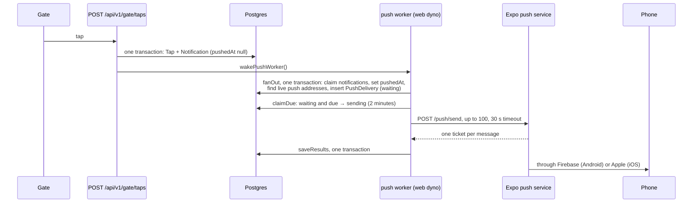
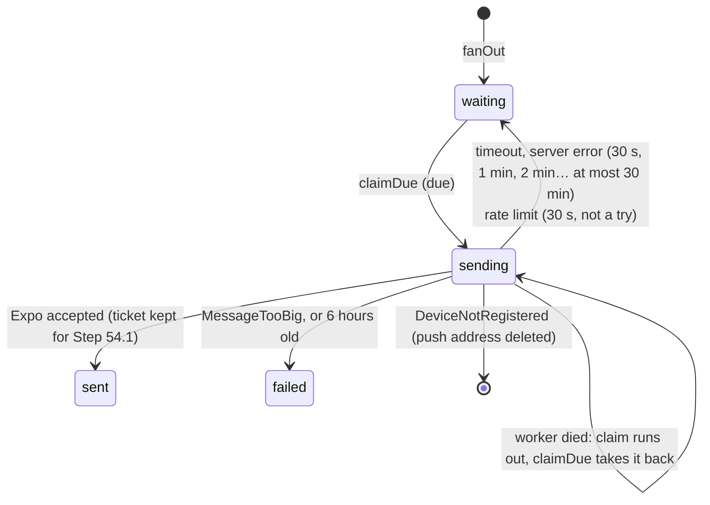

# Push notifications

How a tap at the gate becomes a buzz on a parent's phone (Step 54). The short version: the tap writes a `Notification`, a worker inside the web server turns it into one `PushDelivery` per phone, and sends those through Expo's push service. Nothing is lost on the way, and it costs nothing extra to run.

Related: `docs/NOTIFICATIONS.md` (when a notification is made, and the feed), `docs/PARENT-API.md` (how the app registers its push address), and the recipe, `docs/backend/step-54-push-notifications.md`.

## The one idea to hold on to

**The `Notification` row is the outbox.** It's written in the same database transaction as the gate's tap, so if the tap is stored, so is the promise to tell the parents. `Notification.pushedAt` is null until the worker has made that notification's deliveries. The worker sets it in the same transaction that writes them, so a crash can never leave a notification "pushed" with nobody to push to.



## Which phones get a push

Every push address (`PushToken`) of every parent linked to the child at that notification's school, whose sign-in (`ParentToken`) **isn't revoked**, however long since the app was last opened. A parent who only reads the banners keeps getting them (owner decision, 2026-10-16). For that to hold, `issueParentToken` no longer clears an unused sign-in that has a push address; it still clears revoked ones.

A phone stops getting pushes when:
- the parent signs out on it (logout deletes its push address);
- Expo answers `DeviceNotRegistered`, because the app is gone from it (the push address is deleted);
- the same phone signs in as another parent (the address moves to that sign-in).

## What the phone shows

```json
{
  "to": "ExponentPushToken[…]",
  "title": "Bantay Aral",
  "body": "Juan tapped in at 7:56 AM",
  "data": { "notificationId": "…", "childId": "student-0001" },
  "sound": "default",
  "channelId": "attendance",
  "priority": "high"
}
```

The **first name only**: the lock screen is visible to anyone near the phone, the text passes through Expo, Google and Apple, and students are minors. `toPushMessage` (`src/services/push/push-message.ts`) builds it.

## A delivery's life



The rules are in `resultFor` (`src/services/push/send-due.ts`). Every time is the database's clock (`now()`, `createdAt`), never the app's, which the browser tests pin to a June morning. A notification more than 6 hours old when it's fanned out (after an outage) isn't pushed at all. It's always in the feed, and the worker logs the count.

## Two workers, never the same row

Both claims use `FOR UPDATE SKIP LOCKED` (`src/data/repositories/prisma-push-outbox-repository.ts`):

```sql
WITH due AS (
  SELECT "id" FROM "Notification"
  WHERE "pushedAt" IS NULL
  ORDER BY "createdAt"
  LIMIT 100
  FOR UPDATE SKIP LOCKED
)
UPDATE "Notification" AS n SET "pushedAt" = now()
FROM due WHERE n."id" = due."id"
RETURNING n."id", …
```

Two copies of the worker each take different rows: the old and new server during a deploy, a `heroku run`, a worker dyno later. A partial index, `Notification_to_push` (only rows with `pushedAt` null), keeps this question small however many notifications the years add up.

## Where it runs, and what it costs

Inside the web dyno: **$0 a month more**. Expo's push service is free.

- `src/instrumentation.ts` starts it once when the server starts, in development, the browser tests and the live server alike, never during a build.
- It runs when woken, right after a notification is written (the gate, Simulate a tap, the station), and every 30 seconds as a fallback for retries.
- One pass runs at a time. A wake during a pass makes one more pass straight after.
- The state lives on `globalThis` (`src/services/push/push-worker.ts`), since the start-up hook and the route handlers are bundled apart.
- It holds at most one database connection, and none while waiting on Expo.

A separate worker dyno would cost $7 a month, over the student credit. When it's needed, `startPushWorker` can run from a `worker:` line in the `Procfile`, unchanged.

## Known limits (architect review, 2026-10-16)

- **A push can arrive twice, rarely.** If the server restarts mid-send, or saving the results fails after Expo accepted them, the rows are taken back after their 2-minute claim and sent again. Acceptable at this size; never zero, since Expo and the database can't share one transaction.
- **One bad message holds back its batch.** A whole request refused (`http_400`, or an answer that can't be matched up) retries all its messages together, for up to 6 hours. Push addresses are checked when they're registered, so this is unlikely. Step 54.1 retries such a batch one message at a time.
- **A dead phone lingers until Expo says so.** A lost phone's push address stays until Expo answers `DeviceNotRegistered`, which comes reliably only from receipts (Step 54.1). Sent rows also stay until Step 54.1's 7-day cleanup.
- **A phone registered later doesn't get earlier pushes.** A notification fanned out when its parents had no push address is marked pushed with no deliveries. It's in the feed.

## Settings

| Setting | Values | Notes |
|---|---|---|
| `PUSH_SENDER` | `expo` or `log` | `log` makes every push and "sends" it to the log only (`push: 2 message(s) to the log sender, none sent`), with a `log-` ticket. The default outside production. A live server must set it (`checkProductionEnv`). |
| `EXPO_ACCESS_TOKEN` | from expo.dev, Access tokens | Required with `expo` on a live server: Expo's "enhanced push security", so only this server can push to the app's phones. |

The browser tests run with `PUSH_SENDER=log` (`playwright.config.ts`).

## Files

| File | What it does |
|---|---|
| `src/services/push/push-sender.ts` | `PushSender`, `expoPushSender` (one `fetch`, no package), `logPushSender`, `getPushSender` |
| `src/services/push/push-message.ts` | the message |
| `src/services/push/send-due.ts` | `resultFor` (what each answer means) and `sendDue` (one batch) |
| `src/services/push/push-worker.ts` | `runPushPass`, `createPushWorker`, `startPushWorker`, `wakePushWorker` |
| `src/services/push/start.ts` | starts it with the real outbox; only `instrumentation.ts` imports it |
| `src/data/repositories/*push-outbox-repository.ts` | `fanOut`, `claimDue`, `saveResults` |
| `src/data/repositories/prisma-push-outbox.test.ts` | the SQL, against real Postgres |
| `e2e/parent-api.spec.ts` + `e2e/push-delivery.ts` | a gate tap reaches the log sender |

## Quick recipes

- **See it work locally:** sign in with `curl`, register `ExponentPushToken[test]`, then use Simulate a tap on that parent's child (`docs/COMMANDS.md` 7d). The dev server logs `push: sent 1, …`.
- **Look at the outbox:** `npx prisma studio`, table `PushDelivery`. Or in `psql`: `SELECT status, count(*) FROM "PushDelivery" GROUP BY status;`
- **Send for real:** `PUSH_SENDER=expo` and `EXPO_ACCESS_TOKEN` in `.env`, and a token from the parent app on a development build.
- **Add another provider** (SMS, say): a new `PushSender`, a new `PUSH_SENDER` value, and its check in `checkProductionEnv`. The worker doesn't change.
- **Change the text:** `toPushMessage`, and its test in `send-due.test.ts`.
- **Coming in Step 54.1:** Expo's receipts (15 minutes after a send) drop more dead phones, and old deliveries are deleted after 7 days.
