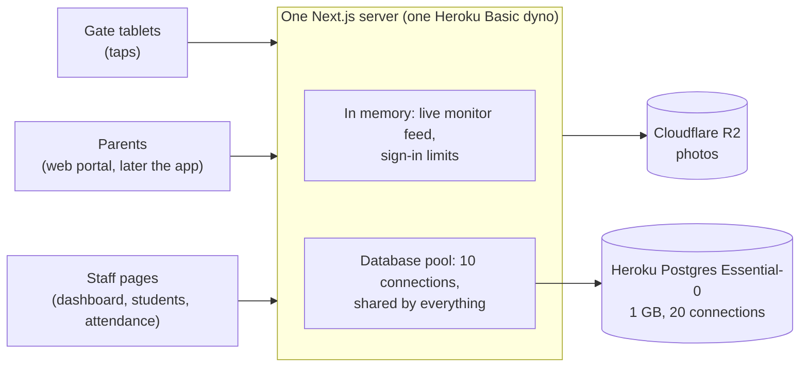

# Growing from one school to many

On 2026-10-13, just before the first deploy to Heroku (Step 52), the whole app was reviewed for one question: **what works for Balanga today but gets worse with more schools, bigger schools, or more years of data?** This page is that review. Every item points at the step in `docs/PLAN.md` that fixes it (Steps 53–64), or at the trigger that tells you it's time (section 5).

Nothing here blocks deploying the demo. The expensive decisions are already right. What's left are patterns that cost nothing at one school and a little more with every school and every year, plus a few safety gaps to close before real parents sign up.

## The verdict, in short

**Already right, and hard to change later:**
- **One database, every row scoped by school,** proven by tests that try to cross over (`docs/SCHOOL-ISOLATION.md`).
- **One copy of the tap rules,** `recordTap()` in `src/services/taps/record-tap.ts`, used by the gate's address and the terminal script alike (`docs/GATE.md`).
- **Tap ids made by the gate,** so a tap sent twice after a dropped connection is stored once.
- **The gate keeps its own roster and photos,** so it shows the student instantly even though the server is in the US, and the server only decides the status.
- **Outside services are behind small interfaces, chosen by environment variables:** Postgres through `DATABASE_URL`, photos through `PhotoStorage` (a folder locally, R2 in production). Changing provider means new settings, not new code.
- **Sessions are signed cookies** (`docs/AUTH.md`), so there's no session table to grow or clean up.
- **The busiest reads have indexes:** `Tap` by `(schoolId, tappedAt)` for one school's day, and by `(studentId, tappedAt)` for one student's day.
- **The known one-server limits are written down** where they live: `src/services/taps/tap-events.ts`, `src/services/auth/login-throttle.ts`, and Step 52's recipe.

**What needs work** falls into four groups: safety and correctness before real use (section 1), decisions the parent app will lock in (section 2), queries that grow (section 3), and the school year (section 4).

## A busy morning

Students don't sign in: they tap. The morning load is gate taps, then parents opening their notification, then staff checking pages.

| | Balanga today | 20 schools of 1,000 |
|---|---|---|
| Taps | about 500, mostly within 30 minutes: one every 3–4 seconds | about 20,000 in 30–45 minutes: around 10 a second, more in bursts |
| Push notifications (Phase 3) | up to one per tap | up to 20,000 in the same window |
| Database work per tap | about a dozen round trips (the token, the resend check, the card, the 2-minute check, the student, the day so far, the school, then one transaction) | the same per tap; the total is what grows |



The one thing to take from the diagram: **every request shares the same 10 database connections.** A page that makes hundreds of queries doesn't just load slowly. While it runs, gate taps wait in line behind it. That's why the "one query per student" pages in section 3 matter even at one school.

## The steps at a glance

| Step | What | Due |
|---|---|---|
| 53 | One parent account for any number of schools (2.1) | done |
| 53.1–53.4 | Parent sign-in services, paged parent data (2.2), then the parent API, split on 2026-10-16 | next |
| 54 | Push notifications reach the phone (2.3) | for the demo, alongside the parent app |
| 55 | Safe for real parents (1.1, 1.2) | before real parents sign up |
| 55.5 | Forgot password by email (not from this review; owner decision, 2026-10-13: parents recover it from the app) | before real parents sign up |
| 56 | One read, one tap (1.3) | before real use at the gate |
| 57 | Lost cards and alerts (1.4, 1.5) | before real use at the gate |
| 58 | The gate keeps taps while offline (1.6) | before real use at the gate |
| 59 | Know when something breaks (1.7) | before real use |
| 60 | Privacy for real student data (1.8) | before real use, and before the app is published |
| 61 | Queries that don't grow (3.1–3.3) | before a second school |
| 61.1 | The roster answers "nothing changed" cheaply (3.4) | before a second school |
| 62 | Pages ask the database once (3.5) | before a second school |
| 63 | School calendar (4.1) | before the next rainy season (around June 2027) |
| 64 | School years (4.2) | before the next school year starts (around June 2027) |
| — | Section 5: more than one server, storage, row-level security, a closer region | when its trigger happens |

The order is a recommendation. Step 54 comes first because the demo needs a tap to reach a parent's phone (`docs/PARENT-APP-BRIEF.md`). Steps 55–60 can swap places; each is small enough to review in one sitting.

## 1. Before real students and parents use it

### 1.1 The demo tools write real data (Steps 55 and 55.1)

The dashboard's **Simulate a tap** button (every staff member, teachers included, for their own class) and the `/station` simulated kiosk (principals and super admins) both create real taps and real parent notifications (`simulateTap` in `src/features/attendance/actions.ts`, `syncStationTaps` in `src/features/station/station-actions.ts`). On a demo server that's the point. At a real school, a teacher could mark a student present who never came, and the parent would be told the child arrived.

**Fix:** switch them off for real schools. The recipe decides how: a server setting, or a "demo school" flag on each school, since the demo and the pilot may share one server.

**Update (Step 55, 2026-10-20):** the dashboard's button is gone. In its place, a staff member records one chosen student's time in by hand from their attendance row, saved with their name (`Tap.recordedById`) and shown as "Recorded by staff", once per student per day, before any tap. That's a real tool for a failed sticker, not a demo one. The `/station` kiosk is still a demo tool: Step 55.1 switches it per school.

**Fixed (Step 55.1, 2026-10-21):** `/station` is gone too (owner decision: it no longer matched the real gate and monitor, and it could make taps nobody made). Taps now come only from the real gate and from "Record time in", which says who recorded it.

### 1.2 Anyone can try birth dates to link a child (Step 55.1)

This is the most serious item, because the students are minors. Parent sign-up needs no check, and linking a child needs the LRN, last name and birth date, with no limit on wrong tries:

```ts
// src/features/parents/auth-actions.ts, linkChild
const student = await studentRepository.findForLink(session.schoolId, parsed.data);
if (!student) {
  return {
    ok: false,
    formError: "We couldn't find a student with that LRN, last name and birth date at your school.",
  };
}
```

Someone who knows a child's LRN and last name (a classmate's parent, an estranged relative) can try every birth date for a high-school age, about 2,500 tries and a few minutes. They then see when that child arrives and leaves, and with Step 53, the child's photo.

**Fix:** a limit on wrong tries, per parent and per student. The school, and the child's other linked guardians, are told when a new parent links. Whether a principal approves each link first is a decision for the recipe.

**Fixed (Step 55.1, 2026-10-21):** 5 wrong tries per parent in 15 minutes (in memory), and 10 tries per child in 24 hours (school, LRN and last name, from any number of accounts), counted in Postgres in a `LinkAttempt` table so a restart can't reset it. Each try is saved before it's counted, so tries sent all at once can't slip past the limit (tested with 50 at once). The table holds an HMAC of the three details with the server's secret, never the LRN. A locked child answers "Too many tries for this student. Try again tomorrow." whether or not the details match. Telling the other guardians about a new link is Step 55.2, and the school's view of every link, with removing one, is Step 55.3. **Decided 2026-10-22 (owner): no principal approval before a link works**; it would only add work for the principal.

**Built (Step 55.2, 2026-10-22):** linking a child saves, in the same transaction, one `guardian_linked` notice for each guardian already linked to that child: "An account named Ana Santos linked to Juan Cruz. If you don't know them, contact the school." It reaches only that guardian (feed, unread count, read marks and push), never the parent who linked. Two parents linking one child at once take turns on the child's row (`FOR NO KEY UPDATE`, which never holds up a tap), so exactly one of them tells the other. See `docs/NOTIFICATIONS.md`, "A second kind".

**Built (Step 55.3, 2026-10-22):** the school sees every link: in the student drawer ("Parent accounts": name, mobile, date linked) and on the dashboard ("New parent links", the last 7 days). 

**Built (Step 55.4, 2026-10-22):** a principal can remove a wrong link from the drawer, after a confirmation. That parent stops seeing the child at once, their queued pushes about the child are dropped, and they can't link the child again until the school chooses "Allow again". The limit that's left: the same person can sign up with a new account, which tells the guardians and shows on the dashboard again.

### 1.3 Two reads of one card can become a time in and a time out (Step 56)

The gate sends every read straight away, without waiting for the one before (`handleScan` in `src/features/gate/gate-kiosk.tsx`). The server checks for a tap in the last 2 minutes, then writes, in two separate moments:

```ts
// src/services/taps/record-tap.ts, recordTap
const previousTap = await deps.taps.findByCardBetween(
  device.schoolId,
  cardSerial,
  new Date(at - DEBOUNCE_MS).toISOString(),
  new Date(at + DEBOUNCE_MS).toISOString(),
);
if (previousTap) {
  …
  return { outcome: "duplicate", previousTap, student: toTapStudent(student) };
}
…
const written = await deps.writer.record({
```

If the reader reads one card twice within a fraction of a second, both requests check before either has written. Both find nothing, and both are stored with different ids. The student gets a time in and a time out together, and the parent gets "arrived" and "left" in the same second. This is called a **race**: two requests racing each other between the check and the write.

**Fix:** the check and the write happen as one step per card (a short Postgres lock on that school's card, held only while checking and writing), and the gate also ignores the same card read again within a few seconds.

### 1.4 A lost card's tap counts as its owner arriving (Step 57)

A lost card's tap is stored with its owner's `studentId`, so the alert can name them. Step 45 chose this and flagged one side effect: the tap counts as the owner arriving (`docs/backend/step-45-tap-service.md`, decision 4). There's a second side effect. Time in and time out alternate (`deriveTapKind`), so the lost card's tap also shifts the owner's **next real tap to "time out"**, and their parent is told the child left school in the morning.

**Fix:** decide with the owner whether a lost card's tap is the owner's attendance. Either way, it must not count toward their time in and time out. Two ways to build it: leave such taps out of the counting (they have an alert), or store them with no student and find the owner through the card.

### 1.5 Alerts can't be cleared (Step 57)

Nothing marks an alert handled. The dashboard loads every alert the school ever had, keeps the open ones (all of them), then looks up each one's tap separately (`src/app/(app)/dashboard/page.tsx`). "Needs attention" only grows, and so does the number of queries behind it.

**Fix:** a principal can mark an alert handled, and the dashboard loads open alerts with their taps in one query.

### 1.6 Taps are lost while the internet is down (Step 58)

A tap read while the tablet is offline shows "Not sent: no connection" and asks the student to tap again. In a morning rush on school internet, some won't. The offline queue was planned from the start (CLAUDE.md, Domain: "a station made while offline still generates its tap records locally"). It's on the plan's after-demo list, along with photos loading from the tablet's own copy when the server can't be reached at start-up.

**Fix:** keep offline taps on the tablet, with the id they already get, and send them when the connection returns. Parents are notified only once a tap reaches the server.

### 1.7 Nobody hears when something breaks (Step 59)

Errors only reach `heroku logs`, which nobody reads at 7 AM. If the tap address starts failing, the first sign is a guard's phone call.

**Fix:** error tracking for the server and the browser, an uptime check on `GET /api/v1/health` that messages the owner, and one practice restore of a database backup, written up in `docs/DEPLOY.md`. Free plans exist (Sentry and UptimeRobot are common examples). Check their current limits, and what an error report stores, since it can include students' names.

### 1.8 Privacy for real student data (Step 60)

Already on the plan's later list: consent records, export and delete per school, and an audit log of who changed what. One more piece belongs here: a parent deleting their own account from the app, which both app stores require before publishing an app that creates accounts. Schools will ask how Talaan handles students' data under the Data Privacy Act. This step is the technical half. The wording of a privacy notice comes from the school; this page isn't legal advice.

## 2. The parent app

### 2.1 A parent account belongs to one school (Step 53)

```prisma
// prisma/schema.prisma
model Parent {
  id           String              @id @default(uuid())
  schoolId     String
  …
  email        String              @unique
```

Each parent has one `schoolId`, and the email is unique across **all** schools. A parent with children at two Talaan schools can't use one account, and can't make a second one with the same email either. The parent session carries that one school too (`src/lib/parent-session.ts`).

Today that's a small change: `ParentStudentLink` already has its own `schoolId`. Once the mobile app ships with "one school per parent" built into its screens and the API, it becomes a migration plus an app update.

**Decided 2026-10-13 (owner):** one account per parent, because a parent can have children at different schools. The school moves from the parent to each linked child. Sign-up needs no school. Linking a child asks for the school as well as the LRN, last name and birth date, so a wrong guess never searches every school. The parent row in `docs/SCHOOL-ISOLATION.md` changes to match. Built in Step 53, before the API's shape is fixed.

### 2.2 Parent screens load everything ever recorded (fixed in Step 53.2, 2026-10-16)

```ts
// src/app/parent/(protected)/page.tsx
const tapsByStudent = await Promise.all(
  linkedStudents.map((student) => tapRepository.listByStudent(session.schoolId, student.id)),
);
```

The parent home page loads **every tap each child ever made**. The bell in the parent layout loads **every notification ever**, on every page (`getParentNotifications` in `src/features/parents/notifications-data.ts`). A child taps about 400 times a school year. After the morning push, thousands of parents open the app within minutes, so each of those requests should be small.

**Fix:** Step 53's services load today only, or one page at a time, newest first. The unread count is a count in the database.

**Built in Step 53.2.**
- The home page reads each child's taps for today and their last 10.
- The bell reads the newest 5 and an unread count that stops at 10.
- The feed reads 30 at a time with a cursor.
- One child's unread count still walks that child's own rows when their parent reads everything (about 400 a year). That's bounded by one child, not by the school; add a partial index on unread rows only if `EXPLAIN` shows it matters (`docs/backend/step-53.2-paged-parent-data.md`).

### 2.3 Push needs a delivery record per phone, and a worker (Step 54)

A `Notification` row today is one line in the parent's feed, one per child per tap. A real push goes to each phone of each linked parent, and any of them can fail. CLAUDE.md's rule is that a notification is never silently lost: the tap and its outbox are written in one transaction, and a separate worker sends.

**Fix:**
- one delivery record per phone (waiting, sent, failed, tries), written in the same transaction as the tap;
- a worker that sends them in batches through Expo's push service (free; it delivers through Firebase Cloud Messaging on Android and Apple's push service on iOS), and retries;
- the worker's running cost stated before it's added: one more dyno, or inside the web server at first.

Step 53's plan stores the phones' push tokens, so the app can register from its first version.

**Built in Step 54 (2026-10-16), changed from the fix above** (owner approval, architect review): the delivery records are made by the worker, in the same transaction that marks the notification pushed, not in the tap's own transaction. The `Notification` row, written with the tap, is the outbox, so nothing can be lost, and a phone registered in between still gets the push. The worker runs inside the web dyno ($0). Step 54.1 adds Expo's receipts and deletes deliveries after 7 days, before a second school. See `docs/PUSH.md`.

## 3. More schools, bigger schools, more years

### 3.1 Every tap reads the student's whole history (Step 61)

To decide time in or time out, `recordTap` loads every tap the student ever made, then keeps only today's:

```ts
// src/services/taps/record-tap.ts
async function directionOf(tap: Tap, studentId: string, deps: RecordTapDeps) {
  const [studentTaps, school] = await Promise.all([
    deps.taps.listByStudent(tap.schoolId, studentId),
    deps.schools.getById(tap.schoolId),
  ]);
  const direction = deriveTapKind(tap, studentTaps);
```

`deriveTapKind` (`src/features/attendance/status.ts`) only ever looks at the same day. So every tap reads about 400 more rows each school year, forever: about 2,400 by a student's last year. `notifyParentsForTap` (`src/features/attendance/notify-parents.ts`) does the same.

**Fix:** a "this student's taps on this day" query. The `(studentId, tappedAt)` index already answers it.

### 3.2 Matching a card reads every school's cards (Step 61)

```prisma
// prisma/schema.prisma
model Card {
  …
  serial    String     @unique
  …
  @@index([studentId])
}
```

`Card` has no index by school. The two lookups by school, matching a tap's card (`listBySerialPrefix`) and building the gate's roster (`listActiveBySchool`), read the card table of **every** school. The prefix match also can't use the `serial` index. Postgres only uses an ordinary index for `LIKE '53:2E:98:0C%'` under the "C" collation, and the local database uses `en_US.utf8` (Heroku's databases use `en_US.UTF-8` too). This was checked on the local database by turning off full-table reads:

```text
SET enable_seqscan = off;
EXPLAIN SELECT * FROM "Card" WHERE "schoolId" = 'school-balanga' AND serial LIKE '53:2E:98:0C%';

 Seq Scan on "Card"  (cost=0.00..4.07 rows=1 width=86)
   Disabled: true
```

"Disabled: true" means Postgres had no index it could use, so it read the whole table anyway. The repository's own comment ("a few hundred cards a school, so a prefix search is cheap") is true of one school, not of one shared table.

**Fix:** an index on `Card` by `schoolId` (with the serial, in a form that supports prefix matching), so a tap reads only its own school's cards.

### 3.3 The database pool's size is left to the default (Step 61)

```ts
// src/lib/db.ts
const adapter = new PrismaPg({ connectionString: process.env.DATABASE_URL });
```

With no size given, the pool allows 10 connections (the `pg` library's default). Essential-0 allows 20 in total, which also has to cover the release phase's migration and any `heroku run` command. That's fine for one server. Two servers plus a push worker would ask for 30.

**Fix:** set the size on purpose (a `DATABASE_POOL_SIZE` setting, for example), and write the connection budget in `docs/DEPLOY.md`.

### 3.4 The gate roster is rebuilt even when nothing changed (Step 61)

`GET /api/v1/gate/roster` loads every active card and every student, builds the JSON, hashes it, and only then compares the hash with the gate's (`src/app/api/v1/gate/roster/route.ts`). The "nothing changed" answer saves the download but not the work. One gate checking every few minutes is nothing. Hundreds of gates are hundreds of full rebuilds.

**Fix:** answer "nothing changed" from something cheap, such as the newest change time of the school's students and cards, before building anything.

### 3.5 Pages that ask the database once per student (Step 62)

This is the biggest one. It's called an **N+1** pattern: one query for the list, then one more for each of the N items in it.

```ts
// src/features/students/search-students.ts
const allStudents = await students.listBySchool(schoolId);
…
const cardsByStudent = await Promise.all(filteredByGrade.map((student) => cards.listByStudent(schoolId, student.id)));
```

The Students page loads every student, asks for each one's cards separately, then sorts and cuts out one page in memory. Every search, filter and page change does it again.

| Page | At Balanga (500 students) | At a 3,000-student school |
|---|---|---|
| Students (`search-students.ts`) | about 500, one per student | about 3,000 |
| Attendance, and the teacher's dashboard | one per student in the class (about 40) | the same |
| Schools (`src/app/(app)/schools/page.tsx`) | loads every student and staff member **of every school**, only to count them | 100 schools of 1,000 is 100,000 rows per view |

**Fix:** one query per list. The database filters, sorts, cuts the page and counts the total. Each student's cards come in the same query (`include`), and the Schools page asks for counts.

## 4. The school year and the calendar

### 4.1 No school calendar (Step 63)

Weekends have their own rule (no late or absent, `docs/ATTENDANCE-MODEL.md`). A weekday holiday, or a class suspension for a typhoon, shows the whole school as absent.

**Fix:** a school can mark holidays and suspensions, and those days show "No class", never absent. The recipe also decides about schools with Saturday classes.

### 4.2 No school year (Step 64)

A student has one grade and one section, the current ones. When students move up in June, past attendance looked up by class lists them under their new section. Graduated, transferred and dropped students have no "inactive" status, so they stay on rosters and count as absent.

**Fix:** students can be marked inactive, keeping their history. A new school year keeps last year's attendance under last year's class. That means either an enrollment per school year, or each tap keeping the grade and section it was made under. The recipe weighs the two. Due before the next school year starts (around June 2027).

## 5. When needed: no step number until it's due

| What | The trigger | The work |
|---|---|---|
| **More than one server** | One dyno is slow at the morning peak (Heroku's metrics: response time, memory), or restarts need to happen without a gap | Heroku's Basic plan runs one copy, so this means Standard dynos. The live monitor feed moves to Postgres `LISTEN/NOTIFY` behind the same two functions in `src/services/taps/tap-events.ts`. The sign-in limits move to a table. Add a connection pooler (PgBouncer). Each costs money, stated first. |
| **Database storage** | `heroku pg:info` shows about 70% of the plan's storage used (section 6) | Decide how many years of taps and notifications to keep, archive older ones, and move to the next plan |
| **Postgres row-level security** | A second real school joins (already decided in `docs/SCHOOL-ISOLATION.md`) | The database itself filters by school, on top of the repositories |
| **Servers closer to the Philippines** | Pages feel slow, or a school or DepEd asks where the data is kept | Heroku's ordinary plans run in the US or Europe. A host with a Singapore region is a settings move, because the app only needs Postgres and S3-compatible storage. |
| **From the plan's after-demo list** | When wanted | Web Push in the browser, gate online/offline on the dashboard, an admin screen for devices |

## 6. Storage, worked out

Measured on the local database on 2026-10-13: a tap row averages **140 bytes**, a notification **114 bytes**. Each has three indexes. With those, a tap costs about **360 bytes**, a notification about **320**.

For a 500-student school, about 200 school days a year at about 2 taps a day:
- **200,000 taps** a year: about 72 MB;
- **200,000 notifications** with "time in and time out" on: about 64 MB;
- plus Postgres's own overhead: **roughly 150–170 MB a year**.

Essential-0 holds **1 GB**: about 5–6 years for Balanga alone, or about a year for five schools that size. Students, cards and staff are tiny next to this. Photos live in R2, not the database: about 10 KB each, so about 5 MB for 500 students, against R2's free 10 GB.

## Quick recipes

**Before adding a query, ask what it grows with.**

| It grows with | Then |
|---|---|
| students in one school | page it in the database (`take`, `skip`) and count with `count` |
| days and years | give it a date range: today, this week, one page of history |
| the number of schools | make sure an index starts with `schoolId` |
| a list it's called inside | make it one query for the whole list (`where: { id: { in: ids } }`, or `include`) |

**Spot an N+1.** A query inside `list.map(…)` is the usual shape. This lists the ones written on one line:

```bash
grep -rnE "\.map\((async )?\(?[a-zA-Z]+\)? => [^)]*\.(list|get|find)[A-Za-z]*\(" src/app src/features src/services | grep -v "\.test\."
```

It misses a loop spread over several lines (the Schools page is one), so read any `Promise.all(` near a `.map(` too.

**See whether Postgres uses an index** (on the local database):

```bash
docker exec -it talaan-postgres psql -U postgres -d talaan
```
```sql
EXPLAIN SELECT * FROM "Tap" WHERE "studentId" = 'student-0001'
  AND "tappedAt" >= '2026-06-18T16:00:00Z' AND "tappedAt" < '2026-06-19T16:00:00Z';
```

On a table this small, Postgres often reads the whole table (`Seq Scan`), because that's genuinely faster for a few hundred rows. To see whether an index *could* be used, run `SET enable_seqscan = off;` first. `Bitmap Index Scan on "Tap_studentId_tappedAt_idx"` means yes. `Disabled: true` under a `Seq Scan` means no usable index exists (section 3.2). `\q` quits.

**See the SQL Prisma sends.** Make a client with `log: ["query"]` in a throwaway script, run it with `npx tsx`, then delete it. That's how Step 53.2 found that a capped `count` orders by `id` unless told otherwise (`docs/PROBLEMS-LOG.md`, P-016).

**Check the live database:** `heroku pg:info --app <name>` shows the plan, the data size, and how many connections are in use.

**Add an index:** add `@@index([...])` to the model in `prisma/schema.prisma`, then make the migration with `npx prisma migrate dev --name <what-it-is>`. `docs/DATABASE-MIGRATIONS.md` covers the rest, including changes to a database that schools are already using.
