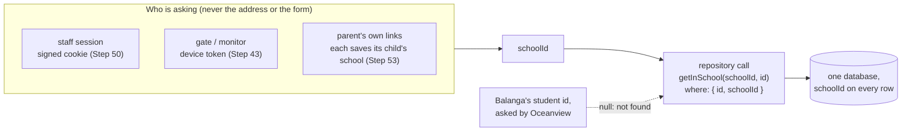

# How one school never sees another's data

Talaan keeps every school in one database (CLAUDE.md, "Multi-tenant, one database"). That's what keeps it cheap: one server and one database, however many schools join. The price is that every query has to know which school it's for. This page explains how that's guaranteed (Step 51), lists every way into the data and where its school comes from, and ends with a recipe for adding a new one.

## The rule

1. **The school comes from who is asking.** A staff member's signed session, a device's token, or, for a parent, the school saved on each of their own links (the server checked it when the child was linked). Never from the address, a hidden form field, or an object the browser sends back.
2. **Every lookup by id asks for the school too.** `studentRepository.getInSchool(schoolId, id)` runs `findFirst({ where: { id, schoolId } })`, so the database itself refuses another school's row. A forgotten check *after* the lookup can't leak anything, because there's nothing to forget.
3. **Writes are scoped the same way.** `update(schoolId, student)`, `remove(schoolId, id)`, `markLost(schoolId, cardId)` and `markRead(schoolId, id)` put the school in the `where`, so another school's id changes no row.
4. **"Not found", never "forbidden".** Another school's id gets exactly the answer a made-up id gets, so nobody can probe which ids exist.

## The repository methods

| Repository | Scoped (takes `schoolId` first) | Unscoped on purpose, and why |
|---|---|---|
| Students | `listBySchool`, `getInSchool`, `update`, `findForLink` | — |
| Staff | `listBySchool`, `getInSchool`, `remove` | `getById`: only for the signed-in person themselves (`session.userId`). `findByEmail`, `findForSignIn`, `getForSession`, `setPassword`: sign-in and set-password links, where who you are decides your school. `list`: the dev switcher's persona list, development only. |
| Cards | `listByStudent`, `getActiveForStudent`, `listBySerialPrefix`, `listActiveBySchool`, `markLost` | `getBySerial`: a serial is one physical card, unique across every school, so linking must see another school's card to refuse it. The refusal never names whose it is. |
| Taps | `listBySchoolOnDate`, `listByStudent`, `getInSchool`, `findByCardBetween` | `getById`: only `recordTap`'s replay check, which compares the stored tap's school with the gate's own. |
| Notifications | `listBySchool`, `listByStudent`, `getInSchool`, `markRead` | — |
| Alerts, parent–child links | by school or by parent | — |
| Schools | — | `getById`, `update`: always called with the session's own school. `list`: the super admin's Schools page and the school picker on the parent's "Link a child" (names only). |
| Devices | — | `findByTokenHash`: the token *is* the identity. |

## Every way in

| Way in | Who | Where the school comes from |
|---|---|---|
| Staff pages: `/dashboard`, `/attendance`, `/students`, `/staff`, `/settings` | staff | `requireSession().schoolId`: their own school, or the one a super admin opened |
| `/schools` | super admin only | none: it lists every school, by design |
| Students: `createStudent`, `updateStudent`, `checkCardSerial` | principal, super admin | `getSession().schoolId` |
| Staff: `inviteStaff`, `createSignInLink`, `removeStaff` | principal, super admin | `getSession().schoolId`, and the target is looked up with `getInSchool` |
| Attendance: `recordTimeIn` (Step 55) | staff; a teacher only for their own advisory class | `getSession().schoolId`, and the student is looked up with `getInSchool` |
| Settings: notification preference, attendance times, theme | principal, super admin | `getSession().schoolId` |
| `createSchool`, `openSchool` | super admin only | the new or chosen school, by design |
| `/api/v1/devices/heartbeat`, `/api/v1/gate/taps`, `/api/v1/gate/roster` | gate | `Device.schoolId`, from the token |
| `/api/v1/gate/stream`, `/gate/display` | monitor, or a principal or super admin | the monitor cookie's device, or the session (`resolveMonitorViewer`) |
| `/api/v1/photos/<school>/…` | staff, gate, monitor, parent app, parent on the web | the viewer's school must equal the key's first part (`canViewPhoto`); for a `tal_par_` token, the key's school and student must be one of the parent's own links (Step 53.4). A web parent's cookie is tried only after that check said no and only without an `Authorization` header, with the same rule on that parent's links (`webParentPhotoViewer`, Step 59.5); otherwise 404 |
| `/parent/*` pages, `markNotificationRead`, `markAllNotificationsRead` | parent | each of the parent's own links carries its child's `schoolId` (Step 53); the parent session holds only the parent |
| `/api/v1/parents/*` (the parent app) | parent | the same as the `/parent/*` pages: the `tal_par_` token gives only the parent, and each of their links carries its child's school. Another child's taps, or another child's notification marked read, is 404 (`docs/PARENT-API.md`) |
| `linkChild` | parent | the school the parent picks, accepted only when a student there matches the LRN, last name and birth date; the new link saves it. Wrong tries are limited per parent and per child (Step 55.1) |
| `/set-password` | whoever holds the link | the staff member in the signed token; the page shows only their own name and email |
| `/design-system` | nobody in production | `notFound()` |

## How it's tested

- **Every action, crossing over** (`src/features/isolation.test.ts`): signed in as Oceanview, with in-memory repositories filled with the demo data, each action is called with Balanga's ids. Every answer is "not found" or a refusal, and Balanga's record is unchanged afterwards. This test found the tap station hole above.
- **The real `where` clauses** (`src/data/repositories/prisma-isolation.test.ts`): the Prisma repositories run against the browser tests' database. Asked for Balanga's rows as Oceanview, every lookup is null and every write changes nothing. Skipped when `E2E_DATABASE_URL` isn't set.
- **The pages and addresses** (`e2e/isolation.spec.ts`): Oceanview's student search finds no Balanga student, a Balanga photo is a 404, an Oceanview gate treats a Balanga card as unknown and its roster has no Balanga students, and picking Balanga with an Oceanview child's details finds no match.
- **Each mock repository** has a "never reaches another school's …" test.

## Why not Postgres row-level security yet

Row-level security (RLS) makes the database itself filter every query by a "current school" setting. With Prisma and a connection pool, that means wrapping every request in a transaction that first runs `set_config('app.school_id', …)`. That changes how every repository is called, adds a database round trip to every request, and is easy to get subtly wrong: a pooled connection can keep the previous request's school. For one pilot school, scoping inside the repositories and proving it with the tests above gives the same protection with much less risk. RLS is listed for after the pilot, when a second real school joins.

## Quick recipes

**I'm adding a page or an action. Where does my school come from?** From `requireSession()` (a page), `getSession()` (a staff action), the device (`authenticateGate`), or, for a parent, the `schoolId` on each of their own links (`parentStudentLinkRepository.listByParent`). Never from `params`, `searchParams`, a form field or an object the browser sends. If the browser sends an object that carries a `schoolId` (like the tap station's taps), compare it with the session's and drop it when it differs.

**I'm adding a repository method that finds one row by id.** Make it take `schoolId` first and put both in the `where` (`findFirst({ where: { id, schoolId } })`, `updateMany`/`deleteMany` with both). Do the same in the mock. If it really must be unscoped, say why in its comment and add it to the table above. Add a line for it to `prisma-isolation.test.ts`.

**I'm adding a new kind of record.** Give it a `schoolId` column, index it, and add a "never reaches another school's …" test to its mock repository's tests.
