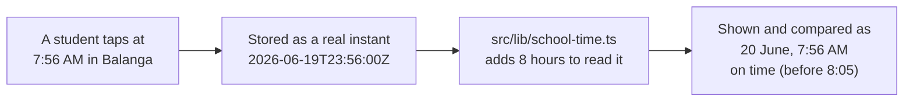

# Step 44: The real clock, in Philippine time

> **Fast-track recipe.** Written before the code, approved, then built on 2026-10-11. The core new code below is what was built. "What changed while building" (just before "Verify it worked") lists where the real code differs from the plan, and why.

## Why

Two things about time in the app are still Phase 1 stand-ins, and the gate can't record a single real tap until both are fixed.

**1. The app's clock is frozen.** `DASHBOARD_NOW` in `src/features/attendance/status.ts` says it's always 9:15 AM on 20 June 2026. Every "today", every present/late/absent, every simulated tap uses it. A real tap made this morning would land on a day the app never looks at.

**2. Stored times aren't real times.** Phase 1 wrote the school's own clock time and pretended it was UTC: a 7:56 AM tap is stored as `07:56:00Z`. That worked while everything was made up. But a real tap at 7:56 AM in Balanga happens at **23:56 UTC the day before** (the Philippines is 8 hours ahead of UTC). Store that honestly and the old code would put it on the wrong day, and call it "11:56 PM".



The fix follows one rule: **store real instants, and read them on the school's clock in exactly one place.**

What you'll see afterwards:
- `npm run dev` shows **today**. The demo data stays on 20 June 2026 (your decision), so today's dashboard starts empty and fills as taps come in. Use **Simulate a tap** to see it.
- The browser tests pin the clock with **`DEMO_NOW`** to the demo morning, so they see the same data every run.
- When the clock is pinned, staff pages show a small **"Demo clock"** badge, so a pinned clock can never go unnoticed on a real server.
- "Good morning" becomes "Good afternoon" or "Good evening" by the school's clock.

Each school choosing its own late and absent times is **Step 44.5**. This step keeps 8:05 and 9:00 as defaults, but already passes them around as values, so Step 44.5 only has to supply them from the school.

## Decisions in this step

- **A fixed +8 hours, not a time-zone library.** The Philippines is UTC+8 all year, with no daylight saving. Adding 8 hours is exact, needs no dependency, and runs the same in the browser and on the server. If a school outside the Philippines ever joins, `school-time.ts` is the only file to change.
- **`DEMO_NOW` is a setting, never code.** It's set by `playwright.config.ts` for the browser tests, and optionally in your own `.env` to show the demo morning. It's never set on Heroku. The badge makes it visible if it ever is.
- **Pages load only the day they show.** Today every page loads *every tap the school ever had* and filters in the browser. With real use (500 students, two taps a day, 200 school days) that's 200,000 rows on every page load. A new repository method reads one day, using the `(schoolId, tappedAt)` index Step 40 created for exactly this.
- **Old dates and future dates on the Attendance page.** A past date is judged as finished (no tap means absent). Today is judged at the current time. A future date shows everyone as not yet tapped. The "this demo only has data for June 20" message goes away.
- **Birth dates** stay plain calendar dates (no time, no zone), as in Step 38. "Not in the future" uses the real date.

## Steps

### 1. School time: `src/lib/school-time.ts`

```ts
/**
 * Every school is in the Philippines: UTC+8 all year, no daylight saving.
 * Times are stored as real instants (UTC), and turned into the school's
 * own date and clock time only here, when something is shown or compared.
 * If a school outside the Philippines ever joins, this is the one file
 * that changes.
 */
const SCHOOL_UTC_OFFSET_MINUTES = 8 * 60;
const MINUTE_MS = 60_000;

/** The instant moved onto the school's clock, so the UTC getters read school time. */
function onSchoolClock(iso: string): Date {
  return new Date(Date.parse(iso) + SCHOOL_UTC_OFFSET_MINUTES * MINUTE_MS);
}

/** The school's calendar date at that instant: "2026-06-20". */
export function schoolDateOf(iso: string): string {
  return onSchoolClock(iso).toISOString().slice(0, 10);
}

/** Minutes since the school's midnight: 7:56 AM is 476. */
export function schoolMinutesOf(iso: string): number {
  const clock = onSchoolClock(iso);
  return clock.getUTCHours() * 60 + clock.getUTCMinutes();
}

/** "08:05" → 485. */
export function minutesFromClockTime(time: string): number {
  const [hours, minutes] = time.split(":").map(Number);
  return hours * 60 + minutes;
}

/** The real instant for a date and clock time at the school: ("2026-06-20", "07:56") → "2026-06-19T23:56:00.000Z". */
export function schoolTimeToIso(date: string, time: string): string {
  const midnight = Date.parse(`${date}T00:00:00Z`);
  return new Date(midnight + (minutesFromClockTime(time) - SCHOOL_UTC_OFFSET_MINUTES) * MINUTE_MS).toISOString();
}

/** The calendar date after `date`: "2026-06-30" → "2026-07-01". */
export function nextDate(date: string): string {
  return new Date(Date.parse(`${date}T00:00:00Z`) + 24 * 60 * MINUTE_MS).toISOString().slice(0, 10);
}

/** "7:56 AM" on the school's clock. */
export function formatSchoolTime(iso: string): string {
  const minutesOfDay = schoolMinutesOf(iso);
  const hours24 = Math.floor(minutesOfDay / 60);
  const minutes = minutesOfDay % 60;
  const period = hours24 >= 12 ? "PM" : "AM";
  const hours12 = hours24 % 12 === 0 ? 12 : hours24 % 12;
  return `${hours12}:${String(minutes).padStart(2, "0")} ${period}`;
}

/** "June 20, 2026": the school's calendar date. */
export function formatSchoolDate(iso: string): string {
  return onSchoolClock(iso).toLocaleDateString("en-US", {
    year: "numeric",
    month: "long",
    day: "numeric",
    timeZone: "UTC",
  });
}
```

**Why `onSchoolClock` + the UTC getters:** a JavaScript `Date` is one instant. Its `getHours()` answers in the time zone of whatever computer runs it (your Mac, Heroku in the US, a parent's phone), so two of them could disagree. Shifting by 8 hours and then reading `getUTCHours()` gives the school's clock on every computer.

Tests (`src/lib/school-time.test.ts`) cover:
- an early-morning tap that is the *previous* day in UTC;
- 11:59 PM versus 12:00 AM at the school;
- the reverse conversion;
- `nextDate` across a month end;
- the AM/PM edges the old `formatTapTime` tests already had.

### 2. "Now": `src/lib/clock.ts`

```ts
/**
 * "Now" for the whole app. Normally the real time. DEMO_NOW pins it to one
 * instant, so the browser tests see the demo morning on every run
 * (DEMO_NOW="2026-06-20T09:15:00+08:00"). Never set on a real server; when
 * it is set, staff pages show a "Demo clock" badge, so it can't go unnoticed.
 */
export function getNow(): string {
  const pinned = process.env.DEMO_NOW;
  if (!pinned) return new Date().toISOString();

  const instant = Date.parse(pinned);
  if (Number.isNaN(instant)) {
    throw new Error(`DEMO_NOW isn't a date and time: "${pinned}". Use the form 2026-06-20T09:15:00+08:00.`);
  }
  return new Date(instant).toISOString();
}

/** Whether DEMO_NOW is pinning the clock (for the badge, and for the tap station's own clock). */
export function isDemoClock(): boolean {
  return Boolean(process.env.DEMO_NOW);
}
```

It's only ever called on the server (pages, server actions, the API). Pages hand "now" down to the components that need it, so the browser and the server always agree on what "now" was for that page.

### 3. "Today" as one value: `SchoolDay` in `status.ts`

Instead of every function taking a raw `now`, they take one `SchoolDay` that says which date is shown, how far into it we are, and the two cutoffs:

```ts
export const DEFAULT_ATTENDANCE_TIMES = { lateAfter: "08:05", absentFrom: "09:00" };

export interface SchoolDay {
  /** The school's calendar date being shown: "2026-06-20". */
  date: string;
  /** How far into that day it is, in minutes: a past day is over (1440), a future one hasn't started (0). */
  minutesNow: number;
  /** A tap after this is late (8:05 AM → 485). */
  lateAfter: number;
  /** With no tap by this time, a student is absent (9:00 AM → 540). */
  absentFrom: number;
}

/** The day `date` as of `now`: today is measured at the current time, a past day is over, a future one hasn't started. */
export function schoolDayFor(
  date: string,
  now: string,
  times: { lateAfter: string; absentFrom: string } = DEFAULT_ATTENDANCE_TIMES,
): SchoolDay {
  const today = schoolDateOf(now);
  const minutesNow = date < today ? 24 * 60 : date > today ? 0 : schoolMinutesOf(now);
  return {
    date,
    minutesNow,
    lateAfter: minutesFromClockTime(times.lateAfter),
    absentFrom: minutesFromClockTime(times.absentFrom),
  };
}

/** Today, as of `now`. */
export function schoolToday(now: string, times = DEFAULT_ATTENDANCE_TIMES): SchoolDay {
  return schoolDayFor(schoolDateOf(now), now, times);
}
```

Then the existing helpers change their last parameter from `now: string = DASHBOARD_NOW` to `day: SchoolDay`, with no default:

| Function | Change |
|---|---|
| `todaysTap(studentId, taps, day)` | a tap counts when `schoolDateOf(tap.tappedAt) === day.date` |
| `studentStatus(studentId, taps, day)` | present if `schoolMinutesOf(tap) <= day.lateAfter`, else late; no tap: absent if `day.minutesNow >= day.absentFrom`, else not yet |
| `countByStatus`, `attendanceByGrade`, `studentsWithoutTapToday` | pass `day` through |
| `deriveTapKind` | "same day" means `schoolDateOf` matches, not the first 10 characters of the UTC string |
| `formatTapTime` | becomes `formatSchoolTime` from step 1, so every call site keeps working |

`DASHBOARD_NOW`, `LATE_CUTOFF_MINUTES`, `ABSENT_CUTOFF_MINUTES` and the private `minutesOfDay`/`isSameDate` are deleted.

**Why no default value any more:** a default `now` is how the frozen date reached twenty files without anyone passing it. With no default, TypeScript points at every place that has to say which day it means.

### 4. Load one day of taps, not all of them

`TapRepository` gets one more method:

```ts
/** A school's taps on one school calendar day, earliest first. */
listBySchoolOnDate(schoolId: string, date: string): Promise<Tap[]>;
```

The Prisma version asks for one day on the school's clock:

```ts
async listBySchoolOnDate(schoolId, date) {
  const rows = await db.tap.findMany({
    where: {
      schoolId,
      tappedAt: { gte: new Date(schoolTimeToIso(date, "00:00")), lt: new Date(schoolTimeToIso(nextDate(date), "00:00")) },
    },
    orderBy: EARLIEST_FIRST,
  });
  return rows.map(toTap);
},
```

`gte`/`lt` mean "from midnight, up to but not including the next midnight". The mock gets the same method, filtering with `schoolDateOf`, so the unit tests stay database-free. The parent dashboard keeps `listByStudent`, because a parent sees their child's whole history.

### 5. Pass "now" and the day through the pages

| File | Change |
|---|---|
| `src/app/(app)/dashboard/page.tsx` | `const day = schoolToday(getNow())`. Loads `listBySchoolOnDate(schoolId, day.date)` and passes `day` to the counts, grade breakdown and class roll. The live feed shows today's taps only. Greeting by school time: morning before 12:00, afternoon before 18:00, evening after. |
| `src/app/(app)/attendance/page.tsx` | The default date is today (`schoolDateOf(getNow())`), not the seed date. Uses `schoolDayFor(date, now)` and that date's taps. The seed-date-only empty state and its "Jump to June 20" link are removed. |
| `src/features/attendance/attendance-search-params.ts` | `parseAttendanceDate(raw, today)` falls back to `today`. `ATTENDANCE_SEED_DATE` is deleted. |
| `src/app/(app)/students/page.tsx` | Today's taps and a `today` value for the status pills and ages. |
| `src/app/(app)/station/page.tsx` + `tap-station-kiosk.tsx` | The page passes `pinnedNow` (the demo time, or `null`). On each tap the kiosk uses `pinnedNow ?? new Date().toISOString()`, so a real station uses its real clock and the tests use the pinned one. |
| `src/features/attendance/actions.ts` (Simulate a tap) | Stamps the tap with `getNow()`, and picks from students with no tap on today's date. |
| `src/app/parent/(protected)/page.tsx` + `child-summary-card.tsx` | Today's status comes from a `day` the page passes. `formatTapDate` becomes `formatSchoolDate`. |
| `src/features/students/age.ts` | `ageInYears(birthDate, today)`, with `today` required. The student form gets `today` from its page. |
| `src/features/students/schemas.ts` | "Birth date can't be in the future" checks the real date at the moment of validation, not a date frozen when the file loaded. |
| Components taking `now` (`attendance-list`, `attendance-table`, `attendance-card-list`, `class-roll`, `students-table`, `students-card-list`) | Take `day: SchoolDay` instead of `now`. |
| App shell top bar | A small "Demo clock: June 20, 9:15 AM" badge when `isDemoClock()`. |

### 6. The demo data becomes real instants

The seed's times are the school's clock written as UTC, so they move to real instants:

- `src/data/seed/taps.ts`: `tappedAt: "2026-06-20T07:56:00Z"` becomes `tappedAt: schoolTimeToIso(SEED_DATE, "07:56")`, and the generated times use `schoolTimeToIso(SEED_DATE, timeAt(7, 35, …))`. The alert's `createdAt` likewise.
- `src/data/seed/notifications.ts`: the same, for the three notifications' `tappedAt`.
- Cards' and links' `linkedAt` are real dates whose exact hour never shows, so they stay as they are.

On screen nothing changes: the 7:56 AM tap still says 7:56 AM, on 20 June. In the database it's now `2026-06-19 23:56:00` (UTC), which is what a real 7:56 AM tap will look like too.

**Your existing databases** hold the old fake-UTC times. Run `npm run db:reset` once after this step. The browser tests' database resets itself.

### 7. Pin the clock for the browser tests

In `playwright.config.ts`'s `webServer.env`:

```ts
env: { DATABASE_URL: e2eDatabaseUrl(), DEMO_NOW: "2026-06-20T09:15:00+08:00" },
```

In `.env.example`, commented out, so it's documented but off:

```bash

# Optional: pin the app's clock to the demo morning (the seed data's day).
# Leave unset for the real clock. Never set this on a real server.
# DEMO_NOW="2026-06-20T09:15:00+08:00"
```

### 8. Tests

- `src/lib/school-time.test.ts` and `src/lib/clock.test.ts` are new. The clock tests cover: real time when unset, the pinned instant when set, and a clear error for a bad value.
- `status.test.ts` is rewritten with real instants built by `schoolTimeToIso`, so each test reads as school time. It adds the case that matters most: a 7:50 AM tap, which is the previous day in UTC, counts for today.
- The tests for `age`, `attendance-search-params`, the card lists, the class roll, `resolve-station-tap`, `notify-parents` and the seed get their fixtures moved to real instants, and pass a `SchoolDay` where they passed `now`.
- No browser test checks a specific time. They run against the pinned demo morning, so they should pass unchanged.

### 9. Docs

`docs/ATTENDANCE-MODEL.md` (which explains `DASHBOARD_NOW`) gets a section on school time and `DEMO_NOW`. The other docs that mention `DASHBOARD_NOW` get a pointer to it.

## What changed while building

Building it turned up a few things the plan didn't cover:

- **"Needs attention" loads each alert's own tap.** It used to find an alert's tap among the dashboard's taps. Once the dashboard loads only today's, an unacknowledged lost-card alert from an earlier day would have lost its time and student. So `TapRepository` gained `getById(id)`, the dashboard loads the tap behind each open alert, and an older alert reads "on June 20, 2026 at 8:05 AM" instead of just "at 8:05 AM".
- **`TapRepository.listBySchool` is gone.** After the switch to `listBySchoolOnDate`, nothing in the app called it. Keeping a "load the whole history" method around would invite someone to use it again, and the project rules ban dead code. Its tests now cover the one-day method, including a 7:56 AM tap that is the 19th in UTC but the 20th at the school.
- **The tap station's context also takes `times`** (the school's late and absent times), so `resolveStationTap` builds its own `SchoolDay`. The page passes the defaults now; Step 44.5 passes the school's own.
- **Sorting students by age needs today too.** `searchStudents(schoolId, params, { today, restrictTo })`. A first attempt sorted by birth date instead, to avoid needing today. It broke the existing test "ties kept in original order": two students of the same age with different birth dates swapped places. So it went back to comparing ages, as of the page's today.
- **A finished day with no taps at all shows "No taps that day"** on the Attendance page, rather than marking a whole class absent. That's what a weekend, a holiday or a day the gate was off looks like. `formatAttendanceDateLabel` stays, for that message.
- **`ageInYears(birthDate, today)` compares the two calendar dates directly**, with no `Date` objects at all, since both are plain "YYYY-MM-DD".
- **"Birth date can't be in the future"** is `studentFormMaxBirthDate()`, a function called at validation time, used by both the schema and the date input's `max`.
- **The badge** uses the amber "late" status colours. It says "Demo clock" on phones and "Demo clock: June 20, 2026, 9:15 AM" from tablet width up, with the full wording in its tooltip.
- **Seed:** `src/data/seed/taps.ts` exports `SEED_DATE = "2026-06-20"`, which `notifications.ts` uses too.

## Verify it worked

1. `npm run db:reset`, then `npm run dev` with **no** `DEMO_NOW` in `.env`. As the Balanga principal:
   - The dashboard shows today, with nobody in yet (the demo taps are on 20 June).
   - **Simulate a tap**: one student shows as in, at the current Philippine time.
   - Attendance opens on today. Pick 20 June 2026: the demo morning's taps, with the same times as before (7:56 AM and so on).
2. Add `DEMO_NOW="2026-06-20T09:15:00+08:00"` to `.env` and restart `npm run dev`. The dashboard shows the demo morning exactly as before this step, and the "Demo clock" badge is visible. Remove the line again afterwards.
3. In `psql`, the first demo tap is stored as the real instant:

   ```sql
   SELECT "tappedAt" FROM "Tap" WHERE id = '00000000-0000-4000-8000-000000000001';
   ```

   `2026-06-19 23:56:00`: 7:56 AM in the Philippines.
4. Checks:

   ```bash
   npm run lint && npm run check:tokens && npm run typecheck && npm run test && npm run build
   npx playwright test
   ```

## If something goes wrong

- **Today's dashboard is empty:** that's expected without `DEMO_NOW`. The demo data is on 20 June 2026. Simulate a tap, or pin the clock as in Verify 2.
- **Demo times show 8 hours off (3:56 PM instead of 7:56 AM):** the database still has the old fake-UTC times. `npm run db:reset`.
- **`DEMO_NOW isn't a date and time`:** check the value's format, including the `+08:00` at the end.

## What you'll learn

- **Store instants, show local time.** A timestamp is a moment, the same everywhere. "Which day" and "what time" depend on the clock you read it with, and that's decided in one place.
- **Why UTC getters after a shift**, rather than `getHours()`, which depends on whichever computer runs the code.
- **Passing "now" in, instead of reading the clock everywhere**, which is what makes the tests repeatable.
- **Range queries on an index:** "taps from this midnight to the next".

## What's next

Step 44.5 lets each principal set their school's late and absent times.
