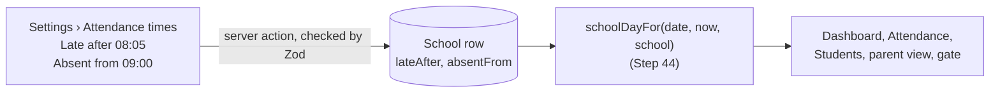

# Step 44.5: Each school sets its own late and absent times

> **Fast-track recipe.** Written before the code, approved, then built on 2026-10-11. "What changed while building" (just before "Verify it worked") lists where the real code differs from the plan, and why.

## Why

Step 44 measures every school against the same 8:05 AM (late after) and 9:00 AM (absent from). Schools start at different times, and some give a longer grace period. You decided each principal sets their own school's times. This step adds them to the school record and to **Settings**.



## Steps

### 1. Two columns on `School`

In `prisma/schema.prisma`'s `School` model:

```prisma
  // The school's clock, "HH:MM". A tap after lateAfter is late; no tap by
  // absentFrom means absent.
  lateAfter              String                 @default("08:05")
  absentFrom             String                 @default("09:00")
```

Migration `add_school_attendance_times`, made with:

```bash
npx prisma migrate dev --name add_school_attendance_times
```

It produced `prisma/migrations/20261011050532_add_school_attendance_times/migration.sql`:

```sql
ALTER TABLE "School" ADD COLUMN     "absentFrom" TEXT NOT NULL DEFAULT '09:00',
ADD COLUMN     "lateAfter" TEXT NOT NULL DEFAULT '08:05';
```

Existing schools get the defaults, so nothing changes for them until a principal saves new times.

**Why text "08:05" and not a number of minutes:** it reads as itself in `psql` and in the form. Zod checks the format on the way in and out, and Step 44's `minutesFromClockTime` turns it into minutes where the comparison happens.

### 2. The schema

In `src/features/schools/schemas.ts`:

```ts
/** A time on the school's clock, "HH:MM" in 24-hour form, e.g. "08:05". */
export const clockTimeSchema = z.string().regex(/^([01]\d|2[0-3]):[0-5]\d$/, "Enter a time like 08:05");

/** Settings › Attendance times. Absent has to come after late, or nobody could ever be late. */
export const attendanceTimesSchema = z
  .object({ lateAfter: clockTimeSchema, absentFrom: clockTimeSchema })
  .refine((times) => times.absentFrom > times.lateAfter, {
    message: "The absent time has to be later than the late time",
    path: ["absentFrom"],
  });
```

`schoolSchema` gains `lateAfter: clockTimeSchema, absentFrom: clockTimeSchema`. Comparing "HH:MM" strings with `>` works because both are zero-padded to the same length.

`toSchool`/`toSchoolData` in `prisma-school-repository.ts` copy the two fields across. The mock school data and `seedSchools` get the defaults. The add-school action starts a new school on the defaults.

### 3. The settings form

`src/features/schools/attendance-times-form.tsx`, a new **Attendance times** section on the Settings page, between Appearance and Notifications:

- Two time inputs (`<input type="time">`, labelled "Late after" and "Absent from"), with React Hook Form and `attendanceTimesSchema`, showing errors inline.
- A short explanation: "A student who taps after the late time shows as late. A student with no tap by the absent time shows as absent."
- Save is disabled until something changes, and while saving. A toast confirms: "Attendance times saved."

`updateAttendanceTimes` in `src/features/schools/actions.ts`, the same shape as `updateNotificationPreference`:
- principals and super admins only, for their own school;
- re-validated with the same schema;
- saved through `schoolRepository.update`, then `refresh()`.

### 4. Use the school's times

Every page that builds a day with `schoolToday(now)` or `schoolDayFor(date, now)` in Step 44 passes the school's `{ lateAfter, absentFrom }` as the last argument instead of the defaults. That covers the dashboard, attendance, students, station, the parent dashboard and Simulate a tap. `DEFAULT_ATTENDANCE_TIMES` stays only as the database default's twin, for tests.

### 5. Tests

- `attendanceTimesSchema`: accepts "08:05"/"09:00", rejects "8:05" and "25:00", and rejects absent at or before late.
- `toSchool`/`toSchoolData`: carry both fields.
- `studentStatus` with non-default times: the same 8:10 AM tap is late at one school and on time at a school whose late time is 8:15.

## What changed while building

- **Pages pass the school itself.** A `School` already has `lateAfter` and `absentFrom`, so it fits where `schoolToday`/`schoolDayFor` expect `{ lateAfter, absentFrom }`. Each page writes `schoolToday(now, school ?? DEFAULT_ATTENDANCE_TIMES)`. The fallback only matters if the school row can't be found, which the pages already treat as an edge case elsewhere.
- **`DEFAULT_ATTENDANCE_TIMES` has a few more users than "tests only".** The seed schools and the add-school action spread it into a new school (`...DEFAULT_ATTENDANCE_TIMES`), and it's the fallback above. Its comment says it must stay the twin of the `@default`s in `prisma/schema.prisma`.
- **The dashboard asks for today's taps by date, not by `day.date`.** `day` now needs the school, and the school, students and taps are loaded together in one `Promise.all`. So the tap query uses `schoolDateOf(now)` (the same date) and `day` is built right after.
- **The parent dashboard uses the parent's school.** A parent and every child they link belong to one school (Step 41), so the parent session's `schoolId` gives the times for every child card.
- **The form explains each field under the field.** Instead of one paragraph, "Late after" says "A tap after this time shows as late." and "Absent from" says "No tap by this time shows as absent." The section's own description says the times apply on school days at this school.
- **The save action returns field errors.** `updateAttendanceTimes` answers `{ ok: false, fieldErrors }` on a bad value, so the server's "The absent time has to be later than the late time" lands under the Absent field, the same way the add-school form does it. After a successful save, the form resets to the saved values, which turns Save off again.
- **Two more tests than planned:** `schoolSchema` requires both times, and `toSchool` rejects a row whose time isn't `HH:MM`. A missing tap is also tested against a later absent time (absent at 9:15 at one school, still "not yet tapped" at a school whose absent time is 9:30).

## Verify it worked

0. Your `talaan` database already has the new columns (`migrate dev` applied them while building). If you pulled this on another machine, run `npx prisma migrate dev` first. Restart `npm run dev`, because a running dev server keeps the old Prisma Client.
1. As the Balanga principal: **Settings › Attendance times** shows 08:05 and 09:00 (your browser may show them as 8:05 AM and 9:00 AM). Change late to 08:15 and save.
2. With `DEMO_NOW` set to the demo morning (Step 44, Verify 2), the dashboard goes from 21 present and 6 late to **22 present and 5 late**: the one student who tapped at 8:12 AM now counts as on time. Set it back to 08:05 afterwards. (Absent at 9:30 instead of 9:00 would turn the 13 absent into "not yet tapped" at 9:15, the demo clock's time.)
3. Try absent 08:00 with late 08:15: "The absent time has to be later than the late time", and nothing is saved.
4. A teacher doesn't see Settings at all (as before).
5. The checks: `npm run lint && npm run check:tokens && npm run typecheck && npm run test && npm run build`, then `npx playwright test`. The browser tests apply the new migration to `talaan_test` by themselves.

## What's next

Step 45, the tap service, where the gate's real taps are judged against these times.
