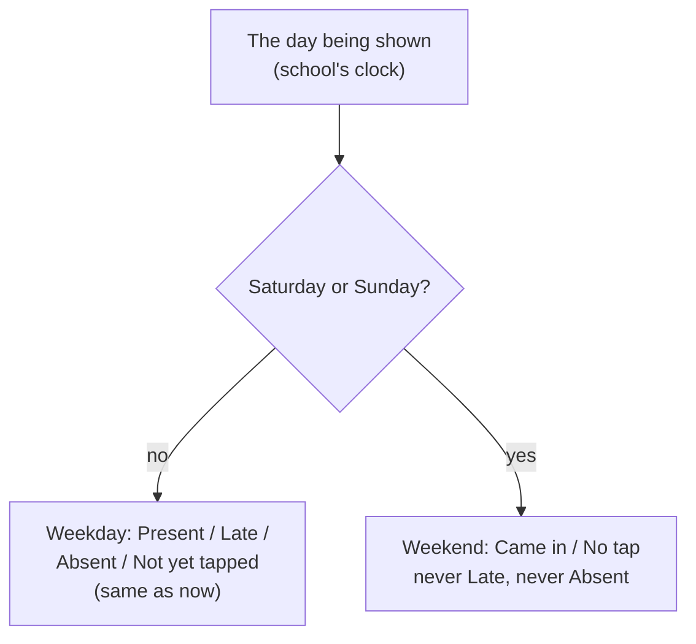

# Step 44.6: Weekends have no late or absent

> **Fast-track recipe.** Written before the code, approved, then built on 2026-10-11. "What changed while building" (just before "Verify it worked") lists where the real code differs from the plan, and why.

## Why

Students sometimes come to school on a Saturday or Sunday, for a practice, a review class or an event, but the times differ from week to week. Judging those taps against the weekday 8:05 AM late time and 9:00 AM absent time would mark nearly everyone late, and everyone who stayed home absent. You decided (2026-10-11) that a weekend has **no status**: a tap is recorded with its time, and nobody is ever late or absent on a Saturday or Sunday.



It is a separate step from 44.5 (each school's own times) so each one stays small enough to review in one sitting. The two don't depend on each other.

**One thing this uncovers:** the seed data's demo day, 20 June 2026, is a **Saturday**. With the weekend rule in place, the whole demo morning would stop showing late and absent students. So this step also moves the demo day one day earlier, to **Friday 19 June 2026**. The times on screen stay the same.

## Steps

### 1. Which days are weekends

In `src/lib/school-time.ts`:

```ts
/** Saturday or Sunday, for a school calendar date ("2026-06-20" is a Saturday). */
export function isWeekend(date: string): boolean {
  const dayOfWeek = new Date(`${date}T00:00:00Z`).getUTCDay();
  return dayOfWeek === 0 || dayOfWeek === 6;
}
```

**Why it reads the date in UTC:** `date` is already the school's own calendar date (Step 44's `schoolDateOf`). Reading it at midnight UTC gives back that same date. Reading it in the computer's local time zone could shift it a day on a server set to a different zone.

The rule is the same for every school: Saturday and Sunday. A school that holds regular Saturday classes, or a weekday holiday or class suspension, would need a per-school setting. That can be a later step.

### 2. The day knows it's flexible

In `src/features/attendance/status.ts`, `SchoolDay` gains one field:

```ts
  /** A weekend: no late time and no absent time. A tap just counts as "came in". */
  flexible: boolean;
```

`schoolDayFor` sets `flexible: isWeekend(date)`. `studentStatus` checks it first:

```ts
export function studentStatus(studentId: string, taps: Tap[], day: SchoolDay): AttendanceStatus {
  const tap = todaysTap(studentId, taps, day);
  if (tap) {
    if (day.flexible) return "present";
    return schoolMinutesOf(tap.tappedAt) <= day.lateAfter ? "present" : "late";
  }
  return !day.flexible && day.minutesNow >= day.absentFrom ? "absent" : "idle";
}
```

On a weekend the only two answers are `present` (tapped) and `idle` (no tap). `countByStatus`, `attendanceByGrade` and `studentsWithoutTapToday` need no change: late and absent simply count 0, and the grade bars' "in school" percentage becomes "came in".

**Why no new status values:** adding `came_in`/`no_tap` would add two new colors and touch every `Record<AttendanceStatus, …>` in the app. On a weekend, "tapped" and "not tapped" mean the same thing as present and idle. Only the **words** change, so only the labels change (next step).

### 3. Weekend words

In `src/components/status-pill.tsx`, one shared label function replaces the two copies of the label list (the pill's and the segmented bar's):

```ts
export function statusLabel(status: AttendanceStatus, flexible = false): string {
  if (flexible && status === "present") return "Came in";
  if (flexible && status === "idle") return "No tap";
  return STATUS_LABEL[status];
}
```

`StatusPill` gains an optional `flexible` prop and shows `statusLabel(status, flexible)`. The colors stay the same: green for came in, grey for no tap.

In `src/features/attendance/segmented-bar.tsx`, `AttendanceLegend` and `AttendanceCountTiles` take `flexible` too. On a weekend they show only the two keys that can be non-zero (Came in, No tap), so you never see "Late 0, Absent 0" as if they still applied.

### 4. Every screen passes the day's `flexible` along

| Screen | File | Weekend change |
|---|---|---|
| Dashboard (principal and teacher) | `attendance-hero.tsx` | Headline "12 of 500 students came in", legend Came in / No tap, and one line under it: "Weekend: no late or absent times." |
| Attendance page | `attendance-list.tsx`, `attendance-table.tsx`, `attendance-card-list.tsx` | Tiles and pills use the weekend words |
| Teacher's class roll | `class-roll.tsx` | Pills use the weekend words |
| Students list | `students-table.tsx`, `students-card-list.tsx` | Pills use the weekend words |
| Parent's child card | `child-summary-card.tsx` | "Came in" or "No tap" |

Each one already receives `day`, so this is `flexible={day.flexible}` on the pill. The hero gets only counts, so the dashboard page passes `flexible={day.flexible}` to it (two lines, one per hero).

These stay **unchanged**:
- The tap station and the "Simulate a tap" button: a tap is recorded the same way on any day.
- Parent notifications: they say time in and time out, and never mention late.
- Needs attention: a lost card is a problem on any day.

The Attendance page already shows the tap time ("Time in"). Time out arrives in Step 49 and will show on weekends the same way.

### 5. The demo day moves to Friday 19 June 2026

- `src/data/seed/taps.ts`: `SEED_DATE = "2026-06-19"`. Every seed tap, the alert and the notifications follow, since they're all built from `SEED_DATE`.
- `playwright.config.ts`: `DEMO_NOW: "2026-06-19T09:15:00+08:00"`.
- `.env.example`, `src/lib/clock.ts` (comment and error message example), and the doc comments in `status.ts` and `tap-repository.ts`: the same date.
- `docs/ATTENDANCE-MODEL.md`: the Step 44 section's examples move to 19 June, and it gains a short "Weekends" section.
- Tests that use 20 June 2026 as "the demo day" move to 19 June. A test that is deliberately about a weekend keeps 20 June, because it's a Saturday.

**Your `.env`:** if you set `DEMO_NOW` there for Step 44, change that line to:

```
DEMO_NOW="2026-06-19T09:15:00+08:00"
```

Your local database still has the old Saturday taps, so run `npm run db:reset` once. The test database is reset by Playwright on every run.

### 6. Tests

- `isWeekend`: Friday 19 June false, Saturday 20 and Sunday 21 June true, Monday 22 June false.
- `studentStatus`, with the default 8:05 / 9:00 times:
  - a Saturday tap at 10:30 AM is `present`, not late;
  - a Sunday with no tap at 4:00 PM is `idle`, not absent;
  - the same tap and no-tap on a Friday are still late and absent.
- `countByStatus` on a Saturday: late and absent are 0.
- `statusLabel` and `StatusPill`: "Came in" and "No tap" when flexible; "Present" and "Not yet tapped" otherwise.
- `AttendanceHero` on a flexible day: shows "came in", the weekend line, and no Late or Absent in the legend.

## What changed while building

- **The dashboard page changes after all.** `AttendanceHero` receives counts, not the day, so the page passes `flexible={day.flexible}` to both heroes (principal and teacher). That's the only page file touched.
- **The bar's screen-reader label follows the legend.** `AttendanceSegmentedBar` also takes `flexible`, so its `aria-label` reads "Came in 2, No tap 3" on a weekend instead of listing Late 0 and Absent 0.
- **The style guide shows the weekend pills.** `/design-system` gains a second row with Came in and No tap under the four weekday pills, since that page should show every state.
- **Which tests moved to 19 June.** Six test files that judge a status on "the demo day" moved one day earlier: status, the attendance card list, the class roll, the students card list, the station and notify-parents. That's 13 tests that failed on the Saturday. Every date in those files moved by one day, so "yesterday" in them became Thursday the 18th. Two "another day" checks use **Monday 22 June** instead of Sunday the 21st, so they still test "a different school day" and not the weekend rule. The clock test's `DEMO_NOW` example moved too.
- **Which tests stayed on 20 June.** Repository round-trips (taps, alerts, notifications, cards), date formatting, ages and the search-params tests use 20 June as an ordinary date where the weekday doesn't matter. They still pass, so they were left alone.
- **More tests than planned.** A past Sunday (judged on Monday morning) is still never absent, and `countByStatus` on a Saturday evening counts 2 came in and 1 no tap, with 0 late and 0 absent. `attendance-hero.test.tsx` is new. It stubs the Simulate a tap button, which calls a server action.

## Verify it worked

1. Run `npm run db:reset`, update `DEMO_NOW` in `.env` as above, and restart `npm run dev`. The dashboard looks exactly as before (Friday morning, same counts), and the top bar still shows **Demo clock**.
2. Change `DEMO_NOW` to a Saturday, `DEMO_NOW="2026-06-20T10:00:00+08:00"`, and restart `npm run dev`:
   - Dashboard: "0 of … students came in", a legend with only Came in and No tap, and "Weekend: no late or absent times."
   - Press **Simulate a tap**: the student shows **Came in**, not Late, even though it's 10 AM.
   - **Attendance**: every un-tapped student reads **No tap**, never Absent.
3. On the same Saturday clock, open Attendance for Friday (`/attendance?date=2026-06-19`): Friday still shows Present, Late and Absent.
4. Put `DEMO_NOW` back to the Friday line.
5. Checks, as usual, plus `npm run test:e2e` (the browser tests now run on the Friday).

## What's next

Step 45, the tap service.
