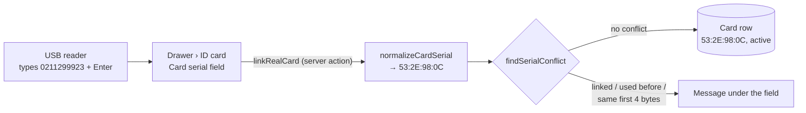

# Step 44.7: Link a real card

> **Fast-track recipe, written from the real diff.** You asked for this step to be built straight away (2026-10-11), so this file records what was built instead of being approved first.

## Why

The student drawer's **Link card** button was Phase 1's "Simulate a card tap": it made up a random serial. Every pilot sticker has to be linked to a student before the gate can recognise it, so the drawer needs to accept a **real** card. Your USB reader acts as a keyboard: it types the card's 10 digits and presses Enter. The drawer just needs a field for it to type into.

The same conversion from "what the reader typed" to "the serial we store" is what the gate will need in Step 45. It's built here once and shared, so a card linked in the drawer is exactly the card the gate finds.



## Steps

### 1. From what was typed to the stored serial

In `src/features/students/card-serial.ts`, next to Phase 1's `generateCardSerial`:

```ts
const READER_DIGITS = /^\d{10}$/;
const HEX_SERIAL = /^(?:[0-9A-F]{8}|[0-9A-F]{14})$/;
const LARGEST_FOUR_BYTES = 0xffffffff;

export function normalizeCardSerial(raw: string): string | null {
  const trimmed = raw.trim();

  if (READER_DIGITS.test(trimmed)) {
    const value = Number(trimmed);
    if (value > LARGEST_FOUR_BYTES) return null;
    const bytes = [value & 0xff, (value >>> 8) & 0xff, (value >>> 16) & 0xff, (value >>> 24) & 0xff];
    return bytes.map(toHexByte).join(":");
  }

  const hex = trimmed.replace(/[\s:-]/g, "").toUpperCase();
  if (!HEX_SERIAL.test(hex)) return null;
  return hex.match(/../g)!.join(":");
}
```

**How the 10 digits work.** `0211299923` is the number `0x0C982E53`. The reader sends a card's first 4 UID bytes lowest byte first, so the bytes are taken from the bottom up: `& 0xff` keeps the lowest byte, and `>>> 8` shifts the next one down. The result is `53 2E 98 0C`, which is what NFC Tools shows as the start of the sticker's serial `53:2E:98:0C:14:00:01`. A 10-digit number above `0xFFFFFFFF` can't come from 4 bytes, so it's rejected.

**Hex** can come from an NFC app or be typed by hand. It may have colons, spaces or dashes, in any case, and must be 4 or 7 bytes, the two sizes you decided to accept (2026-10-09).

| Typed | Stored |
|---|---|
| `0211299923` | `53:2E:98:0C` |
| `0213292883` | `53:97:B6:0C` |
| `532e980c`, ` 53 2e 98 0c `, `53-2E-98-0C` | `53:2E:98:0C` |
| `53:2E:98:0C:14:00:01`, `532E980C140001` | `53:2E:98:0C:14:00:01` |
| `4294967296`, `12345`, `02112999230`, `53:2E:98`, `53:2E:98:0C:14`, `hello`, empty | `null` |

### 2. When a card can't be linked

Also in `card-serial.ts`:

```ts
export function firstFourBytes(serial: string): string {
  return serial.split(":").slice(0, 4).join(":");
}

export type SerialConflict = "linked" | "used_before" | "same_first_bytes";

export function findSerialConflict(serial: string, sameSerial: Card | null, sameFirstBytes: Card[]): SerialConflict | null {
  if (sameSerial) return sameSerial.status === "active" ? "linked" : "used_before";
  const twin = sameFirstBytes.find((card) => card.serial !== serial && card.status === "active");
  return twin ? "same_first_bytes" : null;
}
```

- **`linked`**: an active card already has this serial, at any school.
- **`used_before`**: a lost or retired card had it. `Card.serial` is unique in the database (Step 39), because one physical card is one row forever, so it can't be linked a second time. A found card has to be a new sticker.
- **`same_first_bytes`**: another active card at this school starts with the same 4 bytes, for example `53:2E:98:0C` when `53:2E:98:0C:14:00:01` is already linked. This reader sends only 4 bytes, so the gate couldn't tell the two apart. This is the "known limit" in `docs/ARCHITECTURE.md`'s open question 1, caught at linking time instead of at the gate.

### 3. Find a card's 4-byte twins

`CardRepository` gains, in both the Prisma and mock versions:

```ts
/** This school's cards whose serial starts with these 4 bytes ("53:2E:98:0C"): the exact card and any 4- or 7-byte twin. */
listBySerialPrefix(schoolId: string, firstFourBytes: string): Promise<Card[]>;
```

The Prisma version is `db.card.findMany({ where: { schoolId, serial: { startsWith: firstFourBytes } }, orderBy: { linkedAt: "asc" } })`. The gate's card lookup in Step 45 uses the same method.

### 4. The server action

`linkRealCard(studentId, rawSerial)` in `src/features/students/card-actions.ts`:

1. The same permission check as the other card actions: a principal or super admin, and a student at their own school.
2. The serial must be a string of at most 64 characters, then `normalizeCardSerial`. Anything else gives the field message "That isn't a card serial. Tap the card on the reader, or type its serial, like 53:2E:98:0C."
3. The student must not already have an active card. If they do, a toast says "Replace it instead", as before.
4. `getBySerial(serial)` and `listBySerialPrefix(school, firstFourBytes(serial))` run together, then `findSerialConflict`. A conflict becomes a plain message under the field.
5. Create the card as active, then `refresh()`.

It answers `{ ok: true, card }` or `{ ok: false, fieldError?, formError? }`. The field error shows under the input, and a form error shows as a toast.

### 5. The drawer

`src/features/students/card-box.tsx`, in the "waiting" state (after **Link card**, or after replacing a lost card):

- **What's shown:** "Hold the card against the reader", now with "Or type the serial from an NFC app, then press Enter."
- **The field:** a **Card serial** input that gets the cursor whenever the box is waiting, so the reader's typing lands in it with no click. A `useEffect` focuses it through a `ref` once `mode` is `"waiting"` and nothing is pending. It runs again after a refused card, so the next tap goes straight back in. (The first version used `autoFocus`, which missed right after "Yes, replace card" because the field was still disabled at that moment; see "Fixed after approval" below.) It uses a monospace font, has autocomplete and spellcheck off, and shows its error underneath (`aria-invalid` and `aria-describedby`).
- **Enter links the card.** The card box sits *inside* the student form, so a plain Enter would submit the whole student. `onKeyDown` catches Enter, cancels the form submit, and calls `linkRealCard` instead. The reader presses Enter after every card, so tapping the sticker is all it takes.
- **The buttons:** **Link card** (disabled while the field is empty), **Simulate a card tap** (now the outline button, kept for demos without a reader), and **Cancel**.
- **Each new wait starts clean:** an empty field and no old error.

### 6. Tests

- `card-serial.test.ts`:
  - every row of the table above, with the result also passing `cardSerialSchema`;
  - `firstFourBytes`;
  - `findSerialConflict`: nobody has the serial; an active card has it; a lost or retired card had it; 4-byte and 7-byte twins both ways; a lost twin is ignored.
- `card-repository.test.ts`: `listBySerialPrefix` returns only this school's cards with those first 4 bytes.
- `e2e/students.spec.ts`, "replace a student's card": after replacing, the test checks that the **Card serial** field has focus. It then fills in a random 10-digit number and presses Enter, the way the reader does, and expects a toast like "Card 1A:2B:3C:4D linked". The number is random so the phone-width and desktop runs never link the same card. It also checks that **Simulate a card tap** is still there.

## Fixed after approval (found by Step 45's browser tests)

The owner's Step 45 test run had 2 failures, both in "replace a student's card":

1. **Phone width: the field didn't have the cursor.** `autoFocus` only acts when the input first appears. After "Yes, replace card", the waiting panel appears while the replace request is still finishing, so the input is `disabled`. A disabled input can't take focus, and nothing tried again. **Fix:** `serialRef` plus `useEffect(() => { if (mode === "waiting" && !isPending) serialRef.current?.focus(); }, [mode, isPending])`. This matters beyond the test: without it, a real reader would have typed into nothing.
2. **Desktop: a knock-on, and a race that was always there.** The phone and desktop runs use one database at the same time, and both picked Juan Cruz. Whichever marked his card lost first made the other's "replace" fail. **Fix:** each run gets its own student: Juan Cruz on desktop, and Rosa Castillo (student-0008, active card, used by no other browser test) on the phone.

After the fix the full routine passed: lint, check:tokens, typecheck, 445 unit tests, build, and 164 browser tests (12 skipped by design). `students.spec.ts` also passed three more times in a row.

## Verify it worked

1. The checks: `npm run lint && npm run check:tokens && npm run typecheck && npm run test && npm run build`, then `npx playwright test`.
2. `npm run dev`, sign in as the Balanga principal, open **Students**, and pick a student with **No card** (or replace someone's card).
3. Click **Link card**. The **Card serial** field has the cursor. Tap a sticker on the USB reader: "Card 53:2E:98:0C linked" (your sticker's own bytes), and the badge says **Linked**.
4. Open another student without a card and tap the **same** sticker: "This card is already linked to another student." Nothing is saved.
5. Type `hello` and press Enter: the "That isn't a card serial" message.
6. Type `53:2E:98:0C:14:00:01` (that first sticker's full serial from NFC Tools) for a third student: "Another student's card starts with the same 4 bytes…", because the sticker linked in step 3 is its 4-byte twin.
7. At 360px wide, the field and the three buttons fit, and the buttons wrap instead of running off the side.

## What's next

Step 45, the tap service. It reuses `normalizeCardSerial` and `listBySerialPrefix` from this step, so a sticker linked here is recognised at the gate.
