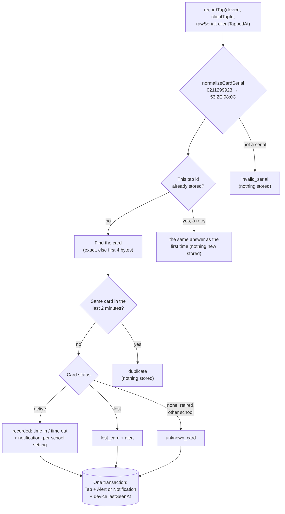

# Step 45: The tap service

> **Fast-track recipe.** Written before the code, for you to approve, then built for you. If building it turns up a difference, this file gets corrected to match what was actually built, and `docs/BUILD-LOG.md` says what changed.

## Why

The gate tablet will send the server one thing per tap: "card `0211299923` was read at 7:56 AM, and this tap's id is `…`". Something on the server has to turn that into a decision:

- **Whose card is this?** The serial arrives in the reader's own format and has to be matched to a card.
- **Is it a double read?** The same card read again within 2 minutes is ignored.
- **What gets written?** A tap, plus a lost-card alert or a parent notification when one is due.
- **Which gate sent it?** The gate's "last seen" time is updated too.

All of it must happen **together or not at all**, in one database transaction. If the notification fails to save, the tap mustn't be half-recorded.

This step builds that decision as a plain function, `recordTap()`, in `src/services/taps/`. It doesn't build the web address the tablet calls (Step 46) or the gate screen (Step 47). Keeping the logic out of the route means it can be tested without a web server. A small terminal command lets you feed it real taps from your USB reader before any of that exists.



## Decisions in this recipe (please confirm or change)

1. **Debounce: 2 minutes, by physical card, either side.** A tap within 2 minutes **before or after** an already-stored tap of the same card is a duplicate and isn't stored. "Either side" matters once the gate can queue taps offline (Step 47), because they may arrive out of order. CLAUDE.md says 1–2 minutes. 2 is the safe end for "one pass through the gate".
2. **Which time a tap gets.** The gate's own clock (`clientTappedAt`), so an offline tap keeps the time it really happened. The exception is a time that can't be right: more than **5 minutes in the future** or more than **7 days old** by the server's clock. In those cases the server's time is used instead, because the tablet's clock is wrong.
3. **No database change.** `Tap.stationId` holds the gate's `Device.id`. Simulated taps keep `"station-main-gate"`. A real `deviceId` foreign key can be added later if a report ever needs to join taps to devices.
4. **A lost card's tap is stored with its owner's `studentId`, as Phase 1 does.** The alert can then name the student, and the guard's photo check (Step 47) catches someone else using the card. One side effect: the tap counts as that student arriving. If you'd rather it didn't, say so. The alternative is storing `studentId: null` and finding the owner through the card.
5. **Retired cards, another school's card, and an unclear match all count as unknown cards.** "Unclear" means two of this school's cards share the same first 4 bytes and the reader sent only 4. Each case is stored with `studentId: null`, so the office can see that an unlinked card was tapped. None of them raises an alert.

## Steps

### 1. Turn what the reader types into a serial

`src/services/taps/card-serial.ts`:

```ts
const READER_DIGITS = /^\d{10}$/;
const HEX_SERIAL = /^(?:[0-9A-F]{8}|[0-9A-F]{14})$/; // 4 or 7 bytes, no separators

/**
 * The serial the app stores, from whatever a reader or a person typed:
 * - the USB reader's 10 decimal digits ("0211299923") are the first 4 UID
 *   bytes in reverse order, so they're turned back: "53:2E:98:0C";
 * - hex, 4 or 7 bytes, with or without colons, spaces or dashes, any case:
 *   "532e980c", "53:2E:98:0C:14:00:01".
 * Anything else is null: not a card serial.
 */
export function normalizeCardSerial(raw: string): string | null
```

Under the hood, the 10 digits become a number (rejected above `0xFFFFFFFF`), then 4 bytes, read lowest byte first. These go in the tests:

| Typed | Stored |
|---|---|
| `0211299923` | `53:2E:98:0C` |
| `0213292883` | `53:97:B6:0C` |
| `532e980c` | `53:2E:98:0C` |
| `53:2E:98:0C:14:00:01` | `53:2E:98:0C:14:00:01` |
| ` 53 2e 98 0c ` | `53:2E:98:0C` |
| `4294967296` (too big), `12345` (too short), `53:2E:98` (3 bytes), `hello` | `null` |

Both rows are two of your own five stickers. `0213292883` is `0x0CB69753` in hex. Read lowest byte first, that's `53 97 B6 0C`, the same way `0211299923` (`0x0C982E53`) becomes the `53:2E:98:0C` NFC Tools showed.

### 2. Find the card

`CardRepository` gains one method, in both the Prisma and mock versions:

```ts
/** This school's cards whose serial starts with these 4 bytes ("53:2E:98:0C"): the exact card and any 4/7-byte twin. */
listBySerialPrefix(schoolId: string, firstFourBytes: string): Promise<Card[]>;
```

The Prisma version is `findMany({ where: { schoolId, serial: { startsWith } } })`. At 500 cards a school, it doesn't matter whether Postgres uses the index for a `startsWith` search.

The choosing is a plain function, `src/services/taps/match-card.ts`, so it's tested without a database:

```ts
/**
 * Exact serial first. Otherwise the card that shares the first 4 bytes, so
 * a card linked by its 7-byte UID is found when this reader sends 4, and
 * the other way round. An active card beats a lost or retired one. Two
 * equally good matches is null: better "unknown card" than the wrong child.
 */
export function matchCard(serial: string, candidates: Card[]): Card | null
```

### 3. Which time the tap gets

`src/services/taps/tap-time.ts`: `chooseTapTime(clientTappedAt, receivedAt)` returns the device time, unless it's more than 5 minutes ahead of or more than 7 days behind `receivedAt` (decision 2). It's tested at both edges.

### 4. Save everything in one transaction

The service decides *what* to write, and the data layer writes it atomically. That keeps every database call in `src/data/`, as the project rules require.

A new interface, `src/data/repositories/tap-writer.ts`, has only a Prisma version. Unit tests use a small in-memory fake, so the five mock repositories don't need changing.

```ts
export interface TapWrite {
  tap: Tap;
  alert: Alert | null;
  notification: Notification | null;
  /** The gate that sent it: its lastSeenAt becomes `seenAt` in the same transaction. */
  deviceId: string;
  seenAt: string;
}

export interface TapWriter {
  /** "exists" if a tap with this id is already stored (a retry that raced the first try); nothing is written then. */
  record(write: TapWrite): Promise<"created" | "exists">;
}
```

`prisma-tap-writer.ts` runs `db.$transaction(async (tx) => { … })`. It creates the tap, then the alert or notification if there is one, then updates the device. A duplicate primary key (Prisma's `P2002`) rolls the whole transaction back and comes out as `"exists"`. It reuses the existing `toTapData`, `toAlertData` and `toNotificationData` mappers.

`TapRepository` gains the debounce lookup, in both versions:

```ts
/** A stored tap of this card at this school between `from` and `to`, if any. */
findByCardBetween(schoolId: string, cardSerial: string, from: string, to: string): Promise<Tap | null>;
```

This uses the `(schoolId, tappedAt)` index, so it reads at most 4 minutes of one school's taps.

### 5. `recordTap()`

`src/services/taps/record-tap.ts`. Its dependencies come in as arguments, the same pattern as `notifyParentsForTap(tap, deps)`:

```ts
export type RecordTapInput = {
  device: { id: string; schoolId: string };
  clientTapId: string;      // a UUID made by the gate
  rawSerial: string;        // exactly what the reader typed
  clientTappedAt: string;   // the gate's clock, ISO
  receivedAt: string;       // the server's clock, getNow()
};

/** Just what the gate screen shows: never the LRN, birth date or guardian. */
export type TapStudent = Pick<Student, "id" | "firstName" | "lastName" | "gradeLevel" | "section">;

export type RecordTapResult =
  | { outcome: "recorded"; tap: Tap; student: TapStudent; direction: "time_in" | "time_out"; replayed: boolean }
  | { outcome: "lost_card"; tap: Tap; student: TapStudent | null; replayed: boolean }
  | { outcome: "unknown_card"; tap: Tap; replayed: boolean }
  | { outcome: "duplicate"; previousTap: Tap; student: TapStudent | null }
  | { outcome: "invalid_serial" };
```

In order:

1. `normalizeCardSerial(rawSerial)`. If it gives `null`, the answer is `invalid_serial`.
2. **A retry?** If `tapRepository.getById(clientTapId)` finds a tap at this school, answer as the first time did: work out the outcome from the stored tap, with `replayed: true`. Nothing new is written. This is what makes a resend after a dropped connection safe.
3. `chooseTapTime(…)`, then `matchCard(serial, await cardRepository.listBySerialPrefix(…))`. The stored `cardSerial` is the **card's own serial** when one matched, so a 4-byte read of a 7-byte card is stored under the same serial every time and the debounce sees it. With no match, the normalized input is stored.
4. **Debounce:** `findByCardBetween(schoolId, cardSerial, time − 2 min, time + 2 min)`. If it finds a tap, the answer is `duplicate`, with the earlier tap so the screen can say "Already tapped at 7:56 AM". Nothing is stored.
5. **Build what to write:**
   - **Active card:** the tap gets the card's `studentId`. The direction is `deriveTapKind` over the student's taps (1st time in, 2nd time out, …). A notification is added unless the school's setting is `off`, or the tap is a time out and the setting is `time_in_only`. This is the same rule as `notifyParentsForTap`, moved into a shared function so the two can't drift apart.
   - **Lost card:** the tap gets the owner's `studentId`, plus a `lost_card_tapped` alert. No notification.
   - **Anything else:** `studentId: null`.
6. `tapWriter.record(…)`. If it answers `"exists"` (a retry arrived during the first try), go back to step 2's replay answer.
7. Return the outcome, with the student's display fields when there's a student.

Phase 1's own tap paths (the dashboard's Simulate a tap, and the `/station` demo) stay as they are. They don't come from a gate device, and changing them isn't needed for the gate to work.

### 6. Try it from the terminal, with the real reader

`scripts/record-tap.ts`, run as `npm run tap:record -- --token tal_dev_…`. It checks the token with Step 43's `authenticateDevice`, refusing a monitor token or a revoked one. It then waits for lines on the keyboard. Every line is one tap: it gets a new UUID, is recorded with the current time, and the result is printed:

```
Connected as "Main gate tablet" (Balanga City National Science High School). Tap a card, Ctrl+C to stop.
0211299923
  unknown card 53:2E:98:0C (not linked to a student yet)
04:A3:5F:2B:91:C0:80
  time in  Juan Dela Cruz, Grade 7 – Rizal, 7:56 AM  (parent notified)
04:A3:5F:2B:91:C0:80
  duplicate  Juan Dela Cruz already tapped at 7:56 AM
```

Click the terminal and tap a sticker on the USB reader. The reader types its 10 digits and presses Enter, exactly as it will on the gate tablet. Your stickers aren't linked to students yet, so they come back as **unknown card** (see "What's next"). A seed card's serial typed by hand gives the student path. You can find seed serials on any student's ID card box.

The script uses the real clock, or `DEMO_NOW` if it's set. It's a development tool, like `device:create`. The tablet will use Step 46's web address instead.

### 7. Tests

- `normalizeCardSerial`: every row of the table in step 1.
- `matchCard`:
  - an exact match;
  - 4 bytes in finding a 7-byte card, and 7 bytes in finding a 4-byte card;
  - an active card preferred over a lost one with the same first 4 bytes;
  - two equally good matches give `null`.
- `chooseTapTime`: a normal device time is kept, 6 minutes ahead is replaced, 8 days old is replaced, and the exact edges are kept.
- `recordTap`, with in-memory fakes:
  - an active card gives `recorded`, `time_in`, a notification, and one write that includes the device;
  - a second tap 2 minutes 1 second later gives `time_out`;
  - with `time_in_only`, that time out writes no notification;
  - with `off`, there are no notifications;
  - a tap 1 minute 59 seconds after another gives `duplicate`, and nothing is written;
  - an earlier-arriving tap 1 minute *before* a stored one also gives `duplicate`;
  - a lost card gives a tap with the owner's id plus an alert, and no notification;
  - an unknown, retired or other-school card gives `studentId: null`;
  - the same `clientTapId` twice gives the same answer with `replayed: true`, and only one write;
  - the writer answering `"exists"` gives the replay answer;
  - `hello` gives `invalid_serial` and no write.
- `toTapData`/mapper reuse needs no new tests. The writer's transaction is checked by the terminal script against the real database (Verify, below).

## Verify it worked

1. The checks, as usual: `npm run lint && npm run check:tokens && npm run typecheck && npm run test && npm run build`, then `npx playwright test`. Nothing on screen changes in this step, so the browser tests should pass untouched.
2. Make a gate device if you don't still have one from Step 43: `npm run device:create -- --school school-balanga --kind gate --label "Main gate tablet"`, and copy the token.
3. `npm run tap:record -- --token tal_dev_…`, then:
   - **Tap a sticker:** "unknown card 53:2E:98:0C" (or that sticker's own bytes).
   - **Type a seed student's serial** (from any student's ID card box in the app): "time in" with their name. Type it again straight away: "duplicate".
   - **Type a lost card's serial** (a student whose card was replaced shows the old one as lost): "lost card", and the dashboard's **Needs attention** shows a new alert.
   - **Type `hello`:** "not a card serial".
4. In `psql`, the tap is there with the gate's id as its station, and the gate's last-seen time moved:
   ```sql
   SELECT "stationId", "cardSerial", "studentId", "tappedAt" FROM "Tap" ORDER BY "tappedAt" DESC LIMIT 3;
   SELECT label, "lastSeenAt" FROM "Device";
   ```
5. A parent of the student you tapped sees a new notification in the bell, if Balanga's notification setting is on.

## What's next

- **A gap this step makes visible: there's no way yet to link a *real* card to a student.** The student drawer's "Link card" button is Phase 1's "Simulate a card tap": it makes up a random serial. For the demo, each sticker has to be linked to a student. I suggest a small **Step 45.5, "Link a real card"**: the drawer gets a "Card serial" field. Click it, tap the sticker on the USB reader, and its 10 digits go through the same `normalizeCardSerial`. Typed hex works too. The serial is checked and linked, and "Simulate a card tap" stays for demos without a reader. Say if you want it, and whether before or after Step 46.
- **Step 46:** the web address the tablet calls, `POST /api/v1/gate/taps`, which is a thin wrapper around `recordTap()`, plus `GET /api/v1/gate/roster`.
