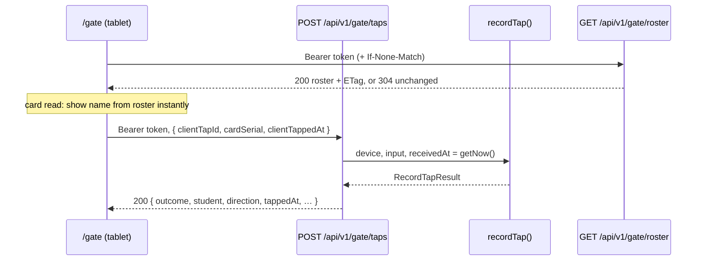

# Step 46: The tap API and the gate's roster

> **Fast-track recipe.** Written before the code, then built on 2026-10-11 when the owner said "build 46 to 49". Claude ran the checks. "What changed while building" (just before "Verify it worked") lists where the real code differs from the plan.

## Why

Step 45 put every tap decision in `recordTap()`. The gate tablet can't call a function on the server directly, though. It needs a web address. This step adds the two addresses the `/gate` page (Step 47) will use:

- **`POST /api/v1/gate/taps`**: "this card was just read". It answers with the outcome.
- **`GET /api/v1/gate/roster`**: "who could tap here?" It returns the school's active cards with each student's name, grade and section, so the gate can show the student **the moment a card is read**, before the server has answered (decided 2026-10-10). Photos are added to it in Step 46.5.

Both are **thin**. They check the gate's token, check the request's shape, call the real logic, and turn the answer into JSON. No attendance rule lives in a route (`docs/ARCHITECTURE.md`, "Why a route handler stays thin").



## Steps

### 1. One helper for "is this a gate?"

`src/services/devices/authenticate-gate.ts`:

```ts
/** The calling gate, or why not: 401 for a missing, unknown or revoked token, 403 for a monitor's token (it can only watch). */
export async function authenticateGate(
  authorization: string | null,
): Promise<{ ok: true; device: Device } | { ok: false; status: 401 | 403; error: string }>
```

It's built on Step 43's `authenticateDevice`, with tests for all three answers.

### 2. `POST /api/v1/gate/taps`

`src/app/api/v1/gate/taps/route.ts`. The request body is checked with Zod (`src/features/gate/schemas.ts`, a new feature folder for the gate's shapes):

```ts
export const gateTapRequestSchema = z.object({
  clientTapId: z.uuid(),
  cardSerial: z.string().min(1).max(64),   // exactly what the reader typed
  clientTappedAt: z.iso.datetime({ offset: true }),
});
```

| Request | Answer |
|---|---|
| no, unknown or revoked token | `401 { error }` |
| a monitor's token | `403 { error }` |
| body that isn't JSON, or fails the schema | `400 { error, issues }` |
| a valid tap | `200`, the outcome as JSON (below), **including `invalid_serial`**, so the gate can show "That card couldn't be read" |

The 200 body is `recordTap()`'s result, reshaped into what a screen needs. Dates are ISO strings, and there's never an LRN, birth date or guardian:

```json
{
  "outcome": "recorded",
  "direction": "time_in",
  "tappedAt": "2026-06-18T23:56:00.000Z",
  "notified": true,
  "replayed": false,
  "student": { "id": "student-0001", "firstName": "Juan", "lastName": "Cruz", "gradeLevel": 7, "section": "Rizal" }
}
```

`duplicate` adds `previousTappedAt`, `lost_card` and `unknown_card` add `cardSerial`, and `invalid_serial` is just `{ "outcome": "invalid_serial" }`. The reshaping is a plain function, `toGateTapResponse(result)`, in `src/features/gate/responses.ts`, tested on its own.

### 3. `GET /api/v1/gate/roster`

`src/app/api/v1/gate/roster/route.ts`, with the same `authenticateGate`. `CardRepository` gains `listActiveBySchool(schoolId)` (Prisma and mock). The roster is built by a plain function, `buildGateRoster(cards, students)`:

```json
{
  "cards": [
    { "serial": "04:11:6C:C7:22:7D:D8", "studentId": "student-0001" }
  ],
  "students": [
    { "id": "student-0001", "firstName": "Juan", "lastName": "Cruz", "gradeLevel": 7, "section": "Rizal" }
  ]
}
```

Cards and students are listed separately, so a student appears once, and Step 46.5 can add `photo` to each student without touching the card list. The gate matches a read serial to a card by exact serial, and otherwise by the first 4 bytes (`firstFourBytes`), the same rule as the server.

**"Anything new?" costs a few bytes.** The answer gets an `ETag`: a short sha256 of the JSON. When the gate asks again with `If-None-Match: <that tag>` and nothing changed, the answer is `304 Not Modified` with an empty body. At 500 students the full roster is about 60 KB, so a gate checking every 5 minutes during a school day would download about 7 MB without this and almost nothing with it (cost rule, `CLAUDE.md`). `Cache-Control: no-cache` makes the browser always ask, while still using the tag.

### 4. Tests

- `authenticateGate`: an active gate token, a monitor token (403), a revoked token and no token (401).
- `gateTapRequestSchema`: accepts a good body, rejects a missing id, a non-UUID id, a date with no offset, and a 65-character serial.
- `toGateTapResponse`: each of the five outcomes gives the fields above and nothing personal (exact keys checked).
- `buildGateRoster`: one entry per student even with a lost and an active card, and no lost cards in `cards`.
- The two route files have no logic of their own to test. The `curl` checks below exercise them for real.

## What changed while building

- **The roster's tag comes from `rosterETag(body)`** in `src/features/gate/roster.ts`: the first 27 characters of the body's sha256, in URL-safe base64, in quotes (`"Bupn2YnnPSdueVHJoWUWUrGIH2-"`). The body is built once and both tagged and sent, so the tag always describes exactly what was sent.
- **The roster is sorted** (cards by serial, students by id), so the same data always gives the same tag, whatever order the database returns rows in.
- **`toGateTapResponse` copies the student field by field.** Its test passes a student with an LRN, birth date and mobile number added on purpose, and checks none of them come out.
- **A broken JSON body and a body that fails the schema have different messages:** "The request body isn't JSON." and "That isn't a valid tap.", the second with Zod's `issues`. Both are `400`.

**Checked live** with a scratch dev server on port 3200 against the test database, with two test devices:
- roster `200` with an ETag, then `304` with 0 bytes, and 36 cards and 36 students;
- a seed card gave `recorded`, then `replayed` for the same id, then `duplicate` for a new id;
- the sticker's `0211299923` gave `unknown_card` (`53:2E:98:0C`), and `hello` gave `invalid_serial`;
- a monitor token got `403` on both routes, `{}` got `400`, and no token got `401`.

## Verify it worked

1. Your usual checks (or ask me to run them).
2. With `npm run dev` running and a gate token from `npm run device:create` (Step 43):
   ```bash
   TOKEN=tal_dev_paste_yours_here
   curl -i http://localhost:3000/api/v1/gate/roster -H "Authorization: Bearer $TOKEN"
   ```
   You should get `200`, the JSON, and an `ETag: "…"` header. Repeat it with `-H 'If-None-Match: "<that tag>"'`: `304`, and no body.
3. Send one tap. Use a seed card's serial, from any student's ID card box:
   ```bash
   curl -i -X POST http://localhost:3000/api/v1/gate/taps \
     -H "Authorization: Bearer $TOKEN" -H "Content-Type: application/json" \
     -d "{\"clientTapId\":\"$(uuidgen)\",\"cardSerial\":\"04:11:6C:C7:22:7D:D8\",\"clientTappedAt\":\"$(date -u +%Y-%m-%dT%H:%M:%SZ)\"}"
   ```
   `200` and `"outcome":"recorded"`. Run it again: `"duplicate"` (a new `uuidgen` makes it a new tap of the same card).
4. A monitor token gives `403`, and `-d '{}'` gives `400`.

The straight quotes matter. If zsh shows `dquote>`, the command has a curly quote in it (see the learning log's `dquote>` entry).

## What's next

Step 46.5 adds student photos and the `photo` field in the roster.
