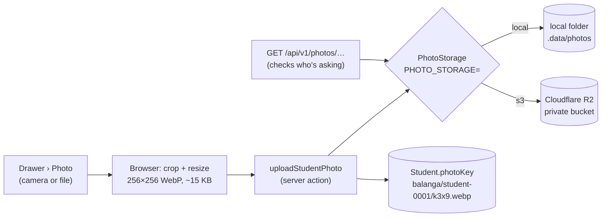

# Step 46.5: Student photos

> **Fast-track recipe.** Written before the code, then built on 2026-10-11 when the owner said "build 46 to 49". Claude ran the checks. "What changed while building" (just before "Verify it worked") lists where the real code differs from the plan.

> **Changed on 2026-10-12, during the review of Steps 46–49.** A chosen photo is no longer saved at once. `photo-actions.ts` (`uploadStudentPhoto`, `removeStudentPhoto`) is gone. The drawer shows a preview, "Not saved yet", and the student form's **Save** sends the thumbnail with the fields: `createStudent`/`updateStudent` check it with `readPhotoUpload` (`photo-changes.ts`), store it, then point the student at it. Remove photo and Undo are held the same way, and Cancel throws them away. A new student can now get a photo and a card in the Add form. See `docs/BUILD-LOG.md`, "Review change: the drawer saves only on Save".

## Why

At the gate, the guard compares the photo on screen with the face of whoever is holding the card. Without a photo, a borrowed or found card can't be caught (decided 2026-10-10: the demo must show photos). This step lets staff add a photo in the student drawer, stores a small thumbnail, and serves it to the gate and the monitor.

**Your decisions (2026-10-11):** Cloudflare **R2** for production storage, signed with the small **`aws4fetch`** library (new dependency, about 6 KB, no dependencies of its own). In development, a local folder stands in, so you need no account to build and test.



## Decisions in this recipe (please confirm or change)

1. **The photo is resized in the browser, never on the server.** Canvas crops to the centre square, scales to 256×256, and saves WebP at quality 0.8, or JPEG where WebP isn't available (older Safari). The original photo never leaves the phone. The server stores about 15 KB a student and runs no image library (cost rule).
2. **The bucket stays private. Photos are served through our own address**, `/api/v1/photos/<key>`, which checks who's asking: staff of that school, or that school's gate or monitor. These are minors' faces, so a public bucket link that anyone could pass around is ruled out. R2 charges nothing for data going out, so serving through the app costs only a little of the server's time. Browsers keep each photo for a year (`Cache-Control: private, max-age=31536000, immutable`), because a new photo always gets a new key.
3. **`Student.photoUrl` becomes `Student.photoKey`.** That follows your rule: store keys, not provider URLs. Moving from R2 to S3, Backblaze or MinIO then changes settings only. No seed student has a photo today, so the rename loses nothing.
4. **The demo photos are uploaded through the drawer, not seeded.** There are no real student photos to seed, and made-up faces of children aren't something to commit. Before the demo, take a few photos of volunteers (with their consent) with the drawer's camera button. Each takes under a minute. Students without a photo show their initials everywhere a photo would be.

## Steps

### 1. The dependency and the settings

```bash
npm install aws4fetch
```

`.env.example` gains:

```bash
# Where student photos are kept: "local" (a folder, for development) or "s3"
# (any S3-compatible service; Cloudflare R2 in production).
PHOTO_STORAGE="local"
# Only for PHOTO_STORAGE="s3". For R2: the account's S3 endpoint,
# https://<account-id>.r2.cloudflarestorage.com, a bucket, and an R2 API token's keys.
# S3_ENDPOINT=""
# S3_BUCKET=""
# S3_ACCESS_KEY_ID=""
# S3_SECRET_ACCESS_KEY=""
```

`src/lib/env.ts` (or wherever env checking lives) refuses `PHOTO_STORAGE="s3"` when any `S3_*` value is missing, with a message that names it. `.gitignore` gains `/.data/`.

### 2. `PhotoStorage`, and its two versions

`src/lib/storage/photo-storage.ts`:

```ts
export interface PhotoStorage {
  put(key: string, bytes: Uint8Array, contentType: string): Promise<void>;
  /** null when there's nothing at that key. */
  get(key: string): Promise<{ bytes: Uint8Array; contentType: string } | null>;
  /** No error when the key is already gone. */
  delete(key: string): Promise<void>;
}

/** The storage chosen by PHOTO_STORAGE. The rest of the app never knows which. */
export function getPhotoStorage(): PhotoStorage
```

- **`local-photo-storage.ts`** writes files under `.data/photos/<key>`, with the content type in a small `.type` file next to each. It refuses a key containing `..`, so a key can't step outside the folder.
- **`s3-photo-storage.ts`** uses `new AwsClient({ accessKeyId, secretAccessKey, service: "s3", region: "auto" })`. A `PUT`, `GET` or `DELETE` goes to `${S3_ENDPOINT}/${S3_BUCKET}/${key}`, and `aws4fetch` signs each request. Any S3-compatible service works with the same code.

### 3. The key and the checks

`src/features/students/photo.ts` (plain functions, tested):

```ts
/** "school-balanga/student-0001/k3x9q2.webp": a new random part on every upload, so caches never show an old face. */
export function newPhotoKey(schoolId: string, studentId: string, type: PhotoType): string
/** "webp" | "jpeg" from the file's first bytes (RIFF…WEBP, or FF D8 FF), or null. The browser's claimed type isn't trusted. */
export function detectPhotoType(bytes: Uint8Array): PhotoType | null
export const MAX_PHOTO_BYTES = 100_000; // 256×256 is ~15 KB; 100 KB leaves room, nothing more
```

### 4. Database

`prisma/schema.prisma`: `photoUrl String?` becomes `photoKey String?`. Migration: `npx prisma migrate dev --name student_photo_key`. Prisma generates a drop and an add, which loses nothing since every value is empty. I'll edit the SQL to a `RENAME COLUMN` anyway, so the migration says what it means (`docs/DATABASE-MIGRATIONS.md`, "renaming"). `studentSchema` swaps `photoUrl: z.url().optional()` for `photoKey: z.string().min(1).optional()`, and the Prisma mappers follow.

### 5. Upload and remove

`uploadStudentPhoto(studentId, formData)` and `removeStudentPhoto(studentId)` in `src/features/students/photo-actions.ts`:
1. The same permission check as the card actions: a principal or super admin, and a student at their own school.
2. The file must be at most `MAX_PHOTO_BYTES`, and `detectPhotoType` must recognise it. Otherwise: "That photo couldn't be used. Try another one."
3. `put` the new key, save `photoKey` on the student, then `delete` the old key. In that order, so a failed upload never leaves a student pointing at nothing.
4. `refresh()`.

### 6. The drawer

A **Photo** section above **ID card**, for an existing student only, like the card box (`src/features/students/photo-box.tsx`):
- The current photo (`StudentAvatar` at 96 px), or the student's initials.
- **Take or choose a photo**: `<input type="file" accept="image/*" capture="user">`. On a phone this offers the camera, and on a laptop a file picker.
- The browser resizes the photo (`resizeToThumbnail(file)`: canvas, centre square, 256×256, WebP or JPEG), shows a preview, and saves. The button is disabled while saving, and a toast says "Photo saved".
- **Remove photo**, with a confirm, as for other destructive actions.

### 7. Serving a photo

`src/app/api/v1/photos/[...key]/route.ts`. `canViewPhoto(key, viewer)` is a plain function: the key's first part is the school, and it must match the viewer's school. A super admin can see every school. The viewer is:
- a gate or monitor device, by `Authorization: Bearer` (the monitor's cookie joins in Step 48);
- otherwise the staff session (`getSession()`; the real sign-in in Step 50 changes nothing here).

Anyone else gets `404`, not `403`, so the address doesn't reveal whether a photo exists. A good request gets the bytes, its content type, and the year-long private cache header.

The existing `StudentAvatar` (`src/features/students/student-display.tsx`, the initials circle used in every list) shows the photo when the student has one, and the initials otherwise. It gains a `size` option for the drawer's 96 px and the gate's larger photo. Every list gets photos without further changes, and the gate and monitor reuse it. The list images are `loading="lazy"`, so a page of 25 students fetches only the photos on screen.

### 8. The roster gets photos

`buildGateRoster` (Step 46) adds `photo: "/api/v1/photos/<key>"` or `null` to each student. A changed photo has a new key, so the roster's ETag changes and the gate fetches just that one new image.

### 9. Tests

- `newPhotoKey`, `detectPhotoType` (WebP, JPEG, PNG rejected, too short), `canViewPhoto` (same school, other school, super admin, nobody).
- Local storage: put, get and delete in a temporary folder, a missing key gives `null`, and `..` is refused.
- S3 storage: a stubbed `fetch` checks the method, the URL `${endpoint}/${bucket}/${key}`, and that an `Authorization: AWS4-HMAC-SHA256 …` header was added. No network is used.
- Browser test: `e2e/students.spec.ts` uploads a small test image (`e2e/fixtures/photo.jpg`, made by me, not a real face) to a student and sees the photo appear in the drawer.

## What changed while building

- **No `src/lib/env.ts` was needed.** `getPhotoStorage(env)` checks its own settings when it's first used, and names every missing `S3_*` value in one message. Its test passes a made-up environment, so no real settings are needed.
- **The S3 version takes `fetch` as an argument** (`createS3PhotoStorage(settings, fetchImpl = fetch)`). The test hands it a fake that records each request, and checks:
  - the method;
  - the URL (`https://<endpoint>/<bucket>/<key>`, with a trailing slash on the endpoint tolerated);
  - the `AWS4-HMAC-SHA256 Credential=<key id>/…` signature header.

  No network is used.
- **Upload bytes are copied once before sending.** TypeScript only accepts a `Uint8Array` backed by a plain `ArrayBuffer` as a request body. `new Uint8Array(bytes)` makes that copy, which is nothing at 15 KB.
- **The photo route types its parameters by hand** (`{ params: Promise<{ key: string[] }> }`) instead of `RouteContext<"/api/v1/photos/[...key]">`. That helper only knows a route after Next.js regenerates its route types, so a fresh checkout would fail the type check until a build.
- **In development, a photo loads even with no sign-in.** `getSession()` still falls back to Balanga's principal when there's no session cookie (the Phase 1 dev switcher). So "no sign-in gives 404" can only be true from Step 50, when that fallback goes away. A gate token from another school does get `404` already.
- **`StudentAvatar` is a plain `` with `loading="lazy"`,** not `next/image`. The image optimizer would fetch the photo on the server without the viewer's cookie and be refused. The thumbnail is already small. One eslint rule is switched off on that line, with the reason beside it.
- **The key is checked twice:**
  - `studentSchema.photoKey` only accepts `<school>/<student>/<letters>.webp|jpeg`, so a provider URL or `../` can't be stored;
  - the local folder storage refuses any key part that is `..` or holds other characters.
- **The browser test found the "add a student" flake from Step 45.** Both test widths often start in the same millisecond, so `TEST_RUN_ID` gave both the same "unique" name, and the search found two students. The test now puts the width into the name and the LRN.
- **The test photo is a plain blue 320×320 PNG** (`e2e/fixtures/photo.png`, 751 bytes, written by a few lines of Python). The browser test checks that the stored photo comes back through the photo route at exactly 256 px wide.

## Verify it worked

1. Your checks. In development `PHOTO_STORAGE="local"` needs no account.
2. Open a student, add a photo from your phone or laptop: it appears in the drawer at once, and `.data/photos/school-balanga/…` has one small `.webp` file (about 10–20 KB).
3. Replace it: the old file is gone and a new one is there.
4. `curl -i http://localhost:3000/api/v1/photos/<that key>` with no sign-in or token gives `404`. The same request with a gate token from another school also gives `404`. With a Balanga gate token it gives `200` and `Content-Type: image/webp`.
5. The roster (Step 46's `curl`) shows `"photo": "/api/v1/photos/…"` for that student.
6. **For the deploy (Step 52), not today:** create a Cloudflare account, enable R2 (it may ask for a card, but this size stays inside the free tier: 10 GB stored, and free data out), make a private bucket and an R2 API token with read and write access to that bucket only. The deploy step gives the exact settings.

## What's next

Step 47, the `/gate` page, shows these photos the moment a card is read.
