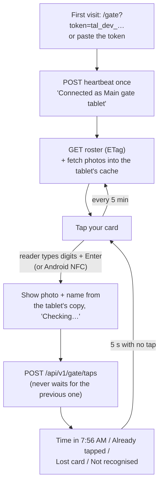

# Step 47: The `/gate` page

> **Fast-track recipe.** Written before the code, then built on 2026-10-11 when the owner said "build 46 to 49". Claude ran the checks and looked at every screen at 360 and 1280 px, light and dark. "What changed while building" (just before "Verify it worked") lists where the real code differs from the plan.

## Why

This is the screen on the Android tablet at the gate, with the USB reader plugged in. A student taps their card, and the screen shows **their photo, name and grade straight away**, then "Time in 7:56 AM" a moment later when the server answers. The guard glances at the photo to check the card belongs to the student holding it.

Decided earlier, and built in here:
- **A tap is never blocked or delayed by the screen** (2026-10-10). Every scan is sent the moment it's read, even while the previous student is still showing, and the screen jumps to the newest. After a few quiet seconds it clears back to "Tap your card". That timer only tidies the screen.
- **The gate keeps its own copy of the roster and photo thumbnails** (2026-10-10), so the photo shows instantly from the tablet while the server decides the status. It holds only what the screen shows, and wipes it when its token is revoked.
- **The heartbeat is called once, at setup** (2026-10-09). Every tap marks the gate as seen.
- **Phones get the full screen. Tablets get it split:** the current student large, and the last few taps beside it.



## Steps

### 1. The page and its own layout

`src/app/gate/page.tsx` sits outside the staff app shell: no sidebar and no sign-in. It's a full-screen layout with the school theme's colours, large type, and touch targets of 44 px or more. The page renders one client component, `GateKiosk` (`src/features/gate/gate-kiosk.tsx`). Everything on it is driven by the gate's own token, never a staff login.

### 2. Connecting the tablet (once)

- Open `/gate?token=tal_dev_…` once, or open `/gate` and paste the token into the setup screen.
- The page calls `POST /api/v1/devices/heartbeat` with it:
  - **200:** it shows "Connected as Main gate tablet, Balanga City National Science High School", saves the token in the tablet's `localStorage`, and removes `?token=` from the address bar (`history.replaceState`), so it isn't left on screen.
  - **401:** "That token doesn't work. Ask the office for a new one."
- The heartbeat also returns the server's time. If the tablet's clock is more than 2 minutes off, a small warning says so. The server already corrects badly wrong times (Step 45), but a correct clock keeps offline taps accurate later.
- A small **Disconnect** item in a corner menu, with a confirm, forgets the token and everything stored with it.

### 3. Reading the card without an on-screen keyboard

The USB reader is a keyboard: it types the digits and presses Enter. A visible text box would make Android pop up its on-screen keyboard over the screen. So the page listens for key presses on the whole document instead, with no input field, through a plain, tested helper:

```ts
/** Collects a reader's keystrokes into scans. Enter ends a scan. A gap of more than 100 ms between keys starts over, so stray human typing doesn't merge into a card. */
export function createScanBuffer(onScan: (raw: string) => void): { key(key: string, at: number): void }
```

**Android's own NFC** (Web NFC, Chrome on Android) is offered as a button, "Use this tablet's NFC", only where the browser supports it. Its `serialNumber` (for example `53:2e:98:0c:14:00:01`) goes through the same path. The server's `normalizeCardSerial` accepts both forms.

### 4. A scan, never blocked

Each scan does the following:
1. Gets a new `crypto.randomUUID()` and the tablet's time.
2. Looks the serial up in the tablet's roster (`findRosterStudent`: exact serial, otherwise the first 4 bytes, the same rule as the server) and shows the photo and name **at once**, with "Checking…".
3. Sends `POST /api/v1/gate/taps` without waiting for any earlier scan.
4. Updates **that scan's** entry when the answer arrives. If a newer scan is already showing, the answer updates the recent-taps list instead.

| Outcome | Big panel | Colour |
|---|---|---|
| `recorded` | photo, name, Grade 7 – Rizal, **Time in 7:56 AM** (or Time out) | present (green) |
| `duplicate` | name, **Already tapped at 7:56 AM** | late (amber) |
| `lost_card` | name if known, **This card was reported lost. Please see the office.** | absent (red) |
| `unknown_card` | **Card not recognised. Please see the office.** | idle (grey) |
| `invalid_serial` | **Couldn't read the card. Tap again.** | idle (grey) |
| no connection | **Not sent: no connection.** Kept in the recent list as failed. | idle (grey) |

The colours are the fixed status tokens, the same in every theme. The result is also announced in an `aria-live` region. Saving taps while offline and sending them later is listed for after the demo. For now, a failed send says so plainly and is never shown as recorded.

### 5. The tablet's own copy

- **Roster:** fetched at start and every 5 minutes with `If-None-Match`, so a `304` costs almost nothing. It's kept in `localStorage` with its ETag, so the photos and names work straight after a reload.
- **Photos:** each `photo` address is fetched with the token, then stored in the browser's Cache Storage (`talaan-gate-photos`) and shown from there. A changed photo has a new address, so only that one is downloaded. Photos that left the roster are deleted from the cache.
- **Revoked token:** any `401` wipes the token, the roster and the photo cache, and returns to the setup screen.
- **Screen wake:** the page asks for a screen wake lock where the browser supports it. A kiosk browser app does the same job more reliably (see Verify).

### 6. Layout

- **Below 768 px (a phone):** the current scan fills the screen, with the photo 60% of the width.
- **From 768 px (a tablet):** two columns. On the left, the current scan with a 280 px photo. On the right, "Recent", the last 6 taps (small photo, name, time, outcome), each updating when its answer arrives.
- **Idle:** "Tap your card", the school logo, the date, and a live clock (school time).
- Both layouts are checked in light and dark mode. The gate runs in the theme's light mode by default, since it's usually in daylight.

### 7. Tests

- **Unit:**
  - `createScanBuffer`: a fast 10-digit run plus Enter gives one scan, a slow human run gives none, and two scans back to back give two.
  - `findRosterStudent`: exact, 4-byte to 7-byte, and no match.
  - The outcome-to-panel mapping, one case per row of the table.
- **Browser test** (`e2e/gate.spec.ts`): the test database gets a gate device with a token known only to the tests, created in Playwright's global setup, never in the demo seed. The test opens `/gate?token=…`, checks "Connected as…", then types a seed card's 10-digit form and Enter with `page.keyboard`, as the reader would. It expects the student's name and "Time in". It then types the same card again and expects "Already tapped". Both are checked at phone and tablet widths.

## What changed while building

- **"Connected as Main gate tablet"**, without the school's name. The heartbeat (Step 43) answers with the device's label only, and the page has no other way to learn the school. Labels like "Balanga main gate" do the job.
- **The gate follows the tablet's own light or dark setting** instead of forcing light. Both were checked in screenshots and both read well. A tablet set to light, the usual default, shows light.
- **Startup runs from a zero-delay timer that cleanup cancels.** React's lint rule (`react-hooks/set-state-in-effect`) refused starting the connection directly in an effect. The timer also stops development mode's double run of effects from connecting twice. Because that double run would find the address bar already cleaned, a token from `?token=` is saved on the tablet **first**, then removed from the address. A bad token is forgotten again when the check-in fails.
- **NFC support is read with `useSyncExternalStore`** (false on the server, the real answer in the browser), so the server-rendered page and the tablet never disagree about the button.
- **An unknown card's panel shows only the message**, under a card symbol instead of initials. The first screenshot showed the heading "Card" over "Card not recognised", which said the same thing twice.
- **Each Recent entry shows one time:** the stored tap's time once the server answers, otherwise the moment of the read. A screenshot under the pinned demo clock showed "Time out 9:15 AM · 5:04 PM": the server's pinned time next to the tablet's real clock. In real use they agree, but the entry should never show two times.
- **The browser tests have their own gate**, `e2e/create-test-devices.ts`, run by Playwright's global setup after the reset. Its token lives only in `e2e/test-data.ts` and the test database, never in the demo seed. Two helpers type a seed card as your reader would: `readerDigitsFor(serial)` (its first 4 bytes as 10 digits, lowest byte first) and `activeCardSerialFor(name)`.
- **Under the pinned demo clock, the server's time wins.** The test browser's real clock is months ahead of `DEMO_NOW`, so `chooseTapTime` (Step 45) uses the server's 9:15 AM. That's also why the tests' students, who tapped in on the demo morning, get "Time out".
- **One more test than planned:** three cards read back to back all appear in Recent, none waiting for another. It runs at tablet width, where Recent is shown.
- **The live announcement is checked too:** the panel's `aria-live` region reads "Name: Time out 9:15 AM", or just the message when nobody is known. The tests look inside the gate's own panel, because the toast area is a second `aria-live` region on every page.

## Verify it worked

1. Your checks (or ask me to run them).
2. On your laptop: `npm run dev`, open `http://localhost:3000/gate?token=<a gate token>`. Plug in the USB reader and tap a sticker you linked in Step 44.7: the name and photo, then "Time in". Tap again: "Already tapped". Tap an unlinked sticker: "Card not recognised".
3. Tap three linked stickers quickly one after another. All three appear in Recent, and none is lost or waits for another.
4. On the tablet (later, on the deployed app from Step 52): install a kiosk browser (for example Fully Kiosk Browser, or Chrome with Android's screen pinning). Set its start page to `https://<your app>/gate?token=…` once, then plug in the reader.
5. In `psql`, the taps have the gate's device id as `stationId`, and `Device.lastSeenAt` moved.

## What's next

Step 48, the guardhouse monitor: the same taps, live on a TV and on the principal's screen.
