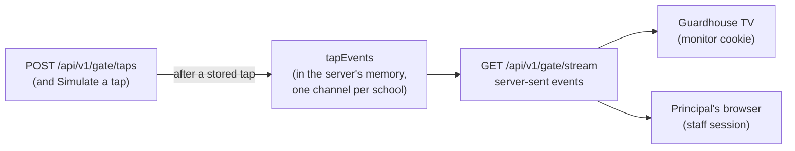

# Step 48: The `/gate/display` guardhouse monitor

> **Fast-track recipe.** Written before the code, then built on 2026-10-11 when the owner said "build 46 to 49". Claude ran the checks and looked at the monitor at 360 and 1280 px, light and dark. "What changed while building" (just before "Verify it worked") lists where the real code differs from the plan.

> **Changed on 2026-10-12: the tap card.** The monitor's newest tap and its Earlier list use the gate's `TapCard` and `TapListItem` (`src/features/gate/tap-card.tsx`), so both screens look alike, with time out in blue. See `docs/BUILD-LOG.md`, "Review change: a refined tap card on the gate and the monitor".

## Why

The guardhouse TV shows every tap live: a large photo, name and grade for the newest, and a short list of the ones before it. The guard can check faces against cards from inside the guardhouse, and the principal can watch arrivals from their own office.

Decided 2026-10-09 and 2026-10-10 (`docs/ARCHITECTURE.md`, "How the monitor is set up"):
- **A TV opens a link with its key built in.** On the first visit the key is swapped for a long-lived cookie and removed from the address bar. There's no login and nothing to type each morning.
- **A signed-in principal or super admin can watch the same feed with no registration.** Teachers can't.
- **One address for every school.** The school comes from who is asking, never from the address.
- **The monitor sends no heartbeat.**



## Decisions in this recipe (please confirm or change)

1. **Live updates through server-sent events (SSE), passed along in the server's own memory.** When a tap is stored, the server tells every open monitor of that school straight away. It needs no extra service and costs nothing. **The limit:** it only works while the app runs as **one** server process, which is the Heroku Basic plan (Step 52). If it ever runs on two, this changes to Postgres's own `LISTEN/NOTIFY`, behind the same `tapEvents` interface. That's noted as an after-the-demo item.
2. **Only stored taps reach the monitor:** recorded, lost card and unknown card. Duplicates and resends don't, since nothing new happened. The dashboard's **Simulate a tap** also publishes, so a demo without a reader still shows on the monitor.
3. **The link is `/gate/display/connect?key=tal_dev_…`.** Setting a cookie needs a route, not a page. The route checks the key is an active **monitor** device (a gate's token is refused, since a gate records taps and the monitor only watches). It sets an httpOnly cookie `talaan_monitor` (Secure in production, SameSite=Lax, 400 days, the longest browsers allow) and sends the browser on to `/gate/display`. Revoking the device stops that TV at its next request.

## Steps

### 1. `tapEvents`

`src/services/taps/tap-events.ts`:

```ts
export type GateTapEvent = {
  id: string;
  outcome: "recorded" | "lost_card" | "unknown_card";
  direction: "time_in" | "time_out" | null;
  tappedAt: string;
  student: (TapStudent & { photo: string | null }) | null;
};

export function publishTap(schoolId: string, event: GateTapEvent): void;
/** Returns the "stop listening" function. */
export function subscribeToTaps(schoolId: string, listener: (event: GateTapEvent) => void): () => void;
```

It's a Node `EventEmitter` kept on `globalThis`, the same trick as the Prisma client, so a development reload doesn't split it in two. Events are keyed by school, so one school's listener can never receive another school's tap. `POST /api/v1/gate/taps` publishes after a stored, non-replayed tap, and so does `simulateTap`. A small `toGateTapEvent(result, photo)` builds the event and is shared by both.

### 2. Who is watching

`resolveMonitorViewer()` in `src/features/gate/monitor-viewer.ts` returns `{ schoolId, kind: "monitor" | "staff" }` or `null`:
- a `talaan_monitor` cookie whose token is an active **monitor** device: that device's school;
- otherwise a staff session of a **principal or super admin** with a school selected: that school;
- anyone else, including teachers: `null`.

The decision itself is a plain function, `monitorViewerFrom(device, session)`, so it's tested without cookies. Step 46.5's photo route uses the same resolver, so the TV's cookie also loads photos.

### 3. The stream

`src/app/api/v1/gate/stream/route.ts`. `GET` returns `text/event-stream`:
- With no viewer: `404`.
- Otherwise it subscribes to that school's taps and writes each one as:
  ```
  event: tap
  data: {"id":"…","outcome":"recorded",…}

  ```
- Every 25 seconds it writes a `: keep-alive` line. Heroku closes a connection that's silent for 55 seconds.
- When the browser goes away (`request.signal` aborts), it unsubscribes, so a closed TV leaves nothing behind.
- `export const dynamic = "force-dynamic"`, so Next.js never caches it. The text formatting is a tested helper, `formatSseEvent(name, data)`.

### 4. Connecting a TV

`src/app/gate/display/connect/route.ts` works as described in decision 3. A bad or non-monitor key goes to `/gate/display?error=key`, which says "This link doesn't work. Ask the office for a new one." Make a monitor once with:

```bash
npm run device:create -- --school school-balanga --kind monitor --label "Guardhouse TV"
```

The TV's link is then `https://<app>/gate/display/connect?key=<that token>`.

### 5. The page

`src/app/gate/display/page.tsx` (a server component, full screen, no staff shell):
- **No viewer:** a plain explanation. For a principal it also says how to connect a TV.
- **A viewer:** it loads that school's last 20 stored taps of today (`listBySchoolOnDate`, newest first) with their students, then hands them to `GateMonitor` (`src/features/gate/gate-monitor.tsx`, a client component). That component opens `new EventSource("/api/v1/gate/stream")` (same-origin, so the cookie or session goes along by itself) and puts each new tap at the top.
- **Layout (TV and laptop):**
  - the newest tap large, with a 240 px photo (Step 46.5's `StudentAvatar`), name, grade and section, time, and the outcome in its status colour;
  - below it, a grid of the previous 11, each with a small photo, name and time;
  - a live clock and the school's name in the header.
- **Phone width:** one column, the newest first.
- **"Reconnecting…":** a small badge shows while the browser is reconnecting. `EventSource` retries by itself, and the page then reloads the latest 20 so nothing is missed.
- The TV runs in light mode by default.

### 6. Getting there from the admin app

The dashboard's **Live taps** card gets an **Open gate monitor** link, opening `/gate/display` in a new tab, for principals and super admins only.

### 7. Tests

- **Unit:**
  - `tapEvents`: a listener gets its own school's taps and not another school's, and stops after unsubscribing;
  - `monitorViewerFrom`: a monitor device, a gate device (refused), a principal, a teacher (refused), a super admin with and without a school, and nobody;
  - `formatSseEvent`;
  - `toGateTapEvent` for each of the three outcomes.
- **Browser test** (`e2e/gate-monitor.spec.ts`): as the principal, open `/gate/display`, then send a tap through `POST /api/v1/gate/taps` with the test gate token from Step 47 (Playwright's `request`). The tapped student's name appears on the monitor within a few seconds, with no reload. A teacher opening `/gate/display` sees the "not available" message.

## What changed while building

- **The monitor shows the latest 12 taps**: one large and 11 below. On first paint they're built from today's stored taps by `monitorEventsFromTaps` (`src/features/gate/monitor-events.ts`). A tap with an alert is a lost card, one with nobody is an unknown card, and the rest are time in or out by their order in the day. No per-card queries are needed. Live events are merged on top by `mergeMonitorEvents`, each tap once, newest first. After a reconnect, `router.refresh()` reloads the page's own list, and the live list stays as it was. No effect copies props into state.
- **The tap API publishes after `recordTap()`** through `publishStoredTap(result)` (`src/services/taps/publish-tap.ts`). It looks up the student's photo key, because `recordTap()`'s screen-safe student has no photo, and skips duplicates, resends and bad reads. `simulateTap` publishes its own event, always a time in, since it only picks students with no tap today.
- **The photo route accepts the TV's cookie too.** `resolvePhotoViewer` checks Bearer first, then the `talaan_monitor` cookie, then the staff session, so the TV's `` photos load.
- **The stream starts with a keep-alive line**, so the connection is shown as open straight away, then sends one every 25 seconds. Closing after the viewer has gone is wrapped in `try`, because the browser may have closed it first.
- **"Open gate monitor" is a plain link** opening a new tab, in the Live taps card's header. That branch of the dashboard never renders for a teacher.
- **Until Step 50, any browser counts as Balanga's principal.** That's the dev session's default persona, so in development `/gate/display` opens without a monitor cookie, and a bad monitor link lands on a working feed (the URL still says `?error=key`). The real check is unit-tested (`monitorViewerFrom`). The browser tests check the parts that don't depend on the default: a teacher gets the "isn't connected" page and a 404 from the stream, a gate's key is refused by the connect link, and a TV's link sets an httpOnly cookie and leaves the address bar clean.
- **Testing "live" honestly.** The first version of the live test only checked that the student's name was on screen. Their demo-morning tap could already be in the first 12, so it could pass with no live stream at all. It now counts the name's mentions before the tap and expects exactly one more after, on the same open page, with no reload. A stricter "they're the newest" check failed for a fair reason: under the pinned demo clock both test widths' taps get exactly 9:15 AM, and the one that arrived second is rightly the newest.

## Verify it worked

1. Your checks (or ask me to run them).
2. `npm run dev`. Sign in as the principal and open `/gate/display` in one window. In another window, open `/gate?token=…` (Step 47) and tap a linked sticker. It shows on the monitor within a second, with its photo.
3. Press **Simulate a tap** on the dashboard: that student shows on the monitor too.
4. Make a monitor device, open its `/gate/display/connect?key=…` link in a private window: the key disappears from the address bar and the feed works with no sign-in. Revoke the device in `psql` (`UPDATE "Device" SET status='revoked' WHERE label='Guardhouse TV';`) and reload: "This screen isn't connected".
5. Switch to a teacher and open `/gate/display`: not available.

## What's next

Step 49 shows time in and time out on the attendance page.
