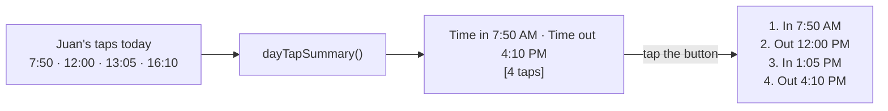

# Step 49: Time in and time out on the attendance page

> **Fast-track recipe.** Written before the code, then built on 2026-10-11 when the owner said "build 46 to 49". Claude ran the checks and looked at the page at 360 and 1280 px, light and dark. "What changed while building" (just before "Verify it worked") lists where the real code differs from the plan.

## Why

From Step 45 a student's second tap of the day is their **time out**, the third a time in again, and so on. That's worked out from the order of their taps, never stored (`docs/ATTENDANCE-MODEL.md`, re-confirmed 2026-10-03). Parents are already notified of both. The Attendance page, though, still shows only **Time in**. This step adds **Time out**, and a small "**N taps**" button that opens the full list when a student came and went more than once (decided 2026-09-23).



## Decision in this recipe (please confirm or change)

**Time out shows only when the student's latest tap is a time out.** With taps in, out, in (the student went out at noon and came back), the student is in school now. Showing the noon tap as "Time out" would say they'd left. In that case Time out shows **"—"**, and the "3 taps" button tells the whole story. With 2 or 4 taps, Time out is the last one.

Status (present, late, absent, and the weekend's came in or no tap) doesn't change. It still comes from the **first** tap only.

## Steps

### 1. The summary

In `src/features/attendance/status.ts`:

```ts
export type DayTapSummary = {
  /** The day's taps, earliest first, each labelled. */
  taps: { tap: Tap; kind: "time_in" | "time_out" }[];
  timeIn: Tap | undefined;   // the first tap
  timeOut: Tap | undefined;  // the last tap, only when it's a time out
};

export function dayTapSummary(studentId: string, taps: Tap[], day: SchoolDay): DayTapSummary
```

It uses the same alternation as `deriveTapKind`: the 1st tap is in, the 2nd out, and so on, by position in the sorted day. That's a single pass over the list instead of one `deriveTapKind` call per tap.

### 2. The table and the phone cards

- **`attendance-table.tsx`:** the columns become Student, **Time in**, **Time out**, Status, Card. When the student has more than 2 taps, the Time out cell also holds a small **"N taps"** button.
- **`attendance-card-list.tsx` (phone):** under the status, "In 7:50 AM · Out 4:10 PM", or "In 7:50 AM" alone. The "N taps" button sits beside it.
- **The button** opens a dialog (the existing `Dialog` component) titled "Juan Cruz's taps on June 19". It shows the numbered list "In 7:50 AM", "Out 12:00 PM", …, each with its time. It's keyboard operable, focus returns to the button on close, and the button's label says what it opens ("4 taps today, show all").
- The comment in `attendance-table.tsx` saying there's no time-out column is replaced.

The teacher's class roll and the parent's child card keep their current layout. The parent card already lists every tap.

### 3. Seed: a demo morning with comings and goings

So the demo shows the new column, two Balanga students get extra taps on the demo morning. All of it happens before 9:15, so the demo clock's view is consistent:
- one leaves early: in 7:41, **out 8:40** (sent home). Time out shows 8:40 AM;
- one goes out and comes back: in 7:38, out 8:20, **in 8:52**. Time out shows "—", with a "3 taps" button.

Their first taps are unchanged, so the counts stay at 21 present, 6 late, 13 absent. The extra taps are more than 2 minutes apart, so they're real taps, not duplicates. These two students are picked from ones no browser test taps.

### 4. Tests

- `dayTapSummary`:
  - no taps;
  - one tap (in, no out);
  - two taps (in, then out = the second);
  - three taps (out undefined, three labelled entries);
  - four taps;
  - taps of another day and another student ignored;
  - taps given out of order are sorted.
- `AttendanceTable` and `AttendanceCardList`: Time out shows for 2 taps, "—" for 3, the "3 taps" button appears only above 2, and the dialog lists the taps with In/Out.
- Seed test: the counts at 9:15 on the demo day are still 21 / 6 / 13.
- Browser test: on the Attendance page (the class of the "came back" student), the "3 taps" button opens the list and closes with Escape, focus back on the button.

## What changed while building

- **The seed students are Precious Rivera and Rodel Espiritu**, both in **Grade 11 – Aguinaldo**, so one class page shows both cases. Their real first taps decided the times:
  - Precious: in 8:17 (late), **out 8:40**;
  - Rodel: in 8:01, out 8:20, **back in at 8:52**.

  A `tsx` check confirmed the counts stay 21 / 6 / 13, and `seed.test.ts` now asserts that.
- **On phones, Out sits under In**, not beside it. The first screenshot at 360 px showed "In 8:17 AM · Out 8:40 AM" squeezing "Precious Rivera" until it broke mid-word. "In" is spelled out only when there's an "Out" below it. Alone, the time says it. A screen reader hears "In at 8:17 AM, out at 8:40 AM".
- **The phone card list is shared with the teacher's class roll** (`AttendanceCardList`, variant `rows`), so the class roll on a phone also shows the time out and the taps button. The desktop class roll (`class-roll.tsx`) is unchanged.
- **Two files for the button:** `day-taps.tsx` is a server-friendly wrapper that renders nothing for 2 taps or fewer, and `day-taps-button.tsx` is the client part with the `Dialog`. The table and the phone list just render `<DayTapsIndicator summary=… />`.
- **The button's accessible name says what it opens:** "3 taps, show all of Rodel Espiritu's taps". The visible text stays "3 taps".
- **Ties in the summary are broken by id**, the same as `deriveTapKind`, so two taps in the same millisecond always get the same order.

## Verify it worked

1. Your checks (or ask me to run them).
2. Run `npm run db:reset` for the new seed taps, and set `DEMO_NOW` to the demo morning.
3. **Attendance**, Grade 11 – Aguinaldo (`/attendance?date=2026-06-19&grade=11&section=Aguinaldo`): Precious Rivera shows Time out **8:40 AM**.
4. Rodel Espiritu: Time out "—" and a **3 taps** button. It lists In 8:01, Out 8:20, In 8:52. Escape closes it and puts focus back on the button.
5. At 360 px, the phone cards show "In … · Out …", and the button still fits.

## What's next

Step 50, real staff sign-in, replacing the dev role switcher in production.
