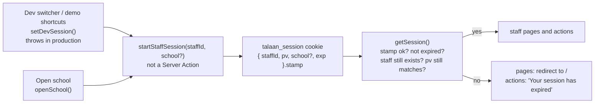

# Step 50: Signed staff sessions

> **Fast-track recipe.** First written before the code on 2026-10-11. On 2026-10-12 the owner chose option A (our own signed cookie) after comparing it with JWT, Better Auth, Auth.js and hosted services ([Talaan Sign-in Options](https://claude.ai/artifact/3AsAcMHFBbZbzjJya1tZAK)), and split the step in two. This recipe now covers what Step 50 built. The real sign-in form, the wrong-password limit, Sign out and the signed parent cookie moved to `docs/backend/step-50.1-sign-in-form.md`. "What changed while building" lists where the code differs from the first plan.

## Why

Until this step, anyone who opened the app was Balanga's principal. With no session cookie, `getSession()` fell back to a default persona, and the cookie itself held a plain staff id that anyone could type. That was fine while the app only ran on a laptop. Step 52 puts it on the internet, and from then on it holds minors' names, photos and arrival times. So before the deploy:

- **No cookie means signed out.** Every staff page sends you to the sign-in screen, and every staff action refuses.
- **The cookie can't be forged.** The server stamps it with a secret, and a cookie whose stamp doesn't match is ignored.
- **Staff have passwords in the database**, ready for the sign-in form (Step 50.1) and set-password links (Step 50.5).



## Decisions (confirmed by the owner, 2026-10-12)

1. **A session lasts 30 days**, then you sign in again. A shared office computer should use Sign out (Step 50.1).
2. **Changing a password signs out every other browser.** The cookie carries `pv`, a short fingerprint of the password hash. No session table.
3. **A super admin who opens a school stays a super admin.** The cookie remembers which school (`school`).
4. **The "Preview as" switcher and the demo shortcuts stay, in development only.** They set the same signed cookie, through a function that throws in production.
5. **Active seed staff get the password `Talaan123!`**, the same as seed parents. Invited seed staff have none.

(The sixth decision, 5 wrong passwords in 15 minutes, belongs to Step 50.1.)

## Your part: the secret

A new setting, `SESSION_SECRET`: at least 32 random characters, used to stamp cookies. Anyone who knows it could make a cookie for any account, so it lives only in `.env` (and later Heroku's settings), never in the code.

```bash
openssl rand -base64 32
```

Add this line to your `.env` (I can't edit that file), with what it printed:

```
SESSION_SECRET="<the 44 characters it printed>"
```

`.env.example` has the same line, empty, with a comment. The browser tests use their own secret (step 8).

## Steps

### 1. Read the secret: `src/lib/env.ts` (new)

```ts
export function sessionSecret(): string {
  const secret = process.env.SESSION_SECRET;
  if (!secret || secret.length < MIN_SESSION_SECRET_LENGTH) {
    throw new Error(`SESSION_SECRET is missing or shorter than ${MIN_SESSION_SECRET_LENGTH} characters. …`);
  }
  return secret;
}
```

It's read when a cookie is made or checked, not when the app starts, so `npm run build` (and CI's build) doesn't need it. A missing secret fails loudly on the first staff page instead of signing with an empty one.

### 2. Signed values: `src/lib/signed-value.ts` (new)

```ts
export type SignPurpose = "staff-session" | "parent-session" | "set-password";
export type SignedPayload = { exp: number } & Record<string, unknown>;

export function signValue(payload: SignedPayload, purpose: SignPurpose, secret: string): string
export function readSignedValue(raw: string | undefined, purpose: SignPurpose, secret: string, now: Date): Record<string, unknown> | null
```

- The value is `<base64url JSON>.<stamp>`. The stamp is `HMAC-SHA256(purpose + "." + payload, secret)`, from `node:crypto`'s `createHmac`.
- **The purpose is part of the stamp**, so a value made for one job never verifies as another.
- **Every payload has `exp`** (seconds since 1970, like a JWT). `readSignedValue` refuses a value whose `exp` has passed or is missing.
- **`timingSafeEqual`** compares the stamps, so response times give nothing away. It compares the stamp's *text*: two base64url spellings can decode to the same bytes, and only the one we made counts.
- **It never throws.** A garbage cookie is just "signed out".

Unit tests (`signed-value.test.ts`): a value round-trips; one changed character in the payload or the stamp fails; a swapped payload with the old stamp fails; another purpose fails; another secret fails; an expired value fails; a stamped payload with no `exp` fails; garbage gives null.

### 3. Staff passwords in the database

`prisma/schema.prisma`, `Staff`:

```prisma
  // One account per email, stored in lower case, so sign-in finds exactly one person.
  email              String      @unique
  // Never the password itself: see src/lib/password.ts. Null until the
  // staff member sets one (Step 50.5).
  passwordHash       String?
```

`npx prisma migrate dev --name staff_password` refused to run here: when a change carries a warning (this one: "a unique constraint … will be added"), it asks for confirmation, and it won't ask in a non-interactive shell. So the migration was written from Prisma's own diff (see `docs/BUILD-LOG.md`, Step 50):

```bash
npx prisma migrate diff --from-config-datasource --to-schema prisma/schema.prisma --script
```

Its two statements went into `prisma/migrations/20261012083808_staff_password/migration.sql`, with one line added between them so existing emails are lower case before the unique index goes on:

```sql
ALTER TABLE "Staff" ADD COLUMN     "passwordHash" TEXT;
UPDATE "Staff" SET "email" = lower("email");
CREATE UNIQUE INDEX "Staff_email_key" ON "Staff"("email");
```

Then:

```bash
npx prisma migrate deploy   # applies it
npx prisma generate         # the client now knows passwordHash
```

A second `migrate diff` printed "This is an empty migration": the database and the schema match.

**Emails are refused when already used.** `inviteStaff` (`src/features/staff/actions.ts`) and `createSchool` (`src/features/schools/actions.ts`) lower-case the email and check `staffRepository.findByEmail` first, answering on the email field: "Someone already uses this email. Each staff account needs its own." (`src/features/staff/messages.ts`). `createSchool` checks before making the school, so a refused email never leaves a school with no principal.

### 4. The password fingerprint and the seed password

`src/lib/password.ts` gains:

```ts
export function passwordVersion(stored: string | null): string {
  if (!stored) return "none";
  return createHash("sha256").update(stored).digest("base64url").slice(0, 16);
}
```

`src/data/seed/staff-password.ts` (new, no imports):

```ts
export const SEED_STAFF_PASSWORD = "Talaan123!";
export const SEED_STAFF_PASSWORD_HASH = "scrypt:qmExiiE2/EtW6yDZSl/AMQ==:3x9/o8…";
```

The hash was made once with `hashPassword`'s own method and kept fixed. A unit test checks it still matches `Talaan123!`. Fixed, rather than made at seed time, so the browser tests can compute the same `pv` the database will give (step 8). `prisma/demo-data.ts` gives it to every **active** seed staff member. Invited ones get null, like a real invited account.

### 5. The staff repository

`StaffRepository` gains two methods, in the interface, the mock and the Prisma version:

```ts
findByEmail(email: string): Promise<Staff | null>;               // case-insensitive
getForSession(id: string): Promise<StaffWithPasswordHash | null>; // { staff, passwordHash }
```

A `Staff` object still never carries the hash (`toStaff` doesn't copy it). Only `getForSession` returns it, next to the staff member. The mock keeps hashes in its own map: `SEED_STAFF_PASSWORD_HASH` for every active account it starts with, none for invited ones.

### 6. The cookie and the session

`src/lib/session-cookie.ts` (new; no Next.js or database imports, so the browser tests can use it):

```ts
export const SESSION_COOKIE = "talaan_session";
export const SESSION_MAX_AGE_SECONDS = 30 * 24 * 60 * 60;
export function makeStaffSessionCookie(contents: StaffSessionCookie, secret: string, now: Date): string
export function readStaffSessionCookie(raw: string | undefined, secret: string, now: Date): StaffSessionCookie | null
```

`readStaffSessionCookie` checks the payload's fields with a Zod schema (`staffId`, `pv`, optional `school`).

`src/lib/session.ts`, rewritten:

```ts
export async function resolveSession(raw: string | undefined, deps: SessionDeps): Promise<Session | null>
export const getSession = cache(async (): Promise<Session | null> => …);
export async function requireSession(): Promise<Session>              // redirect("/") when null
export async function startStaffSession(staffId: string, school?: string): Promise<void>
```

`resolveSession` returns null for no cookie, a wrong stamp, an expired cookie, a removed staff member, or a `pv` that no longer matches. A super admin's `schoolId` is the `school` they opened, if it still exists. Everyone else gets their own school, whatever the cookie says.

- **`cache`** (React) runs `getSession` once per request, so the layout and the page share one database lookup.
- **The real clock.** `getSession` passes `new Date()`, never `DEMO_NOW`.
- **`startStaffSession`** sets the cookie: httpOnly, `sameSite: "lax"`, `secure` in production, `maxAge` 30 days. **It is not a Server Action** (see "What changed while building").

`src/lib/session-actions.ts`: `setDevSession(staffId)` keeps its production guard and now calls `startStaffSession`. The old `talaan-dev-session` cookie is ignored, so anyone signed in through the switcher is signed out once and signs in again.

### 7. Every caller of `getSession()`

| Where | Change |
|---|---|
| `src/app/(app)/layout.tsx` and the 7 staff pages | `requireSession()` |
| `students/actions.ts` (2), `students/card-actions.ts`, `staff/actions.ts` (2), `schools/actions.ts` (5) | `if (!session) return { ok: false, formError: SIGNED_OUT_MESSAGE }` (`{ error }` for the staff ⋮ menu helper) |
| `attendance/actions.ts` (`simulateTap`) | A new `"signed-out"` reason; the button shows the message |
| `station/station-actions.ts`, `theme-override-actions.ts` | They already threw on a refusal, so they throw `SIGNED_OUT_MESSAGE` |
| `photo-viewer.ts` | Null session: not allowed (a 404) |
| `monitor-viewer.ts` | Unchanged: it already treated a null session as "not allowed" |

`SIGNED_OUT_MESSAGE` ("Your session has expired. Sign in again.") is in `src/features/auth/messages.ts`, a file with no server imports, so the Simulate a tap button can use it too.

**Open school** (`openSchool`) checks the school exists, then calls `startStaffSession(session.userId, school.id)` instead of switching to the principal. The dashboard's existing "Viewing …" heading shows, and the top bar says "Super admin, Balanga City National Science High School".

### 8. Browser tests

`e2e/sessions.ts`:

```ts
export const TEST_SESSION_SECRET = "e2e-only-session-secret-not-for-real-use-0123456789";

export function staffSessionCookieValue(staffId: string, school?: string): string {
  return makeStaffSessionCookie(
    { staffId, pv: passwordVersion(SEED_STAFF_PASSWORD_HASH), school },
    TEST_SESSION_SECRET,
    new Date(),
  );
}
```

`playwright.config.ts` gives the test server `SESSION_SECRET: TEST_SESSION_SECRET`. Every existing `signInAs(context, "principal", …)` works unchanged. The parent persona still sets the plain parent cookie until Step 50.1.

New tests in `e2e/login.spec.ts`, "Staff session (Step 50)":
- signed out, `/dashboard` lands on the sign-in screen;
- a cookie with a forged stamp is signed out;
- a cookie made 31 days ago is signed out;
- the old `talaan-dev-session` cookie signs nobody in;
- a super admin who opens Balanga sees "Viewing Balanga…" and can still open Schools.

### 9. Unit tests

- `signed-value.test.ts` (step 2).
- `session.test.ts`, rewritten: no cookie; a valid cookie; another secret; after 30 days; a removed staff member; a changed password; a super admin with no school, with an opened school, and with an opened school that no longer exists; a principal's `school` ignored; the old plain staff id refused.
- `password.test.ts`: `passwordVersion` changes with the hash, is `"none"` without one, and doesn't contain the hash; `SEED_STAFF_PASSWORD_HASH` still matches.
- `staff-repository.test.ts`: `findByEmail` ignores case and spaces; `getForSession` gives active accounts the seed hash and invited ones none.

## What changed while building

- **`startStaffSession` is not a Server Action.** The first plan put it in `session-actions.ts`, a `"use server"` file. Every exported function in such a file is a public endpoint anyone can call with any arguments, and this one takes any staff id: it would have let anyone sign in as anyone. It lives in `session.ts` (no `"use server"`), and is called only by `setDevSession` (guarded), `openSchool` (super admins only) and, in Step 50.1, the sign-in form after the password checks.
- **`readSignedValue` returns a plain object, not `<T>`.** A generic would let the caller assume the payload's shape without checking it. `readStaffSessionCookie` checks it with Zod instead.
- **`session-cookie.ts` is a separate file**, so the browser tests can make cookies without importing Next.js or the database.
- **The seed hash is fixed in the code** (`SEED_STAFF_PASSWORD_HASH`) instead of made at seed time, so the browser tests know each seed account's `pv`.
- **Invited seed staff have no password**, so they behave like a real invited account.
- **Adding staff or a school refuses a used email**, since the unique index would otherwise crash the action.
- **The migration was written from `prisma migrate diff`**, because `migrate dev` won't confirm a warning in a non-interactive shell. It also lower-cases existing emails.
- **`setPassword` and `findForSignIn` wait** for the steps that use them (50.5 and 50.1), so nothing unused is added now.

## Verify it worked

1. Add `SESSION_SECRET` to `.env` (Your part), then:
   ```bash
   npx prisma migrate deploy   # "No pending migrations" if I already applied it to your database
   npm run db:reset
   npm run dev
   ```
2. Open `http://localhost:3000/dashboard` in a private window. You land on the sign-in screen.
3. Click **Principal** under "Try the prototype as". You land on Balanga's dashboard.
4. In the browser's developer tools (Application → Cookies), the `talaan_session` cookie looks like `eyJ….xxxx`, and it's marked HttpOnly. Change one character and reload: you're on the sign-in screen.
5. Sign in as **Super admin**, open **Schools**, click **Open** on Balanga. The dashboard says "Viewing Balanga City National Science High School", and the top bar says "Super admin, …".
6. On the Staff page, try adding someone with `teacher@school-balanga.talaan.example`: the email field says "Someone already uses this email."
7. Your checks:
   ```bash
   npm run lint && npm run check:tokens && npm run typecheck && npm test && npm run build
   npm run test:e2e
   ```

## What's next

Step 50.1: the sign-in form checks the real password, with a limit on wrong tries, a Sign out button, and a signed parent cookie.
