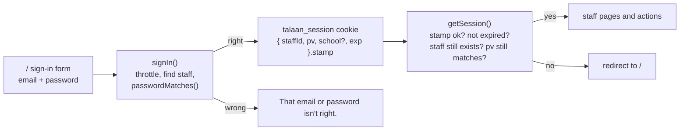

# Step 50: Real staff sign-in

> **Fast-track recipe.** Written before the code on 2026-10-11, for the owner to approve before it's built. When it's built, a "What changed while building" section (just before "Verify it worked") will list where the real code differs from this plan.

## Why

Today anyone who opens the app is Balanga's principal. When there's no session cookie, `getSession()` falls back to a default persona (`src/lib/session.ts`). That was fine while the app only ran on your laptop. Step 52 puts it on the internet, and from then on the app holds minors' names, photos and arrival times. So before the deploy:

- **Staff sign in with their email and password**, checked against a scrypt hash, the same code parents use since Step 41 (`src/lib/password.ts`).
- **No cookie means signed out.** Every staff page sends you to the sign-in screen, and every staff action refuses.
- **Cookies can't be forged.** Today the staff cookie and the parent cookie both hold a plain id. Anyone who types `parent-balanga-1` into their browser's cookie store *is* that parent. From this step both are **signed**: the server adds a secret stamp, and a cookie whose stamp doesn't match is ignored.

Decided on 2026-10-11: **our own signed, httpOnly session cookie**, not Auth.js. It needs no new dependency, it's about 60 lines, and you can read every one of them. `docs/ARCHITECTURE.md`'s Auth.js line is updated to match.



## Decisions in this recipe (please confirm or change)

1. **A session lasts 30 days**, then you sign in again. A principal who signs in on their own phone isn't asked every morning. A shared office computer should use Sign out.
2. **Changing a password signs out every other browser.** The cookie carries `pv`, a short fingerprint of the password hash. When the hash changes (Step 50.5's set-password link), old cookies stop matching. No session table is needed.
3. **5 wrong passwords for one email in 15 minutes locks that email for 15 minutes**, with "Too many tries. Wait 15 minutes and try again." The count is kept in the server's memory. On one Heroku dyno that's every request; it resets on a restart, which is acceptable for a pilot.
4. **A super admin who opens a school stays a super admin.** Today Open school turns you *into* that school's principal. From this step the cookie remembers which school you're viewing (`school`), and the dashboard's existing "Viewing Balanga City NSHS" heading shows. Opening another school switches.
5. **In development, the "Preview as" switcher and the demo shortcuts stay.** They set the same signed cookie, through a function that refuses to run in production. In production, the only way in is the form.
6. **Seed staff get the password `Talaan123!`**, the same as seed parents, so you can sign in as any demo account by typing it.

## Steps

### 1. The secret

A new environment variable, `SESSION_SECRET`: at least 32 random characters, used to stamp cookies. Anyone who knows it could make a cookie for any account, so it lives only in `.env` and in Heroku's settings, never in the code.

Make one with:

```bash
openssl rand -base64 32
```

Add it to your `.env` (I can't edit that file):

```
SESSION_SECRET="<the 44 characters it printed>"
```

`.env.example` gets the same line with a placeholder and a comment. Playwright passes its own fixed test secret to its server (`playwright.config.ts`'s `webServer.env`), so the tests never need yours.

`src/lib/env.ts` (new) reads it: `sessionSecret()` throws "SESSION_SECRET is missing or shorter than 32 characters" when it isn't set. The app fails loudly instead of signing with an empty secret.

### 2. Signed values

`src/lib/signed-value.ts`, a small, tested helper used by every cookie and link that must not be forged:

```ts
/** "payload.stamp": the payload is base64url JSON, the stamp an HMAC-SHA256 of it with the secret and a purpose. */
export function signValue(payload: object, purpose: SignPurpose, secret: string): string

/** The payload, or null when the stamp doesn't match, the purpose differs, or `exp` has passed. Never throws. */
export function readSignedValue<T>(raw: string | undefined, purpose: SignPurpose, secret: string, now: Date): T | null

export type SignPurpose = "staff-session" | "parent-session" | "set-password";
```

- **HMAC-SHA256** comes from `node:crypto` (`createHmac`). The comparison uses `timingSafeEqual`, so how fast an answer comes back gives nothing away.
- **The purpose is part of the stamp.** A staff session cookie pasted where a set-password link is expected (Step 50.5) doesn't verify. Each signed value only works for the job it was made for.
- **Every payload has `exp`**, and `readSignedValue` checks it, so an old cookie copied from somewhere stops working on its own.

### 3. Staff passwords in the database

`prisma/schema.prisma`, `Staff`:

```prisma
  email        String      @unique
  // Never the password itself: see src/lib/password.ts. Null until the
  // staff member sets one (Step 50.5).
  passwordHash String?
```

```bash
npx prisma migrate dev --name staff_password
```

- **`email` becomes unique.** One account per email, so sign-in finds exactly one person. The migration fails if two staff already share an email; the seed's emails are unique (`principal@<school>.talaan.example`), so it shouldn't. Emails are stored in lower case, and the add-staff action lower-cases them.
- **`passwordHash` is nullable.** A principal adding a teacher today creates an *invited* account with no password. That teacher can't sign in until Step 50.5 gives them a link to set one.
- **The seed** hashes `SEED_STAFF_PASSWORD` once and gives every seed staff member that hash, so `npm run db:reset` doesn't spend half a second per account. Seed data only: real accounts each get their own salt.
- `StaffRepository` gains `findByEmail(email)` and `setPassword(id, hash)`. Like `Parent`, a `Staff` object never carries the hash. `findForSignIn(email)` returns `{ staff, passwordHash }` for the sign-in action only.

### 4. The session

`src/lib/session.ts` is rewritten:

```ts
export const SESSION_COOKIE = "talaan_session";
const SESSION_DAYS = 30;

type SessionCookie = { staffId: string; pv: string; school?: string; exp: number };

export type Session = { userId: string; role: Role; schoolId: string | null };

/** Testable core: what a cookie means today, or null. */
export async function resolveSession(raw: string | undefined, deps: SessionDeps): Promise<Session | null>

/** Null when signed out. For actions and anything that must not redirect. */
export async function getSession(): Promise<Session | null>

/** For pages: the session, or a redirect to the sign-in screen. */
export async function requireSession(): Promise<Session>
```

`resolveSession` returns null when:
- there's no cookie;
- the stamp is wrong;
- it has expired;
- the staff member no longer exists;
- `pv` no longer matches their password hash.

For a super admin, `schoolId` is the `school` they're viewing, if that school still exists. For everyone else it's their own school. **The school never comes from anything the browser sends except this signed cookie.**

`src/lib/session-actions.ts` holds the cookie writers, each `"use server"`:
- `startStaffSession(staffId, school?)` sets the cookie: httpOnly, `sameSite: "lax"`, `secure` in production, `maxAge` 30 days.
- `endStaffSession()` deletes it.
- `setDevSession(staffId)` is still guarded by `assertDevSessionMutationAllowed()`. It now calls `startStaffSession`, so the switcher's cookie is the real kind.

The old `talaan-dev-session` cookie is ignored from now on: anyone signed in through the switcher is signed out once and signs in again.

### 5. Sign in and sign out

`src/features/auth/actions.ts`:

```ts
export async function signIn(input: LoginInput): Promise<SignInResult> // { ok: false, formError } or a redirect to /dashboard
export async function signOut(): Promise<void>                          // deletes the cookie, redirects to /
```

`signIn`:
1. Validates with `loginSchema`.
2. Asks the throttle (`src/services/auth/login-throttle.ts`, step 6).
3. Finds the staff member by email.
4. Checks `passwordMatches`.

A missing account, an invited account with no password and a wrong password all give the **same** answer, "That email or password isn't right.", so the form never reveals which emails have accounts. On success it starts the session and goes to `/dashboard`.

- **`login-form.tsx`** calls `signIn` with what was typed, in every environment. The `signInEnabled` prop and the "always signs in as the principal" behaviour go away.
- **`demo-shortcuts.tsx`** keeps its three buttons, in development only. They call `signInAsDemo(staffId)`, which still goes through the guarded `setDevSession`.
- **Sign out:** a "Sign out" item in the top bar's account area, and in the mobile drawer. It's a `<form action={signOut}>` button, so it works before JavaScript loads.
- **`/` when already signed in** redirects to `/dashboard`, so a principal's bookmark of the sign-in page doesn't make them sign in twice.

### 6. The throttle

`src/services/auth/login-throttle.ts`:

```ts
export function createLoginThrottle(options: { maxFailures: number; windowMs: number }): {
  isLocked(key: string, now: number): boolean;
  recordFailure(key: string, now: number): void;
  recordSuccess(key: string): void;
}
export const loginThrottle = createLoginThrottle({ maxFailures: 5, windowMs: 15 * 60_000 });
```

The key is the lower-cased email. Parents' sign-in uses the same throttle with a `parent:` prefix, and so will the parent API (Step 53). It's in memory, like the live monitor's channel, with the same one-dyno note in `docs/AUTH.md`.

### 7. Every caller of `getSession()`

17 files call it (recounted 2026-10-12, after the review changes removed `photo-actions.ts`). Each one changes in one of two ways:

| Where | Change |
|---|---|
| `src/app/(app)/layout.tsx` and the 7 staff pages | `requireSession()`. Signed out means a redirect to `/`. |
| The 7 action files: `students/actions.ts` (which now also saves the photo and card), `students/card-actions.ts` (`checkCardSerial`), staff, attendance, station, schools, theme | `const session = await getSession(); if (!session) return { ok: false, formError: "Your session has expired. Sign in again." }` |
| `monitor-viewer.ts`, `photo-viewer.ts` | A null session is "not allowed", which already gives the not-connected page and a 404. |

**Open school** (`openSchool` in `src/features/schools/actions.ts`) calls `startStaffSession(session.userId, schoolId)` instead of switching to the principal. Super admins keep their own name in the top bar, and every action they take is theirs.

### 8. Parents' cookie is signed too

`src/lib/parent-session.ts` and `parent-session-actions.ts`:
- The cookie becomes `talaan_parent_session`, holding `signValue({ parentId, exp }, "parent-session", secret)`.
- `getParentSession()` reads it with `readSignedValue`, so a hand-typed parent id no longer works.
- The same 30 days, `secure` in production.
- `signInParent` uses the throttle.

The web parent portal looks and works the same.

### 9. Browser tests

The tests sign in by setting cookies (`e2e/sessions.ts`), which must now be signed:

```ts
// e2e/sessions.ts
import { signValue } from "../src/lib/signed-value";
export const TEST_SESSION_SECRET = "e2e-only-session-secret-not-for-real-use-0123456789";
```

`signInAs` builds the signed cookie with the test secret, plus the seed password's fingerprint (`pv`) for staff. `playwright.config.ts` gives the test server `SESSION_SECRET: TEST_SESSION_SECRET`. Every existing test keeps calling `signInAs(context, "principal", …)` unchanged.

New tests in `e2e/login.spec.ts`:
- **Signed out:** opening `/dashboard` lands on the sign-in screen.
- **Sign in:** the principal's email and `Talaan123!` land on the dashboard, with the principal's name in the top bar.
- **Wrong password:** "That email or password isn't right.", and no cookie is set.
- **Sign out:** back to the sign-in screen, and `/dashboard` stays closed.
- **A forged cookie:** a hand-made `talaan_session` with a wrong stamp is treated as signed out.

### 10. Unit tests

- `signed-value.test.ts`:
  - a value round-trips;
  - one changed character fails;
  - another purpose fails;
  - another secret fails;
  - an expired value fails;
  - garbage gives null, never an exception.
- `session.test.ts`:
  - no cookie gives null;
  - a valid cookie gives the session;
  - a removed staff member gives null;
  - a changed password (`pv` differs) gives null;
  - a super admin viewing a school gets that `schoolId`;
  - a principal's cookie can't carry `school` to view another school, since `school` is ignored for everyone except a super admin.
- `login-throttle.test.ts`:
  - 4 failures don't lock;
  - 5 do;
  - after 15 minutes the lock lifts;
  - a success clears the count.
- `auth/actions.test.ts`:
  - a right password signs in;
  - wrong password, unknown email and no-password-yet all give the same message;
  - a locked email is refused even with the right password.

## Docs to update with this step

- **`docs/COMMANDS.md`:**
  - §1: the `SESSION_SECRET` line in `.env`, and how to make one (`openssl rand -base64 32`);
  - §9: "signed out after a restart?" (the secret changed);
  - signing in as each demo account with `Talaan123!`.
- **`docs/AUTH.md`:** rewritten for the signed cookie (it still describes the Phase 1 stand-in).
- **`docs/ARCHITECTURE.md`:** the auth section says "our own signed cookie", not Auth.js.

## Verify it worked

1. Add `SESSION_SECRET` to `.env` (step 1), then run `npm run db:reset` and restart `npm run dev`.
2. Open `http://localhost:3000/dashboard` in a private window. You land on the sign-in screen.
3. Sign in as `principal@school-balanga.talaan.example` with `Talaan123!`. You land on Balanga's dashboard.
4. Sign out. `/dashboard` sends you back to the sign-in screen.
5. Type a wrong password 5 times: the fifth answer is "Too many tries".
6. Sign in as `admin@talaan.example`, open Schools, and open Balanga. The dashboard says "Viewing Balanga City National Science High School", and the top bar still says Super admin.
7. In the browser's developer tools, change one character of the `talaan_session` cookie and reload. You're signed out.
8. Your checks (or ask me to run them).

## What's next

Step 50.5: a teacher you add can't sign in yet, because nobody has set their password. The next step gives the principal a link to send them.
