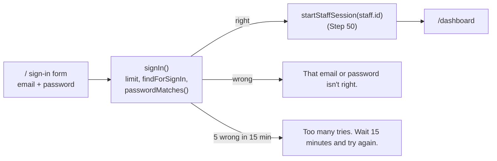

# Step 50.1: The real sign-in form

> **Fast-track recipe.** Split out of Step 50 on 2026-10-12, from the first Step 50 plan's sections 5, 6, 8 and its sign-in tests. Written before the code; the owner confirmed its four decisions the same day. "What changed while building" (just before "Verify it worked") lists where the code differs from this plan.

## Why

After Step 50, a staff session is a signed cookie, and no cookie means signed out. But the only ways in are the development-only demo shortcuts and the dev switcher: in production, nobody could sign in at all. This step makes the form check the real password, adds Sign out, and closes the last forgeable cookie: the parent portal's, which still holds a plain parent id.



## Decisions (confirmed by the owner, 2026-10-12)

1. **5 wrong passwords for one email in 15 minutes locks that email for 15 minutes**, with "Too many tries. Wait 15 minutes and try again." The count is kept in the server's memory: on one Heroku dyno that covers every request, and it resets when the app restarts, which is acceptable for a pilot.
2. **Every failure gives the same answer**, "That email or password isn't right.": a wrong password, an unknown email, and an invited account with no password yet. The form never reveals which emails have accounts.
3. **The parent cookie is signed and renamed** `talaan_parent_session`, 30 days, `secure` in production. Parents signed in today are signed out once.
4. **The demo shortcuts stay in development only.** In production the form is the only way in.

## Steps

### 1. The limit on wrong tries

`src/services/auth/login-throttle.ts`:

```ts
export function createLoginThrottle(options: { maxFailures: number; windowMs: number }): {
  isLocked(key: string, now: number): boolean;
  recordFailure(key: string, now: number): void;
  recordSuccess(key: string): void;
}
export const loginThrottle = createLoginThrottle({ maxFailures: 5, windowMs: 15 * 60_000 });
```

The key is the lower-cased email for staff, and `parent:<email>` for parents. The same throttle will serve the parent API (Step 53). It uses the real clock, never `DEMO_NOW`.

### 2. Finding someone to sign in

`StaffRepository.findForSignIn(email)` returns `{ staff, passwordHash }` (the same `StaffWithPasswordHash` shape as Step 50's `getForSession`), or null. Mock and Prisma.

### 3. Sign in and sign out

`src/features/auth/actions.ts`:

```ts
export async function signIn(input: LoginInput): Promise<SignInResult> // { ok: false, formError } or a redirect to /dashboard
export async function signOut(): Promise<void>                          // deletes the cookie, redirects to /
```

`signIn` validates with `loginSchema`, asks the throttle, finds the account, checks `passwordMatches`, then calls Step 50's `startStaffSession(staff.id)` and redirects. `signOut` calls a new `endStaffSession()` in `src/lib/session.ts` (not a Server Action, like `startStaffSession`).

- **`login-form.tsx`** calls `signIn` with what was typed, in every environment. The `signInEnabled` prop and "always signs in as the principal" go away.
- **`demo-shortcuts.tsx`** keeps its buttons, in development only.
- **Sign out:** an item in the top bar's account area and in the mobile drawer. It's a `<form action={signOut}>` button, so it works before JavaScript loads.
- **`/` when already signed in** redirects to `/dashboard`.

### 4. The parent cookie is signed

`src/lib/parent-session.ts` and `parent-session-actions.ts`:
- the cookie becomes `talaan_parent_session`, holding `signValue({ parentId, exp }, "parent-session", secret)`;
- `getParentSession()` reads it with `readSignedValue` and a Zod check, so a hand-typed parent id no longer works;
- `setParentSession` moves out of the `"use server"` file, for the same reason as `startStaffSession` (it takes any parent id);
- `signInParent` uses the throttle.

The web parent portal looks and works the same.

### 5. Tests

Unit:
- `login-throttle.test.ts`: 4 failures don't lock; 5 do; the lock lifts after 15 minutes; a success clears the count; two emails are counted separately.
- `auth/actions.test.ts`: a right password signs in; a wrong password, an unknown email and an account with no password all give the same message; a locked email is refused even with the right password.
- `parent-session.test.ts`: a signed cookie gives the parent; a plain id or another purpose gives null.

Browser (`e2e/login.spec.ts`, replacing "shows phase 2 message"):
- the principal's email and `Talaan123!` land on the dashboard;
- a wrong password says "That email or password isn't right." and sets no cookie;
- Sign out goes back to the sign-in screen, and `/dashboard` stays closed;
- a hand-typed `talaan_parent_session` is signed out of the parent portal.

`e2e/sessions.ts`'s parent persona signs its cookie with the test secret.

## What changed while building

- **The password check is a service**, `checkStaffSignIn(input, { staff, throttle, now })` in `src/services/auth/staff-sign-in.ts`, so it's unit-tested without Next.js. `signIn` validates, calls it, then starts the session.
- **scrypt always runs.** When there's no account, or no password yet, the check runs against a decoy hash of a random password, so an unknown email doesn't answer faster and give itself away.
- **Keys are `staff:<email>` and `parent:<email>`**, and `recordFailure` returns true when that failure locked the key, so the 5th wrong try itself answers "Too many tries".
- **The messages live together** in `src/features/auth/messages.ts` (signed out, isn't right, too many tries), shared by staff and parents.
- **A refusal shows inline**, above the Sign in button (`role="alert"`), not as a toast, and the typed email stays.
- **The demo shortcuts aren't rendered in production**, instead of showing "isn't connected yet" when clicked. Their note now says "Development only. Every demo account's password is Talaan123!".
- **Sign out also clears the theme preview cookie**, like switching persona does. Its button is `src/components/app-shell/sign-out-button.tsx`: icon only below md in the top bar, a full row in the drawer's footer.
- **`setParentSession` and `clearParentSession` moved into `parent-session.ts`**, and `parent-session-actions.ts` was deleted. The parent cookie's format sits next to the staff one in `session-cookie.ts`, so the browser tests can make it. It carries no password fingerprint: parents can't change a password yet.
- **Parent sign-in's decoy hash waits for Step 53**, which moves parent sign-in into a service: today an unknown parent email still answers a little faster. Noted in that recipe.
- **The browser tests' wrong passwords use made-up emails** (one per run), so locally, where Playwright reuses a running server, failures never pile up against a real account's limit. Each of the 5 tries waits for its own Server Action response, so no two overlap.

## Docs to update with this step

- `docs/AUTH.md`: the form, Sign out, the throttle, and the signed parent cookie.
- `docs/COMMANDS.md`: signing in as each demo account with `Talaan123!`; "Too many tries" in §9.

## Verify it worked

1. Restart `npm run dev`.
2. Sign in as `principal@school-balanga.talaan.example` with `Talaan123!`. You land on Balanga's dashboard.
3. Sign out. `/dashboard` sends you back to the sign-in screen.
4. Type a wrong password 5 times: the fifth answer is "Too many tries".
5. Sign in as a parent, then in the developer tools change the `talaan_parent_session` cookie's value to `parent-balanga-1` and reload: you're on the parent sign-in screen.
6. Your checks.

## What's next

Step 50.5: a teacher you add can't sign in yet, because nobody has set their password. The next step gives the principal a link to send them.
