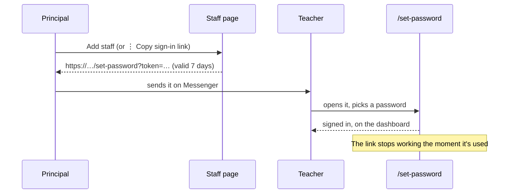

# Step 50.5: Set-password links

> **Fast-track recipe.** Written before the code on 2026-10-11, for the owner to approve before it's built. When it's built, a "What changed while building" section (just before "Verify it worked") will list where the real code differs from this plan.

## Why

After Step 50, a person can sign in only once they have a password. Several ways of creating an account leave it without one:
- **A principal adds a teacher** on the Staff page. The account is *invited*, with no password.
- **A super admin adds a school.** Its principal is invited the same way.
- **The very first account on the live server**, the super admin, comes from nowhere. Step 52's server starts with no staff at all.
- **Someone forgets their password.**

The usual answer is an email with a link, and that needs an email service, a sending domain and a monthly cost. This step uses something cheaper that works today: **the app makes the link, and the principal sends it** however they already talk to staff (Messenger, Viber, SMS). There's no email service and no cost (CLAUDE.md, "cheap to run").



## Decisions in this recipe (please confirm or change)

1. **A link works for 7 days, and only once.** It carries the same `pv` fingerprint as the session cookie (Step 50): a fingerprint of the password hash at the time the link was made. Setting a password changes the hash, so the link stops matching. "Only once" comes with no table of used links.
2. **A new link doesn't cancel an older unused one.** Both work until one is used or they expire. Stopping that would need a stored link id. One week is short, and the link only lets someone set a password the staff member then replaces, so it's acceptable for a pilot. Removing the staff member kills every link at once.
3. **The same link resets a forgotten password.** For an active staff member, the ⋮ menu offers "Copy password reset link". Using it signs out every other browser, through Step 50's `pv`.
4. **Who can make links:**
   - a principal, for staff at their own school (not for themselves: they're already signed in);
   - a super admin, for any school's principal, from the Schools page;
   - the server's terminal, for anyone (`npm run staff:link`). That's how the first super admin gets in.
5. **Passwords need at least 8 characters**, the same rule as parents (`parentPasswordSchema`, which this step renames `passwordSchema` and shares).

## Steps

### 1. The link's token

`src/services/auth/set-password-link.ts`:

```ts
const LINK_DAYS = 7;

/** A signed { staffId, pv, exp } with the "set-password" purpose (Step 50's signValue). */
export function makeSetPasswordToken(staff: { id: string }, passwordHash: string | null, now: Date, secret: string): string

/** The staff id the token is for, or null: wrong stamp, expired, or already used (pv no longer matches). */
export async function readSetPasswordToken(token: string, deps: { staff: StaffRepository }, now: Date, secret: string): Promise<string | null>

export function setPasswordPath(token: string): string // "/set-password?token=…"
```

`pv` for a staff member with no password yet is the fingerprint of the empty string, so an invited account's link also stops working once it's used. The fingerprint function is the same one the session uses: `passwordFingerprint(hash)`, the first 16 characters of the hash's sha256.

### 2. Making a link from the Staff page

`src/features/staff/actions.ts` gains `createSignInLink(staffId)`. It:
- checks the session is a principal or super admin;
- checks the staff member is at `session.schoolId`;
- refuses the caller's own id;
- returns `{ ok: true, url }`, the full address built from the request's own host (`headers()`'s `host`, with `https` in production). Nothing about the site's address is hard-coded.

The UI:
- **After Add staff:** the success state becomes a small dialog, "Send this link to Maria Santos so she can set her password". It shows the link in a read-only field with a **Copy** button (`navigator.clipboard.writeText`, and a "Copied" toast), plus a line saying the link works once, for 7 days.
- **The ⋮ menu:** "Resend invitation" becomes **"Copy sign-in link"** for invited staff, and **"Copy password reset link"** for active staff. Both open the same dialog. `staffRowActions` gains `canMakeLink` (everyone except yourself), so the menu and the server action still share one rule.
- **Schools page:** each school row's ⋮ gains **"Copy principal's sign-in link"** for a super admin, using the same action against that school's principal.

### 3. The set-password page

`src/app/set-password/page.tsx`, outside the staff shell, styled like the sign-in screen:
1. Reads `?token=`. A missing, expired or used token shows "This link has expired or was already used. Ask your principal for a new one." with a link to the sign-in screen.
2. A valid token shows "Set your password, Maria". The form has New password and Confirm password fields, using the shared `passwordSchema`, validated on both sides.
3. `setPasswordWithLink(token, input)` (`src/features/auth/actions.ts`):
   - reads the token again (it may have expired while the form was open);
   - hashes the password and saves it with `staffRepository.setPassword(id, hash)`;
   - marks an invited account **active**;
   - starts the session and redirects to `/dashboard`.

It's multi-tenant-safe: the page shows only the person's own first name, from the token's staff id. It never shows the school's name or logo, so a guessed token reveals nothing.

### 4. The first super admin, and links from the terminal

`scripts/staff-link.ts`, run with `npm run staff:link`:

```bash
# A link for anyone who already has an account
npm run staff:link -- --email principal@school-balanga.talaan.example

# The very first account on a new server: creates a super admin, then prints their link
npm run staff:link -- --create-super-admin --email you@example.com --first-name Pat --last-name Santos
```

It prints the path (`/set-password?token=…`). You put your site's address in front of it: `http://localhost:3000` locally, or the Heroku address after Step 52, where it runs as `heroku run npm run staff:link -- …`. It reads `SESSION_SECRET` from the environment, the same as the app, so the link it prints is one the app accepts.

### 5. Tests

- **`set-password-link.test.ts`:**
  - a fresh token reads back its staff id;
  - after the password changes, it's null;
  - after 7 days, it's null;
  - a staff session cookie (another purpose) is null;
  - a removed staff member's token is null.
- **`staff/actions.test.ts`:**
  - a principal gets a link for a teacher at their school;
  - another school's teacher is refused;
  - their own id is refused;
  - a teacher can't make links.
- **`row-actions.test.ts`:** `canMakeLink`.
- **`e2e/login.spec.ts`:**
  - the principal adds a staff member and copies the link;
  - a fresh browser opens it, sets a password and lands on the dashboard;
  - opening the same link again says it was already used;
  - the new password signs in from the sign-in screen.

## Docs to update with this step

**`docs/COMMANDS.md`:** a "Staff accounts" section with `npm run staff:link -- --email …` and `--create-super-admin`, what the printed path is for, and the same command on Heroku.

## Verify it worked

1. Restart `npm run dev`. Sign in as Balanga's principal and open **Staff**.
2. Add a teacher. Copy the link from the dialog.
3. Open it in a private window and set a password. You're signed in as the new teacher.
4. Open the same link again: "This link has expired or was already used."
5. As the principal, use ⋮ → **Copy password reset link** on that teacher. Set another password through it. The teacher's first browser is signed out on its next click.
6. In a terminal: `npm run staff:link -- --email teacher@school-balanga.talaan.example`, then open `http://localhost:3000` followed by the printed path.
7. Your checks (or ask me to run them).

## What's next

Step 51 checks every way into the app for school leaks, with tests that sign in as one school and try to reach another's data.
