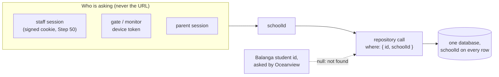

# Step 51: One school can never see another's data

> **Fast-track recipe.** Written before the code on 2026-10-11, for the owner to approve before it's built. When it's built, a "What changed while building" section (just before "Verify it worked") will list where the real code differs from this plan.

## Why

Talaan keeps every school in one database (CLAUDE.md, "Multi-tenant, one database"). That's what keeps it cheap: one server and one database, however many schools join. The price is that **every single query has to remember which school it's for.** One forgotten `where: { schoolId }` and Oceanview's principal sees Balanga's students.

The app is already written that way. Every list takes a `schoolId`, and every action that receives an id checks `student.schoolId !== session.schoolId`. But "already written that way" is a claim. This step makes it **proven and hard to break**:

1. **Lookups by id ask for the school too**, so the database itself refuses another school's row. A forgotten check after the lookup can no longer leak anything.
2. **An audit table** lists every way into the data (each page, action and API address) and where it gets its school from. It goes in `docs/SCHOOL-ISOLATION.md`.
3. **Tests that try to cross over:** signed in as Oceanview, ask for Balanga's things through every door, and expect "not found" every time.

## Decisions in this recipe (please confirm or change)

1. **Scope inside the repositories, and prove it with tests. Postgres row-level security waits.** The original Phase 2 note mentioned row-level security (RLS): the database itself filters every query by a "current school" setting. With Prisma and its connection pool, that means wrapping *every* request in a transaction that first runs `set_config('app.school_id', …)`. That changes how every repository is called, adds a database round trip to every request, and is easy to get subtly wrong (a pooled connection keeping the last school's setting). For one pilot school, repository scoping plus tests gives the same protection for much less risk. RLS is listed for after the pilot, when a second school joins.
2. **"Not found", never "forbidden".** Another school's student id gives exactly what a made-up id gives, so nobody can probe which ids exist.
3. **A super admin is scoped too.** They see one school at a time, the one they opened (Step 50). Only the Schools page lists every school.

## Steps

### 1. Lookups by id take the school

These methods change shape:

| Repository | Before | After |
|---|---|---|
| `StudentRepository` | `getById(id)`, `update(student)` | `getInSchool(schoolId, id)`, `update(schoolId, student)` |
| `StaffRepository` | `getById(id)`, `remove(id)` | `getInSchool(schoolId, id)`, `remove(schoolId, id)` |
| `CardRepository` | `listByStudent(studentId)`, `getActiveForStudent(studentId)`, `markLost(cardId)` | each gains `schoolId` first |
| `TapRepository` | `listByStudent(studentId)`, `getById(id)` | `listByStudent(schoolId, studentId)`, `getInSchool(schoolId, id)` |
| `NotificationRepository` | `listByStudent(studentId)`, `getById(id)`, `markRead(id)` | each gains `schoolId` first |
| `AlertRepository` | (already by school) | unchanged |

The Prisma versions use `findFirst({ where: { id, schoolId } })`, and `updateMany`/`deleteMany` with both, returning null when nothing matched. The in-memory mock versions filter the same way.

These lookups by id stay unscoped, on purpose, each with a comment saying why:
- `staffRepository.getById` / `findByEmail`, used only by sign-in and the session (Step 50). Who you are decides your school, so there's no school to ask with yet.
- `schoolRepository.getById`: it's always called with the session's own school.
- `deviceRepository.findByTokenHash`: the token *is* the identity.
- `tapRepository.getById` inside `recordTap`'s replay check, which already compares `stored.schoolId === device.schoolId`.

TypeScript then points at every caller. Each one passes `session.schoolId`, and the now-redundant `existing.schoolId !== session.schoolId` checks can go. One rule, in one place.

### 2. The audit: `docs/SCHOOL-ISOLATION.md`

A new topic doc, linked from the README, with one row per way in. A short version:

| Way in | Who | Where the school comes from |
|---|---|---|
| Staff pages (`/dashboard`, `/attendance`, `/students`, `/staff`, `/station`, `/settings`) | staff | `requireSession().schoolId` |
| `/schools` | super admin only | none: it lists every school |
| Staff actions (students, cards, photos, staff, attendance, station, schools, theme) | staff | `getSession().schoolId` |
| `/api/v1/devices/heartbeat`, `/gate/taps`, `/gate/roster` | gate | `Device.schoolId` from the token |
| `/api/v1/gate/stream`, `/gate/display` | monitor or principal | the cookie's device, or the session |
| `/api/v1/photos/<school>/…` | staff, gate, monitor, parent (Step 53) | the viewer's school must equal the key's first part |
| `/parent/*` pages and actions | parent | `getParentSession().schoolId`, plus the parent's own links |
| `/design-system` | nobody in production | `notFound()` |

The doc also explains "why not RLS yet" (decision 1), and has a quick recipe: "I'm adding a new page or action. Where does my school come from?"

### 3. Tests that try to cross over

**Unit tests** (`src/features/**/actions.isolation.test.ts`): each action file's tests mock two things:
- `@/lib/session`: signed in as **Oceanview's principal**;
- `@/data/repositories`: the in-memory repositories, filled with the demo seed.

Then they call every action with **Balanga's** ids:
- `updateStudent`, `uploadStudentPhoto`, `removeStudentPhoto`;
- `linkCard`, `linkRealCard`, `replaceCard`;
- `removeStaff`, `resendStaffInvite`, `createSignInLink` (Step 50.5);
- `simulateTap` and `syncStationTaps` with a Balanga card;
- parents' `markNotificationRead` with a Balanga notification.

Each must answer "not found" (or "That notification isn't for your children."), and the Balanga record must be unchanged afterwards.

**Repository tests against the real database** (`src/data/repositories/prisma-isolation.test.ts`): `getInSchool("school-oceanview", <a Balanga student id>)` is null, `update` and `markLost` change nothing, and so on, one line per changed method. This is the only test that proves the real `where` clauses, so it runs against the test database. It's skipped with a clear message when `E2E_DATABASE_URL` isn't set, so `npm test` still works without Docker.

**Browser tests** (`e2e/isolation.spec.ts`), with a new `oceanview_principal` persona in `e2e/sessions.ts`:
- **Students and Attendance:** signed in as Oceanview, `/students?q=<a Balanga name>` shows no results, and `/attendance` for a Balanga-only grade and section shows nobody.
- **Photos:** `GET /api/v1/photos/school-balanga/…` with an Oceanview session gives `404`.
- **Gate:** an Oceanview gate token (made in `create-test-devices.ts`) tapping a Balanga card gets `unknown_card`. Its roster has no Balanga names.
- **Monitor:** an Oceanview monitor's stream receives nothing when a Balanga card is tapped at a Balanga gate.
- **Parents:** a Balanga parent's link-a-child with an Oceanview student's LRN, last name and birth date gets "no match".

### 4. A guard in code review

`src/data/repositories/README.md` (short) states the rule: "a method that finds one row by id takes `schoolId` first, unless its comment says why not". The quick recipe in `SCHOOL-ISOLATION.md` says the same, so the next repository method follows it.

## Verify it worked

1. Your checks (or ask me to run them). The new tests are `npm test -- isolation` and `npx playwright test e2e/isolation.spec.ts`.
2. By hand: sign in as Oceanview's principal (`principal@school-oceanview.talaan.example`, `Talaan123!`). Search Students for "Juan Cruz", a Balanga student: nothing.
3. Open `http://localhost:3000/api/v1/photos/school-balanga/…` with the address of a Balanga photo (copy it from Balanga's student list): "Not found".
4. Read `docs/SCHOOL-ISOLATION.md`'s table, and check every page you know is in it.

## What's next

Step 52 puts the app on Heroku, now that sign-in and school isolation are real.
