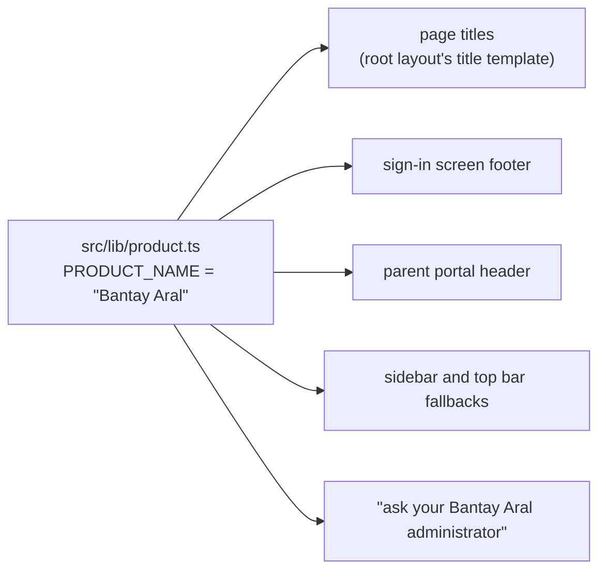

# Step 51.5: The new name, Bantay Aral, on every screen

> **Fast-track recipe,** written from the real diff on 2026-10-13, after building.

## Why

The placeholder name "Talaan" couldn't become the real one: talaan.com wasn't available. The owner chose the domain **bantayaral.com**, written **Bantay Aral** on screens. Two words read naturally, and a screen reader says them right. The owner's rule: change only what people see. Everything else keeps "talaan" as the code name.



## What changed

1. **`src/lib/product.ts`** (new): `export const PRODUCT_NAME = "Bantay Aral";`. A future rename is this one line.
2. **`src/app/layout.tsx`:** the title became a template, so each page gives only its own part:
   ```ts
   title: { default: PRODUCT_NAME, template: `%s · ${PRODUCT_NAME}` },
   applicationName: PRODUCT_NAME,
   ```
   `src/app/gate/page.tsx` now says `title: "Gate"`, and the tab shows "Gate · Bantay Aral". The same goes for the monitor, set-password and design-system pages.
3. **Visible text:**
   - the sign-in footer, "Talaan (placeholder product name)", is now `{PRODUCT_NAME}`;
   - the parent portal's header;
   - the sidebar and top bar's fallback when there's no school or page name;
   - `FORGOT_PASSWORD_MESSAGE` ("…ask your Bantay Aral administrator").
4. **Two code comments** that called the product "Talaan" now say "the app".
5. **`CLAUDE.md` and `README.md`** state both names.

**Kept as "talaan" on purpose:** the repository, the npm package, the database and Docker container, cookie names (`talaan_session`), token prefixes (`tal_dev_`, `tal_par_`), environment variables, the code, and the demo password `Talaan123!`. Renaming those is risk with nothing visible to show for it: renamed cookies sign everyone out, and a renamed database means editing every `.env`.

## Verify it worked

1. `grep -rn "Talaan" src e2e --include='*.ts' --include='*.tsx' | grep -v "src/generated\|Talaan123"` finds only the comment in `src/lib/product.ts`.
2. Open `http://localhost:3000`: the tab says "Bantay Aral", and so does the line under "Parent or guardian?". Click "Forgot your password?": "…ask your Bantay Aral administrator".
3. Open `/gate`: the tab says "Gate · Bantay Aral".
4. The checks.

## What's next

Step 52 deploys it. Name the Heroku app `bantayaral`.
