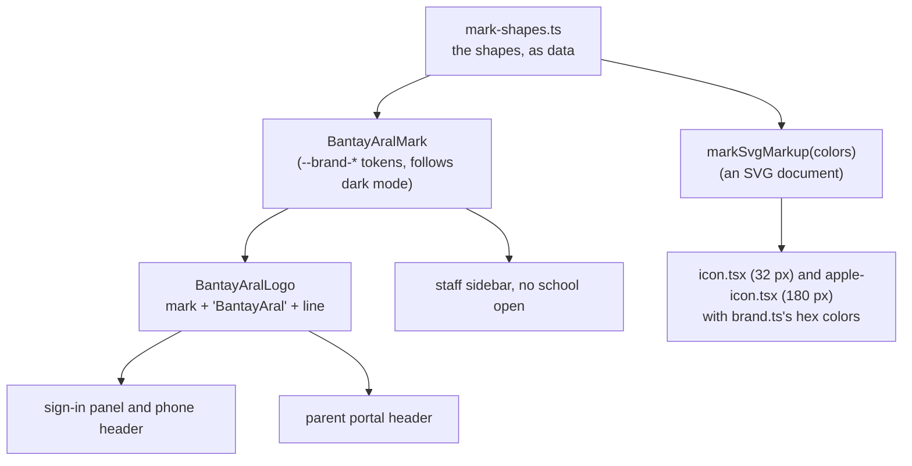

# Step 51.6: The Bantay Aral logo, and a new sign-in page

> **Fast-track recipe,** written from the real diff on 2026-10-13, after building.

## Why

The owner brought three images: the logo (two PNGs), a brand sheet with a sample sign-in page, and a photo of a student tapping in. The PNGs couldn't be used as they were. They had black backgrounds, glowing halos around the edges, and soft text. So the mark was redrawn as clean vectors, and the word is real text in our heading font. The owner chose to build it before the deploy, so the demo goes online with it.

## What changed

### 1. Brand colors (`src/styles/tokens.css`, `src/app/globals.css`)

`--brand-parent-top`, `--brand-parent`, `--brand-child`, `--brand-page-light`, `--brand-page-deep`, `--brand-edge`, `--brand-sun`, `--brand-ink` and `--brand-green-text`, with light and dark values. They were sampled from the brand sheet with a throwaway Playwright script that read its pixels, then converted to OKLCH. `globals.css` maps each one to a Tailwind color (`bg-brand-parent`, `fill-brand-child`, and so on). They're fixed like the status colors: a school's theme never changes them (`docs/STYLING-SYSTEM.md`, "Step 51.6").

`--brand-green-text` is a darker green for text. The logo's own green is 3.4:1 on the page background. The text green is 4.7:1, and its dark-mode shade is 8.7:1.

### 2. The mark and the logo (`src/components/brand/`)

- `mark-shapes.ts`: the shapes as data, with `markSvgMarkup(colors)` for the icons. Three rounds of drawing, each compared side by side with the brand sheet. The first two had the book too small and upright.
- `bantay-aral-logo.tsx`: `BantayAralMark`, with a `useId()` gradient so two logos on one page don't share an id, and `BantayAralLogo`.

### 3. Icons (`src/app/icon.tsx`, `src/app/apple-icon.tsx`)

`ImageResponse` from `next/og` draws the mark into a PNG at build time (`node_modules/next/dist/docs/01-app/03-api-reference/03-file-conventions/01-metadata/app-icons.md`). CSS variables don't exist there, so the colors come from `src/lib/theme/brand.ts`, and `brand.test.ts` keeps them equal to the tokens. Next's default `src/app/favicon.ico` was deleted.

### 4. The sign-in panel (`src/features/auth/login-art-panel.tsx`)

From the brand sheet's sample:
- the logo;
- a "School attendance portal" pill;
- "Every school day, *connected with care.*";
- the line "See who's in school, the moment they tap in";
- three points that say what the app really does;
- from 1280 px, the photo in a landscape 4:3 frame with 24 px corners, with a live card saying "Juan tapped in, 8:02 AM", the same words a parent's phone shows.

The old cycling value-prop animation, and its keyframes in `globals.css`, were removed. The page grid gives the panel more room (`lg:grid-cols-[1.25fr_1fr] xl:grid-cols-[1.6fr_1fr]`) on all four sign-in pages: staff, parent sign-in, parent sign-up and set-password. On phones, `login-mobile-header.tsx` now shows the logo with its line, inside the page's `h1`.

**Left out of the sample, on purpose:**
- the "Help" link, since there's no help page yet;
- the sample's "Safer and more connected school community", a claim the app can't measure;
- the separate "Bantay Aral" line under the form, since the logo shows the name already.

### 5. Elsewhere

- The parent portal's header shows `BantayAralLogo size="sm"`.
- The staff sidebar shows the mark when no school is open. A school's own logo still wins inside its pages.

### 6. The photo

`public/brand/sign-in-photo.jpg` started as a stand-in, cropped below the original's baked-in notification bubble. The owner then made a clean version (no text, bubble or circles), and it replaced the stand-in (see "Review change: the clean photo" below). It's only shown from 1280 px, and `next/image` loads it lazily, so phones never download it.

### Review change: the photo's frame (owner's brief, 2026-10-13)

The first version put the photo in a tall oval. The owner's brief said it felt disconnected from the rest of the interface, and that the crop hid the reader, which is the whole point of the product. So:

- **The frame:** a landscape 4:3 rectangle with `rounded-3xl` (24 px, the same as the gate's tap card), `shadow-(--shadow-card)` and a faint `ring-border/70` edge. The green and blue accents sit behind its top-left and bottom-left corners.
- **The crop, measured.** A grid drawn over the photo put the reader at x 755–912 and y 98–450, the hand and card at x 720–835 and y 233–400, and the head at y 15–300, in the 1074 × 735 photo. A 4:3 frame shows the photo's full height and its left 980 px (`object-left`), so the reader sits inside with room on its right.
- **The notification** sits on the frame's bottom edge, under the reader, so a tap reads as "tap here, parent notified". It can't go in the upper right, because that's where the reader is.
- **Room for the photo:** from 1280 px the text column is at least 300 px and the photo takes the rest (`minmax(18.75rem,0.8fr)` / `1.2fr`). From 1536 px the two share equally (`2xl:grid-cols-2`), because the larger headline needs it.
- **Checked by measurement, not just by eye:** at 1280, 1366, 1440, 1536 and 1920 px, in light and dark, a Playwright script compared the notification's real box with the reader, hand and head mapped onto the screen. The notification never covers them, and stays at least 73 px clear of the form. The reader is 54–82 px wide on screen and 23–36 px from the frame's right edge. Nothing scrolls sideways.
- **Phones and tablets keep the existing behavior:** below 1024 px the panel is hidden and the form comes first. Between 1024 and 1279 px only the text shows, since there isn't room for a clear photo beside it.

### Review change: the logo goes to the main page (owner, 2026-10-13)

On every sign-in screen (`/`, `/parent/login`, `/parent/signup`, `/set-password`), the logo is now a link to `/`. That is the sign-in page, or the dashboard for staff who are already signed in, because `src/app/page.tsx` redirects them. Both places changed: the desktop panel (`login-art-panel.tsx`, with `w-fit` so the link is only as wide as the logo) and the phone header (`login-mobile-header.tsx`, where the link sits inside the `h1`). Each link has the same focus ring as the parent portal's header, and its name is the logo's, "Bantay Aral". `src/app/page.test.tsx` checks that both links point to `/`. Unchanged: the parent portal's header logo still goes to `/parent`, the parent's own home. The staff sidebar shows the school's logo, not this one.

### Review change: the clean photo (owner, 2026-10-13)

The owner generated a clean version from a written prompt: the same scene, 4:3, the reader fully in frame on the right, and room above the student's head. It came as a 1448 × 1086 PNG.

- **Made smaller:** `sips -s format jpeg -s formatOptions 78 -Z 1200 <photo>.png --out public/brand/sign-in-photo.jpg`, giving 1200 × 900 and 221 KB. On screen the photo is at most 514 px wide, so 1200 px still covers a 2× display, and `next/image` serves a smaller WebP of it anyway.
- **No crop needed:** the photo is 4:3, the same as the frame, so it all shows. `object-left` came off.
- **Measured again:** a grid over the new photo put the reader at x 820–970 and y 297–625, the hand and card at x 805–912 and y 425–580, and the head at y 228–490. At 1280, 1366, 1440, 1536 and 1920 px, in light and dark, the notification covers none of them and stays 73 px from the form, and nothing scrolls sideways. The reader is 42–64 px wide on screen, a little smaller than before because the whole scene shows, with the gate beside it.
- **A trap:** after the file changed, the dev server kept serving the old photo, because the image optimizer caches by URL. Deleting `.next/dev/cache/images` fixed it, and is always safe because it rebuilds itself. In your own browser, a hard refresh (Cmd+Shift+R) does the same.

## Verify it worked

1. Open `http://localhost:3000` at full width. You should see the logo, the headline in two colors, three points, the photo with "Juan tapped in", and the form. Switch to dark mode: the parent figure turns white.
2. Narrow the window below 1024 px: only the logo and the form.
3. The browser tab shows the mark. On a phone, "Add to home screen" shows it on a white tile.
4. Sign in as a parent: the logo is in the header.
5. The checks. `npx vitest run src/lib/theme/brand.test.ts` keeps the icon colors and the tokens in step.

## What's next

Step 52 deploys it.
