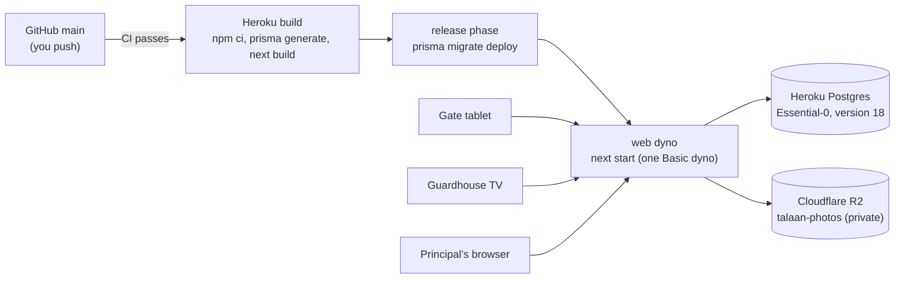

# Step 52: Deploy the demo to Heroku

> **Fast-track recipe.** Written before the code on 2026-10-11 and approved by the owner on 2026-10-13. Half of this step is yours: creating the accounts, which needs your name and card details, so it can't be done for you. The code changes are small. When it's built, a "What changed while building" section (just before "Verify it worked") will record what the real deploy needed.

## Why

Until now the app has only run on your laptop. For the demo at the school, and for the parent app tomorrow, it needs a real address on the internet with a real database. The hosting was decided on 2026-10-03 and confirmed since: **Heroku**, a long-running server, which the live monitor's stream needs, with **Heroku Postgres**, and **Cloudflare R2** for photos (decided 2026-10-11).



## What it costs

| Piece | Plan | Per month |
|---|---|---|
| Web server | Heroku **Basic** dyno (never sleeps) | $7 |
| Database | Heroku Postgres **Essential-0** (1 GB, 20 connections) | $5 |
| Photos | Cloudflare R2 free tier (10 GB; 500 thumbnails are about 8 MB) | $0 |
| **Total** | | **$12**, covered by the Heroku for GitHub Students credit ($13 a month) |

Heroku's credit applies only after you verify your GitHub Student status through Heroku's own page. Until then the card on the account is charged. Check the credit shows on your billing page before the first deploy.

## Decisions in this recipe (please confirm or change)

1. **The live server gets the demo data** (the three made-up schools and their fake students), loaded once with the seed. Real students' names, birth dates and photos wait until the privacy work (consent, export and delete) is done. For the demo, link your real stickers to demo students in the drawer.
2. **Heroku deploys automatically from GitHub's `main`, only after CI passes.** You keep committing and pushing exactly as now. There's no extra `git push heroku` to remember, and a red CI never reaches the school.
3. **Region: United States.** Heroku's regular plans have no Asian region; the US and Europe are about the same distance from the Philippines (around 0.2 s per request). That's fine for a demo and a pilot. A tap still shows the student instantly from the tablet's own copy (Step 47).
4. **The server refuses to start with a missing or dangerous setting**, rather than half-working. That covers no `SESSION_SECRET`, photos set to the local folder (Heroku's disk is wiped on every restart), or `DEMO_NOW` set. The browser tests' own production server skips this check with `E2E=1` (approved 2026-10-13; see "What changed while building").

## Your part: from nothing to a live site (about 45 minutes)

Do these in order. Each stage needs the one before it. The examples use the app name `bantayaral`; if Heroku says it's taken, pick another and use it everywhere `bantayaral` appears.

### How the code gets to Heroku: GitHub, not Heroku Git

Heroku offers two ways to receive code:
- **Connect GitHub (what we use).** Heroku watches the `talaan` repository on GitHub. When `main` changes and CI passes, Heroku fetches it and deploys. You keep doing exactly what you do now, `git push` to GitHub, and nothing else.
- **Heroku Git.** You push a second time, to Heroku itself: `git push heroku main`. It deploys whatever is on your laptop, even if CI is red, and it's a second push to remember. We don't use it.

So you never type `git push heroku`. The only Git you do is your normal push to GitHub.

### Stage A: the Heroku account and the student credit
1. Sign up at heroku.com.
2. Account settings → **Billing**: add a card. It's required even with the credit.
3. Apply the **Heroku for GitHub Students** offer from Heroku's students page, and sign in with your GitHub account when it asks.
4. Wait until the credit shows on the Billing page. Until it does, the card is charged.

### Stage B: the Heroku command-line tool
```bash
brew install heroku/brew/heroku
heroku login
```
`heroku login` opens the browser; click **Log in**, then come back to the terminal. `heroku auth:whoami` prints your email when it worked.

### Stage C: the app and its database
```bash
heroku create bantayaral --region us --no-remote
heroku addons:create heroku-postgresql:essential-0 --version 18 --app bantayaral
```
- `--no-remote` stops Heroku from adding a `heroku` remote to your Git repository. We deploy from GitHub, so it isn't needed.
- The app's address is `https://bantayaral.herokuapp.com`. It shows Heroku's welcome page until the first deploy.
- The database adds `DATABASE_URL` to the app's settings by itself. If Heroku says version 18 isn't offered, leave out `--version 18` and tell me which version you got (CI and your laptop use 18).

### Stage D: Cloudflare R2, for photos
1. Sign up at cloudflare.com. Open **R2 Object Storage** and activate it. R2 asks for a card even on the free tier; you're charged only beyond the free limits.
2. **Create bucket:** name `talaan-photos`, location hint **Asia-Pacific**. Leave public access **off**: the app serves photos itself, only to people allowed to see them.
3. **Manage R2 API tokens → Create API token:** permission **Object Read & Write**, applied to **`talaan-photos` only**. Keep the page open: it shows the **Access Key ID**, the **Secret Access Key** (shown only once) and the **S3 endpoint** (`https://<account-id>.r2.cloudflarestorage.com`).

### Stage E: the settings, all before the first deploy
The server refuses to start without these (that's the check this step builds), so set every one before deploying. Type the keys yourself, straight from the Cloudflare page; never paste them into a chat.
```bash
heroku config:set SESSION_SECRET="$(openssl rand -base64 32)" --app bantayaral
heroku config:set PGSSLMODE=no-verify PHOTO_STORAGE=s3 --app bantayaral
heroku config:set S3_ENDPOINT="https://<account-id>.r2.cloudflarestorage.com" S3_BUCKET="talaan-photos" S3_ACCESS_KEY_ID="…" S3_SECRET_ACCESS_KEY="…" --app bantayaral
```
`PGSSLMODE=no-verify` is Heroku's own advice for Node apps: its database only accepts encrypted connections, but Node can't verify its certificate, so this keeps the encryption without the check.

Check the names (not the values) are all there:
```bash
heroku config --app bantayaral | cut -d: -f1
```
Expect `DATABASE_URL`, `PGSSLMODE`, `PHOTO_STORAGE`, `S3_ACCESS_KEY_ID`, `S3_BUCKET`, `S3_ENDPOINT`, `S3_SECRET_ACCESS_KEY` and `SESSION_SECRET`. Never `DEMO_NOW` or `E2E`.

### Stage F: connect GitHub
In the browser, at dashboard.heroku.com:
1. Open the **bantayaral** app → the **Deploy** tab.
2. **Deployment method:** click **GitHub**, then **Connect to GitHub**, and approve the GitHub window that opens. If your repository is private, let Heroku see it.
3. **Connect to GitHub** (the search box under it): search for `talaan`, then click **Connect** next to it.
4. **Automatic deploys:** branch `main`, tick **Wait for CI to pass before deploy**, then click **Enable Automatic Deploys**.

### Stage G: the first deploy, by hand once
Automatic deploys only react to the *next* push. Your code is already on GitHub, so start the first deploy yourself:
1. On GitHub, open the repository's **Actions** tab and check the latest run on `main` is green.
2. Back on Heroku's **Deploy** tab, scroll to **Manual deploy**, keep branch `main`, and click **Deploy Branch**. (A manual deploy doesn't wait for CI; that's why step 1 checks it first.)
3. Watch the build log on that page, or in the terminal:
   ```bash
   heroku logs --tail --app bantayaral
   ```
   Expect, in order: `npm ci`, `prisma generate`, `next build`, then the **release** phase running `prisma migrate deploy`, then the web dyno starting and "Ready". `Ctrl+C` stops watching.
4. Open `https://bantayaral.herokuapp.com/api/v1/health`. It should say `{"ok":true,"database":"ok"}`.

If it fails, copy the error lines from the log (they never contain a secret's value) and send them to me. "The server can't start with these settings" means one from Stage E is missing; the message names it.

From now on, every push to `main` deploys by itself after CI passes.

### Stage H: after the first deploy
1. Load the demo data, once:
   ```bash
   heroku run npx prisma db seed --app bantayaral
   ```
   `npm run db:reset` refuses to run anywhere but your laptop, by design (it empties every table).
2. Your own super admin account:
   ```bash
   heroku run npm run staff:link -- --create-super-admin --email <you> --first-name <first> --last-name <last> --app bantayaral
   ```
   Open `https://bantayaral.herokuapp.com` followed by the printed path, and set your password.
3. The seed's staff are demo accounts with the well-known `Talaan123!` password. Before showing the site to anyone, sign in as yourself, and give any demo account you'll use a new password with a reset link (Step 50.5).
4. A gate token and a monitor key. Each is printed once:
   ```bash
   heroku run npm run device:create -- --school school-balanga --kind gate --label "Main gate tablet" --app bantayaral
   heroku run npm run device:create -- --school school-balanga --kind monitor --label "Guardhouse TV" --app bantayaral
   ```
Then go through "Verify it worked" below.

## My part: code changes

### 1. `Procfile` (new, at the project root)

```
release: npx prisma migrate deploy
web: npm start
```

- **`release`** runs once per deploy, before the new version takes traffic. It applies any new migration. If it fails, Heroku keeps the old version running, so a bad migration never takes the site down.
- **`web`** runs `next start`, which listens on the port Heroku chooses: Next.js reads the `PORT` setting itself (`node_modules/next/dist/docs/01-app/03-api-reference/06-cli/next.md`).

### 2. `package.json`

- `"engines": { "node": "24.x" }`, so Heroku runs the same Node as CI and your laptop.
- **`prisma`, `tsx` and `dotenv` move from `devDependencies` to `dependencies`.** No new package; they just move. Heroku deletes development packages after the build, but the release phase needs `prisma`, and `heroku run npm run device:create` / `staff:link` need `tsx`. `prisma.config.ts` imports `dotenv`.
- `"heroku-postbuild"` isn't needed: Heroku runs `npm run build` by default, and `postinstall` already runs `prisma generate`.

### 3. Fail fast on bad settings

`src/lib/env.ts` (started in Step 50) gains `checkProductionEnv(env)`, a plain, tested function that returns a list of problems:
- `SESSION_SECRET` missing or shorter than 32 characters;
- `DATABASE_URL` missing;
- `PHOTO_STORAGE` isn't `s3`, or any `S3_*` setting is missing;
- `DEMO_NOW` is set.

`src/instrumentation.ts` (new) calls it from `register()`, which Next.js runs once when the server starts (`node_modules/next/dist/docs/01-app/03-api-reference/03-file-conventions/instrumentation.md`). In production, any problem stops the start with a message naming the setting, which shows in `heroku logs`. It never prints a value, only a name.

### 4. A health check

`GET /api/v1/health` answers `{ "ok": true, "database": "ok" }` after a `SELECT 1`, or `503` with `"database": "unreachable"`. It needs no sign-in and returns nothing about any school. It's useful for you after a deploy, and later for a free uptime monitor.

### 5. Production cookies and the stream

- Step 50's cookies are `secure` in production: sent only over https, which Heroku provides.
- The monitor stream already sends a keep-alive every 25 seconds (Step 48). Heroku's router closes a connection that stays silent for 55 seconds, so the monitor stays connected.
- One dyno only. The live monitor and the sign-in throttle both live in the server's memory (Steps 48, 50). `docs/DEPLOY.md` says so in bold, next to the scale setting.

### 6. `docs/DEPLOY.md` (new topic doc, linked from the README)

How the deploy works (the diagram above), every config var with what it's for (names only, never values), and quick recipes:
- **Deploy:** push to `main`; watch with `heroku logs --tail --app bantayaral`.
- **Roll back:** `heroku releases --app bantayaral`, then `heroku rollback v<N>`. A migration isn't rolled back; see `docs/DATABASE-MIGRATIONS.md`.
- **Make a gate or monitor:** `heroku run npm run device:create -- --school school-balanga --kind gate --label "Main gate tablet" --app bantayaral`.
- **Make a sign-in link:** `heroku run npm run staff:link -- --email … --app bantayaral` (Step 50.5).
- **Open the database:** `heroku pg:psql --app bantayaral`.
- **Back up now:** `heroku pg:backups:capture --app bantayaral`. Essential plans keep automatic backups too; check `heroku pg:backups`.
- **What it costs, and where to check the credit.**

## Docs to update with this step

**`docs/COMMANDS.md`:** a "The live server (Heroku)" section:
- logs, releases and rollback;
- `heroku run` for `device:create`, `staff:link` and `prisma db seed`;
- `heroku pg:psql` and backups;
- `heroku config` (names only);
- what "deploy" means now: push to `main`, then CI, then Heroku.

## What changed while building

Built on 2026-10-13. The code side is done; the first deploy will add its findings here.

- **The browser tests run a production server too.** Playwright starts `next start` (`playwright.config.ts`) on purpose with a pinned clock (`DEMO_NOW`) and photos in the local folder, so the check as first written would have stopped every CI run. Owner's choice: the check stays on in production by default, and Playwright's server alone gets `E2E=1`, which skips it. `src/instrumentation.ts` checks `NEXT_RUNTIME === "nodejs"`, `NODE_ENV === "production"` and `E2E !== "1"` before running `checkProductionEnv`. A local `npm run build && npm start` needs `E2E=1` in front too.
- **The S3 setting names live in one place.** `S3_SETTINGS` moved from `src/lib/storage/photo-storage.ts` to `src/lib/env.ts`, and both the photo storage and `checkProductionEnv` use it. `env.ts` stays free of imports, since sign-in code all over the app imports it.
- **The health route has no `dynamic` setting.** In this Next.js version, route handlers aren't cached unless they ask to be (`node_modules/next/dist/docs/01-app/01-getting-started/15-route-handlers.md`), so `GET /api/v1/health` runs on every request without one.
- **`package-lock.json` had to change too.** Moving three packages between dependency lists changes the lockfile's root entry and drops their `dev` flags; without that, `npm ci` on Heroku and in CI fails with "package.json and package-lock.json are not in sync". `npm install --package-lock-only` rewrote it. No versions changed. The newer npm also wrote out a few bundled entries for an optional Tailwind package (`@tailwindcss/oxide-wasm32-wasi`), which only installs on WebAssembly and is harmless.
- **The gate takes its token on a setup screen,** not in the address (Step 47). "Verify it worked" step 3 was corrected.
- **"Your part" rewritten as Stages A–H (owner question, 2026-10-13).** The first version said only "connect GitHub", which left two things unclear: GitHub versus Heroku Git, and that automatic deploys only react to the *next* push, so the very first deploy is a manual **Deploy Branch**. The old "First deploy, together" section became Stages G and H. `heroku create` now has `--no-remote`, since nothing pushes to Heroku directly.
- **Checked against the libraries:** `pg` (the database driver under `@prisma/adapter-pg`) reads `PGSSLMODE=no-verify` itself (`node_modules/pg/lib/connection-parameters.js`). Not yet known: whether `prisma migrate deploy` in the release phase connects to Heroku Postgres without an extra setting. The first deploy's release log will show it.
- **CI's first run failed at Typecheck** in `src/lib/env.test.ts`. Next.js's types make `NODE_ENV` a required part of `NodeJS.ProcessEnv`, and the test's `GOOD` settings had none, so the `as NodeJS.ProcessEnv` cast was refused. Fix: `const GOOD: NodeJS.ProcessEnv = { NODE_ENV: "production", … }`, an annotation instead of a cast. The unit tests had passed, because Vitest doesn't type-check (see `docs/BUILD-LOG.md`, Step 52).
- **First deploy (2026-10-13): the start-up check caught a missing `S3_SECRET_ACCESS_KEY`.** It worked, but not quite as written: Next.js doesn't stop when `register()` throws. The dyno stays `up` and answers every request with a bare `500`, logging "An error occurred while loading instrumentation hook" and the setting's name each time. Nothing half-works, but `heroku ps` doesn't show "crashed". Making it really stop is a possible follow-up; the owner decides.

## Verify it worked

1. `https://bantayaral.herokuapp.com/api/v1/health` shows `{"ok":true,"database":"ok"}`.
2. Sign in, open Students, and add a photo to a demo student. It shows in the list. In the Cloudflare dashboard, `talaan-photos` now holds one small `.webp` file.
3. On your laptop, open `https://bantayaral.herokuapp.com/gate` and enter the gate token on its setup screen. Plug in the USB reader and tap a sticker you linked: the photo, the name, Time in.
4. In another window, open `/gate/display/connect?key=<the monitor key>`. The tap appears there live. Leave it open for 2 minutes and tap again; it's still connected.
5. `heroku ps --app bantayaral` shows one `web` dyno, `up`.
6. Change something small, push it, and watch the Deploy tab (or `heroku releases --app bantayaral`): Heroku waits for CI, then deploys by itself.

## What's next

Step 53, the parent API: the addresses the Expo parent app calls to sign in, link a child, and see taps and notifications.
