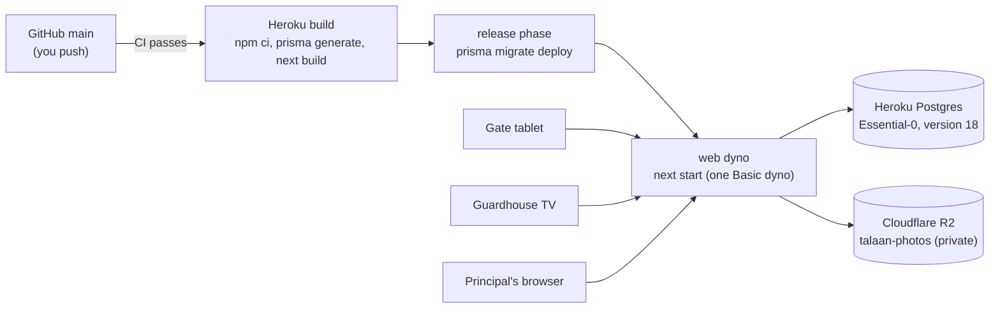

# Step 52: Deploy the demo to Heroku

> **Fast-track recipe.** Written before the code on 2026-10-11, for the owner to approve before it's built. Half of this step is yours: creating the accounts, which needs your name and card details, so it can't be done for you. The code changes are small. When it's built, a "What changed while building" section (just before "Verify it worked") will record what the real deploy needed.

## Why

Until now the app has only run on your laptop. For the demo at the school, and for the parent app tomorrow, it needs a real address on the internet with a real database. The hosting was decided on 2026-10-03 and confirmed since: **Heroku**, a long-running server, which the live monitor's stream needs, with **Heroku Postgres**, and **Cloudflare R2** for photos (decided 2026-10-11).



## What it costs

| Piece | Plan | Per month |
|---|---|---|
| Web server | Heroku **Basic** dyno (never sleeps) | $7 |
| Database | Heroku Postgres **Essential-0** (1 GB, 20 connections) | $5 |
| Photos | Cloudflare R2 free tier (10 GB; 500 thumbnails are about 8 MB) | $0 |
| **Total** | | **$12**, covered by the Heroku for GitHub Students credit ($13 a month) |

Heroku's credit applies only after you verify your GitHub Student status through Heroku's own page. Until then the card on the account is charged. Check the credit shows on your billing page before the first deploy.

## Decisions in this recipe (please confirm or change)

1. **The live server gets the demo data** (the three made-up schools and their fake students), loaded once with the seed. Real students' names, birth dates and photos wait until the privacy work (consent, export and delete) is done. For the demo, link your real stickers to demo students in the drawer.
2. **Heroku deploys automatically from GitHub's `main`, only after CI passes.** You keep committing and pushing exactly as now. There's no extra `git push heroku` to remember, and a red CI never reaches the school.
3. **Region: United States.** Heroku's regular plans have no Asian region; the US and Europe are about the same distance from the Philippines (around 0.2 s per request). That's fine for a demo and a pilot. A tap still shows the student instantly from the tablet's own copy (Step 47).
4. **The server refuses to start with a missing or dangerous setting**, rather than half-working. That covers no `SESSION_SECRET`, photos set to the local folder (Heroku's disk is wiped on every restart), or `DEMO_NOW` set.

## Your part: accounts (about 30 minutes)

**Heroku**
1. Sign up at heroku.com. In Account → Billing, add a card (required even with the credit), then apply the **GitHub Student** offer from Heroku's students page and wait until the credit shows.
2. Install the command-line tool, then sign in:
   ```bash
   brew install heroku/brew/heroku
   heroku login
   ```
3. Create the app, its database and its settings. Pick your own app name; it becomes `https://<name>.herokuapp.com`.
   ```bash
   heroku create <name> --region us
   heroku addons:create heroku-postgresql:essential-0 --version 18 --app <name>
   heroku config:set SESSION_SECRET="$(openssl rand -base64 32)" --app <name>
   heroku config:set PGSSLMODE=no-verify --app <name>
   heroku config:set PHOTO_STORAGE=s3 --app <name>
   ```
   `PGSSLMODE=no-verify` is Heroku's own advice for Node apps. Heroku's database only accepts encrypted connections, but its certificate isn't one Node can verify, so this keeps the encryption without the certificate check.
4. In the Heroku dashboard: **Deploy** → GitHub → connect the `talaan` repository → **Enable Automatic Deploys** from `main`, with **"Wait for CI to pass"** ticked.

**Cloudflare R2**
1. Sign up at cloudflare.com. Open **R2 Object Storage** and activate it. R2 asks for a card even on the free tier; you're charged only beyond the free limits.
2. **Create bucket:** `talaan-photos`, location hint **Asia-Pacific**. Leave public access **off**; the app serves photos itself, only to people allowed to see them.
3. **Manage R2 API tokens → Create API token:** permission **Object Read & Write**, applied to **`talaan-photos` only**. Copy the **Access Key ID**, the **Secret Access Key** and the **S3 endpoint** (`https://<account-id>.r2.cloudflarestorage.com`). The secret is shown once.
4. Give them to Heroku. Typed by you, never pasted into a chat:
   ```bash
   heroku config:set S3_ENDPOINT="https://<account-id>.r2.cloudflarestorage.com" S3_BUCKET="talaan-photos" S3_ACCESS_KEY_ID="…" S3_SECRET_ACCESS_KEY="…" --app <name>
   ```

## My part: code changes

### 1. `Procfile` (new, at the project root)

```
release: npx prisma migrate deploy
web: npm start
```

- **`release`** runs once per deploy, before the new version takes traffic. It applies any new migration. If it fails, Heroku keeps the old version running, so a bad migration never takes the site down.
- **`web`** runs `next start`, which listens on the port Heroku chooses: Next.js reads the `PORT` setting itself (`node_modules/next/dist/docs/01-app/03-api-reference/06-cli/next.md`).

### 2. `package.json`

- `"engines": { "node": "24.x" }`, so Heroku runs the same Node as CI and your laptop.
- **`prisma`, `tsx` and `dotenv` move from `devDependencies` to `dependencies`.** No new package; they just move. Heroku deletes development packages after the build, but the release phase needs `prisma`, and `heroku run npm run device:create` / `staff:link` need `tsx`. `prisma.config.ts` imports `dotenv`.
- `"heroku-postbuild"` isn't needed: Heroku runs `npm run build` by default, and `postinstall` already runs `prisma generate`.

### 3. Fail fast on bad settings

`src/lib/env.ts` (started in Step 50) gains `checkProductionEnv(env)`, a plain, tested function that returns a list of problems:
- `SESSION_SECRET` missing or shorter than 32 characters;
- `DATABASE_URL` missing;
- `PHOTO_STORAGE` isn't `s3`, or any `S3_*` setting is missing;
- `DEMO_NOW` is set.

`src/instrumentation.ts` (new) calls it from `register()`, which Next.js runs once when the server starts (`node_modules/next/dist/docs/01-app/03-api-reference/03-file-conventions/instrumentation.md`). In production, any problem stops the start with a message naming the setting, which shows in `heroku logs`. It never prints a value, only a name.

### 4. A health check

`GET /api/v1/health` answers `{ "ok": true, "database": "ok" }` after a `SELECT 1`, or `503` with `"database": "unreachable"`. It needs no sign-in and returns nothing about any school. It's useful for you after a deploy, and later for a free uptime monitor.

### 5. Production cookies and the stream

- Step 50's cookies are `secure` in production: sent only over https, which Heroku provides.
- The monitor stream already sends a keep-alive every 25 seconds (Step 48). Heroku's router closes a connection that stays silent for 55 seconds, so the monitor stays connected.
- One dyno only. The live monitor and the sign-in throttle both live in the server's memory (Steps 48, 50). `docs/DEPLOY.md` says so in bold, next to the scale setting.

### 6. `docs/DEPLOY.md` (new topic doc, linked from the README)

How the deploy works (the diagram above), every config var with what it's for (names only, never values), and quick recipes:
- **Deploy:** push to `main`; watch with `heroku logs --tail --app <name>`.
- **Roll back:** `heroku releases --app <name>`, then `heroku rollback v<N>`. A migration isn't rolled back; see `docs/DATABASE-MIGRATIONS.md`.
- **Make a gate or monitor:** `heroku run npm run device:create -- --school school-balanga --kind gate --label "Main gate tablet" --app <name>`.
- **Make a sign-in link:** `heroku run npm run staff:link -- --email … --app <name>` (Step 50.5).
- **Open the database:** `heroku pg:psql --app <name>`.
- **Back up now:** `heroku pg:backups:capture --app <name>`. Essential plans keep automatic backups too; check `heroku pg:backups`.
- **What it costs, and where to check the credit.**

## Docs to update with this step

**`docs/COMMANDS.md`:** a "The live server (Heroku)" section:
- logs, releases and rollback;
- `heroku run` for `device:create`, `staff:link` and `prisma db seed`;
- `heroku pg:psql` and backups;
- `heroku config` (names only);
- what "deploy" means now: push to `main`, then CI, then Heroku.

## First deploy, together

Once the accounts are ready and this step's code is committed and pushed:

1. Watch the build: `heroku logs --tail --app <name>`. Expect `prisma migrate deploy` in the release phase, then "Ready".
2. Load the demo data once:
   ```bash
   heroku run npx prisma db seed --app <name>
   ```
   `npm run db:reset` refuses to run anywhere but your laptop, by design (it empties every table).
3. Your own super admin account:
   ```bash
   heroku run npm run staff:link -- --create-super-admin --email <you> --first-name <you> --last-name <you> --app <name>
   ```
   Open `https://<name>.herokuapp.com` followed by the printed path, and set your password.
4. Seed staff on the live server are demo accounts with the well-known `Talaan123!` password. Before showing it to anyone, give Balanga's principal a new password with a reset link (Step 50.5), or leave the demo principal unused and sign in as yourself.
5. A gate token and a monitor key (`device:create`, above).

## Verify it worked

1. `https://<name>.herokuapp.com/api/v1/health` shows `{"ok":true,"database":"ok"}`.
2. Sign in, open Students, and add a photo to a demo student. It shows in the list. In the Cloudflare dashboard, `talaan-photos` now holds one small `.webp` file.
3. On your laptop, open `https://<name>.herokuapp.com/gate?token=<the gate token>`. Plug in the USB reader and tap a sticker you linked: the photo, the name, Time in.
4. In another window, open `/gate/display/connect?key=<the monitor key>`. The tap appears there live. Leave it open for 2 minutes and tap again; it's still connected.
5. `heroku ps --app <name>` shows one `web` dyno, `up`.
6. Change something small, push it, and watch Heroku wait for CI, then deploy by itself.

## What's next

Step 53, the parent API: the addresses the Expo parent app calls to sign in, link a child, and see taps and notifications.
