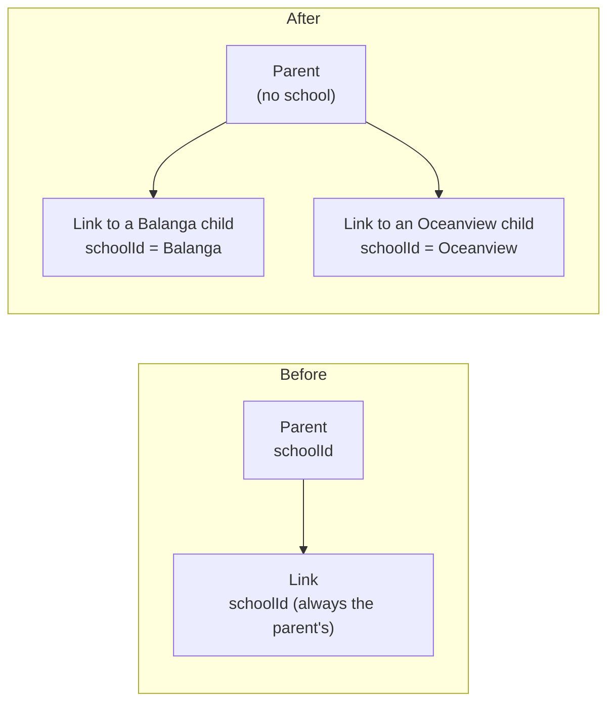

# Step 53: One parent account for any number of schools

> **Fast-track recipe, written before the code on 2026-10-15** for the owner to approve before it's built. Step 53 was split in two on 2026-10-15 (owner approval) so each half fits one review. This half changes who a parent belongs to. The API itself became Steps 53.1–53.4 on 2026-10-16 (`docs/PLAN.md`); its recipe is now `docs/backend/step-53.4-parent-api.md`. When this is built, a "What changed while building" section (just before "Verify it worked") will list where the real code differs from this plan.

## Why

Today a parent account belongs to **one school**, picked at sign-up. A parent with one child at Balanga and another at a different Bantay Aral school would need two accounts, with two emails. On 2026-10-13 the owner decided that one account covers any number of schools (`docs/SCALING.md` 2.1).

So the school moves **from the parent to each linked child**:
- sign-up stops asking for a school;
- "Link a child" asks for the school, as well as the LRN, last name and birth date;
- everything a parent sees is read from **each link's own school**, which the server saved when it checked those details.

It comes before the API because the Expo app's sign-up and link screens are built on this shape (`docs/PARENT-APP-BRIEF.md` already describes it).



## Decisions in this recipe (please confirm or change)

1. **Nothing is lost when the column goes.** Every `ParentStudentLink` already stores its own `schoolId` (Step 51), so dropping `Parent.schoolId` loses nothing a parent can see. A live parent with no linked child yet just picks the school when they link.
2. **The school still never comes from the browser after linking.** When linking, the parent *chooses* a school, and the server only accepts it if a student there matches all three details. From then on, every read uses the `schoolId` saved on the link, never anything the browser sends. `docs/SCHOOL-ISOLATION.md`'s parent rule changes to say so.
3. **Each child's day uses their own school's times** (late after, absent from). Today the home page uses the parent's one school for every child.
4. **The school's name shows on a child's card only when the parent's children are at more than one school.** For most parents, nothing on screen changes.
5. **Paging (one page of notifications at a time) waits for Step 53.1**, where the notification rules move into a service anyway.

## Steps

### 1. Database

`prisma/schema.prisma`: remove from `Parent` the `schoolId` field, its `school` relation and `@@index([schoolId])`. Remove `parents Parent[]` from `School`. `ParentStudentLink` doesn't change.

```bash
npx prisma migrate dev --name parent_any_school
```

The generated SQL drops the foreign key, the index and the column. It runs on Heroku by itself at the next deploy (the release phase, Step 52).

### 2. Types, seed and repositories

| File | Change |
|---|---|
| `src/features/parents/schemas.ts` | `parentSchema` loses `schoolId`. The comments stop saying a parent belongs to one school. |
| `src/data/seed/parents.ts` | The six demo parents lose `schoolId`. Their links keep theirs. |
| `src/data/repositories/parent-repository.ts`, `prisma-parent-repository.ts` | `listBySchool` goes (nothing calls it, and a parent no longer has a school). The mappers stop copying `schoolId`. |
| their tests | The `listBySchool` cases go; the rest stay. |

### 3. The parent session

`src/lib/parent-session.ts`: `ParentSession` becomes `{ parentId }`. The cookie itself already holds only the parent id, so nobody is signed out by this change.

### 4. Sign-up

- `parentSignupSchema` (`auth-schemas.ts`) loses `schoolId`.
- `signup-form.tsx` loses the "Your child's school" picker; `src/app/parent/signup/page.tsx` stops loading the school list.
- `signUpParent` stops checking the school.

### 5. Link a child

- `linkChildSchema` gains `schoolId: z.string().min(1, "Select your child's school")`.
- `src/app/parent/(protected)/link-child/page.tsx` loads the schools' ids and names (the same list the sign-up page loads today), and `link-child-form.tsx` shows the same picker the sign-up form had, as its first field.
- `linkChild` checks the school exists, looks the student up with `studentRepository.findForLink(parsed.data.schoolId, …)`, and saves the link with that `schoolId`. The no-match message becomes "We couldn't find a student with that LRN, last name and birth date at that school."

### 6. What a parent sees

Each read uses the link's own school:

| File | Change |
|---|---|
| `src/app/parent/(protected)/page.tsx` | For each link: `studentRepository.getInSchool(link.schoolId, …)` and `tapRepository.listByStudent(link.schoolId, …)`, and that school's day (`schoolToday` with its own times). Passes the school's name to the card when the children span more than one school. |
| `child-summary-card.tsx` | An optional `schoolName`, shown under the child's name. |
| `notifications-data.ts` | `getParentNotifications(parentId)`, reading each link's school. |
| `notification-actions.ts` | `markNotificationRead` looks the notification up in each of the parent's link schools, and accepts it only for a linked child. `markAllNotificationsRead` goes link by link. |
| `layout.tsx`, `notifications/page.tsx` | Call `getParentNotifications(session.parentId)`. |

### 7. Isolation

- `docs/SCHOOL-ISOLATION.md`: the parent row says the school comes from the parent's own links, and the `Schools` row says the school list is used by "Link a child", not sign-up.
- `e2e/isolation.spec.ts`: "a Balanga parent can't link an Oceanview student" becomes **"picking Balanga with an Oceanview student's details finds no match"**. That still proves a link can't cross schools.

### 8. Tests

- **Unit:** `parent-session.test.ts` (the session is `{ parentId }`), `schemas.test.ts` (sign-up has no school; linking needs one), the parent repository tests, and `seed.test.ts` if it checks a parent's school.
- **Browser:**
  - `e2e/parent.spec.ts`: sign-up no longer picks a school, and linking picks Balanga first.
  - A new case in it: one parent links a Balanga child and an Oceanview child. The home page shows both, each with its school's name.
  - `e2e/isolation.spec.ts`: the changed case above.

## Docs to update with this step

- `docs/SCHOOL-ISOLATION.md` (step 7), `docs/DATA-MODEL.md` (the `PARENT` box in its diagram says "one school only"), and `docs/NOTIFICATIONS.md` (its read path says a parent belongs to exactly one school).
- `docs/BUILD-LOG.md`, `docs/LEARNING-LOG.md` for any question, and `docs/PROBLEMS-LOG.md` for any problem.

## What changed while building

- **The migration was written with `prisma migrate diff`, not `migrate dev`.** `migrate dev` stops to ask "are you sure?" before dropping a column that holds data, and refuses to run where nobody can answer (`docs/PROBLEMS-LOG.md`, P-012). The same SQL, made without asking:
  ```bash
  mkdir prisma/migrations/20261015051136_parent_any_school
  npx prisma migrate diff --from-config-datasource --to-schema prisma/schema.prisma --script \
    -o prisma/migrations/20261015051136_parent_any_school/migration.sql
  npx prisma migrate deploy
  npx prisma generate
  ```
  In your own terminal, `npx prisma migrate dev --name parent_any_school` does all of this and asks you to confirm the drop.
- **The isolation case runs the other way round:** the Balanga demo parent picks Balanga and types an Oceanview student's details. It uses the test's existing Oceanview student, and proves the same thing.
- **A wrong school id when linking** answers under the school field ("Select your child's school"), the same as leaving it empty.
- **`e2e/login.spec.ts` changed too.** Its "parent sign-in" test signs a parent up first, and still picked a school there (P-013).
- **Two more tests changed:** `src/features/isolation.test.ts` (its parent session is `{ parentId }` now, and a parent whose children are all at Oceanview still can't mark a Balanga notification read), and a new `src/features/parents/auth-schemas.test.ts` (sign-up has no school; linking needs one).
- **The sign-up page no longer reads the database,** so it no longer needs `connection()`.

## Verify it worked

1. Your checks: the routine in `docs/LEARNING-LOG.md` ("The routine to run before every commit and push"), including `npx playwright test`.
2. `npm run db:reset`, then `npm run dev`, and open `http://localhost:3000/parent/signup`. There's no school field.
3. After sign-up you land on "Link a child", which now asks for the school first. Link a Balanga student, then link an Oceanview one with the same account.
4. `/parent` shows both children, each with its school's name, and a tap for either (Simulate a tap on that school's dashboard) shows in the bell.
5. Sign in as a demo parent (`parent-one@balanga.example`, `Talaan123!`). Their child shows as before, with no school name, since all their children are at one school.

After you push, the migration runs on Heroku by itself. The live demo parents keep their linked children.

## What's next

Step 53.1, the parent API: tokens for phones, the rules moved into `src/services/parents/`, and `/api/v1/parents/*` for the Expo app.
