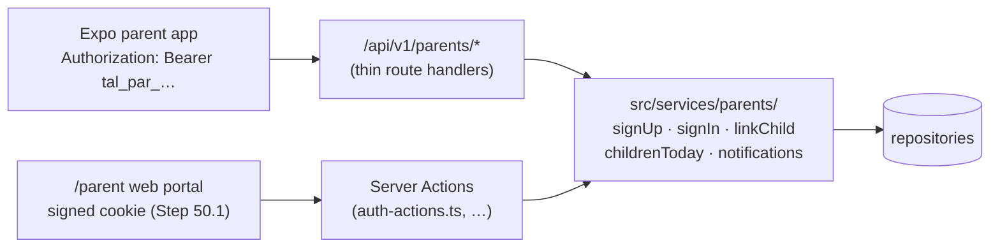

# Step 53: The parent API

> **Fast-track recipe.** Written before the code on 2026-10-11, for the owner to approve before it's built. It was added to the plan the same day: the Expo parent app starts on 2026-10-12, and it needs these addresses to call. When it's built, a "What changed while building" section (just before "Verify it worked") will list where the real code differs from this plan.

## Why

The parent app (Phase 3) is a separate Expo app on the parent's phone. It can't use the web portal's Server Actions or its cookie: those only work inside this web app. It needs plain web addresses under `/api/v1/parents/*` that answer in JSON, the same way the gate tablet does (Steps 43–46).

The web parent portal already does everything the app needs: sign up, sign in, link a child, see today's taps, and read notifications. So this step mostly **moves those rules out of the web actions into services**, then puts two thin doors in front of them: the web's Server Actions (unchanged for the user) and the new API.



## Decisions in this recipe (please confirm or change)

1. **One token per phone, stored hashed, revocable. Not a pair of JWTs.** `docs/ARCHITECTURE.md` proposed a short-lived access token plus a refresh token. That pair exists so a server can check a token without a database lookup. At our size, one indexed lookup per request costs nothing, and a stored token buys things a JWT can't:
   - signing out really ends the token;
   - a lost phone can be cut off;
   - there's no refresh logic to get wrong in the app.

   It's built exactly like the gate's device token (Step 43): a `tal_par_` prefix plus 32 random bytes, kept as a sha256 hash. The token lasts **90 days from its last use**, so a parent who opens the app weekly never signs in again. `ARCHITECTURE.md` is updated to match.
2. **The app stores the token in the phone's secure storage** (Expo's `expo-secure-store`). That's an app decision, noted in `docs/PARENT-API.md` for tomorrow.
3. **Push tokens are stored now and sent later.** `POST /api/v1/parents/push-tokens` saves the phone's push address, so the app can register from its first version. Actually sending a push needs the notification outbox and its worker, the next step. Until then the app shows the feed when opened (pull to refresh), the same as the web portal's bell.
4. **The read mark stays shared by the child's guardians**, as today (`docs/NOTIFICATIONS.md`). Two parents of one child see the same read state. Per-parent read marks can come with the outbox.
5. **Photos:** a parent's token can load **their own linked children's** photos from `/api/v1/photos/…`, and no one else's.

## Steps

### 1. Database

`prisma/schema.prisma`:

```prisma
model ParentToken {
  id         String    @id @default(uuid())
  parentId   String
  parent     Parent    @relation(fields: [parentId], references: [id], onDelete: Cascade)
  // sha256 of the token. The token itself is returned once, at sign-in.
  tokenHash  String    @unique
  // What the app says it is, e.g. "Pixel 7", so a parent can tell sessions apart later.
  label      String?
  lastUsedAt DateTime  @default(now())
  revokedAt  DateTime?
  createdAt  DateTime  @default(now())

  @@index([parentId])
}

enum PushPlatform {
  ios
  android
  web
}

model PushToken {
  id         String       @id @default(uuid())
  parentId   String
  parent     Parent       @relation(fields: [parentId], references: [id], onDelete: Cascade)
  // The phone's push address, as Expo or Firebase gave it.
  token      String       @unique
  platform   PushPlatform
  lastUsedAt DateTime     @default(now())
  createdAt  DateTime     @default(now())

  @@index([parentId])
}
```

```bash
npx prisma migrate dev --name parent_tokens
```

`onDelete: Cascade` here, unlike everywhere else (`Restrict`): a token means nothing without its parent, so deleting a parent account (the privacy step) takes its tokens with it.

### 2. Services (`src/services/parents/`)

The rules move here from `src/features/parents/auth-actions.ts`, `notification-actions.ts` and the dashboard page. Each takes its repositories as an argument, like `recordTap`:

| File | Function | What it does |
|---|---|---|
| `parent-token.ts` | `issueParentToken(parentId, label)` / `authenticateParent(header)` | Makes a token, or turns `Bearer …` into `{ parentId, schoolId }`. It's null when missing, unknown, revoked or unused for 90 days, and updates `lastUsedAt` at most once an hour. |
| `sign-up.ts` | `signUpParent(input)` | Validates, checks the school exists and the email is free, then hashes and creates. Returns the parent or field errors. |
| `sign-in.ts` | `signInParent(email, password)` | The throttle (Step 50.1), then `verifyPassword`. Returns the parent or one vague error. Like `checkStaffSignIn`, it runs scrypt against a decoy hash when the email is unknown, so an unknown email doesn't answer faster (left over from Step 50.1). |
| `link-child.ts` | `linkChild(parent, details)` | LRN, last name and birth date at the parent's own school. Returns the student, "no match" or "already linked". |
| `children-today.ts` | `childrenToday(parent, now)` | Each linked child, with `studentStatus` and `dayTapSummary` for today on their school's clock. |
| `notifications.ts` | `listNotifications(parent, { before, limit })`, `markRead(parent, id)`, `markAllRead(parent)` | The feed, newest first, 30 at a time, and the read marks, with the ownership checks that exist today. |

The web Server Actions then call these and keep their current results, so the web portal works exactly as before. Its existing tests and `e2e/parent.spec.ts` prove that.

### 3. The addresses

Every route is thin: authenticate, validate with Zod, call a service, and answer. All bodies are JSON.

| Method and address | Sign-in | Body / query | Answer |
|---|---|---|---|
| `GET /api/v1/parents/schools` | none | | `{ schools: [{ id, name }] }`, for the sign-up picker |
| `POST /api/v1/parents/signup` | none | `{ schoolId, firstName, lastName, mobile, email, password, deviceLabel? }` | `201 { token, parent }` |
| `POST /api/v1/parents/login` | none | `{ email, password, deviceLabel? }` | `200 { token, parent }` |
| `POST /api/v1/parents/logout` | token | | `204`; the token is revoked and its push token removed |
| `GET /api/v1/parents/me` | token | | `{ parent, school: { id, name, notificationPreference }, children: [ChildToday] }` |
| `POST /api/v1/parents/children` | token | `{ lrn, lastName, birthDate }` | `201 { child: ChildToday }` |
| `GET /api/v1/parents/children/:id/taps?date=YYYY-MM-DD` | token | | `{ date, status, flexible, taps: [{ at, kind }] }`; `404` for a child who isn't theirs |
| `GET /api/v1/parents/notifications?before=<id>&limit=30` | token | | `{ notifications: [Item], unreadCount, nextBefore }` |
| `POST /api/v1/parents/notifications/:id/read` | token | | `204` |
| `POST /api/v1/parents/notifications/read-all` | token | | `204` |
| `POST /api/v1/parents/push-tokens` | token | `{ token, platform }` | `204`; it saves the token, or moves it to this parent |

The shapes:

```ts
type ParentJson = { id: string; firstName: string; lastName: string; email: string; mobile: string };
type ChildToday = {
  id: string; firstName: string; lastName: string; gradeLevel: number; section: string;
  photo: string | null;            // "/api/v1/photos/…", loaded with the same Bearer token
  today: { date: string; status: "present" | "late" | "absent" | "idle";
           flexible: boolean; timeIn: string | null; timeOut: string | null; tapCount: number };
};
type Item = { id: string; childId: string; childName: string; kind: "time_in" | "time_out"; at: string; read: boolean };
```

The status names are the web's own (`AttendanceStatus`): `idle` means no tap yet. On a weekend `flexible` is true, and the app shows "Came in" or "No tap" instead, the same as the web's `statusLabel(status, flexible)` (Step 44.6). Times are ISO strings with the `+08:00` offset. **Never in any answer:** the LRN, the birth date, the guardian's name and mobile, or other students.

**Errors** always look the same, so the app has one error handler:

```json
{ "error": { "code": "invalid_input", "message": "Check the highlighted fields.", "fields": { "email": "Enter a valid email address" } } }
```

| Code | Status | When |
|---|---|---|
| `invalid_input` | 400 | Zod failed; `fields` holds the messages, the same ones the web shows |
| `unauthorized` | 401 | no token, or not a working one; the app goes back to sign-in |
| `wrong_credentials` | 401 | login failed |
| `too_many_tries` | 429 | the throttle |
| `not_found` | 404 | not theirs, or doesn't exist (never "forbidden", as in Step 51) |
| `conflict` | 409 | email taken, child already linked |

`src/features/parents/api-responses.ts` holds `apiError(code, message, fields?)` and the `to…Json` functions that copy fields one by one, like `toGateTapResponse`. A unit test checks the exact keys of each, so a new field is a deliberate decision.

### 4. Photos for parents

`resolvePhotoViewer` (`src/services/photos/photo-viewer.ts`) gains a third kind of Bearer token. A `tal_par_` token is a parent, who may see a photo only when its key's student is one of their linked children. `canViewPhoto` gets a test row for each: own child, another child at the same school, and another school.

### 5. `docs/PARENT-API.md` (new topic doc, linked from the README)

This is the app's contract, written for tomorrow:
- every address above, with a `curl` example and a real answer;
- the error codes;
- token handling: save it in `expo-secure-store`, send it as `Authorization: Bearer`, go to sign-in on any `401`;
- where push tokens fit;
- "What the app never receives".

`ARCHITECTURE.md`'s endpoint table and auth section point to it instead of repeating it.

### 6. Tests

- **Unit:**
  - `parent-token.test.ts`: issue then authenticate; revoked; 90 days unused; a gate token is not a parent token.
  - Each service: the cases the web actions test today, moved.
  - `childrenToday`: a weekday, a weekend, a child with 3 taps.
  - Notification paging: `before` and `limit`.
  - `api-responses.test.ts`: exact keys, and no LRN or birth date anywhere.
- **Browser, API only** (`e2e/parent-api.spec.ts`, Playwright's `request`, no page):
  1. List schools, sign up a new parent and get a token.
  2. `GET /me` shows no children. Link a seed student by LRN, last name and birth date; `/me` now shows them.
  3. Tap that student's card through the gate API (the test gate token).
  4. `GET /notifications` has the new time in. Mark it read; `unreadCount` drops.
  5. The child's photo loads with the token. Another student's photo gives `404`.
  6. Log out; `GET /me` gives `401`.
  7. Six wrong passwords give `429`.
- `e2e/parent.spec.ts` (the web portal) runs unchanged and must stay green.

## Docs to update with this step

- **`docs/COMMANDS.md`:** a "Parent API" section with the `curl` sign-in, `/me` and notifications examples below, and how to get a token.
- **`docs/PARENT-API.md`:** new, the contract for the Expo app.

## Verify it worked

1. Your checks (or ask me to run them).
2. With `npm run dev` running, sign in from a terminal:
   ```bash
   curl -s -X POST http://localhost:3000/api/v1/parents/login -H 'Content-Type: application/json' \
     -d '{"email":"parent-one@balanga.example","password":"Talaan123!","deviceLabel":"curl"}'
   ```
   You get a `token` starting with `tal_par_`.
3. `curl -s http://localhost:3000/api/v1/parents/me -H "Authorization: Bearer <token>"` lists that parent's linked children, each with today's status.
4. Tap one of those children's cards with the gate (or Simulate a tap on the dashboard), then fetch `/api/v1/parents/notifications`: the new entry is first.
5. The web portal at `/parent` works exactly as before.

## What's next

The notification outbox and its worker: each queued notification is actually sent to the parent's phone through Expo's push service (free), with retries, so a tap at the gate buzzes the phone in the parent's pocket.
