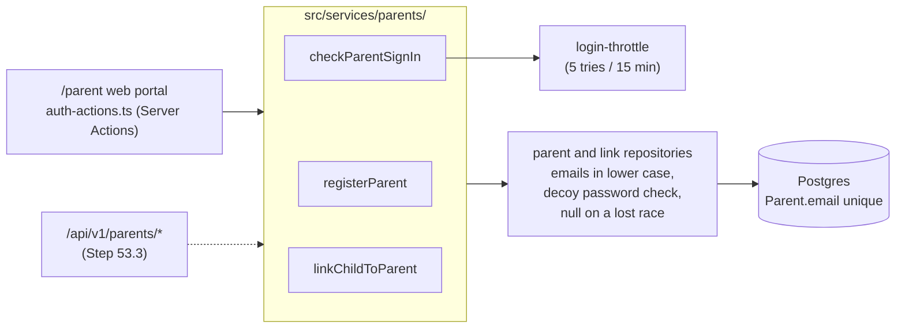

# Step 53.1: Parent sign-in services

> **Written from the real diff on 2026-10-16**, after the code was built and checked. The plan behind it went through three review rounds with the systems-architect first, and the finished files through a fourth (`docs/BUILD-LOG.md`, Step 53.1). This is the first of four steps cut from the original parent API recipe, now `docs/backend/step-53.3-parent-api.md`.

## Why

The parent app (Phase 3) will sign up, sign in and link children through the API (Step 53.3). The rules for those lived inside the web portal's Server Actions, which only a browser on this site can call. This step moves them into `src/services/parents/`, so the web and the API share one copy, the same way `recordTap` serves the gate and the terminal script. It also fixes three things the review found:

1. **Sign-in timing gave away who has an account.** For an unknown email, the parent repository returned before checking any password, so it answered tens of milliseconds faster than for a real one. Staff sign-in already guarded against this (Step 50.1).
2. **Emails were stored as typed and searched case-insensitively.** A case-insensitive search can't use the unique email index, so every sign-in read the whole `Parent` table. The index itself was case-sensitive, so `Ana@x.com` and `ana@x.com` could both exist.
3. **Two requests at once could crash.** Two sign-ups with one email both pass the "is it free?" check, and the second then breaks the unique index: an error page instead of "email taken". The same goes for one "link a child" form sent twice.



## Steps

### 1. One email rule (`src/features/auth/schemas.ts`)

```ts
export function normalizeEmail(email: string): string {
  return email.trim().toLowerCase();
}

export const emailSchema = z.string().trim().toLowerCase().pipe(z.email("Enter a valid email address"));
```

The order matters. In Zod 4, `z.email()` checks first, and anything chained after it runs later, so `z.email().trim()` rejects `" Ana@X.com "` before trimming. This was checked by running both forms. `parentSignupSchema` and `parentLoginSchema` (`src/features/parents/auth-schemas.ts`) use `emailSchema`. Staff sign-in is unchanged: staff emails were already lowercased when stored (`src/features/staff/actions.ts`).

### 2. The decoy hash, shared (`src/lib/password.ts`)

`decoyPasswordHash()` moved here from `staff-sign-in.ts`: a hash of 32 random bytes, made once on first use. Staff sign-in now imports it.

### 3. The repositories

**`ParentRepository`** (`src/data/repositories/parent-repository.ts`, mock and interface):
- `findByEmail` and `verifyPassword` normalise what they look up, and stored emails are already normalised, so the match is exact.
- `create` stores the email normalised and returns **`Parent | null`**: null when another account already has the email.

**`prisma-parent-repository.ts`:**
- `toParentData` normalises the email, so `prisma/demo-data.ts` (which uses it) stores lowercase too.
- `findRowByEmail` is `findUnique({ where: { email: normalizeEmail(email) } })`, which the unique index answers.
- `verifyPassword` always runs scrypt:
  ```ts
  const row = await findRowByEmail(email);
  const matches = await passwordMatches(password, row?.passwordHash ?? (await decoyPasswordHash()));
  return row && matches ? toParent(row) : null;
  ```
  The decoy has to sit here: this repository never hands its password hash out, so a service can't run the check itself.
- `create` catches Prisma's unique-value error and returns null.

**`ParentStudentLinkRepository.create`** returns **`ParentStudentLink | null`**: null when the parent already has a link to that student. The mock checks for a twin; Prisma catches the `(parentId, studentId)` unique error.

**`src/data/repositories/prisma-errors.ts`** (new) holds `isUniqueViolation(error)` (Prisma's `P2002`). In these two tables it can only mean the email or the `(parentId, studentId)` pair. The ids are fresh random UUIDs, and a foreign-key failure is a different code (`P2003`) that still throws.

### 4. The services (`src/services/parents/`)

Each takes its repositories as an argument and imports nothing from Next.js. Every failure carries a `code`, so Step 53.3's API can map them to status codes in one place.

| File | Function | Answers |
|---|---|---|
| `register-parent.ts` | `registerParent(input, { parents })` | `{ ok: true, parent }`, or `{ ok: false, code: "invalid_input" \| "email_taken", fieldErrors }` |
| `check-parent-sign-in.ts` | `checkParentSignIn(input, { parents, throttle, now })` | `{ ok: true, parent }`, or `{ ok: false, code: "invalid_input" \| "too_many_tries" \| "wrong_credentials", formError }` |
| `link-child-to-parent.ts` | `linkChildToParent(parentId, input, { schools, students, links })` | `{ ok: true, student }`, `{ ok: false, code: "invalid_input", fieldErrors }`, or `{ ok: false, code: "no_match" \| "already_linked", formError }` |
| `field-errors.ts` | `firstFieldErrors(zodError)` | each field's first message |

Each validates its input again with the form's own schema (`input: unknown`). A null from `create` becomes "email taken" or "already linked", the same answer as the check before it. Bad input to sign-in doesn't count as a wrong try.

### 5. The web actions (`src/features/parents/auth-actions.ts`)

`signUpParent`, `signInParent` and `linkChild` call the services, then do only what a browser needs: set or read the cookie, `refresh()`, `redirect()`. Their result shapes and messages are unchanged, so the forms and `e2e/parent.spec.ts` didn't change.

### 6. The migration

The schema doesn't change, so the migration is written by hand:

```bash
npx prisma migrate dev --create-only --name parent_email_lowercase
# fill in prisma/migrations/<time>_parent_email_lowercase/migration.sql, then:
npx prisma migrate dev
```

```sql
DO $$
DECLARE
  clashes integer;
BEGIN
  SELECT count(*) INTO clashes
  FROM (SELECT lower(trim(email)) FROM "Parent" GROUP BY 1 HAVING count(*) > 1) AS same_email;
  IF clashes > 0 THEN
    RAISE EXCEPTION '% email address(es) belong to more than one parent account once lowercased. Merge those accounts first (docs/PROBLEMS-LOG.md, P-014).', clashes;
  END IF;
END $$;

UPDATE "Parent" SET "email" = lower(trim("email")) WHERE "email" <> lower(trim("email"));
```

The check comes first, so a stop changes nothing. If it ever stops on Heroku, the release fails and the old code keeps running, and every later deploy stops too until it's cleared. `docs/PROBLEMS-LOG.md` P-014 has the recovery.

**A dead end, avoided:** after the migration was applied locally, its comment was reworded. Prisma keeps a checksum of every applied migration, so `migrate dev` would then have called the file modified and offered to reset the database, deleting every row. The original text was restored, and `npx prisma migrate status` confirmed it matched. Once a migration has run anywhere, leave its file alone.

### 7. Tests

- `src/services/parents/*.test.ts`:
  - sign-up lowercases and trims; bad input gives field errors; a taken email in any case; the lost race;
  - sign-in in any case; one answer for a wrong password and an unknown email; bad input doesn't count a try; 5 tries lock it, then refuse the right password; one email in any case is one count;
  - link a child: a match saves the school; another school's details find nothing; a missing school; bad input; already linked; the lost race.
- `parent-repository.test.ts`: the stored email is normalised; a second account with the same email gives null. `parent-student-link-repository.test.ts`: a twin link gives null.
- `prisma-parent-repository.test.ts`: the lookup is exact and lowercase; an unknown email still checks the decoy; a known email checks its own hash; a unique-value error gives null. `@/lib/password` is mocked in this file only (Vitest isolates each file).
- `auth-schemas.test.ts`: `" Ana@X.com "` becomes `"ana@x.com"` in sign-up and login; a non-email is still refused.

## Verify it worked

1. Your checks: the routine in `docs/LEARNING-LOG.md` ("The routine to run before every commit and push"), including `npx playwright test`.
2. Apply the migration: `npx prisma migrate deploy`, then `npx prisma migrate status` says the database is up to date.
3. With `npm run dev`, sign in at `/parent/login` as ` PARENT-ONE@balanga.example ` (capitals and spaces) with `Talaan123!`. It works.
4. Sign up a new parent as `New.Parent@Example.com`, sign out, and sign in as `new.parent@example.com`. It works, and signing up again with `NEW.PARENT@example.com` says the email is taken.
5. **After the deploy to Heroku:**
   ```bash
   heroku pg:psql --app <name> -c 'SELECT count(*) FROM "Parent" WHERE email <> lower(trim(email));'
   ```
   It should be 0. If it isn't, a parent signed up on the old code while the new release started, and can't sign in. Run the migration's `UPDATE` line once by hand the same way.

## What's next

Step 53.2: parent pages load one day or one page at a time.
