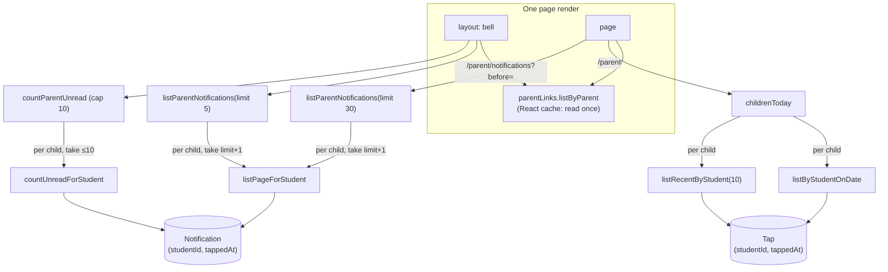

# Step 53.2: Paged parent data

> **Written from the real diff on 2026-10-16**, after the code was built and checked. The plan went through two review rounds with the systems-architect, and the finished files through a third (`docs/BUILD-LOG.md`, Step 53.2). This fixes `docs/SCALING.md` 2.2.

## Why

Every parent page loaded a parent's whole history. A child makes about 400 taps and up to 400 notifications a school year, and after the morning push many parents open the portal at once:

- The **home page** read every tap each child ever made, only to show today's status and a history list.
- The **bell**, in the layout of every parent page, read every notification ever and sent them all to the browser, to show 5 and a count.
- **"Mark all as read"** read everything, then wrote one row at a time.

Now each read is bounded: today's taps and the last 10, the newest 5 notifications, a page of 30, an unread count that stops at 10, and one write for "mark all".



## Steps

### 1. Tap reads (`tap-repository.ts`, `prisma-tap-repository.ts`)

- `listByStudentOnDate(schoolId, studentId, date)`: the school's midnight to the next one (a `schoolDay(date)` helper, now shared with `listBySchoolOnDate`), earliest first. Step 61 reuses it for `recordTap`.
- `listRecentByStudent(schoolId, studentId, limit)`: `orderBy [tappedAt desc, id desc]`, `take: limit`, a backward read of the `(studentId, tappedAt)` index.
- `listByStudent` stays: `recordTap` and `notifyParentsForTap` still use it until Step 61.

### 2. Notification reads and writes (`notification-repository.ts`, `prisma-notification-repository.ts`)

| Method | What it sends |
|---|---|
| `listPageForStudent(schoolId, studentId, { before, take })` | `orderBy [tappedAt desc, id desc]`, `take`. With a cursor: `tappedAt <= t` (so the index starts at the cursor) and `OR [tappedAt < t, (tappedAt = t and id < cursorId)]`. |
| `countUnreadForStudent(schoolId, studentId, cap)` | `count({ where: { …, read: false }, orderBy: [{ tappedAt: "desc" }], take: cap })`. The order matters: without it, Prisma orders the capped count by `id`, which sorts every unread row first (`docs/PROBLEMS-LOG.md`, P-016). |
| `markReadForChildren(children, id)` | one `updateMany` where `id` and `OR` of each `{ schoolId, studentId }`; true when it matched |
| `markAllReadForChildren(children)` | one `updateMany` where `read: false` and the same `OR` |

`LinkedChild = { schoolId, studentId }` is one link: a child at the school the link was checked against. The `OR` of pairs, never `studentId IN … AND schoolId IN …`, keeps each child tied to their own school. `listByStudent` and the old `markRead(schoolId, id)` are gone: nothing in the app used them any more. The tests that did now use the new methods.

### 3. The cursor (`src/features/parents/notification-cursor.ts`)

- `encodeNotificationCursor({ tappedAt, id })`: base64url of `<tappedAt>|<id>`, safe in an address as is.
- `decodeNotificationCursor(raw)`: null for anything that isn't exactly an ISO time and a valid id, meaning the first page.
- `newestNotificationFirst(a, b)`: the one order, with plain `<` on the id, not `localeCompare`.

Ids must be a lowercase UUID or `notification-` and 4 digits. Postgres's `en_US` collation skips hyphens on its first pass (`ab < a-c`, where JavaScript says `a-c < ab`), so for other id shapes the database and the merge could disagree about two notifications in the same millisecond (P-017). Encoding any other id throws, so a mistake shows instead of "Show older" quietly looping back to page one.

### 4. The services (`src/services/parents/`)

- **`children-today.ts`, `childrenToday(parentId, now, deps)`.** For each link, one after another: the student at the link's school, the school once, `schoolToday(now, school)`, today's taps, and the last `RECENT_TAP_COUNT` (10).
- **`notifications.ts`:**
  - `listParentNotifications(parentId, { before, limit = 30 })`: for each child, `limit + 1` from below the cursor; merge with `newestNotificationFirst`; keep `limit`. `nextBefore` is the last kept item's cursor, only when more were found. Each item carries only `{ id, firstName, lastName }` of the child (P-018).
  - `countParentUnread(parentId)`: each child in turn with the cap left over, stopping at `UNREAD_COUNT_CAP` (10).
  - `markParentNotificationRead(parentId, id)` and `markAllParentNotificationsRead(parentId)`: the parent's links become `LinkedChild`s.

Children are read one after another rather than all at once: a parent has a few, and the 10 database connections are shared with the gate (`docs/SCALING.md` 3.3).

### 5. The pages

- **`src/features/parents/parent-links.ts`**: `parentLinks.listByParent`, wrapped in React's `cache`, so the layout and the page read the links once per render. A Server Action's `refresh()` starts a new render with an empty cache. The actions use the plain repository.
- **Layout:** the bell gets `listParentNotifications(…, { limit: 5 })` and `countParentUnread`. `NotificationsBell` takes `unread` as a prop; its label says "more than 9 unread" from 10, and the badge "9+".
- **`/parent`:** `childrenToday`. `ChildSummaryCard` takes `todayTaps` (the status) and `recentTaps`, under "Recent taps" (owner decision, 2026-10-16: the last 10, not every tap ever).
- **`/parent/notifications`:** `searchParams.before`, decoded first, so a bad one is the first page. It shows 30, "Show older" (`?before=<nextBefore>`) and "Back to newest", or the empty state on a first page with nothing. "Mark all as read" shows from the count.
- **Removed:** `notifications-data.ts` (`getParentNotifications`) and `countUnreadNotifications`. `notification-actions.ts` calls the services.

### 6. Tests

- `notification-cursor.test.ts`: round trip for both id shapes; address-safe; eight bad cursors become null; encoding another shape throws; the order.
- `services/parents/notifications.test.ts`: paging two children two at a time with ties gives each once, in order; the last page; names only; a bad cursor is the first page; never another parent's child; the count across children and its cap; mark one and mark all, never another parent's.
- `services/parents/children-today.test.ts`: the school's own late time; the split at the school's midnight (15:59:59.999Z and 16:00:00.000Z); weekends; the last 10; a missing student.
- `tap-repository.test.ts`, `notification-repository.test.ts`: the new methods, and the wrong school finds nothing.
- `prisma-notification-paging.test.ts` (new, needs `E2E_DATABASE_URL`, loaded with `dotenv/config` like `prisma-isolation.test.ts`): tied rows of both id shapes for two Balanga children, paged on real Postgres, give the JavaScript order; the capped count; mark read only at the right school. Rows are dated 2030 so they're the newest, and removed afterwards.
- `notifications-bell.test.tsx`: the count comes as a prop; "more than 9 unread" at the cap.

## Verify it worked

1. Your checks: the routine in `docs/LEARNING-LOG.md` ("The routine to run before every commit and push"), including `npx playwright test`.
2. With `npm run dev`, sign in as `parent-one@balanga.example` / `Talaan123!`:
   - `/parent`: each child shows today's status and "Recent taps", at most 10.
   - The bell shows the newest 5 and the unread count. "Mark all as read" clears the badge.
   - `/parent/notifications?before=nonsense` shows the first page with no "Back to newest".
   - Look at both at 360 and 1280 px, light and dark.
3. The demo has only 3 notifications, so "Show older" doesn't appear there. The services test and the Postgres test cover it.
4. **Measure with realistic data.** With the demo's 3 notifications, Postgres just reads the table and sorts, which is fastest for so few rows, so the demo data shows nothing. Add six years of rows in a transaction that's undone at the end (`docker exec -it talaan-postgres psql -U postgres -d talaan`):
   ```sql
   BEGIN;
   INSERT INTO "Notification" (id, "schoolId", "studentId", kind, "tappedAt", read)
   SELECT gen_random_uuid()::text, 'school-balanga', 'student-0001', 'time_in', now() - (g || ' hours')::interval, true
   FROM generate_series(1, 2400) g;
   INSERT INTO "Tap" (id, "schoolId", "stationId", "cardSerial", "studentId", "tappedAt")
   SELECT gen_random_uuid()::text, 'school-balanga', 'st', 'x', 'student-0001', now() - (g || ' hours')::interval
   FROM generate_series(1, 2400) g;
   ANALYZE "Notification"; ANALYZE "Tap";
   EXPLAIN (ANALYZE, BUFFERS) SELECT * FROM "Tap" WHERE "studentId" = 'student-0001'
     AND "schoolId" = 'school-balanga' ORDER BY "tappedAt" DESC, id DESC LIMIT 10;
   EXPLAIN (ANALYZE, BUFFERS) SELECT COUNT(*) FROM (SELECT id FROM "Notification"
     WHERE "studentId" = 'student-0001' AND "schoolId" = 'school-balanga' AND read = false
     ORDER BY "tappedAt" DESC LIMIT 10) AS sub;
   ROLLBACK;
   ```
   What it showed on 2026-10-16:
   - **Recent taps:** `Index Scan Backward`, 3 buffers, stopped after 11 rows. Bounded, whatever the history.
   - **Unread count, a child whose parent reads everything:** every one of the child's 2,400 rows checked (`Rows Removed by Filter: 2401`, 37 buffers, 0.07 ms). Cheap, but it grows with years: this is the open item in `docs/SCALING.md` 2.2. If it ever shows up on Heroku, the fix is a partial index on unread rows (`@@index([studentId, tappedAt], where: { read: false })`).

## What's next

Step 53.3: parent tokens and the sign-in API, so the Expo app can sign in.
