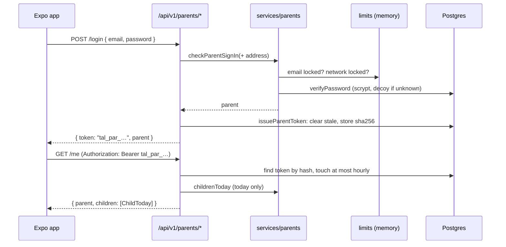

# Step 53.3: Parent tokens and the sign-in API

> **Written from the real diff on 2026-10-16.** The plan went through two review rounds with the systems-architect, and the finished files through a third (`docs/BUILD-LOG.md`, Step 53.3). The original recipe for the whole parent API is now `docs/backend/step-53.4-parent-api.md`, which covers what's left.

## Why

The Expo parent app can't use the web portal's cookie or Server Actions. It needs plain JSON addresses and a token it keeps on the phone. Opening sign-in to scripts also made the old limits too weak (`docs/PROBLEMS-LOG.md`, P-020), so this step adds limits per network as well as per email.



## Steps

### 1. The table (`prisma/schema.prisma`, migration `parent_tokens`)

`ParentToken`: `id`, `parentId` (deleted with its parent: `onDelete: Cascade`), `tokenHash` (unique), `label`, `lastUsedAt`, `revokedAt`, `createdAt`, and an index on `parentId`. It's a new table, so the migration is safe on a database that already has data.

```bash
npx prisma migrate dev --name parent_tokens
npx prisma generate   # Prisma 7's migrate dev no longer does this by itself
```

`PushToken` waits for Step 53.4, linked to the sign-in token so logout can remove that phone's push address.

### 2. Tokens (`src/services/parents/parent-token.ts`, `src/data/repositories/*parent-token-repository.ts`)

- `issueParentToken(parentId, label, now)`: first deletes that parent's revoked tokens and those unused for 90 days, then stores the sha256 of `tal_par_` plus 32 random bytes. The token itself is returned once and never stored or logged.
- `authenticateParent(authorization, now)`: `{ parentId, tokenId }`, or null for no header, a gate's `tal_dev_` token, an unknown, revoked or 90-days-unused token. It moves `lastUsedAt` forward at most once an hour, with a conditional `updateMany`, so requests at the same moment write once.
- `revokeParentToken(tokenId)`: that phone is signed out.

### 3. Limits (`src/services/auth/login-throttle.ts`, `src/lib/client-address.ts`)

| Limiter | Counts | Locks for |
|---|---|---|
| `staffSignInThrottle` | 5 wrong passwords per staff email | 15 minutes |
| `parentSignInThrottle` | 5 wrong passwords per parent email | 15 minutes |
| `parentAddressThrottle` | 30 wrong parent passwords per network | 15 minutes |
| `parentSignUpThrottle` | 100 sign-ups per network (only forms that pass their checks) | 1 hour |

- **Bounded memory.** Each limiter is its own instance with at most 10,000 keys. At the cap, the oldest key that isn't locked makes room, and a live lockout is never dropped. Stale entries are swept at most once a minute.
- **Before the hash.** Both sign-in limits, and the sign-up limit, are checked before any password is hashed.
- **Lockout log lines** never name the email or the address.

`clientAddressKey(x-forwarded-for)` takes the **last** entry, the one Heroku's router adds, and strips brackets, ports and zones. IPv4 written as IPv6 becomes IPv4, and IPv6 is counted by its /64, with `::` fully expanded first. Loopback (127/8, `::1`) gives null: this computer's own requests are never limited by address, which keeps local browser tests from sharing one count. Anything unreadable shares one bucket. `docs/DEPLOY.md` says why Cloudflare's proxy must stay off.

### 4. The addresses (`src/app/api/v1/parents/`)

Every route is thin: read the token, read the JSON, call a service, answer. Each one's answer comes from `src/features/parents/api-responses.ts`, with fields copied one by one and times on the school's clock (`toSchoolOffsetIso`, "…+08:00").

| Address | Notes |
|---|---|
| `GET schools` | public: id and name only |
| `POST signup` | `registerParent` with `confirmPassword` set to the password (the app has no such field, and its message is never sent back); then a token; `201` |
| `POST login` | `checkParentSignIn`; then a token |
| `POST logout` | revokes this phone's token; `204` |
| `GET me` | `childrenToday(…, { recentTaps: 0 })`: today only |
| `POST children` | `linkChildToParent`; no match is `404`, already linked `409`; the answer is the child's day |
| `GET children/:id/taps?date=` | only the parent's own child (else `404`); the date on that child's school's calendar |

Errors: `{ error: { code, message, fields? } }`, with `invalid_input` 400, `unauthorized` 401, `wrong_credentials` 401, `too_many_tries` 429, `not_found` 404, `conflict` 409. The school day uses `getNow()` (the demo clock in tests); tokens and limits use the real clock.

Passwords are capped at 128 characters, and emails at 254, for sign-up and both sign-ins: the slow password hash runs on whatever is sent.

### 5. Tests

- `client-address.test.ts` (14 cases), `login-throttle.test.ts` (making room, never dropping a lockout), `parent-token.test.ts` (issue, refuse, 90 days, hourly touch, cleanup).
- `check-parent-sign-in.test.ts` and `register-parent.test.ts`: the address locks, typos not counted, loopback not limited.
- `api-responses.test.ts`: exact keys, and never the LRN, birth date or guardian.
- `e2e/parent-api.spec.ts`, desktop only, each test from its own `203.0.113.x`:
  - sign up, link, tap at the gate, `/me`, a day's taps, another child is 404, logout then 401;
  - a seed parent signs in, and a wrong email answers like a wrong password;
  - 5 wrong passwords then 429; 30 from one network then 429;
  - a gate token is not a parent;
  - an empty sign-up names only the app's fields;
  - bad input in one shape.
  It's in `npm run test:e2e`.

  **A dead end:** the first version linked Bayani Macapagal, a student with no tap yet. Alone it passed, but in the full run the tap-station tests, which tap the next student with no tap, could tap him first, so the test's own tap was a repeat that stored nothing. It now links Divine Garcia, who has a seed tap at 07:35 and isn't used by any other test, and checks her day reads `time_in` then `time_out` (`docs/PROBLEMS-LOG.md`, P-022).

## Verify it worked

1. Your checks: the routine in `docs/LEARNING-LOG.md`, including `npx playwright test`.
2. `npx prisma migrate deploy`, then with `npm run dev`, the commands in `docs/COMMANDS.md`, section 7d: sign in, `/me`, a day's taps, sign out.

## What's next

Step 53.4: the notifications API, push tokens, photos for parent tokens, and `docs/PARENT-API.md`.
