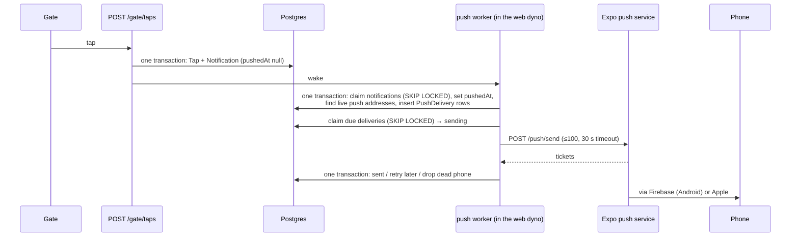

# Step 54: Push notifications reach the phone

> **Written before the code and approved by the owner on 2026-10-16**, as Phase 2b asks (`docs/PLAN.md`). The plan was reviewed with the systems-architect (one round; its three blocking points are fixed below), and so was the finished code (nothing blocking). **Built the same day.** "What changed while building", just before "Verify it worked", lists where the real code differs. The topic doc is `docs/PUSH.md`.

## Why

The demo needs a tap at the gate to buzz the parent's phone. Today a tap writes a `Notification` row, which the parent sees when they open the feed. Nothing is sent. CLAUDE.md's rule: a notification is never silently lost. The tap and its outbox are written in one transaction, and a separate worker sends.

## Decisions (please confirm or change)

1. **The `Notification` row is the outbox.** It's already written in the same transaction as the gate tap (`prisma-tap-writer.ts`). `ARCHITECTURE.md` always said it would double as the outbox. The worker makes one delivery row per phone *when it sends*, seconds later, instead of inside the tap's transaction (the wording in `docs/PLAN.md`).
   - The tap path stays as it is, one write lighter.
   - A phone registered between the tap and the send still gets the push.
   - Nothing can be lost: the notification is committed with the tap, and it's marked "pushed" in the same transaction that writes its deliveries (architect review).
2. **Which phones:** every push address of every parent linked to the child at that school, whose sign-in is **not revoked**, however long since it was last used. This is the 90-day question from Step 53.4's review. A parent who only reads the banners keeps getting them. After 90 days their app token stops working, so tapping a push opens the app at sign-in.
   - So that this holds, signing in on another phone no longer deletes an unused sign-in that has a push address. Revoked sign-ins are still deleted (architect review).
   - A phone that's gone (app removed) is dropped when Expo answers `DeviceNotRegistered`.
   - Rejected: refreshing the sign-in on every push. That would keep a lost phone's token alive forever.
3. **The worker runs inside the web server: $0 a month.** It's started once when the server starts (`src/instrumentation.ts`). Two things make it run: a nudge right after a notification is written (by the gate, Simulate a tap, or the station), and a check every 30 seconds as a fallback.
   - A separate worker dyno would cost $7 a month, over the student credit. The worker is plain functions, so a `worker:` line in the Procfile can run it later.
   - Expo's push service is free.
4. **No new dependency.** Expo's push service is one HTTPS call (`fetch`), behind a small `PushSender` interface. The `PUSH_SENDER` setting picks `expo` (real pushes) or `log` (writes "push to 1 phone" to the log; for development and the browser tests).
5. **What the phone shows:** title "Bantay Aral". The body is **the child's first name only**, for example "Juan tapped in at 7:56 AM", or "tapped out". The lock screen is visible to anyone near the phone, and the text passes through Expo, Google and Apple. Students are minors, so the minimum (architect review). The data part carries `notificationId` and `childId`, so tapping opens the feed.
6. **Too late to push:** a notification more than 6 hours old (after an outage) isn't pushed, and a delivery still failing 6 hours after its notification gives up. It's always in the feed. The count is logged.
7. **Split:** Step 54 sends. **Step 54.1** (new) checks Expo's receipts after 15 minutes (drop more dead phones, mark failed), and deletes sent and failed deliveries older than 7 days. The 7-day cleanup is due before a second school.



## Steps

### 1. Database (migration `push_deliveries`)

```prisma
model Notification {
  // …as today, plus:
  // When the worker made this notification's deliveries. Null: still to send.
  pushedAt   DateTime?
  deliveries PushDelivery[]

  @@index([createdAt], map: "Notification_to_push", where: raw("\"pushedAt\" IS NULL"))
}

enum PushDeliveryStatus { waiting sending sent failed }

model PushDelivery {
  id             String             @id @default(uuid())
  notificationId String
  notification   Notification       @relation(fields: [notificationId], references: [id], onDelete: Cascade)
  // A signed-out phone's pending pushes go with it.
  pushTokenId    String
  pushToken      PushToken          @relation(fields: [pushTokenId], references: [id], onDelete: Cascade)
  status         PushDeliveryStatus @default(waiting)
  tries          Int                @default(0)
  nextAttemptAt  DateTime           @default(now())
  claimedUntil   DateTime?
  ticketId       String?            // Expo's, for Step 54.1's receipts
  lastError      String?            // Expo's error code only, never the token
  createdAt      DateTime           @default(now())
  sentAt         DateTime?

  @@unique([notificationId, pushTokenId])
  @@index([status, nextAttemptAt])
  @@index([pushTokenId])
}
```

The migration also runs `UPDATE "Notification" SET "pushedAt" = now();`, so no old notification is ever pushed. The partial index uses the `partialIndexes` preview the schema already has (`Card_one_active_per_student`). `migrate dev` must show no drift afterwards; if the `raw()` form isn't accepted, the plain `(pushedAt, createdAt)` index is the fallback. All times are compared with the database's `now()` and `createdAt`, never `tappedAt` or the app's clock: the browser tests pin the app's clock to a June morning.

### 2. Sign-ins keep their push address (`prisma-parent-token-repository.ts`)

`deleteStale` deletes a parent's revoked sign-ins, and those unused for 90 days **that have no push address**. A unit test and the mock change with it.

### 3. Sending (`src/services/push/`, no Next.js imports)

| File | What it does |
|---|---|
| `push-sender.ts` | `PushSender.send(messages) → tickets`. `expoPushSender` (fetch, `AbortSignal.timeout(30_000)`, `Authorization: Bearer $EXPO_ACCESS_TOKEN` when set) and `logPushSender` (logs a count, keeps the last 50 messages in memory). `getPushSender()` picks by `PUSH_SENDER`; it defaults to `log` outside production. |
| `push-message.ts` | A delivery → Expo's message: `{ to, title, body, data, sound: "default", channelId: "attendance" }`, first name only. |
| `fan-out.ts` | One interactive transaction: claim up to 100 notifications with `pushedAt IS NULL` (raw SQL, `FOR UPDATE SKIP LOCKED`), set `pushedAt`, and find every live push address for them in one join (link → sign-in → push address). Then `createMany` the deliveries (`skipDuplicates`). Older than 6 hours: marked pushed with no deliveries, and counted. |
| `send-due.ts` | Claim up to 100 deliveries that are `waiting` and due, or `sending` past `claimedUntil` (a crashed send), with SKIP LOCKED. Set them to `sending` until now + 2 minutes, send in one request, and write the results back in one transaction:<br/>• `ok`: `sent`, `ticketId`, `sentAt`.<br/>• `DeviceNotRegistered`: delete that push address (the cascade removes its deliveries).<br/>• `MessageRateExceeded`: back to `waiting` in 30 seconds, not counted as a try.<br/>• Any other error, a timeout, or a 5xx: `waiting`, tries + 1, wait 30 s × 2^tries (at most 30 minutes). After 6 hours: `failed`. |
| `push-worker.ts` | `wakePushWorker()`, and the loop: one pass at a time (`fanOut`, then `sendDue` until nothing is due). A wake during a pass runs one more pass straight after. A 30-second timer is the fallback. It's started once (`globalThis` flag). |

Repositories hold the SQL (`src/data/repositories/push-delivery-repository.ts`, mock and Prisma), as everywhere else. Raw SQL quotes the camelCase names (`"Notification"."pushedAt"`), casts enum values (`::"PushDeliveryStatus"`), and uses `$queryRaw` for `RETURNING`.

### 4. Wiring

- `src/instrumentation.ts`: start the worker in the nodejs runtime, **before** the production-settings early return, so it also runs in development and the browser tests.
- `wakePushWorker()` after a notification is written: the gate tap route, `simulateTap`, `syncStationTaps`.
- `checkProductionEnv`: `PUSH_SENDER` must be `expo` or `log`, and `EXPO_ACCESS_TOKEN` is required with `expo` (Expo's "enhanced push security": only this server can push to the app's phones).
- `.env.example`: `PUSH_SENDER=log` and `EXPO_ACCESS_TOKEN=`. `playwright.config.ts` sets `PUSH_SENDER=log`.

### 5. Docs

- **`docs/PUSH.md`** (new topic doc, linked from the README): how the outbox, the deliveries and the worker fit together, with the diagram, the states, the settings and quick recipes.
- `docs/NOTIFICATIONS.md`, `ARCHITECTURE.md`, `SCALING.md` 2.3, `DEPLOY.md` (the settings and the $0 cost), `PARENT-API.md` and `PARENT-APP-BRIEF.md`:
  - which phones get a push;
  - the push's text and data;
  - the app must create the `attendance` Android channel before it registers its token.

### 6. Tests

- **Unit, with mocks:**
  - the message (first name only, in and out);
  - fan-out (which phones: revoked sign-in no, other school's link no; old notification skipped);
  - send results (ok, dead phone dropped, rate limit not a try, retry with backoff, failed after 6 h);
  - the worker's wake while running;
  - `checkProductionEnv`;
  - `deleteStale` keeps a sign-in with a push address.
- **Against Postgres**, like `prisma-notification-paging.test.ts`:
  - the two claim queries: two claims at once never take the same row;
  - a crashed `sending` comes back after `claimedUntil`;
  - dates come back as dates.
- **Browser**, `e2e/parent-api.spec.ts`: register a push token, tap at the gate, and the `log` sender has a message for that token. A test-only read of the log sender is needed for that; the recipe's build will pick the smallest way, or this check moves to the Postgres test.

## Settings

| Where | Line |
|---|---|
| Your `.env` | `PUSH_SENDER=log` (or leave it out: `log` is the default outside production) |
| Heroku, **before you push this step** | `heroku config:set PUSH_SENDER=log --app bantayaral` |
| Heroku, at the real deploy (after the app's M7) | `heroku config:set PUSH_SENDER=expo EXPO_ACCESS_TOKEN=<from expo.dev, Access tokens> --app bantayaral` |

Without `PUSH_SENDER` on Heroku, the next automatic deploy would refuse to start (`checkProductionEnv`), and the live demo would go down.

## Cost

$0 a month more: the worker runs in the existing dyno, and Expo's push service is free. Each push is one small row. At 500 students, about 1,500 rows a day; Step 54.1 keeps 7 days. The worker holds at most one database connection, and only while it's reading or writing, never while waiting on Expo.

## What changed while building

- **The log sender keeps no list of messages.** The browser test reads the database instead (below), which tests more of the path, so there was nothing to cap.
- **The browser test reads the delivery through a `tsx` script,** `e2e/push-delivery.ts`. Playwright can't load the generated Prisma Client (`Cannot use 'import.meta' outside a module`; `docs/PROBLEMS-LOG.md`, P-024). It's the same approach as `create-test-devices.ts`. The test registers the push token before the second gate tap, then waits for that tap's delivery to be `sent` with a `log-` ticket.
- **Never during a build:** `instrumentation.ts` skips the worker when `NEXT_PHASE` is `phase-production-build`. It's a guard only: Next calls `register()` when a server starts.
- **A timeout is told apart by its name** (`"TimeoutError"`), not by `instanceof Error`: a `DOMException` isn't an `Error` in every environment, which the test showed.
- **The seed marks its notifications pushed** (`prisma/demo-data.ts`), as the migration does for existing rows, so `npm run db:reset` never pushes history.
- **The repository is `push-outbox-repository.ts`** (`fanOut`, `claimDue`, `saveResults`), not `push-delivery-repository.ts`: it owns both the notifications still to push and the deliveries. `revokeParentToken` was already gone (Step 53.4).
- **From the code review,** written into `docs/PUSH.md`'s "Known limits": a push can arrive twice, rarely; one refused request holds back its batch (Step 54.1 retries it message by message); a dead phone lingers until receipts; a phone registered later doesn't get earlier pushes.

## Verify it worked

1. `npx prisma migrate deploy` (your local database already has `push_deliveries`, and so does the test database, applied while building), restart `npm run dev`, then your checks (the routine in `docs/LEARNING-LOG.md`, including `npx playwright test`).
2. By hand: sign in with `curl` as a demo parent, register `ExponentPushToken[test]` (`docs/COMMANDS.md` 7d), then sign in on the web as that school's principal and use Simulate a tap. If the student it picks is one of that parent's children, the dev log shows `push: 1 message(s) to the log sender, none sent` and `push: sent 1, …`. Otherwise use the station, or a gate tap of that child's card.
3. With `PUSH_SENDER=expo` in your `.env`, the same made-up token gets Expo's `DeviceNotRegistered`, and the push address is gone.
4. Once the app's M7 is done: a tap at the gate buzzes a real phone.

## What's next

Step 54.1: receipts and cleanup.
