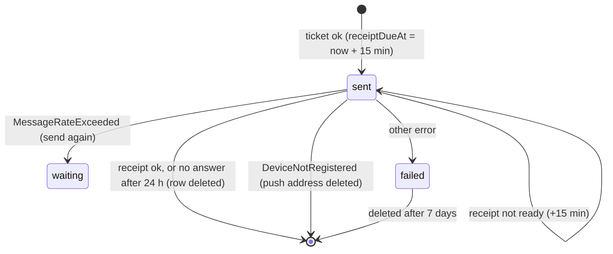

# Step 54.1: Push receipts and cleanup

> **Approved by the owner on 2026-10-19 and built the same day.** "What changed while building", just before "Verify it worked", lists where the code differs from the text below. Originally a fast-track recipe written before the code, as Phase 2b asks. The plan was reviewed with the systems-architect (one round; its two blocking points are fixed below). When it's built, a "What changed while building" section will list where the real code differs. The topic doc is `docs/PUSH.md`.

> **Revised on 2026-10-19 after the owner's review** ("Bantay Aral Push Flow", https://claude.ai/artifact/PgnXN3SSqE8DMRTudHWqAa). The push matters less than the tap: the tap's time is saved before any push exists, and a late push still shows it. So receipts are checked every 5 minutes, not every minute, and a delivered push's row is deleted as soon as its receipt says so. Nothing successful is kept.

## Why

Step 54 sends pushes, and Expo answers each one with a **ticket**: "accepted". Whether it actually reached the phone comes later, in a **receipt**, about 15 minutes on. That's where most dead phones show up (`DeviceNotRegistered`), and since Step 54 keeps a sign-in that has a push address however long unused, a dead phone now lingers until a receipt says so. Also, every push is one `PushDelivery` row forever. At 50 schools that's about 150,000 rows a day.

## Decisions (please confirm or change)

1. **A receipt is checked when it's due, never during a busy pass.** Each sent delivery gets a `receiptDueAt`, 15 minutes after sending.
   - Receipts are checked **at most every 5 minutes** (owner decision, 2026-10-19), and only in a pass that had **nothing to fan out and nothing to send** (architect review: receipts for the 7:00 pushes come due at 7:15, mid-rush, and must not delay new taps). Expo keeps receipts for 24 hours, so waiting is safe.
   - What each receipt means:

     | Receipt | Then |
     |---|---|
     | ok | the row is deleted: nothing about a success is kept (owner decision) |
     | `DeviceNotRegistered` | the push address is deleted (as with a ticket) |
     | `MessageRateExceeded` | sent again (the phone never got it), within the 6 hours |
     | any other error | failed. `InvalidCredentials` and `MismatchSenderId` mean every push is broken, so they're logged as errors, with a count. |
     | not ready yet | asked again 15 minutes later, until 24 hours after sending, then deleted as if delivered |
2. **How long rows are kept** (owner decision, 2026-10-19):
   - **a delivered push: not at all.** Its row is deleted when the receipt says ok;
   - **a failed push: 7 days**, for looking into a problem, then deleted by the hourly cleanup, 1,000 at a time, at most 20,000 an hour.

   The plan said 7 days for everything. The architect estimated that at about 430 MB at 50 schools, almost half the 1 GB database. Now a row lives only from the tap to its receipt (15 to 20 minutes), plus the few that fail. That's under 0.5 MB at the pilot, and about 35 MB at 50 schools in the rush, then near zero.
3. **A whole request refused (`http_400`) is tried one message at a time,** right away. A message refused on its own is failed, but only if another message in the same batch went through. If they all fail, something is wrong for every push (a bad deploy, say), so the batch keeps retrying as today and the error is logged (architect review). Expo's error code is logged, never a push token. The one-by-one sends stop after 60 seconds, and the rest go next pass.
4. **A sign-in unused for 12 months is cleared**, push address and all, by the hourly cleanup. Step 54 made a sign-in with a push address never expire, so a phone that's lost and switched off (it may never report `DeviceNotRegistered`) would keep a working credential for a child's attendance forever (architect review). Twelve months covers a school year and its holidays. The cost: a parent who reads only the banners and doesn't open the app for a whole year stops getting pushes, until they open it and sign in.



## Steps

### 1. Database (migration `push_receipts`)

```prisma
model PushDelivery {
  // …as today, plus:
  // When to ask Expo for this push's receipt. Null: not sent yet. A delivered push's row is deleted.
  receiptDueAt DateTime?

  @@index([receiptDueAt], map: "PushDelivery_receipt_due", where: raw("\"receiptDueAt\" IS NOT NULL"))
}
```

Rows already sent (from Step 54) get `receiptDueAt = now()` in the migration, so they're checked once. Cleanup of failed rows uses the existing `(status, nextAttemptAt)` index: `nextAttemptAt` starts at `createdAt` and only moves forward, so "older than 7 days" can be asked of it, and no new index is needed.

### 2. The sender (`src/services/push/push-sender.ts`)

`PushSender.getReceipts(ticketIds)` returns `{ ok: true, receipts: { [id]: ok | { error } } }` or `{ ok: false, error }`.
- The Expo version calls `POST https://exp.host/--/api/v2/push/getReceipts` with up to 1,000 ids, a 10-second timeout, and the same token.
- A receipt error with no code counts as `unknown`, and a top-level `errors` in the answer means `ok: false`.
- The log sender answers ok for every id, so `log-` tickets need no special case.

### 3. The outbox repository

| Method | What it does |
|---|---|
| `saveResults` (changed) | "sent" also sets `receiptDueAt = now() + 15 min`. |
| `receiptsDue(limit)` | Plain `SELECT` of rows whose `receiptDueAt` has passed, up to 1,000, with `ticketId`, `pushTokenId`, the age of the send and of the notification. No claim: a lock taken by a `SELECT` ends with the statement, and holding a transaction open across Expo's answer would hold a connection (architect review). Every write below is safe to repeat. |
| `saveReceipts(results)` | One statement per outcome, with `WHERE "id" = ANY(…) AND "status" = 'sent' AND "receiptDueAt" IS NOT NULL`:<br/>• ok, or no answer after 24 h: the rows are deleted<br/>• not ready: `+15 min`<br/>• send again: `status = 'waiting'`, `receiptDueAt = null`, due now<br/>• failed: `status = 'failed'`, `lastError`<br/>• gone: delete those push addresses. |
| `cleanUp()` | In batches of 1,000, `DELETE … WHERE "id" IN (SELECT … LIMIT 1000 FOR UPDATE SKIP LOCKED)`: failed over 7 days ago; and sign-ins (`ParentToken`) unused for 12 months, whose push addresses and deliveries go by the cascade. At most 20 batches a run. |

### 4. The worker (`src/services/push/`)

- `check-receipts.ts`: `receiptOutcome(row, receipt)`, the decision table above, as a plain function. `checkReceipts(deps)` asks for the due rows, gets their receipts in one request, and saves them. The two configuration errors are logged at error level with a count.
- `send-due.ts`: the `http_400` split (decision 3).
- `push-worker.ts`: `runPushPass` runs `checkReceipts` when its fan-out and sends found nothing, at most every 5 minutes, and `cleanUp` at most once an hour (times kept in memory: a restart just runs them once more, which is harmless). The log line gains `receipts ok, …`.

### 5. Docs

`docs/PUSH.md`: receipts, the state diagram, how long rows are kept, the 12-month limit, and the updated "Known limits". `docs/PARENT-API.md`, `PARENT-APP-BRIEF.md` and `AUTH.md`: a sign-in now ends after 12 months unused even with a push address, so the app re-registers its push token on every start (it already does).

### 6. Tests

- **Unit:**
  - `receiptOutcome`, every row of the table, including not ready before and after 24 h;
  - the `http_400` split: some through, none through, a single message;
  - receipts and cleanup skipped in a busy pass, and their every-5-minutes and once-an-hour timing;
  - `getReceipts` parsing with a fake `fetch`: ok, error codes, no code, a top-level `errors`, timeout.
- **Against Postgres**, in `prisma-push-outbox.test.ts`:
  - `receiptsDue` picks only due rows;
  - each `saveReceipts` outcome: ok deletes the row, "send again" leaves no receipt due;
  - `cleanUp` deletes only failed rows over 7 days old and 12-month sign-ins, and leaves waiting, young and receipt-pending rows.

## Cost

$0 more. One `getReceipts` request every 5 minutes at most, only when nothing else is happening: at most 288 small queries a day. `PushDelivery` holds only pushes in flight (tap to receipt) and a week of failures.

## What changed while building

The owner approved the revised recipe with two changes, and asked for the rules to be written plainly in `README.md` ("Parent notifications: the rules"):

- **30 days, not 12 months** (decision 4). The owner: "just 1 month of not signing in to the app. They just need to sign in to keep receiving pushes." Because the hourly cleanup deletes any sign-in unused for 30 days, the sign-in limit itself is now 30 days for every parent (`PARENT_TOKEN_UNUSED_LIMIT_MS`, was 90). Opening the app counts as use, since the app calls the API when it starts. Step 54's exception (keep an unused sign-in that has a push address) is gone again: `deleteStale` at sign-in clears every sign-in unused for 30 days, and the fan-out pushes only to sign-ins used in the last 30 days.
- **The background check every 5 minutes, not 30 seconds** (the owner's third answer). The worker has two entry points now: `wake()` after a notification (send now, no upkeep) and `tick()` every 5 minutes (retries, and, only when nothing is waiting, receipts and the hourly cleanup). So receipts are never checked more than once per tick, which is the "at most every 5 minutes" in decision 1, with no separate timer.
- **The receipt wait lives in `send-due.ts`** (`RECEIPT_WAIT_MS`), which builds the "sent" result with `receiptInMs`, so `check-receipts.ts` imports it from there rather than the other way round.
- **The one-by-one retry has a time budget** (60 seconds). A message it had no time for is retried next pass, not counted as a try.
- **Cleanup also deletes revoked sign-ins**, not only unused ones: a revoked token can never be used again.
- **Postgres-backed tests:** two more cases in `prisma-push-outbox.test.ts` (receipts due and each outcome; the cleanup), and a 31-days-unused sign-in in the fan-out case. 6 tests pass.

## Verify it worked

1. `npx prisma migrate deploy` (your local and test databases already have `push_receipts`, applied while building), restart `npm run dev`, then your checks (the routine in `docs/LEARNING-LOG.md`, including `npx playwright test`).
2. With `PUSH_SENDER=log`, register a push token and make a tap (`docs/COMMANDS.md` 7d). About 15 to 20 minutes later, the dev log shows `push: … receipts ok 1`, and that push's row is gone from `PushDelivery`.

## What's next

Step 55: safe for real parents.
