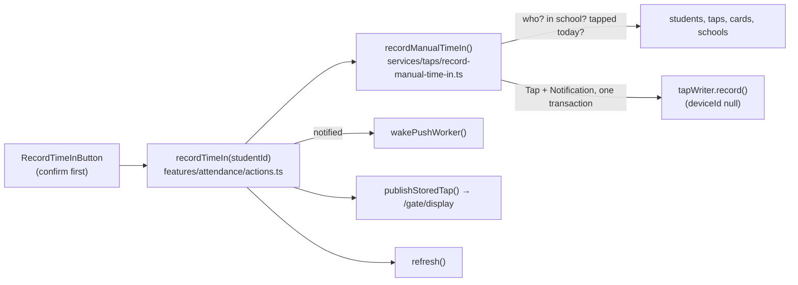

# Step 55: Record a time in by hand

> **Written from the real diff on 2026-10-20**, after the code (owner decision, because of the next day's demo to the principal). The plan was reviewed by the systems-architect in two rounds; both of its round-2 points (two clicks, the card serial) are built in below. The topic doc is `docs/ATTENDANCE-MODEL.md`, "Recording a time in by hand".

## Why

The dashboard's "Simulate a tap" tapped the *next* student who hadn't tapped, never a chosen one, and wrote real taps and parent notifications with nothing saying a person had made them (`docs/SCALING.md` 1.1). The owner wants the opposite for real use: when a student's sticker fails, or they have none, a teacher records **that** student's time in from their own row on the attendance page, and the button is disabled once the student has tapped.

## Decisions

1. **Time in only, recorded as now.** A student with any tap today is refused, so it's always a time in. A late arrival honestly shows as Late, with "Recorded by staff" under the time. Choosing an earlier arrival time is a later step.
2. **Who:** a principal or super admin for anyone at their school; a teacher only their own advisory class.
3. **Two clicks, one tap.** The tap id is built from the student and the date, so two clicks (or two teachers) at the same moment make the same id, and the database keeps one. The notification is written in the same transaction as the tap, so parents get one.
4. **Keep the card serial when there is one**, so the gate's 2-minute check sees the hand-recorded tap. No card: no serial (`cardSerial` becomes nullable).
5. **Never pretend a gate read it:** `stationId` is `"manual"`, `source` is `manual`, `recordedById` is the staff member.
6. **Where the button sits:** where the time in will appear, and only while there's none (the Time in cell on desktop, under the status on a phone card). Once tapped, the time takes its place. (Revised in the owner's review; see "What changed while building".)



## Steps

### 1. Database (migration `manual_taps`)

In `prisma/schema.prisma`:

```prisma
model Staff {
  // …
  recordedTaps Tap[]
}

model Tap {
  // …
  cardSerial   String?
  source       TapSource @default(card)
  recordedById String?
  recordedBy   Staff?    @relation(fields: [recordedById], references: [id], onDelete: SetNull)
}

enum TapSource {
  card
  manual
}
```

```bash
npx prisma format
npx prisma migrate dev --name manual_taps --create-only   # read the SQL first
npx prisma migrate dev                                    # apply it
npx prisma generate                                       # Prisma 7's migrate dev doesn't regenerate the client
```

The SQL only adds: the `TapSource` type, two columns (`source` defaults to `card`, so every old tap is a card tap), drops `NOT NULL` from `cardSerial`, and adds the foreign key with `ON DELETE SET NULL`. Safe on the live database.

### 2. The app's `Tap` (`src/features/attendance/schemas.ts`, the Prisma tap repository)

- `cardSerial: cardSerialSchema.nullable()`.
- `source: tapSourceSchema.optional()` and `recordedById: z.string().min(1).nullable().optional()`. Optional, with "left out" meaning `card`, so the many test taps built by hand don't all change.
- `toTap` reads both columns; `toTapData` writes `source ?? "card"` and `recordedById ?? null`.

### 3. Gate taps always have a serial (`src/services/taps/record-tap.ts`)

`CardTap = Tap & { cardSerial: string }` for the `lost_card` and `unknown_card` results, so the gate's answers (`src/features/gate/responses.ts`) keep a string. `replay()` answers `invalid_serial` for a stored tap with no serial: only a hand-recorded tap has none, and a gate never makes one. `toTapStudent` is exported for the new service.

### 4. The writer without a device (`src/data/repositories/tap-writer.ts`, `prisma-tap-writer.ts`)

`deviceId: string | null`; the device's `lastSeenAt` is updated only when there is one.

### 5. The service (`src/services/taps/record-manual-time-in.ts`, new)

- `manualTimeInId(studentId, date)`: sha256 of `manual-time-in|<student>|<date>`, shaped as a version 5 UUID (`…-5xxx-[89ab]xxx-…`) so it passes `z.uuid()`. No new dependency (`node:crypto`).
- `recordManualTimeIn({ schoolId, studentId, staff, now })`: `getInSchool` (else `not_found`); a teacher's class must match (else `not_found`); any tap on the school date → `already_tapped`; otherwise build the tap (`stationId: "manual"`, the active card's serial or null, `source: "manual"`, `recordedById`), a `time_in` notification if `shouldNotifyParents` says so, and `writer.record(...)`. `"exists"` → `already_tapped`.
- Its `recorded` result has the same shape as a gate's, so `publishStoredTap()` shows it on the guardhouse monitor unchanged.

### 6. The action (`src/features/attendance/actions.ts`, rewritten)

`recordTimeIn(studentId)` replaces `simulateTap()`: session and school, the staff record (for a teacher's class), the service, then `wakePushWorker()` if notified, `publishStoredTap()`, `refresh()`. Answers `{ ok: true, studentName, time }` or `{ ok: false, error }` with a plain message.

### 7. The screens

- `record-time-in-button.tsx` (new): "Record time in" (spoken name "Record time in for <name>"), `layout="table"` a small outline button, `layout="card"` a text button in the link colour, 44px tall; a confirmation dialog; a toast with the recorded time.
- `manual-tap-note.tsx` (new): "Recorded by staff" under a manual time in.
- `attendance-table.tsx`: the button in the Time in cell while there's no time in; the note under the time.
- `attendance-card-list.tsx`: the button under the status pill, in place of the "—", while untapped; the note under the time.
- `attendance-list.tsx` and `src/app/(app)/attendance/page.tsx`: `canRecordTimeIn={date === today}`, so past days have no button.
- Removed: `simulate-tap-button.tsx`, its place in `attendance-hero.tsx`, and the mock in `attendance-hero.test.tsx`.

### 8. Tests

- `record-manual-time-in.test.ts` (9): records with serial, records with no card, teacher's own class vs another, another school, already tapped, "exists", setting off; the id is stable and a valid UUID.
- `record-manual-time-in.pg.test.ts` (2, needs `E2E_DATABASE_URL`): two calls at once → one tap, at most one notification; the serial or null round-trips through Postgres. Uses a date in 2031, so no other test's taps are in the way.
- `prisma-tap-repository.test.ts`: a manual tap round-trips.
- `e2e/attendance.spec.ts`: on desktop (Teresa Lazaro) and phone (Manuel Flores), press the button, confirm, see the toast "… recorded at 9:15 AM" and "Recorded by staff", and the button is gone, the time in its place. Each project uses its own student because both share one test database, and both have no card, so the station tests' "Valid card" can't tap them first.

### 9. Also in this change

The seed's Balanga principal is now **Catherine L. Jongco** (owner request, 2026-10-20), in `src/data/seed/staff.ts`. The seed only fills a fresh database: the live one is changed with one SQL line (see "Verify it worked").

## What changed while building

- **No new insert method.** The architect suggested an insert-or-null repository method; the gate's `tapWriter` already answers `"created"` or `"exists"` inside one transaction with the notification, so the service uses it with `deviceId: null`.
- **Prisma 7's `migrate dev` didn't regenerate the client**, so `TapSource` was missing until `npx prisma generate`.
- **The test database** needed the migration before the Postgres test could run; the browser tests' global setup does it on every run, and it was applied the same way once by hand.
- **The button moved, after the owner's look at the phone screen** ("not sitting well, specially beside No card"). First version: its own last column on desktop, disabled on every tapped row, and a boxed 44px button under the name on phones, under the "No card" tag. Now it sits where the time in will appear, only while there's none, on both layouts; the extra column is gone. Same rules, same server checks.
- **The owner's full `npm run test:e2e` failed on desktop** (P-027): Ricardo Marasigan's button was already disabled, because `station.spec.ts`'s "Valid card" had tapped him first. Run alone, `attendance.spec.ts` passed. Both students are now cardless ones.
- **From the architect's code review** (nothing blocking): the action passes the staff record's own `role`, which it has just read, instead of the session's (the same value, since `getSession()` reads the staff row on every request, but clearer). Telling the guardhouse monitor is wrapped in `try`/`catch`: the tap is already saved by then, so a monitor that misses it logs a line instead of showing the teacher an error. It also confirmed the migration is safe on a table with rows (a constant default only changes the table's definition on Postgres 11 and newer), and that a gate can't reuse a manual tap's id by accident (gates make random version 4 ids; these are version 5).

## Cost

$0. Two small columns on `Tap`; one extra read (the student's card) per button press.

## Verify it worked

1. The routine in `docs/LEARNING-LOG.md`: `npm run lint`, `npm run check:tokens`, `npm run typecheck`, `npm test`, `npm run build`, then `npm run test:e2e`.
2. `npm run dev`, sign in as a teacher or principal, open **Attendance** for today, press **Record time in** on an untapped student, confirm: the toast names the time, the row shows it with "Recorded by staff", the button is disabled. The guardhouse monitor shows the tap.
3. On the live server after pushing: the release step runs `prisma migrate deploy` by itself.

## What's next

Step 55.1: demo tools per school, and limits on wrong child-linking tries.
