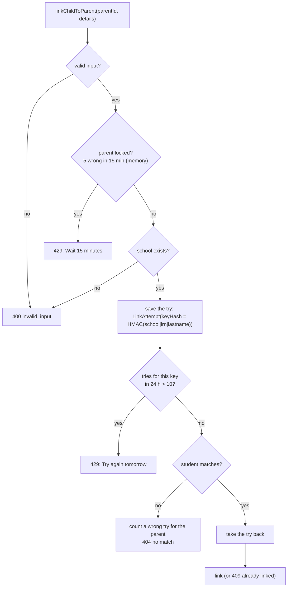

# Step 55.1: Remove the tap station, and limit child linking

> **Written from the real diff on 2026-10-21**, after the code. The owner approved the plan the same day with two changes to what was proposed: `/station` is removed rather than switched per school, and both halves are one step. The limits follow the systems-architect's round-1 review (2026-10-20). Topic docs: `docs/ATTENDANCE-MODEL.md` ("Where a `Tap` comes from"), `docs/NOTIFICATIONS.md`, `docs/AUTH.md`, `docs/SCALING.md` 1.1 and 1.2.

## Why

1. **`/station`** was Phase 1's pretend gate (Step 19): a principal pressed "Valid card" and the page made up a tap for the next waiting student. The real gate (`/gate`) and its monitor have photos and a newer look the station never got, and a pretend tap at a real school tells a parent their child arrived when nobody tapped. "Record time in" (Step 55) now covers the one real need, a failed sticker.
2. **Linking a child** had no limit on wrong tries. With a child's LRN and last name, about 2,500 birth dates cover a high-school age; a script with a free account could find the right one in minutes, then see the child's arrivals and photo.

## Decisions

1. **Remove, don't switch.** Less code than a per-school flag with its settings and tests, and nothing in the sidebar to confuse with the real gate.
2. **Per parent: 5 wrong tries in 15 minutes, in memory** (`parentLinkThrottle`), like the sign-in limits. Easy to get around with new accounts; it's there for the honest parent's typo storm and to slow a script down.
3. **Per child: 10 tries in 24 hours, in Postgres** (`LinkAttempt`), from any number of accounts. A daily Heroku restart would wipe an in-memory count.
4. **Save, then count.** Each try is inserted before the count, so tries sent all at once each see the rows committed before them, and at most 10 get through (the architect's fix for a check-then-insert race).
5. **The key is an HMAC** of school, LRN and lowercased, trimmed last name, with `SESSION_SECRET`. No LRN is stored, and a plain sha256 of a 12-digit LRN could be reversed by trying all of them. Locking a child out needs their LRN and last name, the same details the limit protects.
6. **A locked child answers the same** whether or not the details match anyone, since the count runs before the student lookup. Message: "Too many tries for this student. Try again tomorrow." (owner, 2026-10-21; no staff unlock screen exists).
7. **A right answer takes its try back**, so a parent who gets it right isn't counted against their own child.
8. **Cleanup** of tries older than 24 hours runs from a link try itself, at most once an hour. The count always filters on time, so it's right even before a cleanup.



## Steps

### 1. Remove the tap station

```bash
rm -r "src/app/(app)/station" src/features/station
rm e2e/station.spec.ts
```

- `src/components/app-shell/nav-items.ts` (and its test): the `station` segment and the "Tap station" item (`Nfc` icon import too).
- `package.json`: `e2e/station.spec.ts` out of `test:e2e`.
- Now unused, so deleted: `TapRepository.create` and `AlertRepository.create` (mock and Prisma, with their tests), `notifyParentsForTap` (only `shouldNotifyParents` stays in `notify-parents.ts`), `studentsWithoutTapToday`, `MAIN_GATE_STATION_ID`.
- `npx next typegen` before `tsc`: Next's generated route types still listed the deleted page (`npm run typecheck` does this first anyway).

### 2. The tests that used the station

- `e2e/parent.spec.ts`: the principal records **Carmen Sison**'s time in (Grade 7 – Rizal, has an LRN, no tap on the demo morning, no other test taps her), then the new parent links her and sees the notification. No more reading back whoever the station picked.
- `e2e/a11y.spec.ts`: the station page, its four results and its 44px check are replaced by an axe check of the "Record time in" dialog (Katrina Aguilar, cancelled, so nothing is written). The real `/gate` has no 44px check yet.
- `src/features/isolation.test.ts`: Oceanview calling `recordTimeIn` on a Balanga student gets "not in a class you can record", and Balanga's taps are unchanged.

### 3. The table (migration `link_attempts`)

```prisma
model LinkAttempt {
  id        String   @id @default(uuid())
  schoolId  String
  school    School   @relation(fields: [schoolId], references: [id], onDelete: Cascade)
  keyHash   String
  createdAt DateTime @default(now())

  @@index([keyHash, createdAt])
  @@index([createdAt])
}
```

```bash
npx prisma migrate dev --name link_attempts --create-only   # a new table only
npx prisma migrate dev
npx prisma generate
```

`npm run db:reset` already clears it (`TRUNCATE "School" CASCADE`).

### 4. The code

- `src/data/repositories/link-attempt-repository.ts` and `prisma-link-attempt-repository.ts` (new): `record`, `countSince`, `remove`, `deleteOlderThan`.
- `src/services/parents/link-attempts.ts` (new): `LINK_TRIES_PER_CHILD = 10`, `LINK_TRIES_WINDOW_MS`, `TOO_MANY_LINK_TRIES_MESSAGE`, `linkAttemptKey(secret, schoolId, lrn, lastName)`, and `countLinkTry()` (save, count, maybe clean up).
- `src/services/auth/login-throttle.ts`: `parentLinkThrottle` (5 in 15 minutes).
- `src/services/parents/link-child-to-parent.ts`: the flow in the diagram; a `too_many_tries` result; `liveLinkChildDeps()` so the web action and the API route just call `linkChildToParent(parentId, input)`.
- `src/app/api/v1/parents/children/route.ts`: `too_many_tries` → `429`. The web form already shows any `formError`.

### 5. Tests

- `link-child-to-parent.test.ts`: the parent stopped after 5 wrong tries (another parent isn't); a child locked after 10 tries from 10 accounts, even with the right details, and open again after 24 hours; the last name counted however it's typed; a right answer leaves no try behind; `linkAttemptKey` stable, LRN-free, secret-dependent.
- `link-attempts.pg.test.ts` (new, needs `E2E_DATABASE_URL`): 50 wrong tries for Jose Pascual at once, from 50 accounts: at most 10 reach the lookup, all 50 are saved.

## What changed while building

- **The code review found a hole older than this step** (P-028, Security): the child lookup matched the last name with Prisma's case-insensitive `equals`, an `ILIKE`, where `%` and `_` are wildcards, so `%` as a last name linked any child, and each spelling would have had its own count. Now the database finds the student by school, LRN and birth date and the last name is compared in code; the staff email lookup, which had the same flaw with `_`, is now an exact match on the stored lower-case email. `prisma-lookups.pg.test.ts` checks both.
- **A refused try is taken back** (also from the review): otherwise someone retrying during a lock kept it rolling past the "tomorrow" the message promises. It can't let an 11th try through, since every try that passed is still counted.
- **Nothing in the seed changed** but a comment: the spare batch of untapped students (added for the station) now gives browser tests untapped students of their own.
- **Docs that described the station** were rewritten: `ATTENDANCE-MODEL.md` (where a tap comes from), `NOTIFICATIONS.md` (one rule, two writers, every notification in its tap's transaction), `SCHOOL-ISOLATION.md`, `TESTING.md`, `ACCESSIBILITY.md`, the README.

## Cost

$0. One small table: about 100 bytes a try, kept 24 hours. One insert and one indexed count per link try; one delete per successful link.

## Verify it worked

1. The routine: `npm run lint && npm run check:tokens && npm run typecheck && npm test && npm run build`, then `npm run test:e2e`.
2. `npm run dev`: the sidebar has no **Tap station**, and `/station` is "not found".
3. As a parent on `/parent/link-child`, try a wrong birth date 6 times: the 6th says "Too many tries. Wait 15 minutes and try again."
4. **Before pushing:** `heroku pg:psql --app bantayaral -c 'SELECT count(*) FROM "Staff" WHERE email <> lower(trim(email));'` must answer `0` (P-028).
5. After pushing: Heroku's release step runs the migration by itself. Then copy `docs/PARENT-API.md` to the app's repository again (`mobile/README.md`, "Keeping it current"): linking can now answer `429`.

## What's next

Step 55.2: the school and the child's other guardians see each new link.
